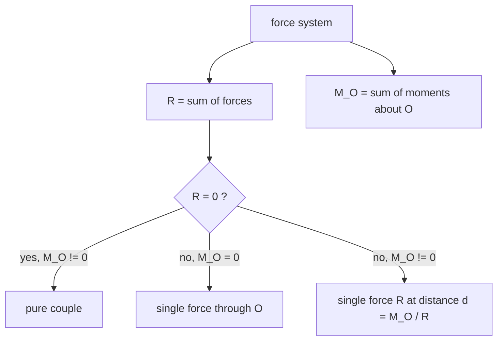

# Moments, Couples and Equivalent Force Systems

> [!abstract] The big idea
> A force can *push* a body along a line and *twist* it about a point. The twist is the **moment** $\mathbf M_O=\mathbf r\times\mathbf F$. Two equal, opposite, parallel forces produce a pure twist, a **couple**, which is the same about *every* point. Combining the two ideas: any force can be moved to another point if you add the right couple. Any force system reduces to one force plus one couple at a chosen point.

## Definitions

- **Moment about a point O** (2-D): $M_O=Fd$ ($d$ the perpendicular distance), or $M_O=xF_y-yF_x$; positive counter-clockwise. In 3-D, $\mathbf M_O=\mathbf r\times\mathbf F$ ([[Vectors - Dot and Cross Products]]).
- **Varignon's theorem:** the moment of a force equals the sum of the moments of its components.
- **Couple:** forces $\pm\mathbf F$ a perpendicular distance $d$ apart; moment $M=Fd$ about *any* point, and a couple can be moved anywhere without changing its effect.
- **Force–couple equivalence:** a force $\mathbf F$ at A is equivalent to $\mathbf F$ at O plus a couple $M=\mathbf r_{OA}\times\mathbf F$.

![[EM-moments-couples.png]]

**Figure:** Left, the moment of $\mathbf F=(60,80)$ N acting at $(3,2)$ m about the origin is $3(80)-2(60)=120$ N·m counter-clockwise. Middle, a couple. Right, shifting a force to O needs the compensating couple $Fd$.

> [!question]- 🎯 Predict first: you push a door at its hinge side instead of the handle. Why is it so much harder to open?
> The moment is $Fd$ and $d$ (the distance from the hinge) is tiny; the same push gives almost no twist. The force is unchanged: only the *moment arm* changed. Spanners are long for the same reason.

## Reducing a force system to a point
1. **Sum the forces:** $\mathbf R=\sum\mathbf F_i$.
2. **Sum the moments** about the chosen point: $M_O=\sum(x_iF_{iy}-y_iF_{ix})$ (plus any couples).
3. The system is equivalent to $\mathbf R$ at O plus $M_O$. If $M_O\ne0$ and $\mathbf R\ne0$ you can slide $\mathbf R$ sideways by $d=M_O/R$ to remove the couple (the **line of action** of the resultant).

## Worked example
> [!example]- 🔬 Move $\mathbf F=(60,80)$ N acting at $(3,2)$ m to the origin
> Moment about O: $M_O=x F_y-yF_x=3(80)-2(60)=120$ N·m counter-clockwise.
> Equivalent system at O: force $(60,80)$ N (magnitude $100$ N) plus a couple of $120$ N·m.
> The resultant's line of action is $d=M_O/R=120/100=1.2$ m from O (the original line, as it must be).
> **Check:** Varignon: moment of $F_y=80$ at $x=3$ is $+240$; moment of $F_x=60$ at $y=2$ is $-120$; sum $=120$ ✓.

> [!warning]- ⚠️ Using the wrong moment arm
> $d$ is the **perpendicular** distance from the point to the force's line of action, not the distance to where the force is applied. Easiest: resolve into components and use Varignon.

> [!danger]- 💥 Forgetting that a couple's moment is a free vector
> A couple of $120$ N·m does not need a location: it appears in every moment equation with the same value, wherever you take moments.

## Quick quiz
> [!question]- Q1. Two 50 N forces $0.4$ m apart form a couple. What moment, and does it matter where you take moments?
> $M=50(0.4)=20$ N·m, and it **does not** matter.

> [!question]- Q2. A force of 100 N acts $0.3$ m from a wrench's centre, at $60^\circ$ to the handle. What is the moment?
> $M=Fd\sin60^\circ=100(0.3)(0.866)=26$ N·m: only the component perpendicular to the handle twists.

## Connections
- **Prerequisites:** [[Force Systems and Resultants]], [[Vectors - Dot and Cross Products]]
- **Next:** [[Free-Body Diagrams and Equilibrium of Rigid Bodies]]
- **Cross-domain:** [[Newton's Third Law and Momentum Conservation]] (rotational analogue: angular momentum); [[Torsion of Circular Shafts]] (a couple applied to a shaft is the torque).

## Self-check
- [ ] I can compute a moment in 2-D (and 3-D by cross product).
- [ ] I can state what a couple is and why it can be moved anywhere.
- [ ] I can reduce a force system to a force and a couple.

## Metadata
- **Status:** draft · **Type:** concept · **Difficulty:** beginner–intermediate
- **Course map:** [[Engineering Mechanics - MOC]]
