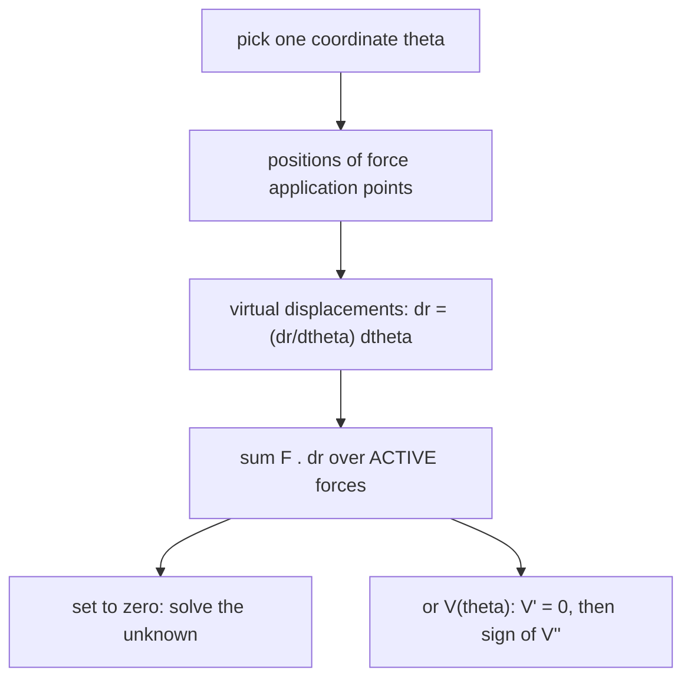

# Virtual Work and Potential Energy Stability

> [!abstract] The big idea
> Instead of drawing every force, **imagine a tiny, allowed motion** (a *virtual displacement*) and add up the work the active forces would do. If the body is in equilibrium, that **virtual work is zero**. Constraint forces (smooth pins, rollers, rigid bars) do no work in such motions, so they never appear. It is the statics version of [[Euler-Lagrange Equations]], and its energy form tests *stability*.

## The principle

For a system with ideal (workless) constraints,
$$\delta W=\sum_i\mathbf F_i\cdot\delta\mathbf r_i=0\quad\text{in equilibrium}.$$
Use **one coordinate** $\theta$ that describes the allowed motion and write every virtual displacement as (geometry)$\times\delta\theta$.

**Potential-energy form:** if the active forces are conservative, $\delta W=-\delta V$, so equilibrium means $\dfrac{dV}{d\theta}=0$, with
$$\frac{d^2V}{d\theta^2}>0\ \text{stable},\qquad<0\ \text{unstable},\qquad=0\ \text{neutral (check higher derivatives)}.$$

![[EM-virtual-work.png]]

**Figure:** A rod of weight $W$ and length $l$ balanced upright on a pivot with a torsion spring $k$: $V(\theta)=\tfrac12k\theta^2+\tfrac{Wl}{2}\cos\theta$. For a weak spring ($k<Wl/2$, red) $\theta=0$ is a hilltop (unstable); for $k=Wl/2$ (green) it is neutral to second order; for a stiff spring (blue) it is a valley (stable). The same $V''=k-Wl/2$ condition.

> [!question]- 🎯 Predict first: why does a heavy rod balanced on a springy hinge fall over if the weight is too large?
> Gravity contributes a **negative** curvature $-\tfrac{Wl}{2}$ to $V$ (potential energy *drops* as it tips) while the spring contributes $+k$. When the weight term wins, the equilibrium becomes unstable. This is the same competition as in [[Euler Buckling of Columns]]: critical load $\Leftrightarrow$ $V''=0$.

## Method
1. **Choose one coordinate** $\theta$ (or $x$) describing the allowed motion.
2. **Write the position** of each point where an active force acts; **differentiate**: $\delta\mathbf r=\frac{d\mathbf r}{d\theta}\delta\theta$.
3. **Sum** $\mathbf F\cdot\delta\mathbf r$ (only **active** forces: loads, weights, springs; no reactions).
4. **Set $\delta W=0$**: the unknown force or angle drops out directly.
5. **Stability:** form $V(\theta)$, solve $V'=0$, test $V''$.

## Worked example
> [!example]- 🔬 Uniform bar of weight $W$, length $l$, leaning at angle $\theta$ against a smooth wall and floor; horizontal force $P$ pushes the foot toward the wall. Find $P$ to hold it
> Foot at $x=l\cos\theta$: moving toward the wall, $|\delta x|=l\sin\theta\,\delta\theta$; work of $P$: $+Pl\sin\theta\,\delta\theta$. Centre of gravity height $y=\tfrac l2\sin\theta$: $\delta y=\tfrac l2\cos\theta\,\delta\theta$, work of the weight: $-W\tfrac l2\cos\theta\,\delta\theta$.
> $\delta W=0\Rightarrow P=\tfrac W2\cot\theta$.
> **Check:** this is exactly the wall reaction $N_w=\tfrac W2\cot\theta$ found by moments in the ladder problem of [[Dry Friction]]; virtual work got it with no reactions drawn.

> [!warning]- ⚠️ Including reaction forces in $\delta W$
> Reactions at smooth pins and rollers do no work for allowed motions; including them gives wrong equations. Include only **active** forces (and friction forces if friction does work).

> [!danger]- 💥 Using a virtual displacement the constraints do not allow
> The virtual displacement must respect the geometry (a bar's length stays fixed). Always express every $\delta\mathbf r$ through a single $\delta\theta$.

## Quick quiz
> [!question]- Q1. A mass $m$ hangs from a spring of constant $k$. Find equilibrium by potential energy.
> $V=\tfrac12kx^2-mgx$ ($x$ down): $V'=kx-mg=0\Rightarrow x=mg/k$, and $V''=k>0$: stable.

> [!question]- Q2. What does $V''=0$ at a load signal?
> A **critical** state: the equilibrium is about to change character (buckling, snap-through); see [[Resonance and Buckling - Instability as an Eigenvalue Problem]].

## Connections
- **Prerequisites:** [[Free-Body Diagrams and Equilibrium of Rigid Bodies]], [[Energy and Equilibrium in One Dimension]]
- **Next:** [[Particle Kinematics - Rectilinear and Curvilinear Motion]] (statics ends, dynamics begins)
- **Cross-domain:** [[Euler-Lagrange Equations]] (virtual work + inertia = d'Alembert → Lagrange); [[Energy Methods - A Unified View]] and [[Strain Energy and Castigliano's Theorem]] (the same principle for elastic bodies).

## Self-check
- [ ] I can write a virtual displacement in terms of one coordinate.
- [ ] I can find a force or angle in equilibrium by virtual work.
- [ ] I can classify equilibria with $V''$.

## Metadata
- **Status:** draft · **Type:** concept · **Difficulty:** intermediate–advanced
- **Course map:** [[Engineering Mechanics - MOC]]
