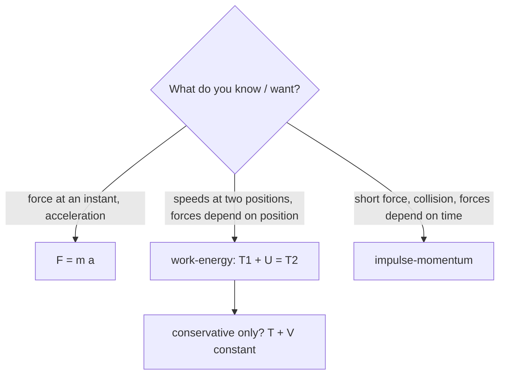

# Kinetics of Particles - Work-Energy and Impulse-Momentum

> [!abstract] The big idea
> Newton's second law $\sum\mathbf F=m\mathbf a$ can be used three ways. **Directly** (force → acceleration, when you need $a$ or a force at an instant); **integrated over distance** (the **work–energy** principle, when you need speeds at two positions); **integrated over time** (**impulse–momentum**, when you need speeds after a short, hard force or a collision). Pick the form that avoids the integral you do not know.

## The three forms

| Form | Statement | Best for |
|---|---|---|
| Force–acceleration | $\sum\mathbf F=m\mathbf a$ | instantaneous forces, constraint reactions |
| Work–energy | $T_1+U_{1\to2}=T_2$, with $T=\tfrac12mv^2$ and $U=\int\mathbf F\cdot d\mathbf r$ | speed at positions, forces vary with position |
| Impulse–momentum | $m\mathbf v_1+\int\mathbf F\,dt=m\mathbf v_2$ | forces vary with time, impacts, speeds after short pushes |

If forces are conservative: $T_1+V_1=T_2+V_2$ ([[Energy and Equilibrium in One Dimension]], [[Conservative Forces, Gradient and Curl]]). **Power:** $P=\mathbf F\cdot\mathbf v$; efficiency $=P_{\rm out}/P_{\rm in}$. Only forces with a component along the displacement do work; the normal force and the tension in an inextensible string **do no work**.

![[EM-energy-block.png]]

**Figure:** A $2$ kg block slides $3$ m down a $30^\circ$ incline with $\mu_k=0.2$. Gravity does $+29.4$ J, friction removes $10.2$ J, and the remaining $19.2$ J becomes kinetic energy: $v=4.39$ m/s. The energy ledger balances: **work in = kinetic energy gained**.

> [!question]- 🎯 Predict first: two identical balls leave a cliff top at the same speed, one thrown straight up and one straight down. Which hits the ground faster?
> **The same speed.** Energy only cares about the height drop and the initial speed, not direction (no air resistance): $v=\sqrt{v_0^2+2gh}$. The upward ball takes longer but returns to the cliff top with speed $v_0$ and goes on exactly as the downward one does.

## Method
1. **Which form?** Speeds at two positions with force vs position known → work–energy; force vs time or a collision → impulse–momentum; instantaneous $a$ → $F=ma$.
2. **Work–energy:** draw a free-body diagram, list forces doing work (gravity, friction, springs), compute each $U$, set $T_1+\sum U=T_2$.
3. **Impulse–momentum:** it is a vector equation, apply it per component; **average force** $=\Delta p/\Delta t$.
4. **Check** with units (J, N·s) and a sanity limit ($\mu_k=0$ gives pure gravity).

## Worked examples
> [!example]- 🔬 The block above
> $T_1=0$. Work by gravity: $mgd\sin30^\circ=2(9.81)(3)(0.5)=29.43$ J. Work by friction: $-\mu_kN\,d=-0.2(2)(9.81)\cos30^\circ(3)=-10.20$ J.
> $T_2=19.24$ J $=\tfrac12(2)v^2\Rightarrow v=4.39$ m/s. **Check:** $a=g(\sin30^\circ-\mu_k\cos30^\circ)=3.20$ m/s², $v^2=2ad=19.2$ ✓.

> [!example]- 🔬 Impulse–momentum: a $0.16$ kg ball arrives at $40$ m/s and leaves the bat at $60$ m/s the other way; contact lasts $5$ ms
> $\Delta p=m(v_2-v_1)=0.16(60-(-40))=16$ N·s. Average force $=16/0.005=\mathbf{3200}$ N, about $2000$ times the ball's weight; this is why a bat can break.

> [!warning]- ⚠️ Counting work by forces that do none
> A normal force on a sliding block (⟂ to motion) and tension in a string around a fixed pulley do **no work**. Work–energy needs only forces with a component along the motion.

> [!danger]- 💥 Applying energy conservation in a collision
> Momentum is conserved in a collision (no external impulse); **kinetic energy is not** unless the collision is elastic. Use impulse–momentum (or conservation of momentum) for the collision and work–energy *before and after* it.

## Quick quiz
> [!question]- Q1. A $1000$ kg car brakes from $20$ m/s to rest with constant friction force $5000$ N. Stopping distance?
> $\tfrac12mv^2=Fd$: $d=\tfrac12(1000)(400)/5000=40$ m.

> [!question]- Q2. A $0.5$ kg ball falls $5$ m onto a floor and rebounds to $3$ m. What impulse did the floor give?
> Impact speed $\sqrt{2g(5)}=9.9$ m/s, rebound speed $\sqrt{2g(3)}=7.67$ m/s; $\Delta p=0.5(9.9+7.67)=8.8$ N·s upward.

## Connections
- **Prerequisites:** [[Particle Kinematics - Rectilinear and Curvilinear Motion]]
- **Next:** [[Impact and Systems of Particles]]
- **Cross-domain:** [[Newton's Laws as Differential Equations]] and [[Energy and Equilibrium in One Dimension]] (the same derivations in the Physics I framework); [[Energy Methods - A Unified View]] (work–energy in structures); [[Incompressible Inviscid Flow and Bernoulli - Formula Bank]] (Bernoulli is work–energy for a fluid parcel).

## Self-check
- [ ] I can choose between force, energy and momentum methods.
- [ ] I can list which forces do work and compute each.
- [ ] I can find an average impact force from an impulse.

## Metadata
- **Status:** draft · **Type:** concept · **Difficulty:** intermediate
- **Course map:** [[Engineering Mechanics - MOC]]
