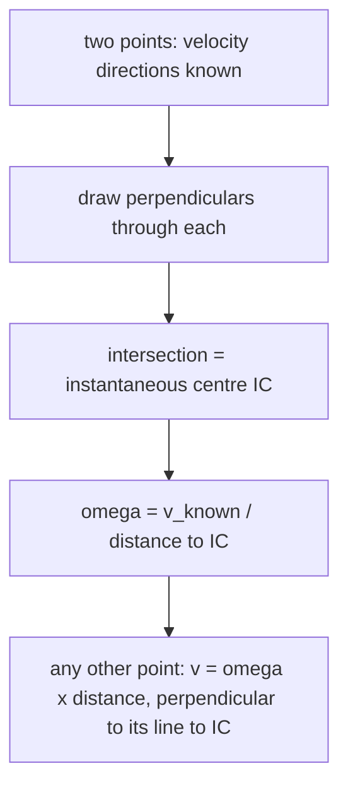

# Plane Kinematics of Rigid Bodies

> [!abstract] The big idea
> Every motion of a rigid body in a plane is, at each instant, a **pure rotation about one point**: the **instantaneous centre of zero velocity** (IC). Knowing where it is turns velocity problems into one-liners: $v=\omega\times$ (distance to the IC). Equivalently, relate two points by **relative motion**: $\mathbf v_B=\mathbf v_A+\boldsymbol\omega\times\mathbf r_{B/A}$. A body that rolls without slipping has its IC at the contact point.

## Three tools

| Tool | Formula | Best when |
|---|---|---|
| Rotation about a fixed axis | $v=r\omega,\ a_t=r\alpha,\ a_n=r\omega^2$ | a fixed pivot exists |
| Relative velocity | $\mathbf v_B=\mathbf v_A+\boldsymbol\omega\times\mathbf r_{B/A}$ | two points on one body, one velocity known |
| **Instantaneous centre** | $v_P=\omega\,\overline{P\text{-IC}}$, velocity $\perp$ the line to the IC | velocity directions of two points known (draw perpendiculars; they meet at the IC) |
| Rolling without slip | $v_G=R\omega,\ a_G=R\alpha$ | wheels, cylinders, gears |

For accelerations use $\mathbf a_B=\mathbf a_A+\boldsymbol\alpha\times\mathbf r_{B/A}-\omega^2\mathbf r_{B/A}$: the IC itself generally **does** accelerate (it has zero velocity, not zero acceleration). Mechanism analysis with this machinery is developed in [[Velocity and Acceleration - Analytical Method]] and [[Velocity and Acceleration - Graphical Methods (Polygons)]].

![[EM-rolling-wheel.png]]

**Figure:** A wheel of radius $0.3$ m rolling at $v_G=3$ m/s: $\omega=10$ rad/s. The contact point is at rest (the IC); the centre moves at $3$ m/s, the side point at $\sqrt2\times3=4.24$ m/s and the top point at **twice** the centre speed, $6$ m/s. Right, a rim point traces a **cycloid**: a loop-free arch whose cusps touch the ground with zero velocity.

> [!question]- 🎯 Predict first: the top of a rolling wheel moves at what speed relative to the ground, and the bottom?
> Top: $2v_G$ (twice the centre speed). Bottom (contact): **zero**. A car's top-of-tyre moves faster than the car; the contact patch is momentarily stationary, which is why static friction (not sliding) acts there.

## Method
1. **Draw the body** and mark the points whose velocities you know or want.
2. **Directions:** the velocity of any point is **perpendicular to its line to the IC**.
3. **Find the IC** by drawing perpendiculars to two known velocity directions; the IC is where they cross. (Parallel velocities of unequal size: lines through tips meet at the IC.)
4. **Get $\omega=v/r$** from a point whose speed is known, then every other speed.
5. **Check** with relative-velocity vector addition.

## Worked example
> [!example]- 🔬 Wheel radius $0.3$ m rolling without slipping, $v_G=3$ m/s
> IC at the contact point, distance $R=0.3$ m from G: $\omega=v_G/R=\mathbf{10}$ rad/s.
> Top point: distance $2R=0.6$ m from the IC: $v=0.6\times10=6$ m/s horizontal. Side point (level with G): distance $R\sqrt2$ from the IC: $v=0.424\times10=4.24$ m/s at $45^\circ$ below horizontal.
> **Check:** relative velocity: $\mathbf v_{\rm top}=\mathbf v_G+\omega R(\hat x)=3+3=6$ ✓. The arch length of the cycloid is $8R=2.4$ m per revolution, though the wheel moves $2\pi R=1.88$ m.

> [!warning]- ⚠️ Assuming the IC has zero acceleration
> The IC has zero **velocity** at that instant, but it accelerates (towards the wheel's centre, $a=R\omega^2$). Use the relative-acceleration equation for accelerations, never "rotate about the IC" for $a$.

> [!danger]- 💥 Using $v=R\omega$ on a wheel that slips
> $v_G=R\omega$ holds only if the contact point is at rest. If the wheel skids or spins (a car on ice), $v_G\ne R\omega$ and the IC is **not** at the contact point.

## Quick quiz
> [!question]- Q1. A ladder slides down a wall; where is its IC?
> At the intersection of the perpendicular to the wall at the top end (the top moves along the wall) and the perpendicular to the floor at the bottom end: a rectangle's far corner, whose locus is a circle.

> [!question]- Q2. A pulley (radius $r$) lifts a load at $2$ m/s with a rope not slipping. What is the pulley's $\omega$?
> $\omega=v/r$: the rope's speed equals the rim speed ($2/r$ rad/s).

## Connections
- **Prerequisites:** [[Particle Kinematics - Rectilinear and Curvilinear Motion]], [[Vectors - Dot and Cross Products]] (the cross product $\boldsymbol\omega\times\mathbf r$)
- **Next:** [[Plane Kinetics of Rigid Bodies]]
- **Cross-domain:** [[KDoMs - MOC]] (instantaneous centres of linkages), [[Rotating Vectors - Phasors, Velocity Polygons and Complex Kinematics]] (rotating vectors are rigid-body kinematics), [[Gears, Transformers and Reflected Impedance]] (rolling contact = gear pitch circles).

## Self-check
- [ ] I can locate the IC from two velocity directions.
- [ ] I can use the IC and relative velocity to find any point's velocity.
- [ ] I can state the rolling condition and what it implies at the contact.

## Metadata
- **Status:** draft · **Type:** concept · **Difficulty:** intermediate
- **Course map:** [[Engineering Mechanics - MOC]]
