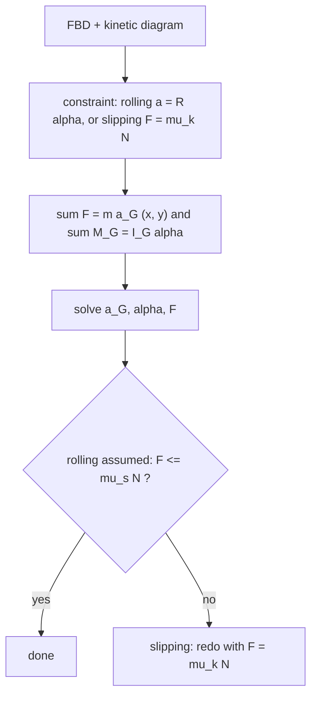

# Plane Kinetics of Rigid Bodies

> [!abstract] The big idea
> A rigid body in plane motion obeys **two** laws at once: the centre of mass moves as if all the mass were there, $\sum\mathbf F=m\mathbf a_G$, and the body spins according to $\sum M_G=I_G\alpha$. The second law introduces the **mass moment of inertia** $I$, rotation's version of mass. Add the energy form $T=\tfrac12mv_G^2+\tfrac12I_G\omega^2$ and the rolling-body results (why a hoop loses a race to a sphere) fall out.

## The equations

$$\sum F_x=ma_{Gx},\qquad\sum F_y=ma_{Gy},\qquad\sum M_G=I_G\alpha,\qquad\big(\text{or }\sum M_O=I_O\alpha\ \text{about a fixed pivot O}\big).$$

**Energy:** $T=\tfrac12mv_G^2+\tfrac12I_G\omega^2$; work–energy $T_1+U_{1\to2}=T_2$; for **rolling without slipping the friction force does no work** (its point of application is at rest). **Impulse–momentum:** linear $m\mathbf v_G$ and angular $H_G=I_G\omega$.

**Rolling down an incline** (angle $\theta$, radius of gyration $k$, no slip): $a_G=\dfrac{g\sin\theta}{1+k^2/R^2}$. The friction needed is $F=\dfrac{mg\sin\theta\;(k^2/R^2)}{1+k^2/R^2}$, so rolling requires $\mu_s\ge\dfrac{\tan\theta}{1+R^2/k^2}$.

![[EM-rolling-race.png]]

**Figure:** Left, $a/(g\sin\theta)$ for a hoop ($k=R$: $0.5$), solid cylinder ($k^2=R^2/2$: $0.667$), solid sphere ($k^2=2R^2/5$: $0.714$) and a frictionless sliding block ($1$). The more mass near the axis, the smaller $k$ and the faster the body rolls. Right, the race down a $30^\circ$ slope: the sphere wins, then the cylinder, then the hoop, whatever their masses or radii.

> [!question]- 🎯 Predict first: a solid disk and a ring of the same mass and radius roll down the same ramp. Which wins, and does the answer depend on the mass?
> The **disk** wins, and the mass cancels (only $k^2/R^2$ matters: $0.5$ for a disk, $1$ for a ring). The ring puts all its mass at radius $R$, so it needs more kinetic energy into rotation, leaving less for translation. Race any two same-shaped bodies of different mass and size: a tie.

## Method
1. **FBD** with the weight at G, normal and friction at the contact, and any other loads; **kinetic diagram**: $m\mathbf a_G$ and $I_G\alpha$.
2. **Kinematic constraint:** rolling $a_G=R\alpha$ (or sliding $F=\mu_kN$).
3. **Equations:** $\sum F=ma_G$ (two components) and $\sum M_G=I_G\alpha$ (or about the IC/pivot).
4. **Solve** for $a_G,\alpha$ and the friction.
5. **Verify** the assumption: static friction needs $F\le\mu_sN$; if not, the body slips and $F=\mu_kN$.
6. **Energy shortcut** for speed after a drop $h$: $T=\tfrac12mv^2(1+k^2/R^2)=mgh$.

## Worked examples
> [!example]- 🔬 Solid cylinder rolling down a $30^\circ$ incline without slipping
> $k^2/R^2=\tfrac12$: $a=\dfrac{g\sin30^\circ}{1.5}=3.27$ m/s² (compare $4.91$ for frictionless sliding). Friction $F=\tfrac13mg\sin30^\circ$; need $\mu_s\ge\tfrac13\tan30^\circ=0.19$.
> **Speed after dropping $1$ m (energy):** $v=\sqrt{\dfrac{2gh}{1+k^2/R^2}}$: cylinder $3.62$ m/s; sphere $3.74$; hoop $3.13$; sliding block $4.43$ m/s.
> **Check:** $\tfrac12mv^2(1+\tfrac12)=mgh$ gives $v=\sqrt{4gh/3}=3.62$ ✓; and $v^2=2as$ with $s=h/\sin30^\circ=2$ m gives $\sqrt{2(3.27)(2)}=3.62$ ✓.

> [!example]- 🔬 Spinning up a flywheel
> A uniform disk ($m=10$ kg, $R=0.2$ m, $I=\tfrac12mR^2=0.2$ kg·m²) with a $5$ N·m motor torque: $\alpha=M/I=25$ rad/s²; reaches $100$ rad/s in $4$ s, storing $\tfrac12I\omega^2=1000$ J.

> [!warning]- ⚠️ Taking $\sum M=I\alpha$ about an arbitrary moving point
> $\sum M_G=I_G\alpha$ holds about the **centre of mass** (or a fixed point). About any other moving point extra terms appear ($\sum M_P=I_G\alpha+m\,\mathbf r_{G/P}\times\mathbf a_P$).

> [!danger]- 💥 Using friction $=\mu N$ for a rolling wheel
> Rolling friction is whatever the equations demand, up to $\mu_sN$ (static, **no sliding**). Only when slipping starts does $F=\mu_kN$.

## Quick quiz
> [!question]- Q1. A cylinder rolls down an incline with *no* friction at all. What happens?
> It **slides**, not rolls: with no friction there is no torque about G, so $\omega$ stays constant and $a=g\sin\theta$.

> [!question]- Q2. Which is easier to start spinning, a disk of radius $R$ or a ring of the same mass and radius?
> The disk: $I_{\rm disk}=\tfrac12mR^2<I_{\rm ring}=mR^2$, half the inertia for the same torque.

## Connections
- **Prerequisites:** [[Plane Kinematics of Rigid Bodies]], [[Kinetics of Particles - Work-Energy and Impulse-Momentum]], [[Mass Moments of Inertia]]
- **Next:** [[Vibration of Particles and Rigid Bodies]]
- **Cross-domain:** [[Newton's Second Law in Polar Coordinates]] and [[Euler-Lagrange Equations]] (a Lagrangian does the whole rolling problem in one line: $T=\tfrac12mv^2(1+k^2/R^2)$, $U=mgh$); [[Torsion of Circular Shafts]] (a shaft's twist stiffness and a flywheel's inertia set the torsional natural frequency).

## Self-check
- [ ] I can write the force and moment equations with the kinetic diagram.
- [ ] I can solve a rolling incline problem and check the friction requirement.
- [ ] I can use the energy form with $\tfrac12I\omega^2$.

## Metadata
- **Status:** draft · **Type:** concept · **Difficulty:** intermediate–advanced
- **Course map:** [[Engineering Mechanics - MOC]]
