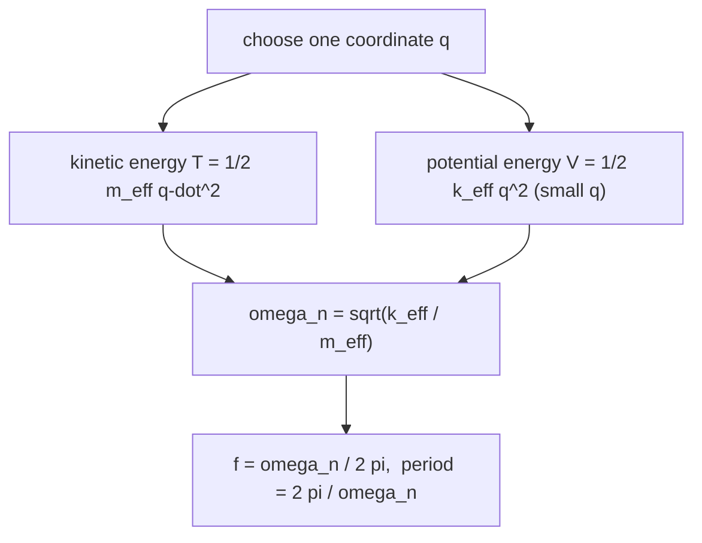

# Vibration of Particles and Rigid Bodies

> [!abstract] The big idea
> Dynamics ends where Physics I's oscillators begin: any system with a **restoring force or torque** proportional to displacement vibrates with $\ddot q+\omega_n^2q=0$. The recipe for $\omega_n$ is always "stiffness over inertia", $\omega_n^2=k_{\rm eff}/m_{\rm eff}$. Whether it is a block on a spring, a flywheel on a shaft or a rod pendulum, you find the *effective* stiffness and inertia in the coordinate you chose. This note maps the course's vibration chapter onto the full treatment already in the vault.

## The map

| Situation | Equation | Natural frequency | Full treatment |
|---|---|---|---|
| Mass on a spring | $m\ddot x+kx=0$ | $\omega_n=\sqrt{k/m}$ | [[Simple Harmonic Motion]] |
| Add viscous damping | $m\ddot x+c\dot x+kx=0$ | $\omega_d=\omega_n\sqrt{1-\zeta^2}$, $\zeta=c/2\sqrt{km}$ | [[Damped Oscillations]] |
| Add a periodic force | $m\ddot x+c\dot x+kx=F_0\cos\omega t$ | resonance near $\omega_n$ | [[Driven Oscillations and Resonance]] |
| Rotating body on a torsion spring | $I\ddot\theta+k_t\theta=0$ | $\omega_n=\sqrt{k_t/I}$ | [[Torsion of Circular Shafts]] gives $k_t=GJ/L$ |
| Physical pendulum | $I_O\ddot\theta+mgd\sin\theta=0$ | $\omega_n=\sqrt{mgd/I_O}$ (small angles) | [[Lab - Variable g Pendulum]], [[The Nonlinear Pendulum]] |
| Large amplitude | $\sin\theta\not\approx\theta$ | period grows with amplitude | [[The Nonlinear Pendulum]] |

**Energy method (Rayleigh):** for a conservative system in simple harmonic motion, the maximum kinetic energy equals the maximum potential energy:
$$T_{\max}=V_{\max}\ \Longrightarrow\ \omega_n^2=\frac{V_{\max}\text{-coefficient}}{T_{\max}\text{-coefficient}}.$$
Write $T=\tfrac12m_{\rm eff}\dot q^2$ and $V=\tfrac12k_{\rm eff}q^2$ for the chosen coordinate $q$; then $\omega_n^2=k_{\rm eff}/m_{\rm eff}$. This avoids free-body diagrams for complicated systems and is how a rolling cylinder on a spring or a pulley system is solved in one line.

> [!question]- 🎯 Predict first: a spring of stiffness $k$ is cut in half. By what factor does the natural frequency of the same mass change?
> Each half is **twice as stiff** ($k_{\rm half}=2k$), so $\omega_n$ rises by $\sqrt2$ (to $1.41\times$). Stiffness is inversely proportional to length for a spring, which is also why springs in series are softer and in parallel stiffer.

## Worked examples
> [!example]- 🔬 Flywheel on a torsion rod: $m=2$ kg, $R=0.1$ m disk on a shaft with $k_t=2$ N·m/rad
> $I=\tfrac12mR^2=0.01$ kg·m². $\omega_n=\sqrt{k_t/I}=\sqrt{2/0.01}=14.1$ rad/s, $f=2.25$ Hz, period $0.44$ s.
> **Check:** quadrupling the inertia (a heavier disk) halves $\omega_n$ ✓. For a real shaft $k_t=GJ/L$: a longer, thinner shaft is softer.

> [!example]- 🔬 Energy method for a solid cylinder rolling without slipping on a spring ($k=200$ N/m, $m=4$ kg)
> $v=R\dot\theta$; $T=\tfrac12mv^2+\tfrac12I\omega^2=\tfrac12\cdot\tfrac32m\dot x^2$ so $m_{\rm eff}=\tfrac32m=6$ kg. $V=\tfrac12kx^2$.
> $\omega_n=\sqrt{200/6}=5.77$ rad/s (compare $7.07$ rad/s for a block sliding without rotation: rolling is slower because rotation adds inertia).

> [!warning]- ⚠️ Using the static equilibrium position as origin and forgetting gravity
> If gravity acts on a hanging spring system, measure the displacement from the **static equilibrium**: then the constant gravity term drops out and $\omega_n=\sqrt{k/m}$ is unchanged ([[Simple Harmonic Motion]]).

> [!danger]- 💥 Mixing a translational $k$ with a rotational $I$
> $\omega_n=\sqrt{k/I}$ is wrong dimensionally. Use a consistent pair: $(k,m)$ for $x$ or $(k_t,I)$ for $\theta$; or refer the spring to $\theta$ via $k_t=kr^2$.

## Quick quiz
> [!question]- Q1. A $2$ kg mass hangs from a spring and stretches it $5$ cm. Natural frequency?
> $k=mg/\delta=392$ N/m; $\omega_n=\sqrt{g/\delta}=14$ rad/s, $f=2.2$ Hz (independent of $m$).

> [!question]- Q2. Why does a loaded truck vibrate more slowly than an empty one on the same springs?
> $\omega_n=\sqrt{k/m}$: more mass, same $k$ lowers the frequency. Loaded trucks also have a lower $\zeta$ if the dampers stay the same.

## Connections
- **Prerequisites:** [[Plane Kinetics of Rigid Bodies]], [[Mass Moments of Inertia]]
- **Cross-domain:** [[The Universal Second-Order Linear System]], [[Series RLC Natural Response - Damping Cases]], [[Frequency Response and Resonance Curves]] (the electrical twins of every row above); [[The Mechanical-Electrical Analogy (Impedance Analogy)]]; [[Resonance and Buckling - Instability as an Eigenvalue Problem]].

## Self-check
- [ ] I can write $\omega_n^2=k_{\rm eff}/m_{\rm eff}$ for a chosen coordinate.
- [ ] I can use the energy method for a rolling or pulley system.
- [ ] I can find the right row of the table for a new system.

## Metadata
- **Status:** draft · **Type:** concept (bridge) · **Difficulty:** intermediate
- **Course map:** [[Engineering Mechanics - MOC]]
