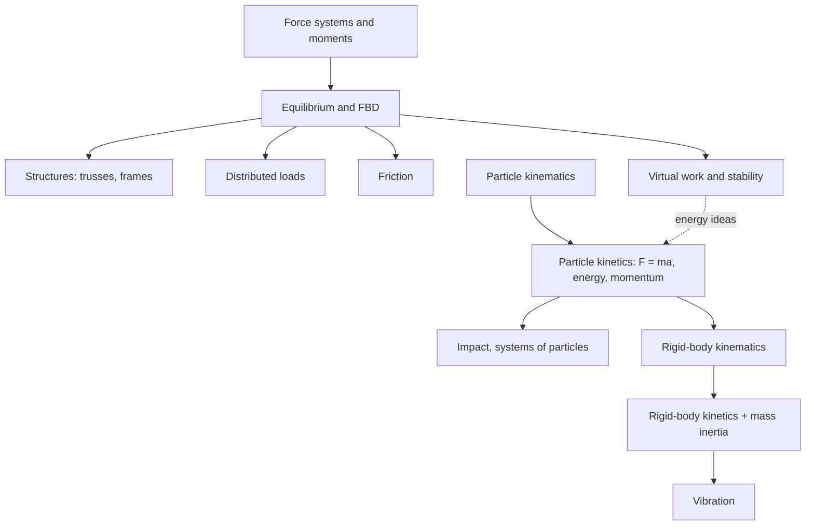
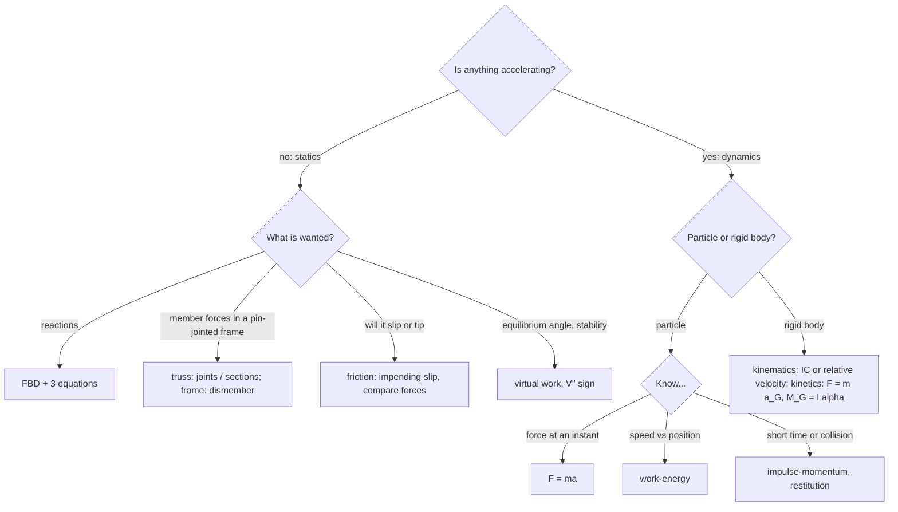

# Engineering Mechanics — Map of Content

Statics and dynamics of particles and rigid bodies, built on the two standard texts kept as PDFs in this folder: Meriam & Kraige, *Engineering Mechanics: Statics* (7th ed.) and *Dynamics*. The 16 notes follow the books' chapters but link to the vault's existing treatment of centroids, beams, mechanisms and oscillations instead of repeating it.

> [!abstract] The course in one line
> **Draw the free-body diagram, choose the right law, and check with a limiting case.** Statics: forces and moments sum to zero. Dynamics: they equal mass (or inertia) times acceleration.

## Course Overview
- **Course:** Engineering Mechanics (AM1100), 3-1-0-0-6, Semester 2.
- **Core purpose:** predict forces in structures and machines, and the motion of particles and rigid bodies.
- **Prerequisites:** vectors and calculus ([[Vectors - Dot and Cross Products]]); [[Physics I - MOC]] runs in parallel.
- **Follows into:** [[Strength of Materials - MOC]], [[KDoMs - MOC]], [[Fluid Mechanics - MOC]].

## Book-to-Notes Map

| Book chapter | Notes |
|---|---|
| Statics 1 Introduction | vectors and Newton's laws: [[Vectors - Dot and Cross Products]], [[Newton's Laws as Differential Equations]] |
| Statics 2 Force Systems | [[Force Systems and Resultants]], [[Moments, Couples and Equivalent Force Systems]] |
| Statics 3 Equilibrium | [[Free-Body Diagrams and Equilibrium of Rigid Bodies]] |
| Statics 4 Structures | [[Plane Trusses - Method of Joints and Sections]], [[Frames and Machines]] |
| Statics 5 Distributed Forces | [[Distributed Loads and Equivalent Point Loads]]; centroids in [[Centre of Mass and Centroids]], [[Composite Bodies and Cutouts]]; area inertia in [[Second Moments of Area]] |
| Statics 6 Friction | [[Dry Friction]], [[Friction in Machines - Belts, Screws and Wedges]] |
| Statics 7 Virtual Work | [[Virtual Work and Potential Energy Stability]] |
| Dynamics 2 Kinematics of Particles | [[Particle Kinematics - Rectilinear and Curvilinear Motion]] |
| Dynamics 3 Kinetics of Particles | [[Kinetics of Particles - Work-Energy and Impulse-Momentum]] |
| Dynamics 4 Systems of Particles | [[Impact and Systems of Particles]] |
| Dynamics 5 Plane Kinematics of Rigid Bodies | [[Plane Kinematics of Rigid Bodies]] |
| Dynamics 6 Plane Kinetics of Rigid Bodies | [[Plane Kinetics of Rigid Bodies]], [[Mass Moments of Inertia]] |
| Dynamics 7 3-D Dynamics | beyond these notes (see [[Rotation Matrix and Vector Transformation]] for the first step) |
| Dynamics 8 Vibration | [[Vibration of Particles and Rigid Bodies]] |

## Concept Map

## Main Spine

### Statics
1. [[Force Systems and Resultants]]
2. [[Moments, Couples and Equivalent Force Systems]]
3. [[Free-Body Diagrams and Equilibrium of Rigid Bodies]]
4. [[Plane Trusses - Method of Joints and Sections]]
5. [[Frames and Machines]]
6. [[Distributed Loads and Equivalent Point Loads]]
7. [[Dry Friction]]
8. [[Friction in Machines - Belts, Screws and Wedges]]
9. [[Virtual Work and Potential Energy Stability]]

### Dynamics
10. [[Particle Kinematics - Rectilinear and Curvilinear Motion]]
11. [[Kinetics of Particles - Work-Energy and Impulse-Momentum]]
12. [[Impact and Systems of Particles]]
13. [[Plane Kinematics of Rigid Bodies]]
14. [[Plane Kinetics of Rigid Bodies]]
15. [[Mass Moments of Inertia]]
16. [[Vibration of Particles and Rigid Bodies]]

## Methods and Problem Types

| Problem type | Concept | Method |
|---|---|---|
| Resultant of several forces | [[Force Systems and Resultants]] | sum components |
| Reduce loads to a point | [[Moments, Couples and Equivalent Force Systems]] | $\mathbf R$ plus $M_O$ |
| Support reactions | [[Free-Body Diagrams and Equilibrium of Rigid Bodies]] | FBD, $\sum F=0$, $\sum M=0$ |
| Forces in a truss | [[Plane Trusses - Method of Joints and Sections]] | joints, or a section for one bar |
| Forces in a frame | [[Frames and Machines]] | dismember, third law |
| Beam with distributed load | [[Distributed Loads and Equivalent Point Loads]] | area and centroid |
| Slipping or tipping | [[Dry Friction]] | $F\le\mu_sN$; compare slip and tip forces |
| Belt or screw | [[Friction in Machines - Belts, Screws and Wedges]] | $e^{\mu\beta}$, $\tan(\alpha\pm\phi)$ |
| Equilibrium angle, stability | [[Virtual Work and Potential Energy Stability]] | $\delta W=0$, $V''$ |
| Projectile or curved path | [[Particle Kinematics - Rectilinear and Curvilinear Motion]] | components or $n$–$t$ |
| Speed after a distance | [[Kinetics of Particles - Work-Energy and Impulse-Momentum]] | work–energy |
| Collision | [[Impact and Systems of Particles]] | momentum + restitution |
| Velocities in a linkage or wheel | [[Plane Kinematics of Rigid Bodies]] | instantaneous centre |
| Spin-up, rolling | [[Plane Kinetics of Rigid Bodies]] | $\sum F=ma_G$, $\sum M_G=I\alpha$ |
| Natural frequency | [[Vibration of Particles and Rigid Bodies]] | $\sqrt{k_{\rm eff}/m_{\rm eff}}$ |

### "I see this kind of problem, what do I use?"

## Visual Library
Force resultant (2-D and 3-D), moments and couples, support reactions, solved truss with member forces, frame with a two-force member, distributed-load resultants, friction law and angle of repose, belt friction, virtual work and stability, projectile trajectories, energy ledger of a sliding block, bouncing ball, rolling wheel and cycloid, rolling race, inertia table. All 15 are generated, together with every quoted number, by `Tools/em_figs.py`.

## Formula & Theorem Map

| Purpose | Result |
|---|---|
| Resultant | $R_x=\sum F_x,\ R_y=\sum F_y$; $l^2+m^2+n^2=1$ |
| Moment, couple | $M_O=xF_y-yF_x$; couple $M=Fd$ |
| Equilibrium | $\sum F=0,\ \sum M=0$ (3 or 6 equations) |
| Truss | $m+r=2j$; tension $+$ |
| Distributed load | $R=\int w\,dx$ at the centroid |
| Friction | $F\le\mu_sN$; $\tan\phi=\mu_s$; $T_2/T_1=e^{\mu\beta}$; $M=Wr\tan(\alpha+\phi)$ |
| Virtual work | $\delta W=0$; $V''>0$ stable |
| Particle | $a=v\,dv/ds$; $a_n=v^2/\rho$; $T_1+U=T_2$; $mv_1+\int F\,dt=mv_2$ |
| Impact | $e=(v_2'-v_1')/(v_1-v_2)$ |
| Rigid body | $v=\omega\times r$; $\sum F=ma_G$; $\sum M_G=I\alpha$; $T=\tfrac12mv^2+\tfrac12I\omega^2$ |
| Inertia | $I=\int r^2dm$; $I=I_G+md^2$ |
| Vibration | $\omega_n=\sqrt{k/m}$ or $\sqrt{k_t/I}$ |

## Cross-Domain Links
- [[Plane Trusses - Method of Joints and Sections]] ↔ [[Euler Buckling of Columns]]: compression bars buckle.
- [[Distributed Loads and Equivalent Point Loads]] ↔ [[Hydrostatic Force on Plane Surfaces and Centre of Pressure]]: the same triangle rule.
- [[Virtual Work and Potential Energy Stability]] ↔ [[Energy and Equilibrium in One Dimension]], [[Euler-Lagrange Equations]].
- [[Plane Kinematics of Rigid Bodies]] ↔ [[KDoMs - MOC]]: mechanisms as moving rigid bodies.
- [[Vibration of Particles and Rigid Bodies]] ↔ [[The Universal Second-Order Linear System]].

## Exam / Revision Map
- **Commonly confused:** weight vs mass; moment vs couple; $F=\mu_sN$ only at impending slip; $e$ vs $e^2$ for bounce height; mass vs area moment of inertia; IC velocity zero but acceleration not.
- **Pattern bank:** truss with a zero-force member; ladder (minimum $\mu_s$); tip-or-slip crate; rolling race; collision with restitution; physical pendulum frequency.

## Study Progress
- [ ] Statics: force systems and equilibrium
- [ ] Statics: structures and distributed loads
- [ ] Statics: friction and virtual work
- [ ] Dynamics: particles
- [ ] Dynamics: rigid bodies
- [ ] Vibration

## MOC Maintenance Rules
1. New solved tutorial → add a "Tutorials and Problems" section here.
2. Re-run `Tools/em_figs.py` after changing a number in a note.

## Quick Navigation
- **Statics:** [[Free-Body Diagrams and Equilibrium of Rigid Bodies]] · **Dynamics:** [[Kinetics of Particles - Work-Energy and Impulse-Momentum]]
- **Back to:** [[Mechanical Engineering Curriculum - MOC]]
