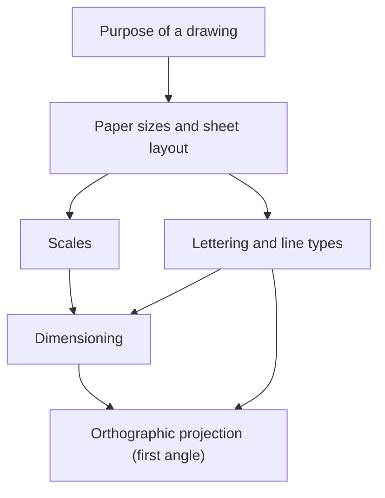
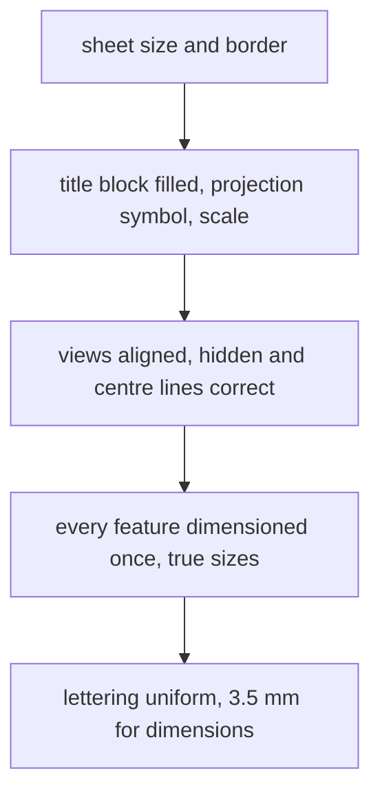

# Engineering Drawing — Map of Content

The language of engineers: how a part is shown, sized and specified so that anyone can make it. This map covers the **General Guidelines** lecture (Dr S. Ravisubramanian, ME CAE Lab, Machine Design, IIT Madras): purpose, sheet sizes and layout, scales, lettering, line types and dimensioning, plus the projection convention behind the title block's symbol. The slide deck is a PDF in this folder.

> [!abstract] The course in one line
> **One drawing, one meaning.** Standards (ISO and BIS SP 46:2003) exist so that the maker reads exactly what the designer meant.

## Course Overview
- **Course:** Engineering Drawing (ME1480), 1-0-0-3-3, Semester 1.
- **Core purpose:** produce and read dimensioned orthographic drawings.
- **Prerequisites:** none; geometry and a sharp pencil.
- **Next courses:** [[Computer Aided Machine Drawing - MOC]], [[Introduction to Machine Design - MOC]].

## Concept Map

## Main Spine
1. [[Purpose of Engineering Drawing]]
2. [[Paper Sizes and Sheet Layout]]
3. [[Drawing Scales]]
4. [[Lettering and Types of Lines]]
5. [[Dimensioning - Dimension, Extension and Leader Lines]]
6. [[Projection Symbol and First-Angle Projection]]

## Standards Cheat-Sheet

| Item | Value |
|---|---|
| A0 sheet | $1189\times841$ mm, area $1\ \mathrm m^2$, ratio $\sqrt2:1$ |
| A3 / A4 | $420\times297$ / $297\times210$ mm |
| Grid reference | even number of divisions, each 25–75 mm |
| Title block | name, date, projection symbol, scale, title, drawing number |
| Scale notation | $1:1$ full, $X:1$ enlarge, $1:X$ reduce |
| Lettering (type B) | title 7 mm, subtitle 5 mm, dimensions and notes 3.5 mm |
| Lines | thick continuous visible; thin continuous dimension/extension/leader; thick dashed hidden; thin chain centre |
| Projection (India) | first angle: top view below, left view right of the front |

## Methods and Problem Types

| Task | Concept | Method |
|---|---|---|
| Choose a sheet | [[Paper Sizes and Sheet Layout]] | smallest A size that fits the drawing plus dimensions |
| Fit a big part | [[Drawing Scales]] | reduction scale; dimensions stay true |
| Draw a hidden feature | [[Lettering and Types of Lines]] | thick dashed line |
| Dimension a part | [[Dimensioning - Dimension, Extension and Leader Lines]] | extension + dimension lines outside; one dimension per feature |
| Lay out views | [[Projection Symbol and First-Angle Projection]] | front, top below, left to the right |

### Before you submit a drawing

## Visual Library
A-series nesting, sheet layout, scales, line types, dimensioning and first-angle views are all drawn by `Tools/ed_figs.py` and embedded in the notes above.

## Exam / Revision Map
- **Know cold:** sheet sizes, scale notation, line meanings, the three dimensioning lines, first-angle layout.
- **Commonly confused:** $X:1$ vs $1:X$; dimension number (true size) vs drawn length; visible vs hidden lines; first vs third angle.

## Study Progress
- [ ] Standards and sheet layout
- [ ] Scales and lettering
- [ ] Lines and dimensioning
- [ ] First-angle projection

## MOC Maintenance Rules
1. New lecture → new concept note, linked in the spine.
2. Re-run `Tools/ed_figs.py` after changing a figure.

## Quick Navigation
- **Foundations:** [[Purpose of Engineering Drawing]] · **Core:** [[Dimensioning - Dimension, Extension and Leader Lines]]
- **Next:** [[Computer Aided Machine Drawing - MOC]] · **Back to:** [[Mechanical Engineering Curriculum - MOC]]
