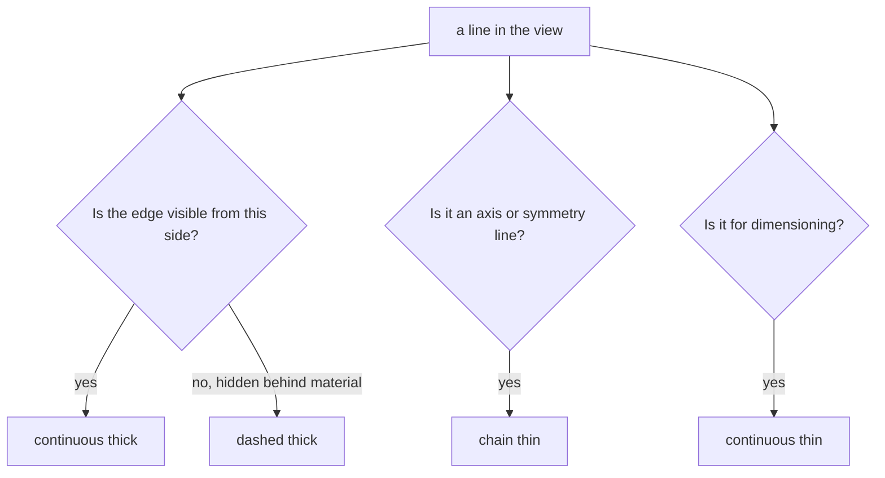

# Lettering and Types of Lines

> [!abstract] The big idea
> A drawing is read by shape and by words. **Lettering** must be legible and uniform so nobody misreads a number, and **line types** are a code: thickness and pattern say what each line *means* (an edge you can see, an edge you cannot, an axis, a dimension). Learn the code and any drawing becomes readable.

## Lettering

Two requirements: **legibility** (clear at a glance) and **uniformity** (same style throughout). Uniformity covers size (text height), line thickness, shape, space between letters and space between words. Typical bad lettering: not uniform in style, height, slope or stroke; wrong spacing.

**Lettering type B** (BIS SP 46:2003): main title $h=7$ mm, subtitles $h=5$ mm, dimensions and notes $h=3.5$ mm. Stroke thickness is $h/10$; letters may be vertical or sloped at $75^\circ$.

## Types of lines

![[ED-lines.png]]

**Figure:** Left, the four basic line types. Right, a plate with a hole drawn in two views: in the front view the hole is *visible* (thick circle, with thin centre lines), in the side view it is *hidden* (thick dashed lines).

| Appearance | Name by application | Used for |
|---|---|---|
| Continuous **thick** | Visible line | edges and outlines you can see in this view |
| Continuous **thin** | Dimension, extension, leader lines | [[Dimensioning - Dimension, Extension and Leader Lines]] |
| Dashed **thick** | Hidden line | features that cannot be seen in this view |
| Chain **thin** | Centre line | symmetry, centres of circles, axes of axisymmetric parts, paths of motion |

> [!question]- 🎯 Predict first: a hidden line and a visible line meet at the same corner. Which one wins where they overlap?
> The **visible** line is drawn, and the hidden line is omitted there. Priority is: visible over hidden, hidden over centre line (a centre line stops short of crossing a visible edge it would coincide with). The reader should never have to guess which line is which.

> [!warning]- ⚠️ Mixing line thicknesses
> A thin dimension line drawn as thick will be mistaken for an edge. Keep thick lines clearly thicker than thin ones, and **all three dimensioning lines thin** so they cannot be confused with the part.

> [!tip]- 🧠 Remember the pattern
> *Thick* = the part itself (visible solid, hidden dashed). *Thin* = information about the part (dimensions, centres). Dashes mean "behind"; chains mean "axis".

## Self-check
- [ ] I can state the two lettering requirements and the type-B heights.
- [ ] I can name the four basic lines and their uses.
- [ ] I can say how a hole appears in a view where it is hidden.

## Connections
- **Previous:** [[Drawing Scales]] · **Next:** [[Dimensioning - Dimension, Extension and Leader Lines]]
- **Course map:** [[Engineering Drawing - MOC]]

## Metadata
- **Status:** draft · **Type:** concept · **Difficulty:** beginner
- **Course map:** [[Engineering Drawing - MOC]]
