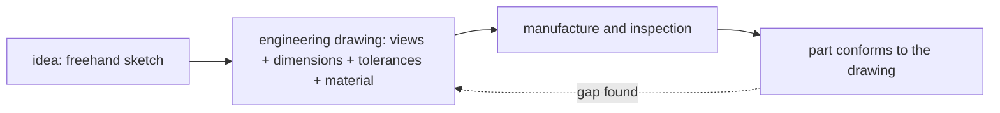

# Purpose of Engineering Drawing

> [!abstract] The big idea
> A freehand sketch carries an idea; an **engineering drawing** carries a *specification*. It is a legal-grade, unambiguous message from the designer to the maker: what shape, what size, how rough, what tolerance, what material. Two people who have never met must build the same part from the same sheet. That is why it follows strict standards (ISO, and for India BIS SP 46:2003).

> [!quote] ✏️ From sketch to drawing
> Leonardo da Vinci's flying machine (the course opens with it) is a brilliant freehand sketch. It shows *what he imagined*; it does not say how long each rib is, which wood to use, or how tightly the joints should fit. The drawing is what you add to make the idea buildable.

## What a drawing must communicate

| # | Content | Where it appears |
|---|---|---|
| 1 | Geometry of the part | views, [[Projection Symbol and First-Angle Projection]] |
| 2 | **Dimensions** | [[Dimensioning - Dimension, Extension and Leader Lines]] |
| 3 | Geometric details: hidden lines, sections, shapes | [[Lettering and Types of Lines]] |
| 4 | Manufacturing details | notes, process callouts |
| 5 | **Tolerances** (allowed variation) | beside dimensions, in the title block |
| 6 | **Surface roughness** | surface-finish symbols |
| 7 | Machining instructions and **material** | notes and the title block |

## Where drawings are used
Mechanical engineering (assemblies, bearings, crankshafts), civil (buildings, highways, pipelines, bridges, water and sewage), electrical (wiring and circuit diagrams, sensors), ocean (deck plans, ship equipment), chemical (plant layout, piping), metallurgical and materials (furnace drawings), computer science (a pen-drive patent drawing is the same discipline).

> [!question]- 🎯 Predict first: why does a good drawing show a part's *surface roughness* when the part's shape is already drawn?
> Because shape alone does not tell the machinist *how* to make it. A bearing seat needs a mirror finish (grinding); a flange face can be rough-turned. Roughness drives the process, the cost and the fit.

> [!warning]- ⚠️ Treating the drawing as a picture
> A picture shows what a part looks like. A drawing states what it **must be**. If a dimension is missing, the maker will guess, and a guess is how wrong parts are made. Every feature must be fully defined once, and only once.

## Self-check
- [ ] I can list the seven things a drawing communicates.
- [ ] I can explain why standards are needed.
- [ ] I can give two non-mechanical uses of drawings.

## Connections
- **Next:** [[Paper Sizes and Sheet Layout]] · **Course map:** [[Engineering Drawing - MOC]]
- **Cross-domain:** [[Introduction to Machine Design - MOC]] and [[Computer Aided Machine Drawing - MOC]] build directly on this language.

## Metadata
- **Status:** draft · **Type:** concept · **Difficulty:** beginner
- **Course map:** [[Engineering Drawing - MOC]]
