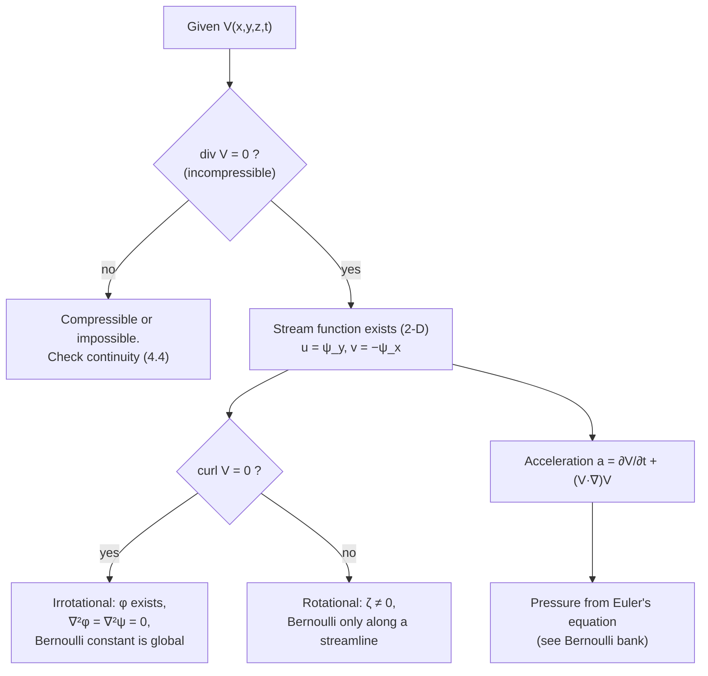

# Differential Mass Conservation and Fluid Kinematics – Formula Bank

← up: [[Fluid Mechanics - MOC|Fluid Mechanics MOC]] · builds on: [[Material Derivative and Fluid Acceleration|Material derivative]], [[Conservation of Mass (Continuity Equation)|Integral continuity]] · worked problems: [[Differential Mass Conservation and Fluid Kinematics - Solved Problems|Solved Problems]]

Equation numbers are White's. Items marked ✓ are verified symbolically in `Tools/fm_core.py`. Sign convention for $\psi$ and $\phi$ is White's (§3).

> [!abstract] Contents
> [[#1. Acceleration field]] · [[#2. Differential mass conservation]] · [[#3. Stream function]] · [[#4. Motion of a fluid element]] · [[#5. Vorticity and circulation]] · [[#6. Velocity potential and irrotational flow]] · [[#7. Standard plane flows]] · [[#8. Checking a velocity field]]

---

## 1. Acceleration field

$$
\mathbf a=\frac{D\mathbf V}{Dt}=\frac{\partial\mathbf V}{\partial t}+(\mathbf V\!\cdot\!\nabla)\mathbf V\qquad(4.2)
$$

$$
a_x=\frac{\partial u}{\partial t}+u\frac{\partial u}{\partial x}+v\frac{\partial u}{\partial y}+w\frac{\partial u}{\partial z},\ \text{and cyclically}
$$

Local term $\partial\mathbf V/\partial t$ (zero if steady) + convective term (nonzero wherever velocity varies in space). **Steady ≠ zero acceleration.** Same operator for any property: $\dfrac{dp}{dt}=\dfrac{\partial p}{\partial t}+\mathbf V\!\cdot\!\nabla p$ (4.3).

**Cylindrical components** (steady, axisymmetric-free, $v_z=0$):

$$
a_r=v_r\frac{\partial v_r}{\partial r}+\frac{v_\theta}{r}\frac{\partial v_r}{\partial\theta}-\frac{v_\theta^2}{r},\qquad
a_\theta=v_r\frac{\partial v_\theta}{\partial r}+\frac{v_\theta}{r}\frac{\partial v_\theta}{\partial\theta}+\frac{v_rv_\theta}{r}
$$

(plus $\partial/\partial t$ terms if unsteady). The $-v_\theta^2/r$ is the centripetal acceleration.

---

## 2. Differential mass conservation

Mass balance on a fixed element $dx\,dy\,dz$:

$$
\boxed{\frac{\partial\rho}{\partial t}+\frac{\partial(\rho u)}{\partial x}+\frac{\partial(\rho v)}{\partial y}+\frac{\partial(\rho w)}{\partial z}=0}\ (4.4)\quad\Longleftrightarrow\quad \frac{\partial\rho}{\partial t}+\nabla\!\cdot(\rho\mathbf V)=0\ (4.6)
$$

Equivalent form following a particle: $\dfrac{D\rho}{Dt}+\rho\,\nabla\!\cdot\mathbf V=0$.

| Case | Cartesian | Cylindrical $(r,\theta,z)$ |
|---|---|---|
| general | (4.4) | $\dfrac{\partial\rho}{\partial t}+\dfrac1r\dfrac{\partial(r\rho v_r)}{\partial r}+\dfrac1r\dfrac{\partial(\rho v_\theta)}{\partial\theta}+\dfrac{\partial(\rho v_z)}{\partial z}=0$ (4.9) |
| **steady** | $\dfrac{\partial(\rho u)}{\partial x}+\dfrac{\partial(\rho v)}{\partial y}+\dfrac{\partial(\rho w)}{\partial z}=0$ (4.10) | drop $\partial\rho/\partial t$ |
| **incompressible** (steady or not) | $\boxed{\nabla\!\cdot\mathbf V=\dfrac{\partial u}{\partial x}+\dfrac{\partial v}{\partial y}+\dfrac{\partial w}{\partial z}=0}$ (4.11, 4.12a) | $\dfrac1r\dfrac{\partial(rv_r)}{\partial r}+\dfrac1r\dfrac{\partial v_\theta}{\partial\theta}+\dfrac{\partial v_z}{\partial z}=0$ (4.12b) |
| plane, incompressible | $u_x+v_y=0$ | $\dfrac1r(rv_r)_r+\dfrac1r(v_\theta)_\theta=0$ |

**Spherical** $(r,\theta,\phi)$, incompressible (P4.12): $\ \dfrac{1}{r^2}\dfrac{\partial(r^2v_r)}{\partial r}+\dfrac{1}{r\sin\theta}\dfrac{\partial(v_\theta\sin\theta)}{\partial\theta}+\dfrac{1}{r\sin\theta}\dfrac{\partial v_\phi}{\partial\phi}=0$. Purely radial flow: $v_r=f(\theta,\phi,t)/r^2$.

**When is a flow "incompressible"?** (4.13–4.18) Bernoulli $\Delta p\approx\rho V\Delta V$ and $\Delta p\approx a^2\Delta\rho$ give
$$\frac{\Delta\rho}{\rho}\approx Ma^2\,\frac{\Delta V}{V}\qquad\Rightarrow\qquad Ma^2\ll1,\quad\boxed{Ma\lesssim0.3}$$
(density change ≈ 4.5 % at $Ma=0.3$; $V<100$ m/s in air at standard conditions; nearly all liquid flows). Exception: stratified (thermally or salinity layered) fluids, where $\partial\rho/\partial z$ matters even at low speed.

**Remarks.** Continuity holds for steady or unsteady, viscous or inviscid flow, because it only assumes a continuum. It does not allow sources/sinks inside the element (singular points need separate handling). **Every proposed velocity field must satisfy it** (Ex. 4.2: $V$ linear in $x,y,z$ conserves mass iff $a_1+b_2+c_3=0$).

**Integrating continuity** (Ex. 4.3). Given $u,w$ in an incompressible flow: $\dfrac{\partial v}{\partial y}=-\dfrac{\partial u}{\partial x}-\dfrac{\partial w}{\partial z}$, then $v=\int(\cdot)\,dy+f(x,z,t)$; the "constant" of integration is a function of the other variables, fixed by a boundary condition (e.g. $v=0$ at a wall).

---

## 3. Stream function

For a **2-D incompressible** flow ($u_x+v_y=0$) there exists $\psi(x,y)$ with (White's sign convention)

$$
\boxed{u=\frac{\partial\psi}{\partial y},\qquad v=-\frac{\partial\psi}{\partial x}}\qquad\qquad
\boxed{v_r=\frac1r\frac{\partial\psi}{\partial\theta},\qquad v_\theta=-\frac{\partial\psi}{\partial r}}
$$

| Property | Statement |
|---|---|
| Streamlines | $\psi=\text{const}$ (since $d\psi=u\,dy-v\,dx=0\Rightarrow dy/dx=v/u$) |
| Volume flow | between two streamlines per unit depth $=\psi_2-\psi_1$; across a curve $A\to B$: $Q=b(\psi_B-\psi_A)$ |
| Direction of crossing | for positive $\psi_B-\psi_A$ the flow crosses the path from left to right of the direction $A\to B$ (uniform stream $\psi=Uy$ proves the sign) |
| Continuity | satisfied identically ($\psi_{xy}=\psi_{yx}$) |
| Rotationality | $\zeta_z=v_x-u_y=-\nabla^2\psi$; irrotational ⇔ $\nabla^2\psi=0$ |
| Axisymmetric (Stokes) | $v_r=\dfrac{1}{r^2\sin\theta}\dfrac{\partial\psi}{\partial\theta}$, $v_\theta=-\dfrac{1}{r\sin\theta}\dfrac{\partial\psi}{\partial r}$ (P4.55, same sign pattern as the plane polar form); cylindrical $v_r=-\dfrac1r\psi_z$, $v_z=\dfrac1r\psi_r$ |

Other textbooks flip the sign of $\psi$; always check the convention before comparing answers.

**To find $\psi$ from $(u,v)$:** integrate $u=\psi_y$ in $y$, add $f(x)$, differentiate in $x$ and match $-v$.

---

## 4. Motion of a fluid element

A fluid element can **translate, rotate, deform linearly (stretch) and deform angularly (shear)**; the velocity gradient tensor splits exactly into these.

![[FM-K1-element-motion.png]]
**Figure:** The four basic motions. Dashed = element at $t$, filled = at $t+dt$. Only angular deformation closes the right angle without turning the axes; rotation turns without deforming.

**Velocity gradient tensor** (2-D shown):

$$
\nabla\mathbf V=\begin{pmatrix}u_x&u_y\\v_x&v_y\end{pmatrix}=\underbrace{\tfrac12\begin{pmatrix}2u_x&u_y+v_x\\u_y+v_x&2v_y\end{pmatrix}}_{\mathbf S\ \text{(strain rate)}}+\underbrace{\tfrac12\begin{pmatrix}0&u_y-v_x\\v_x-u_y&0\end{pmatrix}}_{\mathbf R\ \text{(rotation)}}
$$

| Motion | Formula | Meaning |
|---|---|---|
| **Translation** | $\mathbf V=(u,v,w)$ at the element's centre | |
| **Linear deformation** (normal strain rate) | $\dot\varepsilon_{xx}=\dfrac{\partial u}{\partial x},\ \dot\varepsilon_{yy}=\dfrac{\partial v}{\partial y},\ \dot\varepsilon_{zz}=\dfrac{\partial w}{\partial z}$ | rate of relative stretching of a line along each axis |
| **Dilatation** (volumetric strain rate) | $\dfrac1{\mathcal V}\dfrac{D\mathcal V}{Dt}=\dot\varepsilon_{xx}+\dot\varepsilon_{yy}+\dot\varepsilon_{zz}=\nabla\!\cdot\mathbf V$ | $=0$ for incompressible flow: the element changes shape, not volume |
| **Angular deformation** (shear strain rate) | $\dot\varepsilon_{xy}=\dfrac12\left(\dfrac{\partial v}{\partial x}+\dfrac{\partial u}{\partial y}\right)$; engineering $\dot\gamma_{xy}=\dfrac{\partial v}{\partial x}+\dfrac{\partial u}{\partial y}=\dfrac{d\alpha}{dt}+\dfrac{d\beta}{dt}$ (4.113) | rate of closing of an initially right angle; $\tau_{xy}=\mu\dot\gamma_{xy}$ (Newtonian) |
| **Rotation** (angular velocity) | $\omega_z=\dfrac12\dfrac{d(\alpha-\beta)}{dt}=\dfrac12\left(\dfrac{\partial v}{\partial x}-\dfrac{\partial u}{\partial y}\right)$ (4.108); $\omega_x=\tfrac12(w_y-v_z)$, $\omega_y=\tfrac12(u_z-w_x)$ (4.109) | average turning rate of two initially perpendicular lines |
| **Vector form** | $\boldsymbol\omega=\tfrac12\nabla\times\mathbf V$ (4.110) | |

**Principal strain rates** (2-D): eigenvalues of $\mathbf S$,
$$\dot\varepsilon_{1,2}=\frac{u_x+v_y}{2}\pm\sqrt{\Big(\frac{u_x-v_y}{2}\Big)^2+\Big(\frac{u_y+v_x}{2}\Big)^2},\qquad\tan2\theta_p=\frac{u_y+v_x}{u_x-v_y}$$
(an element aligned with the principal axes only stretches or squeezes).

**Polar components:**
$$\dot\varepsilon_{rr}=\frac{\partial v_r}{\partial r},\quad\dot\varepsilon_{\theta\theta}=\frac1r\frac{\partial v_\theta}{\partial\theta}+\frac{v_r}{r},\quad\dot\gamma_{r\theta}=r\frac{\partial}{\partial r}\!\Big(\frac{v_\theta}{r}\Big)+\frac1r\frac{\partial v_r}{\partial\theta}$$

![[FM-K2-shear-decomposition.png]]
**Figure:** Simple shear $u=\dot\gamma y$ is **rotational**: it equals a clockwise rotation $\omega_z=-\dot\gamma/2$ plus a pure strain $\dot\varepsilon_{xy}=\dot\gamma/2$ at 45°. The streamlines are straight, yet the fluid rotates.

---

## 5. Vorticity and circulation

**Vorticity** is twice the angular velocity (4.111):

$$
\boxed{\boldsymbol\zeta=\nabla\times\mathbf V=2\boldsymbol\omega},\qquad\zeta_z=\frac{\partial v}{\partial x}-\frac{\partial u}{\partial y}
$$

Cylindrical: $\ \zeta_z=\dfrac1r\dfrac{\partial(rv_\theta)}{\partial r}-\dfrac1r\dfrac{\partial v_r}{\partial\theta}$ ✓.

- **Irrotational:** $\nabla\times\mathbf V=\mathbf 0$ (4.112). **Rotational:** otherwise.
- Vorticity of a rigid-body rotation at $\Omega$ is $2\Omega$; of a simple shear $u=\dot\gamma y$ is $-\dot\gamma$ ✓.
- Irrotational flow can be compressible or incompressible, steady or unsteady.

**Circulation** around a closed curve $C$:

$$
\boxed{\Gamma=\oint_C\mathbf V\!\cdot d\mathbf l=\iint_A\boldsymbol\zeta\!\cdot\mathbf n\,dA}\qquad(\text{Stokes' theorem}),\qquad\zeta_z\approx\lim_{A\to0}\frac{\Gamma}{A}
$$

So vorticity is **circulation per unit area**; circulation is the flux of vorticity through the loop. $\Gamma=0$ for every loop in simply connected irrotational flow.

| Flow | $v_\theta(r)$ | $\zeta_z$ | $\Gamma(r)$ |
|---|---|---|---|
| **solid-body (forced) vortex** | $\Omega r$ | $2\Omega$ (uniform) | $2\pi r^2\Omega=\zeta\pi r^2$ |
| **free (potential) vortex** | $\dfrac{\Gamma}{2\pi r}=\dfrac Kr$ | $0$ for $r>0$ (singular at the axis) | $2\pi K$ for any loop **enclosing** the axis, 0 otherwise ✓ |
| **Rankine vortex** | $\Omega r\ (r<R_c);\ \dfrac{\Omega R_c^2}{r}\ (r>R_c)$ | $2\Omega$ core, 0 outside | $2\pi\Omega r^2$ inside, $2\pi\Omega R_c^2$ outside |

![[FM-K3-vortices.png]]
**Figure:** Rankine vortex (black) joins a solid-body core to a free-vortex tail; vorticity is concentrated in the core, and circulation outside the core is constant.

**Generation of rotation** (Sec. 4.9): an initially irrotational flow becomes rotational by (1) viscous forces at walls, jets, wakes; (2) entropy gradients (curved shocks); (3) density stratification; (4) non-inertial effects (Coriolis). Outside the thin viscous layers, low-speed flow past bodies is irrotational.

**Kelvin's theorem** (standard result, only mentioned by White): for inviscid barotropic flow with conservative body forces the circulation around a material loop is constant, $D\Gamma/Dt=0$.

---

## 6. Velocity potential and irrotational flow

If $\nabla\times\mathbf V=0$ then $\mathbf V=\nabla\phi$ (4.121, 4.122):

$$
u=\frac{\partial\phi}{\partial x},\quad v=\frac{\partial\phi}{\partial y},\quad w=\frac{\partial\phi}{\partial z},\qquad v_r=\frac{\partial\phi}{\partial r},\quad v_\theta=\frac1r\frac{\partial\phi}{\partial\theta}
$$

Incompressible + irrotational ⇒ **Laplace's equation** (4.129):

$$
\boxed{\nabla^2\phi=\frac{\partial^2\phi}{\partial x^2}+\frac{\partial^2\phi}{\partial y^2}+\frac{\partial^2\phi}{\partial z^2}=0},\qquad\nabla^2\psi=0\ (\text{2-D})
$$

**Plane flows with both $\psi$ and $\phi$** (Cauchy–Riemann, 4.125–4.128):

$$
u=\frac{\partial\phi}{\partial x}=\frac{\partial\psi}{\partial y},\qquad v=\frac{\partial\phi}{\partial y}=-\frac{\partial\psi}{\partial x}
\qquad\Rightarrow\qquad\left(\frac{dy}{dx}\right)_\phi=-\frac uv=-\frac{1}{(dy/dx)_\psi}
$$

so **streamlines and potential lines are orthogonal** except at stagnation points ($u=v=0$, where the ratio is indeterminate; Ex. 4.9: 30° there).

To find $\phi$ from $(u,v)$: integrate $u=\phi_x$ in $x$, add $f(y)$, differentiate in $y$ and match $v$ (Ex. 4.9).

**Uses.** Reduces three unknowns $(u,v,w)$ to one $\phi$; the unsteady irrotational Bernoulli equation (4.124) is a relation between $\phi$ and $p$ – see [[Incompressible Inviscid Flow and Bernoulli - Formula Bank|Bernoulli formula bank]].

---

## 7. Standard plane flows

White's convention ($u=\psi_y$). $m$ = source strength (area/time per unit depth), $K$ = vortex strength.

| Flow | $\psi$ | $\phi$ | Velocity |
|---|---|---|---|
| uniform stream $U\mathbf i$ | $Uy$ | $Ux$ | $u=U,\ v=0$ |
| line source $m$ at origin | $\dfrac m{2\pi}\theta$ | $\dfrac m{2\pi}\ln r$ | $v_r=\dfrac{m}{2\pi r},\ v_\theta=0$ |
| line vortex $K$ (counter-clockwise) | $-K\ln r$ | $K\theta$ | $v_r=0,\ v_\theta=\dfrac Kr$ |
| stagnation flow $u=Kx,\ v=-Ky$ | $Kxy$ | $\dfrac K2(x^2-y^2)$ | irrotational ✓ |
| $u=a(x^2-y^2),\ v=-2axy$ | $a\big(x^2y-\tfrac{y^3}{3}\big)$ | $a\big(\tfrac{x^3}{3}-xy^2\big)$ ✓ | irrotational (Ex. 4.9) |
| half-body, doublet, cylinder | superposition of the above (Ch. 8) | | |

![[FM-K4-p459-element.png]]
**Figure:** An element in the stagnation flow $\mathbf V=x\mathbf i-y\mathbf j$ (P4.59) is stretched in $x$ and squeezed in $y$ by factors $e^{\pm t}$: it stays rectangular (irrotational ⇒ no net angle change) and its area is conserved (incompressible).

---

## 8. Checking a velocity field

> [!warning] Common traps
> - Writing $a_x=\partial u/\partial t$ only; the convective terms are easy to drop in steady flow.
> - Using $\nabla\!\cdot\mathbf V=0$ for compressible flow, or the **steady** form when the density varies with time.
> - Assuming straight streamlines ⇒ irrotational (shear flow counter-example).
> - Forgetting the function of integration ($f(x,z,t)$) when integrating continuity.
> - Mixing up $\omega=\tfrac12\zeta$ and $\zeta$; and engineering vs tensor shear strain ($\dot\gamma=2\dot\varepsilon_{xy}$).
> - Sign convention of $\psi$ (White: $u=+\psi_y$).
> - Treating the free vortex as irrotational **at the origin**; it has all its circulation there.

## Prerequisites and next
- Prerequisites: [[Lagrangian and Eulerian Descriptions|Lagrangian and Eulerian Descriptions]], [[Streamlines, Pathlines, Streaklines and Timelines|Streamlines, Pathlines, Streaklines and Timelines]]
- Next: [[Incompressible Inviscid Flow and Bernoulli - Formula Bank|Incompressible inviscid flow and Bernoulli]]

## Cross-domain links
- $\nabla\!\cdot\mathbf V=0$ is the same conservation statement as KCL at a node; see [[Cross-Domain Synthesis - MOC|Cross-Domain Synthesis]]. The split of $\nabla\mathbf V$ into symmetric (strain) and antisymmetric (rotation) parts is the same decomposition used for the strain tensor in [[Strength of Materials - MOC|Strength of Materials]].
