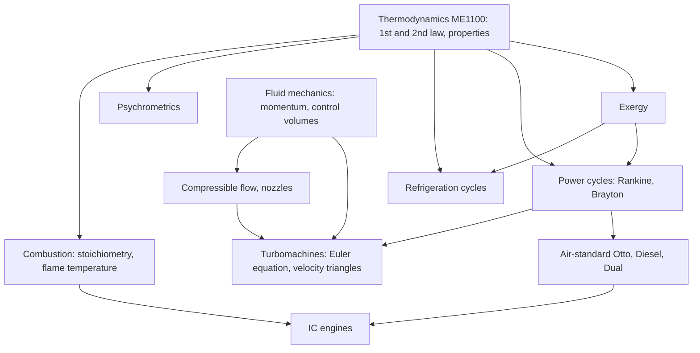

# Foundations of Thermal Engineering — Map of Content

Navigation spine for the two-part thermal sequence that follows Thermodynamics (ME1100). Part of [[Mechanical Engineering Curriculum - MOC]]. The official syllabus is in [[Foundations of Thermal Engineering/Course Details|Course Details]]; this page re-organises it into a study map and will gain concept notes as the lectures arrive. Explanations belong in atomic notes (`/wiki-concept-note`), not here.

## Course Overview

| | FTE-1 | FTE-2 |
|---|---|---|
| Code | ME2102 | ME3105 |
| Semester | 4 | 5 |
| L-T-E-P-O / credits | 2-1-0-0-4 / 7 | 2-1-0-0-4 / 7 |
| Purpose | go deeper into the **second law**: exergy, power cycles, refrigeration, air conditioning | **combustion, IC engines, turbomachines**, compressible flow |

**Textbooks:** V. Babu, *Fundamentals of Engineering Thermodynamics* (Ane); Moran, Shapiro, Boettner & Bailey, *Fundamentals of Engineering Thermodynamics* (Wiley, 7th ed). For FTE-2 also: Gopalakrishna & Prithvi Raj, *A Treatise on Turbomachinery*; Heywood, *Internal Combustion Engine Fundamentals*; Dixon & Hall, *Fluid Mechanics and Thermodynamics of Turbomachines*; V. Babu, *Fundamentals of Gas Dynamics*.

**Prerequisite:** Thermodynamics (ME1100, folder `Mechanical Engineering/Thermodynamics/` is still empty).

### Prepare from the existing vault
- Control-volume and momentum tools used by turbomachines: [[System and Control Volume]], [[Reynolds Transport Theorem]], [[Linear Momentum Equation]], [[Momentum Equation Applications - Jets, Vanes, Bends]] (the velocity-triangle and Euler-turbine ideas are these applied to rotors).
- Dimensionless groups for turbomachines: [[Buckingham Pi Theorem]], [[Dimensional Analysis and Similitude - Formula Bank]].
- Incompressible limit of 1-D flow: [[Incompressible Inviscid Flow and Bernoulli - Formula Bank]] (compressible nozzle flow is the generalisation).

## Syllabus Map

### FTE-1 (ME2102)
1. **Energy sources and utilisation:** different energy sources; major processes involving energy utilisation.
2. **Exergy:** maximum (reversible) work, exergy balance, exergy analysis.
3. **Power cycles:** Rankine (basic, superheat, reheat, regenerative); air-standard Brayton (basic, two-stage, intercooling, reheat, regenerative); first- and second-law analysis of each.
4. **Refrigeration:** common refrigerants and properties; vapour-compression cycle and its analysis; actual cycles (superheating, sub-cooling, liquid-suction heat exchanger); multistage and cascade systems.
5. **Psychrometrics and air conditioning:** mass and energy balances for air-conditioning systems; wet- and dry-bulb temperatures; psychrometric chart; air-conditioning processes.

### FTE-2 (ME3105)
1. **Combustion:** reactions and stoichiometry; first-law analysis and heat calculations; adiabatic flame temperature.
2. **Air-standard engine cycles:** Otto, Diesel, Dual.
3. **IC engines:** evolution and features, nomenclature, classification, construction and working of 2S/4S petrol and diesel engines, components, valve and port timing diagrams, p–v diagrams, test parameters, combustion and emissions, alternate fuels (bio-fuel, hydrogen), hybrid electric vehicles.
4. **Turbomachines:** turbo vs positive-displacement machines, types, velocity triangles, Euler equation, degree of reaction, non-dimensional groups, thermodynamics and efficiencies, performance characteristics.
5. **Compressible flow:** compressibility, speed of sound, one-dimensional flow in nozzles.

## Concept Notes

| Part | Note | What it settles |
|---|---|---|
| FTE-1 | [[Exergy and Reversible Work]] | exergy of heat and flow, destruction $T_0S_{gen}$, second-law efficiency |
| FTE-1 | [[Rankine Cycle - Superheat, Reheat and Regeneration]] | steam cycle, reheat, open feedwater heater |
| FTE-1 | [[Brayton Cycle - Intercooling, Reheat and Regeneration]] | gas-turbine cycle, optimum pressure ratio |
| FTE-1 | [[Vapour-Compression Refrigeration and Heat Pumps]] | R134a cycle, COP, subcooling |
| FTE-1 | [[Psychrometrics and Air-Conditioning Processes]] | $\omega$, dew point, cooling and dehumidifying |
| FTE-2 | [[Otto, Diesel and Dual Cycles and Engine Performance]] | air-standard cycles, mep, bsfc |
| FTE-2 | [[Combustion - Stoichiometry, Heating Value and Flame Temperature]] | air–fuel ratio, LHV, adiabatic flame temperature |
| FTE-2 | [[Turbomachines - Euler Equation and Velocity Triangles]] | Euler equation, reaction, affinity laws |
| FTE-2 | [[Isentropic Nozzle Flow and Choking]] | stagnation relations, area–Mach, choked flow |

Steam and R134a properties come from CoolProp; numbers and figures are recomputed in `Tools/fte_core.py`.

## Concept Map

## Methods & Problem Types

| Problem type | Method | Part |
|---|---|---|
| Work lost to irreversibility, exergy destroyed | exergy balance $\dot X_{dest}=T_0\dot S_{gen}$ | FTE-1 |
| Efficiency of a steam plant with reheat/regeneration | state-point table from steam tables, energy balance per component | FTE-1 |
| Gas-turbine cycle with intercooling and reheat | air-standard analysis, pressure ratio optimisation | FTE-1 |
| Refrigerator or heat-pump COP, multistage system | $p$–$h$ diagram, energy balances, flash-chamber balances | FTE-1 |
| Cooling/heating/humidifying of air | psychrometric chart, mass and energy balance | FTE-1 |
| Adiabatic flame temperature | first law on the reaction, iterate on temperature | FTE-2 |
| Otto/Diesel/Dual efficiency, mean effective pressure | air-standard cycle, compression and cut-off ratios | FTE-2 |
| Engine performance (brake power, bmep, efficiencies) | test-parameter relations | FTE-2 |
| Work of a rotor from inlet and outlet velocities | Euler turbomachine equation with velocity triangles | FTE-2 |
| Nozzle flow, choking | 1-D isentropic relations, speed of sound, Mach number | FTE-2 |

## Cross-Domain Links
- **Exergy** ↔ [[Energy Methods - A Unified View]]: both turn an energy statement into a *quality* statement (what can still do work).
- **Euler turbomachine equation** ↔ [[Linear Momentum Equation]]: it is angular momentum through a control volume, $\dot W=\dot m(u_2c_{\theta2}-u_1c_{\theta1})$.
- **Turbomachine non-dimensional groups** ↔ [[Buckingham Pi Theorem]]: flow, head and power coefficients are $\Pi$ groups.
- **Cycles** ↔ [[Conservation Laws and Flow Networks]]: each component is a node obeying mass and energy balance.

## Study Progress
- [ ] FTE-1: energy sources · exergy · Rankine · Brayton · refrigeration · psychrometrics
- [ ] FTE-2: combustion · Otto/Diesel/Dual · IC engines · turbomachines · compressible flow
- [ ] Tutorials · Past-paper patterns

## Study Log
*(add dated entries when the course starts)*

## MOC Maintenance Rules
When a concept note is added, link it from the matching syllabus item above, add problem links to the methods table, and log the change in [[Wiki Maintenance Log]].
