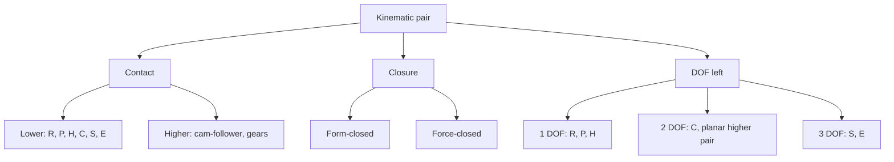

# Kinematic Pairs, Links and Chains

> [!abstract] In one breath
> A mechanism is **rigid links joined by pairs**. Each pair restricts the relative motion of the two links it joins and leaves a few degrees of freedom. What a mechanism does is decided by which pairs connect which links, so learn the pairs first.

Part of [[KDoMs - MOC]]. Next: [[Mobility - Kutzbach Equation and Exceptions]].

## 1. Machine, mechanism, rigid body

| Term | Meaning |
| --- | --- |
| **Machine** | Transmits and transforms energy to do useful work (engine, pump). |
| **Mechanism** | Rigid links arranged to transmit *motion* in a prescribed way. It need not carry real loads. |
| **Kinematics** | Motion without regard to force. |
| **Dynamics** | Motion with the forces and inertias that cause it. |
| **Rigid link** | A body whose points keep fixed mutual distances: a planar link has 3 degrees of freedom, a spatial one 6. |

## 2. Classifying pairs

A pair (joint) restricts the relative motion of two links. Three independent ways to sort them:

1. **By the nature of contact.** *Lower pairs* have surface contact; *higher pairs* have line or point contact.
2. **By how the contact is kept.** *Form-closed* (geometry holds it: a pin in a hole, a slider in a groove) or *force-closed* (a spring, gravity or a load must press the surfaces together: a cam and follower, a link resting on a plane).
3. **By the degrees of freedom it leaves** between the two links.

![[FND-1-pairs.png]]

| Lower pair | Symbol | Relative DOF |
| --- | --- | --- |
| Revolute (hinge, pin) | R | 1 (rotation) |
| Prismatic (slider) | P | 1 (translation) |
| Helical (screw) | H | 1 (rotation and translation tied by the lead) |
| Cylindrical | C | 2 (rotation, translation) |
| Spherical (ball and socket) | S | 3 (three rotations) |
| Planar | E | 3 (two translations, one rotation) |

In a *planar* mechanism only R and P appear as full joints; they remove 2 of the 3 planar DOF. A **higher pair** (cam–follower, gear teeth) leaves 2 relative DOF in the plane, rolling and sliding, so it removes only 1.

> [!tip] A joint removes as many DOF as it transmits force components
> A planar pin carries 2 reaction force components (and no moment) and removes 2 DOF. A higher pair carries 1 force (along the common normal) and removes 1 DOF. This is why counting constraints for mobility and drawing a free-body diagram are the same bookkeeping: [[Free-Body Diagrams and Equilibrium of Rigid Bodies]].

## 3. Joints of more than two links

Several links can share one pin. A joint of $k$ links counts as **$k-1$ joints** for mobility (two links make a single pin; a third link on the same pin adds one more). Drawing conventions: a small circle is a revolute pair; a continuous link drawn through a pin means that link is *one* body passing the pin; the fixed link is numbered 1 and hatched; a polygon with several pins is one rigid ternary or quaternary link.

## 4. Links, chains, mechanisms

| Term | Meaning |
| --- | --- |
| **Link** | A rigid body with at least two pairs. |
| **Kinematic chain** | Links joined by pairs. |
| **Closed chain** | Every link has at least two pairs and the loop closes. |
| **Open chain** | An end link has only one pair (a robot arm). |
| **Mechanism** | A chain with one link fixed (a frame). |
| **Linkage** | A mechanism whose pairs are all lower pairs. |
| **Constrained mechanism** | One input fixes every link's position (mobility 1). |

Mechanism types by motion: **planar** (all points move in parallel planes), **spherical** (all points move on concentric spheres, e.g. a Hooke's joint), **spatial** (neither).

> [!question]- Predict first: a roller follower pressed on a cam by a spring. Form- or force-closed, lower or higher?
> **Higher** (line contact) and **force-closed**: take the spring away and the roller leaves the cam. A groove cam holding the roller on both sides would make it form-closed.

> [!question]- Why does a ball joint give 3 DOF but a hinge only 1?
> The ball in its socket can still turn about any axis through its centre (3 rotations). The hinge's pin removes the other two rotations and all three translations.

## 5. Connections

- [[Plane Kinematics of Rigid Bodies]] — the 3 planar DOF of a free link that pairs then remove.
- [[Cam Motion Laws and the Flat-Face Follower]] — the cam–follower higher pair in detail.
- [[Gear Formula Bank]] — gear teeth as a higher pair whose motion obeys the fundamental law of gearing.
