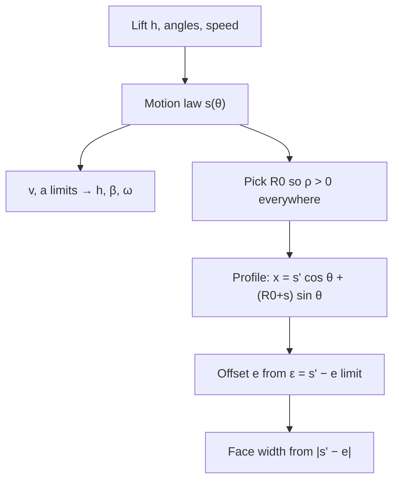

# Cam Motion Laws and the Flat-Face Follower

> [!abstract] In one breath
> A cam turns a *prescribed lift curve* $s(\theta)$ into a surface. For a **flat-face translating follower** the surface is fixed completely by $s(\theta)$ and the base-circle radius $R_0$; the **offset only decides how far the driving force sits from the follower axis**, not the shape of the cam.

Part of [[KDoMs - MOC]]. Solved in [[Tutorial-9-solution]].

## 1. Choose the motion law first

| Law | $s$ over a rise $h$ in angle $\beta$, $u=\varphi/\beta$ | Ends | Peak speed | Peak acceleration |
| --- | --- | --- | --- | --- |
| Uniform | $hu$ | speed jumps (infinite $a$) | $h\omega/\beta$ | impact |
| Simple harmonic | $\tfrac h2(1-\cos\pi u)$ | $a$ jumps | $1.57\,h\omega/\beta$ | $4.93\,h\omega^2/\beta^2$ |
| **Cycloidal** | $h\left(u-\dfrac{\sin 2\pi u}{2\pi}\right)$ | $v=0$ **and** $a=0$ | $2\,h\omega/\beta$ | $2\pi\,h\omega^2/\beta^2=6.28\,h\omega^2/\beta^2$ |

Cycloidal pays a higher peak acceleration to get $a=0$ at both ends, so no acceleration step (finite jerk only) where the follower leaves a dwell.

Derivatives with respect to cam angle (what the geometry needs):

$$
s=h\Big(u-\frac{\sin2\pi u}{2\pi}\Big),\quad
s'=\frac{h}{\beta}(1-\cos2\pi u),\quad
s''=\frac{2\pi h}{\beta^{2}}\sin2\pi u
$$

Time derivatives follow with $\omega$ constant: $\dot s=s'\omega$, $\ddot s=s''\omega^2$. The return is the mirror image, $s=h-s_{\text{rise}}$.

## 2. Geometry of the flat face

Take the follower moving along $y$, cam turning anticlockwise at $\omega$, face perpendicular to $y$.

- **Face position.** The face plane is at distance $p(\theta)=R_0+s(\theta)$ from the cam centre $O$. At a dwell on the base circle the face is tangent to it.
- **Contact point.** Cam and follower have an instantaneous centre on the line through $O$ perpendicular to the follower's motion, and on the common normal. So the contact point lies at lateral distance
$$x_c=\frac{\dot s}{\omega}=s'(\theta)$$
from the line through $O$ parallel to the follower axis (to the right during the rise for anticlockwise rotation).
- **Radius of curvature.** The profile is the envelope of the face lines, so
$$\rho=R_0+s+s''$$
It must stay positive everywhere: **a flat face cannot follow a concave cam**.
- **Eccentricity of the driving effort.** The cam pushes along $y$ at the contact point; the guide holds the follower on its axis at offset $e$. The lever arm is
$$\varepsilon=s'-e\quad(\text{axis on the rise side of }O,\ e>0)$$
A large $\varepsilon$ makes the follower jam in its guide. Driving effort exists only on the rise; on the return the spring pushes.
- **Face width** must cover every contact position $s'-e$, so it grows with $|s'|_{\max}$ and with $e$ if the face is symmetric about the axis.

> [!tip] Why the offset exists
> Offset moves the axis towards the contact point on the rise, cutting $\varepsilon=s'-e$ from $s'_{\max}$ to $s'_{\max}-e$. The price is a wider face and a larger $\varepsilon$ on the return. It never changes the cam outline.

## 3. Design order

Profile of the cam in cam-fixed axes ($\theta$ measured from the start, cam anticlockwise):

$$
x=s'\cos\theta+(R_0+s)\sin\theta,\qquad y=-s'\sin\theta+(R_0+s)\cos\theta
$$

## 4. Traps

> [!warning] Common slips
> - Using the *offset* to compute $\rho$. It does not enter: $\rho=R_0+s+s''$.
> - Forgetting that $s''$ **reduces** $\rho$ on the second half of the rise. The profile is sharpest there (here $\rho_{\min}\approx 9$ mm).
> - Using $\beta$ in degrees inside $h\omega/\beta$. Use radians.
> - Measuring "into the rise" from $\theta=0$ when a dwell comes first.

> [!question]- Predict first: which is bigger, peak acceleration with cycloidal or SHM, for the same $h,\beta,\omega$?
> Cycloidal: $6.28$ against $4.93$ in units of $h\omega^2/\beta^2$, about 27 % more. It buys $a=0$ at the ends, so there is no acceleration jump entering or leaving a dwell.

> [!question]- Quick check: the follower is flat-faced and $s'=0$ at some angle. Where is the contact point?
> On the line through the cam centre parallel to the follower axis, because $x_c=s'=0$. That is the case through every dwell. It moves farthest out where the speed peaks, mid-rise, at $s'_{\max}=2h/\beta$.

## 5. Connections

- [[Plane Kinematics of Rigid Bodies]] — the instantaneous centre that gives $x_c=\dot s/\omega$.
- [[Rotating Vectors - Phasors, Velocity Polygons and Complex Kinematics]] — $\dot s=\omega\,x_c$ is the same $v=\omega\times r$ that drives every velocity polygon.
- [[Vibration of Particles and Rigid Bodies]] — a follower with a spring is a forced oscillator; high peak acceleration and sharp acceleration changes excite it, which is why cycloidal is chosen at speed.
