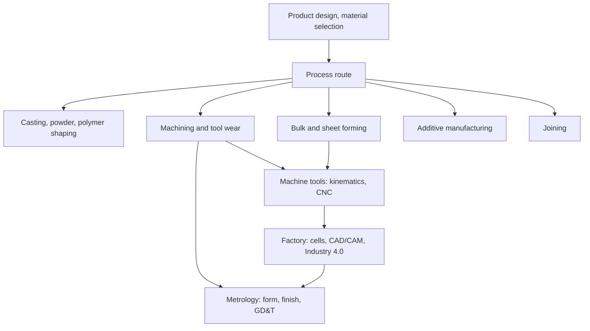

# Manufacturing Technology — Map of Content

Navigation spine for the two-part manufacturing sequence. Part of [[Mechanical Engineering Curriculum - MOC]]. Official syllabus: [[Manufacturing Technology/Course Details|Course Details]].

## Course Overview

| | Manufacturing Technology-I | Manufacturing Technology-II |
|---|---|---|
| Code | ME2302 | ME3305 |
| Semester | 4 | 5 |
| L-T-E-P-O / credits | 3-1-0-1-6 / 11 | 3-1-0-1-6 / 11 |
| Theme | **how to shape and join materials**: processes, mechanics, tooling | **how to hold, move, position and inspect**: machine functions, factory, metrology |

**Prerequisites (syllabus: none).** Process mechanics uses [[Strength of Materials - MOC]] (stress-strain, plasticity) and [[Materials and Design - MOC]] (structure, heat treatment). Part II draws on [[KDoMs - MOC]] (machine kinematics) and [[Measurements, Instrumentation and Control - MOC]].

**Textbooks (I):** Kalpakjian & Schmid, *Manufacturing Processes for Engineering Materials* (5th ed). Reference: Groover, *Fundamentals of Modern Manufacturing*.
**Textbooks (II):** Groover, *Automation, Production Systems and Computer-Integrated Manufacturing* (4th ed); I. C. Gupta, *A Text Book of Engineering Metrology*; Boyes, *Handbook of Jig and Fixture Design* (2nd ed); Schwab, *The Fourth Industrial Revolution*; Chattopadhyay, *Machining and Machine Tools*. Reference: Kalpakjian & Schmid; Schuler, *Metal Forming Handbook*.

## Syllabus Map

### Part I (ME2302)
1. **Introduction:** manufacturing, product design, material selection, process route, general trends; mechanical behaviour and properties of metals.
2. **Solidification and moulding:** metal casting processes and equipment, powder-based processes, heat treatment, shaping of polymers, ceramics and composites.
3. **Deformation processes:** bulk forming and sheet-metal forming.
4. **Subtractive processes:** energy-based classification, mechanics of machining, machining processes and operations, tool wear and failure, machinability, cutting-tool materials.
5. **Additive processes:** additive manufacturing of metals, polymers, ceramics.
6. **Joining processes:** solid- and liquid-state joining, brazing, soldering, adhesive bonding.
7. **Product-specific process selection:** case studies.

### Part II (ME3305)
1. **Rigid positioning of tools and parts:** tool and work holding, jigs and fixtures.
2. **Movement of tools and parts:** tool–work relative kinematics, linear and rotary motion, mechanical synchronisation (machine kinematics), programmable positioning (electric motor drives, CNC, tool-path programming).
3. **Movement of parts between machines:** material transport, part identification and data capture, robotics.
4. **Manufacturing factory:** CAD/CAM, CAPP, process-route modelling, layout optimisation, economics, automation in cells and assembly lines, digital and smart manufacturing (Industry 4.0).
5. **Metrology:** measurement standards; form measurements (straightness, flatness, roundness, cylindricity); linear and angular measurement; surface roughness; profile and form testers, CMM; GD&T, limits and fits; gauging.

## Concept Notes

| Topic | Note | What it settles |
|---|---|---|
| Casting | [[Casting - Solidification Time and Riser Design]] | Bernoulli gating, Chvorinov, riser sizing |
| Bulk forming | [[Bulk Deformation - Forging, Rolling, Extrusion and Drawing]] | flow stress, forging force, bite condition, drawing stress |
| Sheet forming | [[Sheet Metal Forming - Blanking, Bending and Deep Drawing]] | blanking force, bend allowance, draw ratio |
| Machining | [[Orthogonal Cutting - Merchant's Shear Plane Model]] | shear angle, Merchant circle, specific energy |
| Machining | [[Tool Life and Machining Economics]] | Taylor, economic and minimum-time speeds |
| Work holding | [[Jigs and Fixtures - The 3-2-1 Location Principle]] | six degrees of freedom, locating and clamping |
| Metrology | [[Metrology and GD&T - Form, Position and Gauging]] | form, position, MMC bonus, GO and NO-GO gauges |
| Joining | [[Joining Processes - Welding, Brazing and Adhesives]] | heat input, HAZ, carbon equivalent |
| Additive | [[Additive Manufacturing - Processes and Design Rules]] | process families, build time, staircase, design rules |

Numbers and figures: `Tools/mfg_core.py`.

## Concept Map

## Methods & Problem Types

| Problem type | Method |
|---|---|
| Casting time and riser sizing | solidification-time rule (Chvorinov) |
| Forging or rolling force | plastic work with flow stress and friction |
| Cutting force and power in turning | orthogonal-cutting mechanics (shear-plane model), specific cutting energy |
| Tool life | Taylor equation $VT^n=C$ |
| Select a process for a part | material, shape, volume, tolerance and cost screening |
| Position a workpiece | 3-2-1 location principle for fixtures |
| Inspect a feature | choose gauge or instrument, resolve form vs size vs finish, apply GD&T callout |
| Cost per part | fixed and variable cost, break-even volume |

## Cross-Domain Links
- **Plastic deformation in forming** ↔ [[Stress-Strain Diagram and Hooke's Law]] and [[Plane Stress Transformation]]: flow stress, true strain and yield criteria set the forces.
- **Shear-plane analysis in machining** ↔ [[Mohr's Circle for Stress]]: the force circle of Merchant's theory is a Mohr-type construction.
- **Casting and welding heat flow** ↔ [[Heat Transfer - MOC]]: solidification time and weld thermal cycles are conduction problems.
- **Machine-tool kinematics and robotics** ↔ [[KDoMs - MOC]]: motion generation, gear trains, linkages.
- **CNC drives** ↔ [[12 DC Machines]] and [[Measurements, Instrumentation and Control - MOC]]: motors and feedback loops.
- **Limits, fits and GD&T** ↔ [[Computer Aided Machine Drawing - MOC]]: the same symbols on the drawing that metrology then verifies.

## Study Progress
- [ ] Part I: casting · forming · machining · additive · joining · process selection
- [ ] Part II: fixtures · machine kinematics and CNC · automation and robotics · factory and Industry 4.0 · metrology and GD&T
- [ ] Tutorials and lab · [ ] Past-paper patterns

## Study Log
*(add dated entries when the course starts)*

## MOC Maintenance Rules
Link each new concept note from the syllabus map, add tutorial links to the methods table, log changes in [[Wiki Maintenance Log]].
