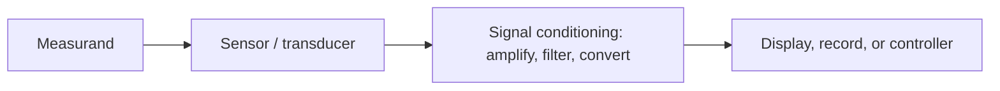

# Measurement Performance and Error Propagation

> [!abstract] In one breath
> A measurement is a number **plus its uncertainty**. Instruments are described by a handful of **static characteristics** (range, resolution, sensitivity, accuracy, repeatability, linearity, hysteresis). When a result is computed from several measured quantities, the uncertainties **combine**: for independent errors, in a root-sum-square.

Part of [[Measurements, Instrumentation and Control - MOC]]. Next: [[Sensors and Signal Conditioning]].

## 1. A measurement system

Each block adds its own error and dynamics (the sensor lag is in [[First-Order Systems - Time Constant and Response]]).

## 2. Static characteristics

| Term | Meaning |
| --- | --- |
| **Range** | span between the minimum and maximum measurable values |
| **Sensitivity** | output change per input change, $S=\Delta y/\Delta x$ (V/°C, mV/V per µε) |
| **Resolution** | smallest input change that gives a detectable output change |
| **Accuracy** | closeness of the reading to the true value (stated as % of reading or % of full scale) |
| **Precision / repeatability** | scatter in repeated readings at the same input |
| **Linearity** | maximum deviation of the calibration curve from the best straight line |
| **Hysteresis** | different output going up and coming down |
| **Zero drift, sensitivity drift** | change with time or temperature |
| **Threshold, dead band** | smallest input that moves the output from rest |

**Systematic error** (bias): same sign every time; removed by calibration. **Random error**: scatter; reduced by averaging ($\sigma_{mean}=\sigma/\sqrt N$). Accuracy is limited by bias, precision by scatter: a rifle that groups tightly off-target is precise but not accurate.

**Specifying accuracy.** An instrument that is ±1 % of full scale on a 0–100 range has an error of ±1 unit anywhere: at a reading of 10 that is ±10 % of the reading. **Choose an instrument whose range puts the reading in the upper two-thirds of the scale.**

## 3. Error propagation

For a result $y=f(x_1,x_2,\dots)$ with independent uncertainties $\delta x_i$:

$$
\delta y_{RSS}=\sqrt{\sum_i\Big(\frac{\partial f}{\partial x_i}\delta x_i\Big)^2},\qquad
\delta y_{max}=\sum_i\Big|\frac{\partial f}{\partial x_i}\Big|\delta x_i
$$

For products and powers the **relative** errors combine: $y=x_1^{a}x_2^{b}$ gives $\dfrac{\delta y}y=\sqrt{(a\,\delta x_1/x_1)^2+(b\,\delta x_2/x_2)^2}$.

**Example.** The power in a resistor, $P=V^2/R$, from $V=12.00\pm0.05$ V and $R=47.0\pm0.5\ \Omega$:

$$
P=3.064\ \text{W},\qquad
\frac{\delta P}{P}=\sqrt{\Big(2\frac{0.05}{12}\Big)^2+\Big(\frac{0.5}{47}\Big)^2}=1.35\ \%\ \Rightarrow\ \delta P=\mathbf{\pm0.041\ W}
$$

The worst-case sum gives $\pm0.058$ W. The voltage error counts double (it is squared) but is smaller in relative terms, so the resistor tolerance contributes nearly as much.

## 4. Calibration

Apply known inputs (traceable to a standard), record outputs up and down, fit the curve, and state the uncertainty. **Calibrate over the range actually used**, at the operating temperature, and repeat at intervals.

> [!warning] Traps
> - Quoting accuracy as % of reading when the datasheet says % of full scale.
> - Mistaking resolution for accuracy: a display with 0.01 mV digits may be accurate to only 1 mV.
> - Adding independent errors arithmetically: use RSS (the worst-case sum is overly pessimistic).
> - Averaging to remove a **bias**: averaging reduces scatter only.
> - Forgetting that squaring doubles the relative error.

> [!question]- Predict first: a 0–100 °C thermometer with ±1 % of full scale, reading 20 °C. What is the uncertainty?
> ±1 °C, i.e. ±5 % of the reading. At 80 °C it is the same ±1 °C (±1.25 %). Use the scale in its upper part.

> [!question]- Ten readings of the same input have a standard deviation 0.5 units. What is the random uncertainty of their mean?
> $0.5/\sqrt{10}=0.16$ units. Ten times as many readings narrow it by only $\sqrt{10}=3.2$, and a systematic error is unchanged.

## 5. Connections

- [[Error Analysis - Uncertainty and Propagation]] — the same propagation formulas, applied to the physics experiments.
- [[Metrology and GD&T - Form, Position and Gauging]] — instrument resolution and the rule of ten against tolerance.
- [[Concept of Stress]] and [[Strain Transformation and Rosettes]] — what the strain gauge measures.
- [[Sensors and Signal Conditioning]] — where the calibration curve, noise and drift come from.
