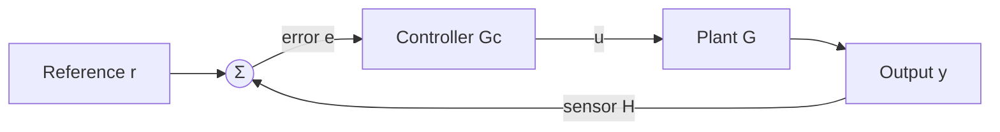

# Feedback, Block Diagrams and Transfer Functions

> [!abstract] In one breath
> A **transfer function** $G(s)=Y/U$ describes a linear system as an algebraic ratio. Blocks connected in series multiply; a **feedback loop** with forward path $G$ and feedback $H$ closes to $G/(1+GH)$. Feedback buys accuracy and speed and makes the system less sensitive to the plant, at the price of a stability limit.

Part of [[Measurements, Instrumentation and Control - MOC]]. Previous: [[Second-Order Systems - Damping and Overshoot]]. Next: [[PID Control and Tuning]].

## 1. Open loop and closed loop

**Open loop:** the controller acts without looking at the output (a toaster timer). Simple, cheap, but any disturbance or plant change goes uncorrected. **Closed loop:** the output is measured, compared with the reference, and the *error* drives the controller.

## 2. Transfer functions and block reduction

For a linear time-invariant system with zero initial conditions, $G(s)=\mathcal L\{y\}/\mathcal L\{u\}$. Reduction rules:

| Arrangement | Equivalent |
| --- | --- |
| Series $G_1,G_2$ | $G_1G_2$ |
| Parallel (summed) | $G_1\pm G_2$ |
| **Negative feedback** (forward $G$, feedback $H$) | $\dfrac{G}{1+GH}$ |
| Move a summing point or pickoff past a block | multiply or divide the branch by $G$ |

Characteristic equation $1+GH=0$: its roots (closed-loop **poles**) fix stability and the transient.

## 3. What feedback does

With $L=G_cGH$ the **loop gain**:

$$
\frac YR=\frac{G_cG}{1+L},\qquad \frac YD=\frac{G_d}{1+L}\ (\text{disturbance}),\qquad S=\frac1{1+L}\ (\text{sensitivity to plant changes})
$$

A large $|L|$ at the signals' frequencies makes $Y/R\to1/H$ (set by the sensor, not the plant), shrinks the effect of disturbances, and reduces sensitivity to plant variation by the factor $1/(1+L)$.

**Steady-state error** for a unit step with unity feedback: $e_{ss}=\dfrac{1}{1+K_p}$ where $K_p=\lim_{s\to0}G_cG(s)$ (the DC loop gain). A **type-1** loop (one integrator) has zero step error; a type-0 loop (none) has a finite one.

## 4. Worked example: proportional control

Plant $G(s)=\dfrac{10}{s+2}$ (a first-order process with DC gain 5 and $\tau=0.5$ s), proportional controller $K$, unity feedback:

$$
T(s)=\frac{10K}{s+2+10K},\qquad \text{final value }\frac{10K}{2+10K},\qquad e_{ss}=\frac1{1+5K},\qquad \tau_{cl}=\frac1{2+10K}
$$

| $K$ | closed-loop final value | steady-state error | time constant |
| --- | --- | --- | --- |
| 0.5 | 0.714 | **28.6 %** | 0.143 s |
| 1 | 0.833 | **16.7 %** | 0.083 s |
| 5 | 0.962 | **3.8 %** | 0.019 s |
| open loop | 5 (gain, no reference) | — | 0.5 s |

More gain gives a faster **and** more accurate response (the pole moves from $-2$ to $-2-10K$), but the error never reaches zero with P action alone: that is what integral action fixes ([[PID Control and Tuning]]). In this first-order plant the gain can be made as large as one likes; with a higher-order plant a large $K$ drives the loop unstable ([[Frequency Response, Nyquist Plots and Stability Margins]]).

![[MIC-4-feedback.png]]

## 5. Stability: the poles

A closed-loop system is stable iff all roots of $1+GH=0$ have negative real parts. For a second-order characteristic polynomial $s^2+a_1s+a_0$, stability means $a_1,a_0>0$; higher orders use the Routh–Hurwitz table or the Nyquist plot.

> [!warning] Traps
> - Applying $G/(1+GH)$ with **positive** feedback: the sign is $1-GH$.
> - Forgetting the sensor: with $H\ne1$ the output settles to $r/H$ at high gain, not to $r$.
> - Reading $e_{ss}$ from the closed-loop final value of a plant with a pure integrator (type 1: the error is zero).
> - Assuming more gain is always better: it is limited by the stability and by actuator saturation.
> - Mixing up the error $e=r-y$ and the *measured* error $r-Hy$.

> [!question]- Predict first: the plant above with $K=20$. What happens to the steady-state error and the response speed?
> $e_{ss}=1/(1+100)=0.99$ % and $\tau_{cl}=1/202=5$ ms: very accurate and very fast. For this first-order plant. A real actuator would saturate long before; a delay or extra lag in the loop would make it unstable.

> [!question]- Why does feedback make a loop insensitive to the plant gain?
> $T=L/(1+L)\approx1$ when $|L|\gg1$: the plant gain drops out. If the plant gain drops by half but $L$ is still 100, the closed-loop gain falls by only about 0.5 %.

## 6. Connections

- [[The Universal Second-Order Linear System]] and [[First-Order Systems - Time Constant and Response]] — the building blocks inside the loop.
- [[Conservation Laws and Flow Networks]] — block diagrams are signal-flow graphs; reduction is the same elimination as for circuit nodes.
- [[Rotating Vectors - Phasors, Velocity Polygons and Complex Kinematics]] — $G(j\omega)$ is a complex number: magnitude and phase of a rotating phasor, the basis of frequency-domain design.
- [[Gears, Transformers and Reflected Impedance]] — gear ratios and load inertia reflected to the motor shaft appear as gains in the plant block.
