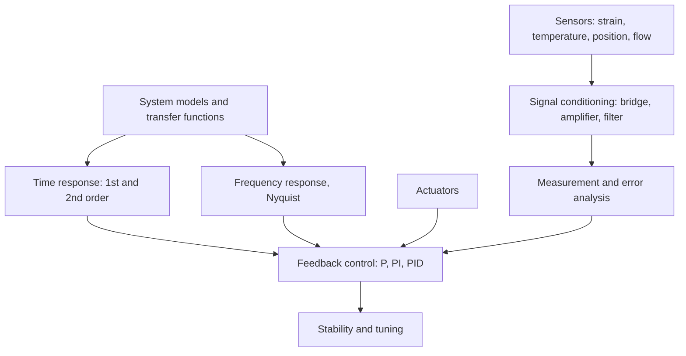

# Measurements, Instrumentation and Control — Map of Content

Navigation spine for ME2400. Part of [[Mechanical Engineering Curriculum - MOC]]. Official syllabus: [[Measurements and instrumentation/Course Details|Course Details]]. (The curriculum lists the course as *Measurements and instrumentation*, ME2400.)

## Course Overview

**Course:** Measurements, Instrumentation and Control · **Code:** ME2400 · **Semester 4** · **L-T-E-P-O / credits:** 3-0-0-2-6 / 11 (includes a practical group project)

**Core purpose:** measure mechanical quantities, condition the signals, and close a feedback loop around a process so that it behaves as required (stable, accurate, fast).

**Textbooks:** W. Bolton, *Instrumentation and Control Systems* (2nd ed). References: Beckwith, Marangoni & Lienhard, *Mechanical Measurements* (6th ed); McMillan, *Process/Industrial Instruments and Controls Handbook* (5th ed).

**Prerequisite (syllabus: none).** In practice this is built on the vault's [[EE1100 MOC]] (circuits, RLC response, filters) and [[2nd Order ODEs - MOC]] (system response).

### Prepare from the existing vault
[[04 Capacitors, Inductors and First Order Circuits]] · [[Series RLC Natural Response - Damping Cases]] · [[DC Step Response of RLC Circuits]] · [[Frequency Response and Resonance Curves]] · [[Filter Theory]] · [[03 DC Network Theorems]] (bridges) · [[2nd Order Linear ODE with Constant Coefficients]].

## Syllabus Map

1. **Measurement systems and performance:** accuracy, range, resolution, error sources.
2. **Instrumentation elements:** sensors for common engineering measurements; signal processing and conditioning; correction elements and actuators (pneumatic, hydraulic, electric).
3. **Control systems:** basic elements, open/closed loop, block diagrams; control methods P, PI, PID, when to choose which, controller tuning.
4. **System modelling and response:** system models, transfer functions, time response, frequency response, Nyquist diagrams and their use.
5. **Practical group project** applying the above.

## Concept Notes

| Topic | Note | What it settles |
|---|---|---|
| Performance | [[Measurement Performance and Error Propagation]] | static characteristics, RSS uncertainty |
| Sensors | [[Sensors and Signal Conditioning]] | strain gauge bridge, thermocouple, RTD, LVDT, sampling |
| Dynamics | [[First-Order Systems - Time Constant and Response]] | time constant, step, ramp lag, bandwidth |
| Dynamics | [[Second-Order Systems - Damping and Overshoot]] | $\omega_n$, $\zeta$, overshoot, resonance |
| Control | [[Feedback, Block Diagrams and Transfer Functions]] | block reduction, steady-state error |
| Control | [[PID Control and Tuning]] | P, I, D actions, Ziegler–Nichols |
| Stability | [[Frequency Response, Nyquist Plots and Stability Margins]] | Bode, Nyquist, gain and phase margin |

Numbers and figures: `Tools/mic_core.py` (simulations with SciPy).

## Concept Map

## Methods & Problem Types

| Problem type | Method |
|---|---|
| Specify or compare instruments | accuracy, resolution, range, repeatability; error propagation |
| Strain-gauge or resistance-sensor circuit | Wheatstone bridge, balance and sensitivity |
| Response of a first-order sensor (thermocouple, RC) | time constant $\tau$, step response $1-e^{-t/\tau}$ |
| Response of a second-order system | $\omega_n$, $\zeta$, overshoot and settling time |
| Closed-loop transfer function | block-diagram reduction |
| Choose and tune a controller | P, PI, PID action; steady-state error and stability trade-offs |
| Is the loop stable? | Nyquist plot, gain and phase margins |

## Cross-Domain Links
- **Second-order system response** ↔ [[The Universal Second-Order Linear System]] and [[The Mechanical-Electrical Analogy (Impedance Analogy)]]: $\omega_n$ and $\zeta$ describe an RLC circuit, a spring-mass-damper and a servo in the same way.
- **First-order sensor lag** ↔ [[Exponential Decay - Time Constants, Damping and Spatial Relaxation]]: a thermocouple is an $RC$ circuit with thermal $R$ and $C$.
- **Frequency response and resonance** ↔ [[Frequency Response and Resonance Curves]] and [[Resonance and Buckling - Instability as an Eigenvalue Problem]]: Bode/Nyquist plots are the same curves as in EE1100.
- **Strain gauges** ↔ [[Strain Transformation and Rosettes]]: the rosette equations are how gauge readings become principal strains.
- **Signal filtering** ↔ [[Filter Theory]].
- [[Lecture 32 Introduction to Operational Amplifiers.pdf]] — signal conditioning (amplifiers, filters, bridges) is the op-amp material of EE1100.
- [[Manufacturing Technology - MOC]] — metrology uses the same accuracy, resolution and error-source vocabulary when choosing a gauge or instrument.

## Study Progress
- [ ] Measurement performance · [ ] Sensors and conditioning · [ ] Actuators · [ ] Block diagrams · [ ] P/PI/PID · [ ] Transfer functions · [ ] Frequency response and Nyquist · [ ] Group project
- [ ] Tutorials and lab · [ ] Past-paper patterns

## Study Log
*(add dated entries when the course starts)*

## MOC Maintenance Rules
Link each new concept note from the syllabus map, add tutorial links to the methods table, log changes in [[Wiki Maintenance Log]].
