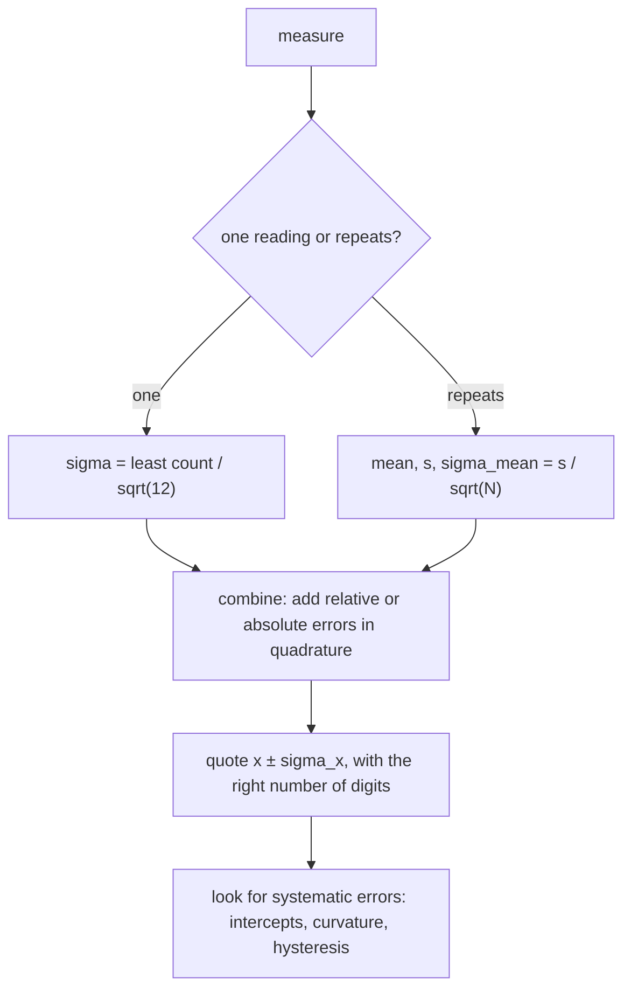

# Error Analysis - Uncertainty and Propagation

> [!abstract] The big idea
> A measurement without an uncertainty is not a result. Every number has a **least-count error** (the instrument cannot resolve finer), a **statistical error** (repeats scatter) and possibly a **systematic error** (everything is shifted the same way). The skill is to estimate each, combine them correctly (independent errors add **in quadrature**), and quote $x\pm\sigma_x$ honestly.

## The four tools

| Tool | Formula | When |
|---|---|---|
| Least-count error | $\sigma=c/\sqrt{12}$ for least count $c$ | one reading from a scale or vernier |
| Statistical error | $\bar t=\frac1N\sum t_i,\ \ s^2=\frac{1}{N-1}\sum(t_i-\bar t)^2,\ \ \sigma_{\bar t}=s/\sqrt N$ | repeated readings that scatter |
| Propagation | $\sigma_u^2=\big(\tfrac{\partial f}{\partial x}\big)^2\sigma_x^2+\big(\tfrac{\partial f}{\partial y}\big)^2\sigma_y^2+\cdots$ | $u=f(x,y,\dots)$, independent errors |
| Weighted mean | $\bar g=\sum w_ig_i,\ \ w_i=\dfrac{1/\sigma_i^2}{\sum_k1/\sigma_k^2},\ \ \sigma_{\bar g}^{-2}=\sum_k\sigma_k^{-2}$ | several estimates with different $\sigma$ |

![[PL-error-types.png]]

**Figure:** Left, a reading known only to lie between $60.1$ and $60.2$ cm: all values in the interval are equally likely, giving a standard deviation $0.1/\sqrt{12}=0.03$ cm. Middle, ten repeated period estimates scatter around the mean; the shaded band is the standard error of the mean. Right, uncertainty of the mean falls as $1/\sqrt N$: sixteen repeats are four times better than one, but you need four times the effort to halve the error.

> [!question]- 🎯 Predict first: you time 10 oscillations instead of one. By what factor does the *timing* error on one period shrink?
> By **10**, because the same reaction-time error ($\sim0.2$ s) is spread over ten periods: $\sigma_T=\sigma_t/10$. Timing many oscillations is better than repeating single ones. (The $1/\sqrt N$ gain comes in *on top*, from repeating the 10-oscillation run.)

> [!tip]- 🧠 Vernier vs metre scale: where is the best estimate?
> With a metre scale there is no coincidence reading, so the best estimate is the **midpoint** of the two divisions the mark falls between. With a vernier or screw gauge the reading is *main scale + coincidence × least count* (no midpoint); the uncertainty is still $c/\sqrt{12}$.

## Error propagation, worked: $g=4\pi^2L/T^2$

![[PL-error-propagation.png]]

**Figure:** Left, with $L=60.15\pm0.03$ cm and $T=1.556\pm0.003$ s, the length contributes $0.005$ m/s² and the period $0.038$ m/s² to $\sigma_g$ (the period is squared, so its relative error counts double). Right, three independent estimates of $g$ combine with weights $1/\sigma^2$: the precise middle run dominates.

$$\sigma_g^2=\Big(\frac{4\pi^2}{T^2}\Big)^2\sigma_L^2+\Big(\frac{8\pi^2L}{T^3}\Big)^2\sigma_T^2\ \Rightarrow\ g=9.808\pm0.038\ \text{m/s}^2$$

**Shortcut for products and powers:** if $u=x^ay^b$ then $\dfrac{\sigma_u}{u}=\sqrt{a^2\dfrac{\sigma_x^2}{x^2}+b^2\dfrac{\sigma_y^2}{y^2}}$. Here $\sigma_g/g=\sqrt{(0.05\%)^2+(2\times0.19\%)^2}=0.39\%$ ✓.

## Systematic errors
They shift every reading the same way: parallax, a zero offset in a meter, a clock that runs fast. You cannot average them away. **Detect them in the data:** a line that should pass through the origin has an intercept; a graph that should be straight is curved; results differ in loading and unloading. Correct what you can *before* the experiment and describe the rest in the report.

## Common traps

> [!warning]- ⚠️ Adding errors linearly
> Independent errors add in quadrature: $\sqrt{a^2+b^2}$, not $a+b$. Linear addition is the worst case and overestimates.

> [!warning]- ⚠️ Dividing by $N$ instead of $N-1$ in the sample variance
> One degree of freedom was used to find the mean. With $N=1$ the sample variance is undefined, as it should be.

> [!danger]- 💥 Quoting too many digits
> If $\sigma_g=0.038$, write $g=9.81\pm0.04$, not $9.8079\pm0.0381$. Round the uncertainty to one or two significant figures, then round the value to the same decimal place.

## Quick quiz

> [!question]- Q1. A micrometer has least count $0.01$ mm. What uncertainty do you assign to one reading?
> $0.01/\sqrt{12}=0.003$ mm.

> [!question]- Q2. Two estimates: $9.78\pm0.08$ and $9.84\pm0.03$. What is the best combined value?
> Weights $\propto1/\sigma^2$: $156:1111$. $\bar g=(156\cdot9.78+1111\cdot9.84)/1267=9.83$, $\sigma=1/\sqrt{156+1111}=0.028$ (better than either).

> [!question]- Q3. A straight-line fit should pass through the origin but has a positive intercept. What does that suggest?
> A systematic error (zero offset, friction, an unaccounted constant), not random noise.

## Connections
- **Used in every experiment** of [[Physics Laboratory I - MOC]], e.g. [[Lab - Variable g Pendulum]] and [[Lab - Newton's Rings]].
- **Cross-domain:** [[Applied Mechanics Lab - MOC]] (the same errors limit the beam and torsion experiments); partial derivatives as sensitivities link to [[Conservative Forces, Gradient and Curl]] (the gradient is the vector of sensitivities).

## Self-check
- [ ] I can assign $\sigma=c/\sqrt{12}$ and say when to use the midpoint.
- [ ] I can propagate errors through $g=4\pi^2L/T^2$ and see which term dominates.
- [ ] I can combine estimates with weights and say why the result beats each one.

## Metadata
- **Status:** draft · **Type:** concept · **Difficulty:** beginner–intermediate
- **Course map:** [[Physics Laboratory I - MOC]]
