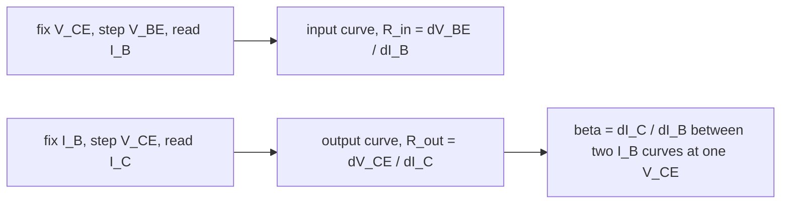

# Lab - Transistor Characteristics

> [!abstract] The experiment in one line
> Measure how an NPN transistor in common-emitter connection behaves: the **input** curve ($I_B$ against $V_{BE}$, a diode) and the **output** family ($I_C$ against $V_{CE}$ at fixed $I_B$). From them you read the current gain $\beta$ and the input and output resistances.

## Aim and theory
**Aim:** study the static characteristics of a transistor in the common-emitter (CE) configuration. **Apparatus:** NPN transistor, supply, voltmeter, ammeter.

A transistor is two p–n junctions back to back with three terminals: **emitter** (heavily doped, supplies carriers), **base** (thin, lightly doped) and **collector** (collects them). Kirchhoff's current law gives $I_E=I_B+I_C$ in every configuration. The three modes:

| Mode | Base–emitter | Collector–base | Use |
|---|---|---|---|
| Cutoff | reverse | reverse | switch **off** |
| Active | forward | reverse | **amplifier**: $I_C\approx\beta I_B$ |
| Saturation | forward | forward | switch **on** |

In the active mode electrons injected from the emitter cross the thin base (few recombine) and are swept into the collector by the reverse-biased junction's field. Small signals are described by

$$\beta=\frac{\Delta I_C}{\Delta I_B}\Big|_{V_{CE}},\qquad R_{in}=\frac{\Delta V_{BE}}{\Delta I_B}\Big|_{V_{CE}},\qquad R_{out}=\frac{\Delta V_{CE}}{\Delta I_C}\Big|_{I_B},\qquad I_{CEO}=(1+\beta)I_{CBO}.$$

![[PL-transistor.png]]

**Figure:** Left, input characteristic: nothing flows below the cut-in voltage ($\approx0.6$ V), then $I_B$ rises exponentially like a forward-biased diode. Right, output family (illustrative $\beta=100$): $I_C$ rises quickly from zero (saturation) and then stays nearly flat in the active region at $\beta I_B$, with a slight tilt (the Early effect) that sets $R_{out}$.

> [!question]- 🎯 Predict first: you double the base current from $20\ \mu$A to $40\ \mu$A at fixed $V_{CE}$. What happens to the collector current?
> It roughly **doubles** (here from $2$ to $4$ mA), since $I_C\approx\beta I_B$. A change of $20\ \mu$A in the base circuit controls a change of $2$ mA in the collector circuit: that factor of $100$ *is* amplification.

## Procedure (condensed)
**Input characteristic.** Keep $R_2$ at minimum; set $V_{CE}=5$ V with $R_1$ and hold it. Increase $V_{BE}$ in steps and measure $I_B$ each time. Plot $I_B$ ($\mu$A) against $V_{BE}$ (V); repeat for other $V_{CE}$. $R_{in}$ is the **reciprocal of the slope**: it varies from $\sim4$ k$\Omega$ near the origin to $\sim600\ \Omega$ on the steep part.

**Output characteristic.** Hold $I_B$ at a convenient value ($\sim20\ \mu$A). Raise $V_{CE}$ from zero in steps, reading $I_C$ each time; plot $I_C$ (mA) against $V_{CE}$; repeat for several $I_B$ to get a family. $R_{out}$ is the reciprocal slope of the nearly flat part.

## Worked example
> [!example]- 🔬 Reading $\beta$ from the family (illustrative curves)
> At $V_{CE}=7$ V, the $I_B=20\ \mu$A curve gives $I_C=2.2$ mA and the $40\ \mu$A curve gives $4.4$ mA.
> $\beta=\Delta I_C/\Delta I_B=(4.4-2.2)\ \text{mA}/(40-20)\ \mu\text{A}=110$.
> $R_{out}$ from the $40\ \mu$A curve's slope: if $I_C$ rises $0.12$ mA for $\Delta V_{CE}=3$ V, then $R_{out}=3/0.12\ \text{mA}=25$ k$\Omega$.
> **Check:** $\beta$ computed at different $V_{CE}$ in the active region should be nearly constant; it drifts with temperature and $I_C$.

> [!warning]- ⚠️ Reading $\beta$ in the saturation region
> Near $V_{CE}\lesssim0.3$ V the curves bunch together and $I_C\ne\beta I_B$. Always take $\beta$ in the flat (active) part.

> [!danger]- 💥 Exceeding the power or current rating
> Raising $V_{CE}$ and $I_C$ together can overheat the transistor; $I_C$ then rises further (thermal runaway). Keep within the limits on the board and use small steps.

## Questions
> [!question]- Why must the base be thin and lightly doped?
> So that most carriers injected from the emitter reach the collector instead of recombining in the base: it makes $\beta$ large (and $I_C\approx I_E$).

> [!question]- Why does a small collector current flow even when $I_B=0$?
> $I_{CEO}=(1+\beta)I_{CBO}$: the reverse leakage of the collector junction is amplified by the transistor action.

## Connections
- **Cross-domain:** [[A-Q1 - Formation of the p-n Junction]], [[A-Q3 - V-I Characteristics of a p-n Diode]] and [[A-Q4 - Bias, Cut-in Voltage, Saturation Current and Resistance]] (the input curve *is* a diode curve); [[Series-Parallel Resistance Reduction]] (load lines).
- **Errors:** [[Error Analysis - Uncertainty and Propagation]] (slopes from graphs: fit a line over the chosen region).

## Self-check
- [ ] I can name the three modes and the biasing of each junction.
- [ ] I can read $\beta$, $R_{in}$ and $R_{out}$ from the curves.
- [ ] I can explain why the input curve looks like a diode and the output curves are flat.

## Metadata
- **Status:** draft · **Type:** concept (lab) · **Difficulty:** intermediate
- **Course map:** [[Physics Laboratory I - MOC]]
