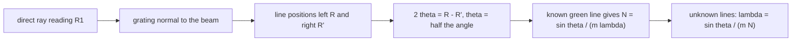

# Lab - Transmission Grating

> [!abstract] The experiment in one line
> Use a spectrometer to measure the angles of the bright lines of mercury through a diffraction grating, first calibrating the grating (finding the line density $N$) with the known green line, then using it to measure the other wavelengths.

## Aim and theory
**Aim:** determine the wavelengths of the spectral lines of mercury.

A grating is a large number of equal, equidistant slits (spacing $d$). Light from successive slits arrives in step in directions where the path difference is a whole number of wavelengths:

$$d\sin\theta=m\lambda\ \ \Longleftrightarrow\ \ \sin\theta=mN\lambda,\qquad N=1/d\ \text{(lines per metre)}$$

With $N$ slits the maxima are $N$ times narrower in amplitude and $N^2$ times brighter than one slit's. White light gives a white zero order and a spectrum on each side of each higher order.

**Mercury lines** (nm): violet $435.8$, blue-green $491.6$, green $546.1$ (bright), yellow doublet $577.0$ and $579.1$ (bright). The two feeble violet lines and the very bright blue line are easily mistaken for each other.

![[PL-grating-orders.png]]

**Figure:** First- and second-order lines for an illustrative grating with 600 lines/mm: first-order angles are $15.2^\circ$ (violet) to $20.3^\circ$ (yellow); second order spans $31.5^\circ$ to $44.0^\circ$. The yellow doublet is separated by only $0.07^\circ$ here, so it needs a fine telescope setting.

> [!question]- 🎯 Predict first: which colour is bent *most* by a grating, and is that the same as in a glass prism?
> **Red/longer wavelength bends most** ($\sin\theta\propto\lambda$). A prism does the opposite (violet bends most). Grating spectra are also *linear* in $\lambda$, which is why spectrometers use gratings.

## Procedure (condensed)
1. **Align:** put the telescope on the collimator's axis and set the slit image on the cross-wires; note the reading $R_1$ (direct ray). Rotate the telescope by $90^\circ$, mount the grating on the table, and turn the table until the reflected slit image is at the cross-wires, so the grating is **normal** to the beam. Then rotate the table back by $45^\circ$ and clamp.
2. **Level** the spectrometer and focus the telescope on infinity.
3. **Read both verniers** for the direct ray and for each prominent line on the **left and right**; $2\theta=R-R'$ (the angle between the same line on the two sides), so $\theta=(R-R')/2$. Average the two verniers to cancel the eccentricity of the circle.
4. **Standardise:** with the known green line $\lambda=546.1$ nm in first order, $N=\sin\theta/(m\lambda)$.
5. **Measure the others:** $\lambda=\sin\theta/(mN)$ for at least four lines.

## Worked example
> [!example]- 🔬 Calibrate with the green line, then find the violet (consistent illustrative numbers, 600 lines/mm)
> Green line, first order, $2\theta=38.26^\circ$ so $\theta=19.13^\circ$, $\sin\theta=0.3277$. Then $N=0.3277/(1\cdot546.1\times10^{-9})=6.00\times10^5$ lines/m $=600$ lines/mm.
> Violet line: $\theta=15.16^\circ$, $\sin\theta=0.2614$ so $\lambda=0.2614/(6.00\times10^5)=435.7$ nm ✓.
> **Check:** the highest order observable for green is $m<1/(N\lambda)=3.05$, i.e. $m=3$.

> [!warning]- ⚠️ Using $R-R'=\theta$ instead of $2\theta$
> The telescope moves from the left line to the right line: that is **twice** the diffraction angle. Forgetting the factor $2$ gives wavelengths that are wildly off.

> [!danger]- 💥 Non-normal incidence
> If the grating is not perpendicular to the beam, left and right angles differ and $d\sin\theta=m\lambda$ is not valid as written. Check by comparing left and right readings for the same line.

## Questions
> [!question]- Why standardise the grating instead of trusting the stated line count?
> The stated $N$ is nominal; a $1\%$ error in $N$ is a $1\%$ error in every $\lambda$. Calibrating with a known line makes the unknown wavelengths *relative* to a standard.

> [!question]- What limits the separation of the yellow doublet?
> The resolving power $\lambda/\Delta\lambda=mN_{\rm illuminated}$: $577/2.1\approx275$ lines illuminated in first order. The beam must cover at least that many slits, and the telescope slit must be narrow.

## Connections
- **Theory:** interference of many sources; [[Lab - Newton's Rings]] is the same idea with a thin air film instead of many slits.
- **Cross-domain:** [[Rotating Vectors - Phasors, Velocity Polygons and Complex Kinematics]] (adding $N$ phasors with equal phase steps gives the $N^2$ peaks).
- **Errors:** [[Error Analysis - Uncertainty and Propagation]] (least count of the vernier, and the error from $\theta$ through $\sin\theta$).

## Self-check
- [ ] I can derive $d\sin\theta=m\lambda$ and explain why $2\theta=R-R'$.
- [ ] I can calibrate $N$ and use it to find an unknown wavelength.
- [ ] I can say which orders are visible and why.

## Metadata
- **Status:** draft · **Type:** concept (lab) · **Difficulty:** intermediate
- **Course map:** [[Physics Laboratory I - MOC]]
