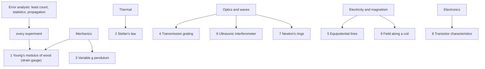
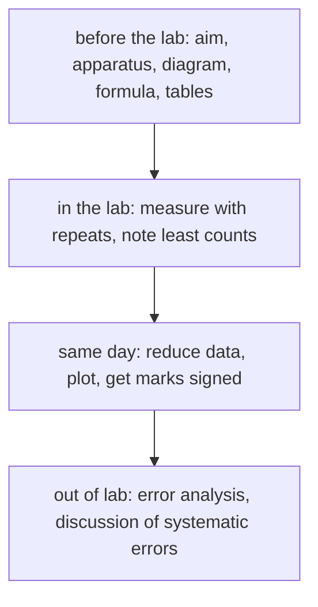

# Physics Laboratory I — Map of Content

Nine experiments in mechanics, thermal physics, optics, electricity, electronics and magnetism, plus a short course in error analysis. Each note turns the lab manual into: aim, theory, procedure, data reduction, a worked example, traps and viva questions. The manual and a slide deck on the grating experiment are PDFs in this folder.

> [!abstract] The lab in one line
> **Predict, measure with an honest uncertainty, plot, and compare with theory.** Marks reward preparation (aim, diagram, formula and tables written before you arrive), same-day completion and a correct error analysis.

## Course Overview
- **Course:** Physics Laboratory I (PH1030), Jan–May 2026, 0-0-0-3-1 (4 credits).
- **Format:** 9 experiments, each marked out of $30$ in-lab plus $10$ for out-of-lab work; the total is normalised to $75$, plus a $25$-mark end-semester practical.
- **Rules that cost marks:** coming unprepared; carrying record sheets out of the lab; not wearing shoes; leaving without returning the equipment.
- **Prerequisites:** [[Physics I - MOC]] for the theory; [[Error Analysis - Uncertainty and Propagation]] before the first session.

## Concept Map

## Main Spine

| # | Experiment | Measured quantity | Key formula |
|---|---|---|---|
| 1 | [[Lab - Young's Modulus of Wood by Strain Gauge]] | $Y$ from bridge voltage vs load | $Y=\dfrac{6gL\lambda RI}{bd^2(1+R/P)(dV/M)}$ |
| 2 | [[Lab - Stefan's Law (Hot Filament)]] | slope of $\log V_{TC}$ vs $\log T$ | $L=\sigma T^4$ |
| 3 | [[Lab - Variable g Pendulum]] | $g$, radius of gyration $K$ | $g=4\pi^2L/T^2,\ K=\sqrt{l_1l_2}$ |
| 4 | [[Lab - Transmission Grating]] | wavelengths of mercury lines | $d\sin\theta=m\lambda$ |
| 5 | [[Lab - Mapping Equipotential Lines]] | equipotentials, $V(\rho)$ | $V\propto\ln\rho$ |
| 6 | [[Lab - Ultrasonic Interferometer]] | sound speed, compressibility | $v=2fd,\ \beta=1/\rho v^2$ |
| 7 | [[Lab - Newton's Rings]] | wavelength of sodium light | $D_m^2=4m\lambda R$ |
| 8 | [[Lab - Transistor Characteristics]] | $\beta$, $R_{in}$, $R_{out}$ | $\beta=\Delta I_C/\Delta I_B$ |
| 9 | [[Lab - Magnetic Field along the Axis of a Coil]] | $B(x)$, $B_E$ | $B=B_E\tan\theta$ |

Skills: [[Error Analysis - Uncertainty and Propagation]].

## By Theme

### Theme 1 — Linearise, then read the slope
Almost every analysis plots one quantity against another so that a straight-line slope carries the answer: $\log V_{TC}$ vs $\log T$ (slope 4), $D^2$ vs $m$ (slope $4\lambda R$), $L$ vs $T^2$ (slope $g/4\pi^2$), $dV$ vs $M$, $\tan\theta$ vs $x$.

### Theme 2 — Waves and interference
[[Lab - Transmission Grating]], [[Lab - Newton's Rings]], [[Lab - Ultrasonic Interferometer]]: path difference $=$ whole number of wavelengths gives maxima.

### Theme 3 — Fields mapped by a probe
[[Lab - Mapping Equipotential Lines]], [[Lab - Magnetic Field along the Axis of a Coil]].

### Theme 4 — Sensors and transducers
Strain gauge and Wheatstone bridge, thermopile, piezoelectric crystal, transistor: [[Lab - Young's Modulus of Wood by Strain Gauge]], [[Lab - Stefan's Law (Hot Filament)]], [[Lab - Ultrasonic Interferometer]], [[Lab - Transistor Characteristics]].

## Good Practice for Graphs and Record Sheets

1. **Independent variable on the horizontal axis**, dependent on the vertical.
2. **Scale:** not so small that precision is lost, not so large that scatter is exaggerated; the origin need not be zero but must be marked.
3. **Caption every axis** with the standard name, symbol and unit, e.g. $P\ (10^4\ \mathrm{N/m^2})$; write $0.47$, not $.47$.
4. Scale numbers outside the axes; use powers of ten instead of long strings of zeroes.
5. Give the graph a title; draw a **best-fit line** with error bars where possible.
6. Before the session write the **aim, apparatus, diagram, formula and blank tables** on the record sheets.

## Cross-Domain Links
- [[Applied Mechanics Lab - MOC]]: the same uncertainty ideas apply to the beam, torsion and tensile experiments.
- [[Physics I - MOC]]: [[Simple Harmonic Motion]] and [[The Nonlinear Pendulum]] explain experiment 3; [[Conservative Forces, Gradient and Curl]] explains experiment 5.
- [[Measurements, Instrumentation and Control - MOC]]: sensors and signal conditioning, upcoming.

## Exam / Revision Map
- **Know cold:** the formula column in the table above, the list of mercury lines ($435.8$, $491.6$, $546.1$, $577.0$, $579.1$ nm), $\sigma=c/\sqrt{12}$, quadrature addition.
- **Commonly confused:** $R-R'=2\theta$ (not $\theta$) in the grating experiment; $D^2$ not $D$ for Newton's rings; $l$ measured to the centre of gravity, not the end of the rod; $\tan\theta$, not $\theta$, for the coil.
- **Viva themes:** why a half bridge, why $\pi$ phase shift, why an AC supply, why every third maximum, why a large $R$ lens.

## Study Progress
- [ ] Error analysis read and practised
- [ ] Experiments 1–3 prepared
- [ ] Experiments 4–6 prepared
- [ ] Experiments 7–9 prepared
- [ ] End-semester practical revision

## MOC Maintenance Rules
1. New experiment → one `Lab - …` note, listed in the table.
2. Illustrative numbers must stay labelled as illustrative; real measurements belong in your own record sheets.
3. Re-run `Tools/pl_figs.py` after changing a formula.

## Quick Navigation
- **Theory:** [[Physics I - MOC]] · **Skills:** [[Error Analysis - Uncertainty and Propagation]]
- **Back to:** [[Mechanical Engineering Curriculum - MOC]]
