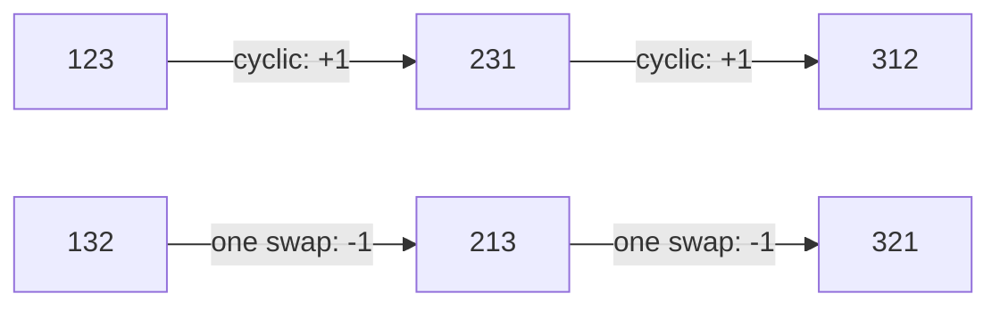
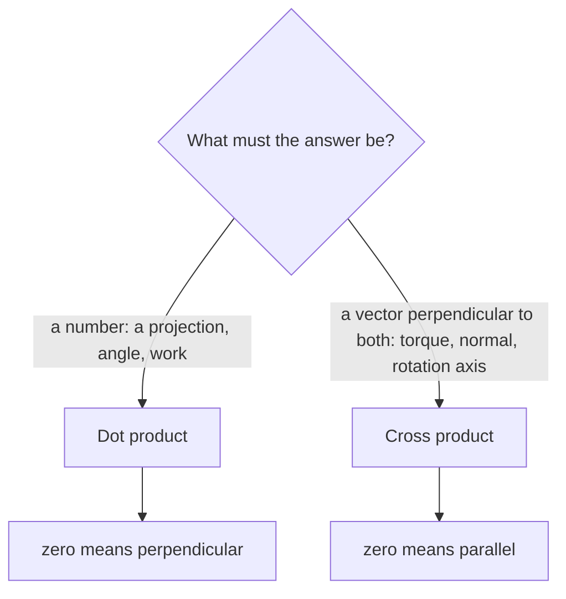

# Vectors - Dot and Cross Products

> [!abstract] The big idea
> Two ways to multiply vectors, each answering a different question. The **dot product** asks *"how much of $\mathbf v$ points along $\mathbf u$?"* and returns a number. The **cross product** asks *"what area do they span, and which way is the normal?"* and returns a vector. Almost every physical quantity in this course (work, torque, angular momentum, flux, circulation) is one of the two.

## Visual

![[PH-vec-dot-cross.png]]

**Figure:** Left, the dot product is the shadow of $\mathbf v$ on $\mathbf u$ times $|\mathbf u|$, so it is zero when they are perpendicular. Right, the cross product's magnitude is the parallelogram's area, so it is zero when they are parallel.

> [!question]- 🎯 Predict first: what are $\mathbf u\cdot\mathbf u$ and $\mathbf u\times\mathbf u$?
> $\mathbf u\cdot\mathbf u=u^2\cos 0=u^2$ (the squared length), and $\mathbf u\times\mathbf u=\mathbf 0$ because $\sin 0=0$: a vector spans no area with itself. If you said "both zero" you were mixing up the two products. That is the most common first slip.

## Two products side by side

| | Dot product $\mathbf u\cdot\mathbf v$ | Cross product $\mathbf u\times\mathbf v$ |
|---|---|---|
| Returns | scalar | vector |
| Geometric form | $uv\cos\theta$ | $uv\sin\theta\;\hat{\mathbf n}$ (right-hand rule) |
| Components | $u_xv_x+u_yv_y+u_zv_z$ | $(u_yv_z-u_zv_y,\;u_zv_x-u_xv_z,\;u_xv_y-u_yv_x)$ |
| Zero when | perpendicular | parallel |
| Swap the order | unchanged | sign flips |
| Physical uses | work $\mathbf F\cdot d\mathbf r$, power, flux $\mathbf F\cdot\hat{\mathbf n}\,dA$ | torque $\mathbf r\times\mathbf F$, angular momentum $\mathbf r\times\mathbf p$, magnetic force |

Determinant form of the cross product, which is the easiest way to remember the components:

$$\mathbf u\times\mathbf v=\begin{vmatrix}\hat{\mathbf x}&\hat{\mathbf y}&\hat{\mathbf z}\\u_x&u_y&u_z\\v_x&v_y&v_z\end{vmatrix}$$

## Index notation (the course's power tool)

Write $\mathbf u=u_i$ and sum over any index that appears twice (the **summation convention**). Two symbols do all the work:

- **Kronecker delta** $\delta_{ij}=1$ if $i=j$, else $0$. It says "the basis vectors are orthonormal": $\hat{\mathbf e}_i\cdot\hat{\mathbf e}_j=\delta_{ij}$. Then $\mathbf u\cdot\mathbf v=u_iv_i$.
- **Levi-Civita symbol** $\epsilon_{ijk}=+1$ for even permutations of $(1,2,3)$, $-1$ for odd, $0$ if any index repeats. Then $(\mathbf u\times\mathbf v)_i=\epsilon_{ijk}u_jv_k$.

The one identity worth memorising turns every triple product into algebra:

$$\epsilon_{ijk}\,\epsilon_{ilm}=\delta_{jl}\delta_{km}-\delta_{jm}\delta_{kl}\quad\Longrightarrow\quad \mathbf a\times(\mathbf b\times\mathbf c)=\mathbf b(\mathbf a\cdot\mathbf c)-\mathbf c(\mathbf a\cdot\mathbf b)$$

> [!tip]- 🧠 Memory hook for the identity
> "**BAC minus CAB**": the middle vector of the bracket comes first, multiplied by the dot of the other two. Check it with $\mathbf a=\hat x$, $\mathbf b=\hat x$, $\mathbf c=\hat y$: left side $\hat x\times(\hat x\times\hat y)=\hat x\times\hat z=-\hat y$; right side $\hat x(0)-\hat y(1)=-\hat y$. ✓

## Which product do I need?

## Common traps

> [!warning]- ⚠️ The cross product is neither commutative nor associative
> $\mathbf u\times\mathbf v=-\mathbf v\times\mathbf u$, and $(\mathbf a\times\mathbf b)\times\mathbf c\ne\mathbf a\times(\mathbf b\times\mathbf c)$. Always keep the bracket and the order.

> [!warning]- ⚠️ $\mathbf u\cdot\mathbf v=0$ does not force $\mathbf u=0$ or $\mathbf v=0$
> It also happens when they are perpendicular. Likewise $\mathbf u\cdot\mathbf v=\mathbf u\cdot\mathbf w$ does **not** imply $\mathbf v=\mathbf w$; you can cancel a number, never a vector.

## Worked example

> [!example]- 🔬 Given $\mathbf u=(1,2,2)$ and $\mathbf v=(2,-1,2)$: find the angle and the area they span
> **Dot:** $\mathbf u\cdot\mathbf v=2-2+4=4$. Both lengths are $\sqrt{1+4+4}=3$, so $\cos\theta=4/9$ and $\theta\approx63.6^\circ$.
>
> **Cross:** $\mathbf u\times\mathbf v=(2\cdot2-2\cdot(-1),\;2\cdot2-1\cdot2,\;1\cdot(-1)-2\cdot2)=(6,\,2,\,-5)$, so the area is $\sqrt{36+4+25}=\sqrt{65}\approx8.06$.
>
> **Check:** $|\mathbf u|^2|\mathbf v|^2-(\mathbf u\cdot\mathbf v)^2=81-16=65$ ✓ (this is $\sin^2\theta+\cos^2\theta=1$ in disguise). The cross product is also perpendicular to both: $(6,2,-5)\cdot(1,2,2)=0$ ✓.

## Quick quiz

> [!question]- Q1. A force $\mathbf F=(3,0,0)$ N moves a block along $\mathbf d=(2,2,0)$ m. How much work?
> $W=\mathbf F\cdot\mathbf d=6$ J. Only the component along the motion counts; the $y$-displacement costs nothing.

> [!question]- Q2. Which of $\mathbf a\cdot(\mathbf b\times\mathbf c)$ and $\mathbf a\times(\mathbf b\cdot\mathbf c)$ is meaningful?
> Only the first (the scalar triple product, the volume of the parallelepiped). In the second, $\mathbf b\cdot\mathbf c$ is a number, and a vector cannot be crossed with a number.

> [!question]- Q3. Why is $\epsilon_{ijk}$ zero when two indices match?
> Swapping the two equal indices must flip the sign and leave the symbol unchanged, so it can only be $0$. This is the same reason $\mathbf u\times\mathbf u=\mathbf 0$.

## Connections

### Prerequisites
- School vectors and trigonometry.

### Next
- [[Rotation Matrix and Vector Transformation]]: how the components change when the axes turn, and why dot and cross products do not.
- [[Newton's Laws as Differential Equations]]: $\mathbf F=m\ddot{\mathbf r}$ is a vector equation, so everything above applies.

### Cross-domain links
- [[Inner Product Spaces and Orthogonal Functions]]: the dot product is the inner product on $\mathbb R^3$; "orthogonal functions" are the same idea with integrals replacing sums.
- [[Rotating Vectors - Phasors, Velocity Polygons and Complex Kinematics]]: $\mathbf v=\boldsymbol\omega\times\mathbf r$ is the cross product at work.
- [[Velocity and Acceleration - Analytical Method]]: relative velocity in mechanisms uses the same cross product.

## Self-check
- [ ] I can state which product returns a scalar and which a vector without looking.
- [ ] I can compute both products from components and check them with $|\mathbf u|^2|\mathbf v|^2-(\mathbf u\cdot\mathbf v)^2$.
- [ ] I can use $\delta_{ij}$ and $\epsilon_{ijk}$ to prove BAC-CAB.

## Metadata
- **Status:** draft · **Type:** concept · **Difficulty:** beginner
- **Course map:** [[Physics I - MOC]]
