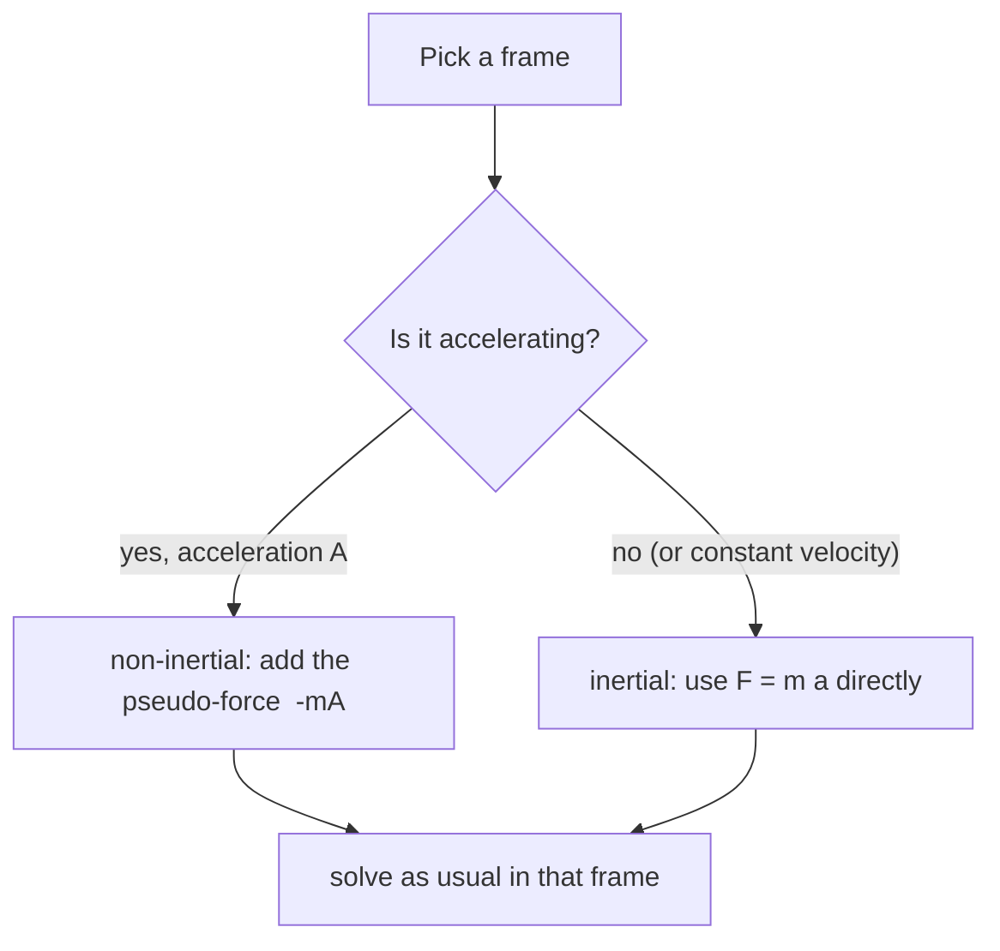

# Inertial and Non-Inertial Frames

> [!abstract] The big idea
> Newton's laws only hold as written in **inertial frames**, those that are not accelerating. In an accelerating frame you can still use $\mathbf F=m\ddot{\mathbf r}$ if you pay for it with an extra **pseudo-force** $-m\mathbf A$ pointing opposite to the frame's acceleration. It feels real (you are pushed back into the car seat) but it has no source: nobody is pushing.

## Visual

![[PH-frames-cart.png]]

**Figure:** A ball hanging from the roof of an accelerating cart. The ground observer sees the string pull the ball forward with the cart (no mystery). The cart observer sees the ball hang still with the string tilted back, and must invent a backward force $-m\mathbf A$ to explain why.

## Governing relation

Let frame $S$ accelerate with acceleration $\mathbf A=\dot{\mathbf V}$ relative to an inertial frame $S_0$. A particle at $\mathbf r_0(t)$ in $S_0$ and $\mathbf r(t)$ in $S$ has $\ddot{\mathbf r}_0=\ddot{\mathbf r}+\mathbf A$ (pure translation, no rotation). Since $m\ddot{\mathbf r}_0=\mathbf F$ is Newton's law in $S_0$:

$$\boxed{\,m\ddot{\mathbf r}=\mathbf F-m\mathbf A\,}$$

**Assumptions:** $S$ translates without rotating. A rotating frame adds Coriolis and centrifugal terms, which are not needed in this course.

> [!question]- 🎯 Predict first: in a lift that accelerates *upward* at $a$, does a scale under you read more or less than $mg$?
> More. In the lift's own frame the person is at rest and the pseudo-force $-ma$ points down, so $N-mg-ma=0$ and $N=m(g+a)$. At the top of a rollercoaster dip you feel heavy for exactly this reason. A free-falling lift ($a=-g$) reads $0$: weightlessness.

## Method

1. **Choose the frame** that makes the problem simplest (usually the accelerating one when something sits still in it).
2. **Find $\mathbf A$**, the acceleration of the *frame* relative to an inertial one.
3. **Draw the free-body diagram** with real forces plus $-m\mathbf A$.
4. **Apply $\sum\mathbf F=m\ddot{\mathbf r}$** in that frame.
5. **Check:** do the same problem in the ground frame once; the answers must agree.

## Common traps

> [!warning]- ⚠️ Pseudo-forces are not in action–reaction pairs
> Newton's third law relates *real* forces. $-m\mathbf A$ has no partner acting on another body. Do not draw a "reaction" to it.

> [!warning]- ⚠️ Using the pseudo-force *and* the ground frame together
> Pick one frame and stay in it. Adding $-m\mathbf A$ to an inertial-frame diagram double-counts the acceleration.

> [!danger]- 💥 "Centrifugal force pushes you out of the car on a bend"
> In the ground frame nothing pushes you outward; your body just tries to keep going straight while the door turns into you. The "force" only exists in the rotating frame of the car.

## Worked example

> [!example]- 🔬 A ball hangs from the roof of a cart accelerating at $A=2$ m/s². What angle does the string make with the vertical?
> In the cart frame the ball is at rest: tension $T$ balances gravity and the pseudo-force.
> Horizontal: $T\sin\alpha=mA$. Vertical: $T\cos\alpha=mg$.
> $\tan\alpha=A/g=2/9.81=0.204\Rightarrow\alpha\approx11.5^\circ$, with the ball lagging *behind* the direction of acceleration.
> **Ground-frame check:** the net force $T\sin\alpha$ gives the ball acceleration $A$ forward, so $T\sin\alpha=mA$ ✓. Same equation, no pseudo-force needed.

## Quick quiz

> [!question]- Q1. A coin rests on a table inside a train that brakes at $3$ m/s². What coefficient of static friction keeps it from sliding?
> In the train frame the pseudo-force is $m\cdot3$ forward; friction must balance it: $\mu_s\ge3/9.81=0.31$.

> [!question]- Q2. Is the Earth's surface an inertial frame?
> Only approximately. It rotates (once per day) and orbits the Sun; those accelerations are tiny compared with everyday forces, but they are why cyclones turn and Foucault's pendulum precesses.

## Connections

### Prerequisites
- [[Newton's Laws as Differential Equations]]
- [[Rotation Matrix and Vector Transformation]]

### Next
- [[Newton's Third Law and Momentum Conservation]]

### Cross-domain links
- [[Material Derivative and Fluid Acceleration]]: the "$\mathbf u\cdot\nabla\mathbf u$" term is acceleration measured in a frame that follows the fluid parcel.
- [[Gears, Transformers and Reflected Impedance]]: another case of "you can solve in whichever frame is easiest if you convert the load correctly".
- Equivalence principle: gravity and a pseudo-force from acceleration are locally indistinguishable (the starting point of general relativity).

## Self-check
- [ ] I can derive $m\ddot{\mathbf r}=\mathbf F-m\mathbf A$ in two lines.
- [ ] I can say which frame each of my free-body diagrams is drawn in.
- [ ] I can explain why "centrifugal force" is frame-dependent.

## Metadata
- **Status:** draft · **Type:** concept · **Difficulty:** beginner–intermediate
- **Course map:** [[Physics I - MOC]]
