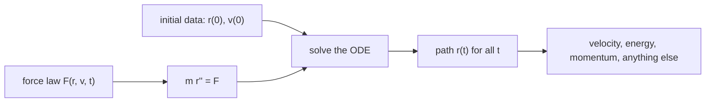

# Newton's Laws as Differential Equations

> [!abstract] The big idea
> $\mathbf F=m\ddot{\mathbf r}$ is not a formula to plug into, it is a **second-order differential equation** for the path $\mathbf r(t)$. Give it the force and *two* pieces of initial data (position and velocity) and the entire past and future are fixed. That is the clockwork universe, and it is also why every later topic in this course ends up as "solve an ODE".

> [!quote] 🕰️ Laplace, 1814
> An intelligence that knew the position and momentum of every particle "would embrace in a single formula the movements of the greatest bodies of the universe and those of the lightest atom; for it, nothing would be uncertain, and the future, like the past, would be present to its eyes."

## The three laws, restated for this course

| Law | Statement | What it really says |
|---|---|---|
| First | A particle with no net force moves at constant velocity | Defines **inertial frames**: where this is true |
| Second | $\mathbf F=\dot{\mathbf p}=m\ddot{\mathbf r}$ | The equation of motion; the content of mechanics |
| Third | $\mathbf F_{12}=-\mathbf F_{21}$ | Forces come in pairs; gives momentum conservation |

The model throughout is the **point particle**: mass with no size and no internal degrees of freedom. It is a convenient fiction that works whenever the object's rotation and shape do not matter.

## Visual

![[PH-newton-determinism.png]]

**Figure:** Left, one equation with three initial conditions gives three different futures. Right, the state "now" fixes the path both ways: run the equation backwards and you recover the past. The laws have no arrow of time.

## Solving the simplest case

For constant force $F_0$ along $x$, with $x(0)=x_0$ and $\dot x(0)=v_0$:

$$\ddot x=\frac{F_0}{m}\;\Rightarrow\;\dot x=v_0+\frac{F_0}{m}t\;\Rightarrow\;x=x_0+v_0t+\frac{F_0}{2m}t^2$$

Two integrations, two constants. Those constants are the initial conditions; nothing in the equation can supply them.

> [!question]- 🎯 Predict first: if the force depends on velocity, is the motion still determined by $x_0$ and $v_0$?
> Yes. $m\ddot x=F(x,\dot x,t)$ is still second order, so two numbers still fix the solution. What changes is that you can no longer integrate twice by hand, and that time reversal may fail (friction is the classic case: you cannot unscramble an egg, and $\dot x\to-\dot x$ does not undo drag).

## Common traps

> [!warning]- ⚠️ $\mathbf F=m\mathbf a$ is not a definition of force
> It is a *law* once you have an independent force law ($-kx$, $-mg\hat z$, $-GMm\hat r/r^2$). Writing "$F=ma$" and then not knowing $F$ is how an ODE problem stalls.

> [!warning]- ⚠️ Mixing up weight and mass
> Mass (kg) is inertia and never changes. Weight $m\mathbf g$ (N) is one particular force. On the Moon your weight drops six-fold; your mass does not.

> [!tip]- 🧠 Always ask: what are the two constants?
> Before solving any mechanics problem, count the initial conditions the question hands you. If you cannot find two (for a 1-D problem), either you are missing data or the problem is quietly a boundary-value problem.

## Worked example

> [!example]- 🔬 A $2$ kg block starts at $x=1$ m with $v=2$ m/s under a constant force $4$ N. Where is it at $t=3$ s, and where was it at $t=-1$ s?
> $F_0/m=2$ m/s². Then $x(t)=1+2t+t^2$.
> $x(3)=1+6+9=16$ m. $x(-1)=1-2+1=0$ m (it passed through the origin one second earlier).
> **Check:** $v(t)=2+2t$, so $v(-1)=0$: at $t=-1$ it was momentarily at rest at $x=0$, exactly the vertex of the red parabola in the figure.

## Quick quiz

> [!question]- Q1. How many initial conditions does a 3-D single particle need?
> Six: three position and three velocity components. This is the dimension of its **phase space** (see [[Phase Space and Phase Portraits]]).

> [!question]- Q2. Newton's second law is often written $\mathbf F=\dot{\mathbf p}$. When does that differ from $m\ddot{\mathbf r}$?
> When mass changes (a rocket burning fuel, a raindrop collecting water). Then $\dot{\mathbf p}=m\dot{\mathbf v}+\dot m\mathbf v$.

## Connections

### Prerequisites
- [[Vectors - Dot and Cross Products]]

### Related
- [[Inertial and Non-Inertial Frames]]: the first law as the *definition* of the frames where the second law is valid.
- [[Newton's Second Law in Polar Coordinates]]: the same ODE when Cartesian axes are the wrong choice.
- [[Euler-Lagrange Equations]]: the same ODE derived from one scalar instead of three force components.

### Cross-domain links
- [[2nd Order Linear ODE with Constant Coefficients]]: for $F=-kx$ this equation *is* that ODE.
- [[Existence, Uniqueness, and Fundamental Sets]]: the mathematical reason two initial conditions pick exactly one trajectory.
- [[Fluid Mechanics - MOC]] (see [[Lagrangian and Eulerian Descriptions]]): following a particle is exactly this equation applied to a fluid parcel.

## Self-check
- [ ] I can write $\mathbf F=m\ddot{\mathbf r}$ as an ODE and name its two integration constants.
- [ ] I can solve the constant-force case forwards *and* backwards in time.
- [ ] I can say why a velocity-dependent force breaks time reversal.

## Metadata
- **Status:** draft · **Type:** concept · **Difficulty:** beginner
- **Course map:** [[Physics I - MOC]]
