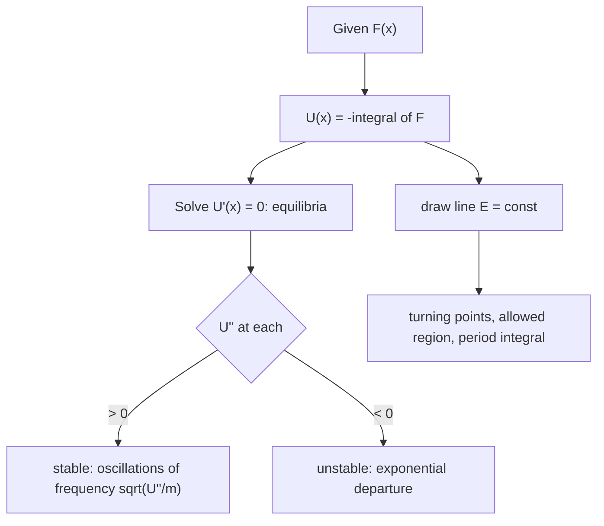

# Energy and Equilibrium in One Dimension

> [!abstract] The big idea
> In one dimension a force that depends only on position always has a potential energy $U(x)$, and then **one curve tells you everything**: where the particle can go (where $E\ge U$), where it must turn around, where it can rest, and whether that rest is stable. You can read the whole motion off the graph before solving anything.

## Governing relations

**Work–energy theorem** (from $m\ddot x=F$, multiply by $\dot x$ and integrate): the net work equals the change in kinetic energy,

$$W_{1\to2}=\int_{x_1}^{x_2}F\,dx=\tfrac12mv_2^2-\tfrac12mv_1^2$$

If $F=F(x)$ define $U(x)=-\int_{x_0}^{x}F\,dx'$, i.e. $F=-dU/dx$. Then

$$E=\tfrac12m\dot x^2+U(x)=\text{const}\;\Longrightarrow\;\dot x=\pm\sqrt{\tfrac{2}{m}\big(E-U(x)\big)}$$

- **Allowed region:** $E\ge U(x)$ (kinetic energy cannot be negative).
- **Turning points:** $U(x_\pm)=E$, where $\dot x=0$ and the particle reverses.
- **Period of bounded motion:** $T=2\displaystyle\int_{x_-}^{x_+}\frac{dx}{\sqrt{(2/m)(E-U)}}$.
- **Equilibrium:** $U'(x_0)=0$. **Stable** if $U''(x_0)>0$ (a valley), **unstable** if $U''(x_0)<0$ (a hilltop).
- **Small oscillations about a stable point:** $\omega^2=U''(x_0)/m$.

## Visual

![[PH-potential-1d.png]]

**Figure:** An asymmetric double well. Green dots are stable (valley floors), the red dot is unstable (the hump between). $E_1$ traps the particle in the deep well between its turning points. $E_2$ lets it cross the hump and roam both wells; $E_3$ lets it reach the whole plotted range.

> [!question]- 🎯 Predict first: sketch what a ball does on a hill-and-valley track if released from rest on the *left* shoulder of the hump
> It rolls down into the left well, climbs the other side to the *same height* it started at (energy conserved, no friction), and returns. It never reaches the right well because $E<U_{\rm hump}$.

## Method

1. **Get $U(x)$** by integrating $-F$ (choose the zero where convenient).
2. **Sketch it** and mark all $U'=0$ points.
3. **Classify each** with $U''$: $>0$ stable, $<0$ unstable (if $U''=0$ look at higher derivatives).
4. **For a given $E$** draw the horizontal line: allowed regions, turning points.
5. **Period / frequency:** small oscillation $\omega=\sqrt{U''/m}$; large amplitude needs the integral.
6. **Check:** $E\ge U_{\min}$; the period formula must give $2\pi\sqrt{m/k}$ when $U=\tfrac12kx^2$.

## Common traps

> [!warning]- ⚠️ Using $E=\tfrac12mv^2+U$ with friction
> It is conserved only if every force is conservative. With friction, $E$ decreases along the path and the particle ends at the bottom of a well.

> [!warning]- ⚠️ Calling any $U'=0$ point "stable"
> A hilltop is also a point of zero force. Only $U''>0$ makes small displacements come back.

> [!danger]- 💥 $U''(x_0)=0$ does not mean "marginal and fine"
> It means the test is inconclusive: $U=x^3$ at $0$ is unstable on one side and $U=x^4$ is stable. Go to the next nonzero derivative.

## Worked example

> [!example]- 🔬 $U=\tfrac14x^4-\tfrac12x^2$ with $m=1$. Find the equilibria, classify them and the small-oscillation period at $x=1$
> $U'=x^3-x=x(x^2-1)=0\Rightarrow x=0,\pm1$. $U''=3x^2-1$.
> At $x=0$: $U''=-1<0$ **unstable**, $U(0)=0$. At $x=\pm1$: $U''=2>0$ **stable**, $U(\pm1)=-\tfrac14$.
> Small oscillations about $x=1$: $\omega=\sqrt{2}$ rad/s, $T=2\pi/\sqrt2=4.44$ s.
> A particle with $E=-0.1$ is trapped in one well (needs $E\ge0$ to cross the hump). **Check:** the barrier height is $U(0)-U(1)=\tfrac14$, so any $E>0$ crosses ✓.

## Quick quiz

> [!question]- Q1. A force $F=-\alpha x^3$ acts on a mass. Is the period independent of amplitude?
> No. $U=\tfrac14\alpha x^4$ is flatter than a parabola near $0$ and steeper far away; larger amplitude gives higher speeds and a *shorter* period ($T\propto1/A$). Only the parabola gives an energy-independent period.

> [!question]- Q2. Where on the potential curve is the kinetic energy greatest?
> At the bottom of the well, where $U$ is smallest.

## Connections

### Prerequisites
- [[Newton's Laws as Differential Equations]], [[Simple Harmonic Motion]]

### Next
- [[Phase Space and Phase Portraits]]: the same information as a picture in the $(x,\dot x)$ plane.
- [[Conservative Forces, Gradient and Curl]]: $F=-dU/dx$ becomes $\mathbf F=-\nabla U$ in 3-D.

### Cross-domain links
- [[Energy Methods - A Unified View]]: minimum potential energy defines stable structural equilibrium, the same $U''>0$ test.
- [[Euler Buckling of Columns]]: loss of stability is $U''$ changing sign as the load rises.
- [[Strain Energy and Castigliano's Theorem]]: strain energy is the potential $U$ of an elastic body.

## Self-check
- [ ] I can find and classify equilibria from $U(x)$.
- [ ] I can read turning points and the allowed region from a graph.
- [ ] I can write the period integral and recover $2\pi\sqrt{m/k}$ from it.

## Metadata
- **Status:** draft · **Type:** concept · **Difficulty:** intermediate
- **Course map:** [[Physics I - MOC]]
