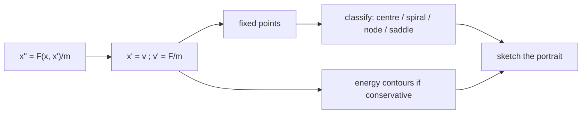

# Phase Space and Phase Portraits

> [!abstract] The big idea
> Instead of plotting position against time, plot position against velocity. The state of a 1-D particle is *one point* $(x,\dot x)$ in the **phase plane**, and its whole life is a curve through that plane. Trajectories never cross (the state determines the future), so a handful of curves, one through every point, forms a **portrait** that shows every possible motion at once without solving anything.

## Linear systems: four portraits

![[PH-phase-linear.png]]

**Figure:** The same oscillator with increasing damping, $\beta/\omega_0=0,\ 0.2,\ 1,\ 2$. Undamped: closed ellipses around a centre. Underdamped: spirals into the origin. Critical and overdamped: nodes where all paths flow straight into the origin, never crossing the axis more than once.

For the undamped oscillator, $E=\tfrac12m\dot x^2+\tfrac12m\omega_0^2x^2$ is constant, so each trajectory is the ellipse

$$\frac{x^2}{A^2}+\frac{\dot x^2}{(A\omega_0)^2}=1,\qquad\text{area }=\pi A\cdot A\omega_0=\frac{2\pi E}{m\omega_0}$$

and the motion is **clockwise**: above the axis $\dot x>0$ so $x$ increases, below it $x$ decreases. Each ellipse is an energy contour; the starting point only chooses which ellipse and where on it.

> [!question]- 🎯 Predict first: a damped oscillator's trajectory spirals inward. Which way, and does it ever reach the origin?
> Clockwise like the undamped ellipses, and it approaches the origin as $t\to\infty$ without ever arriving: the energy $E$ shrinks like $e^{-2\beta t}$ but never reaches zero. The origin is an **attractor** (a stable fixed point).

## Anatomy of any portrait

| Feature | Looks like | Means | 1-D condition |
|---|---|---|---|
| **Fixed point** | a single dot | equilibrium, $F=0$, $\dot x=0$ | $U'(x_0)=0$ |
| **Centre** | closed loops around a dot | stable, conservative oscillation | $U''>0$, no damping |
| **Saddle** (X) | paths approach then leave | unstable equilibrium | $U''<0$ |
| **Attractor / sink** | spiral or node into a dot | stable with damping | $U''>0$ plus friction |
| **Closed orbit** | isolated loop | periodic motion, $x(t+T)=x(t)$ | bounded energy |
| **Separatrix** | a curve through a saddle | divides qualitatively different motions | $E=U_{\rm saddle}$ |

## Reading a potential as a portrait

![[PH-double-well.png]]

**Figure:** The double well $U=\tfrac14x^4-\tfrac12x^2$ and its portrait. Energy contours $\tfrac12\dot x^2+U=E$ are the trajectories. The red figure-eight is the separatrix $E=0$: inside, the particle is trapped in one well (two small loops around the centres); outside, it circles both. The saddle at the origin is the top of the hump.

## Method

1. **Write the second-order equation as two first-order ones:** $\dot x=v,\ \dot v=F(x,v)/m$.
2. **Find the fixed points:** $v=0$ and $F(x,0)=0$.
3. **Linearise at each point** (or check $U''$) to classify it as centre, node, spiral or saddle.
4. **Add energy contours** $E=\tfrac12mv^2+U$ for a conservative system.
5. **Add arrows:** clockwise for $v>0\Rightarrow x$ increases.
6. **Check:** paths must not cross; closed loops only when no damping.

## Common traps

> [!warning]- ⚠️ Using $\dot x$ on the vertical axis for some problems and $p=m\dot x$ for others
> The shapes are the same up to scaling, but areas then mean different things. Use $p$ when you want area $=$ action.

> [!warning]- ⚠️ Expecting closed loops in a damped system
> Damping drains energy, so paths spiral. A closed loop plus damping appears only with a *driver* that refills the energy: the limit cycle in [[Driven Oscillations and Resonance]].

> [!tip]- 🧠 Why trajectories cannot cross
> A crossing point would have two possible futures from the same $(x,\dot x)$, contradicting the uniqueness of the solution of the ODE (see [[Existence, Uniqueness, and Fundamental Sets]]). The only meeting points are fixed points, reached only after infinite time.

## Worked example

> [!example]- 🔬 Draw the portrait of $\ddot x=-x-0.4\dot x$ by finding its fixed point and type
> $\ddot x+0.4\dot x+x=0$ so $\omega_0=1$, $\beta=0.2<1$: **underdamped**. The only fixed point is $(0,0)$, a **stable spiral**; roots $-0.2\pm0.98i$.
> Each turn the amplitude shrinks by $e^{-\beta T}=e^{-0.2\cdot6.4}=0.28$.
> **Check:** the spiral turns *clockwise*, and after each full turn it returns to the positive $x$-axis at $0.28\times$ the previous amplitude ✓ (second panel of the figure).

## Quick quiz

> [!question]- Q1. What does a closed loop in the portrait tell you about the motion in time?
> It is periodic: the particle returns to the same $(x,\dot x)$, so $x(t+T)=x(t)$. The loop's area is the "action" and, for SHM, $2\pi E/\omega$.

> [!question]- Q2. At a saddle point, why can a trajectory sit exactly on it?
> It is an equilibrium (zero force). But the slightest push sends it away along the unstable direction, so it is unstable in practice.

## Connections

### Prerequisites
- [[Energy and Equilibrium in One Dimension]], [[Damped Oscillations]]

### Next
- [[The Nonlinear Pendulum]]: the full portrait of a real system with a separatrix.
- [[Euler-Lagrange Equations]]: in Lagrangian mechanics $(q,p)$ is the natural phase space.

### Cross-domain links
- [[The Universal Second-Order Linear System]] and [[Series RLC Natural Response - Damping Cases]]: poles in the left half-plane are exactly the spirals and nodes here.
- [[Eigenvalues, Rotation and Diagonalization Everywhere]]: the type of fixed point is read from the eigenvalues of the linearised system (complex $\to$ spiral, real same-sign $\to$ node, real opposite-sign $\to$ saddle).
- [[Resonance and Buckling - Instability as an Eigenvalue Problem]]: instability is an eigenvalue crossing into the right half-plane.

## Self-check
- [ ] I can turn a second-order ODE into a phase-plane system.
- [ ] I can sketch centre, spiral, node and saddle portraits and name each from the roots.
- [ ] I can read bounded vs unbounded motion from the energy contours.

## Metadata
- **Status:** draft · **Type:** concept · **Difficulty:** intermediate
- **Course map:** [[Physics I - MOC]]
