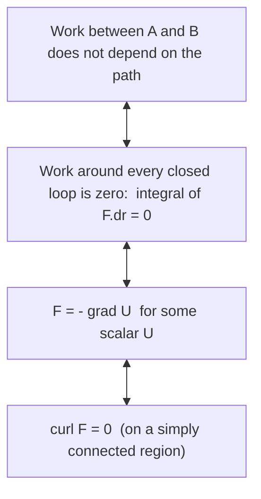

# Conservative Forces, Gradient and Curl

> [!abstract] The big idea
> In three dimensions a force is a *field* $\mathbf F(\mathbf r)$, and the work it does is a line integral that normally depends on the path. A force is **conservative** when the work depends only on the endpoints. Four statements then become one: path-independence, zero work around any closed loop, $\mathbf F=-\nabla U$ for some potential, and $\nabla\times\mathbf F=\mathbf 0$. The curl is the cheap test, the gradient is how you build the potential.

## The four-way equivalence

**Work–energy theorem in 3-D:** $W=\int_1^2\mathbf F\cdot d\mathbf r=\tfrac12mv_2^2-\tfrac12mv_1^2$ holds for *any* force. If $\mathbf F=-\nabla U$, then $W=U_1-U_2$ and $E=\tfrac12mv^2+U$ is conserved.

## The gradient

![[PH-grad-contours.png]]

**Figure:** For $f=xe^{-x^2-y^2}$ (a hill and a valley), the arrows of $\nabla f$ are everywhere perpendicular to the level curves and point uphill. Right, the slope along a direction at angle $\alpha$ to $\nabla f$ is $|\nabla f|\cos\alpha$: steepest along the gradient, zero along a contour.

$$\nabla f=\Big(\frac{\partial f}{\partial x},\frac{\partial f}{\partial y},\frac{\partial f}{\partial z}\Big),\qquad D_{\hat{\mathbf u}}f=\nabla f\cdot\hat{\mathbf u},\qquad \mathbf F=-\nabla U$$

Force is *minus* the gradient: it points **downhill** on the potential-energy landscape.

> [!question]- 🎯 Predict first: at a point on a contour line of $U$, which way is the force relative to the contour?
> Perpendicular to it, pointing towards lower $U$. Equipotential lines and force lines cross at right angles, just like contours and the steepest path on a hiking map.

## The curl test

![[PH-curl-fields.png]]

**Figure:** Left, $\mathbf F=(y,x)=\nabla(xy)$ is conservative: the circulation around the red square is $0$. Right, $\mathbf F=(-y,x)$ swirls: its circulation around the same square is $2.88=2\times\text{area}$, so no potential exists.

$$\nabla\times\mathbf F=\begin{vmatrix}\hat{\mathbf x}&\hat{\mathbf y}&\hat{\mathbf z}\\\partial_x&\partial_y&\partial_z\\F_x&F_y&F_z\end{vmatrix}=\Big(\frac{\partial F_z}{\partial y}-\frac{\partial F_y}{\partial z},\ \frac{\partial F_x}{\partial z}-\frac{\partial F_z}{\partial x},\ \frac{\partial F_y}{\partial x}-\frac{\partial F_x}{\partial y}\Big)$$

Curl measures local swirl. In 2-D only the $z$-component survives: $\partial_xF_y-\partial_yF_x$.

![[PH-work-paths.png]]

**Figure:** Work from $(0,0)$ to $(1,1)$ by two paths. For the conservative force both paths give $W=1$. For $(-y,x)$ the diagonal gives $0$ and the L-shaped path gives $1$: the answer depends on the route.

## Method

1. **Test for conservativeness:** compute $\nabla\times\mathbf F$ (all three components). If it is $\mathbf0$ on a region with no holes, the force is conservative.
2. **Build the potential:** integrate $F_x=-\partial U/\partial x$ in $x$, then fix the "constant" (a function of $y,z$) with $F_y$, then $F_z$.
3. **Work between two points:** $W=U_1-U_2$, no path needed.
4. **If not conservative:** parameterise the actual path $\mathbf r(t)$ and compute $\int\mathbf F\cdot\dot{\mathbf r}\,dt$.
5. **Check:** differentiate $-\nabla U$ and recover $\mathbf F$.

## Common traps

> [!warning]- ⚠️ A zero curl is not enough if the region has a hole
> The vortex $\mathbf F=(-y,x)/(x^2+y^2)$ has $\nabla\times\mathbf F=0$ everywhere except the origin, yet its circulation around the origin is $2\pi$. The condition needs a *simply connected* region (no hole to loop around).

> [!warning]- ⚠️ Forgetting the minus sign in $\mathbf F=-\nabla U$
> The force points *down* the potential. A positive-gradient force means you wrote $U$ with the wrong sign.

> [!danger]- 💥 "Friction is conservative because it depends only on position"
> Friction opposes the *velocity*, so its work depends on path length, not endpoints. It is a textbook non-conservative force; $\oint\mathbf F\cdot d\mathbf r<0$.

## Worked example

> [!example]- 🔬 Show $\mathbf F=(2xy+z^2,\;x^2,\;2xz)$ is conservative, find $U$, and the work from $(0,0,0)$ to $(1,2,3)$
> **Curl:** $\partial_yF_z-\partial_zF_y=0-0=0$; $\ \partial_zF_x-\partial_xF_z=2z-2z=0$; $\ \partial_xF_y-\partial_yF_x=2x-2x=0$ ✓.
> **Potential:** $-\partial_xU=2xy+z^2\Rightarrow U=-(x^2y+xz^2)+g(y,z)$. Then $-\partial_yU=x^2$ matches with $g'_y=0$, and $-\partial_zU=2xz$ matches with $g'_z=0$. So $U=-(x^2y+xz^2)$.
> **Work:** $U(0)=0$ and $U(1,2,3)=-(2+9)=-11$, so $W=U_1-U_2=0-(-11)=\mathbf{11}$ (in the units of $\mathbf F$ times length).
> **Check:** $-\nabla U=(2xy+z^2,\,x^2,\,2xz)$ ✓.

## Quick quiz

> [!question]- Q1. Compute $\nabla f$ for $f=x^2y$ at $(1,2)$ and the slope along $(3,4)/5$
> $\nabla f=(2xy,\,x^2)=(4,1)$, $|\nabla f|=\sqrt{17}=4.12$. Slope along $\hat u$: $(4\cdot3+1\cdot4)/5=3.2$.

> [!question]- Q2. Is a uniform gravitational field $\mathbf F=(0,0,-mg)$ conservative? What is $U$?
> Yes (curl is zero). $U=mgz$ gives $-\nabla U=(0,0,-mg)$ ✓.

> [!question]- Q3. Why does a conservative force do zero net work on a particle that returns to its start?
> Work depends only on endpoints, and here they coincide, so $W=U_1-U_1=0$.

## Connections

### Prerequisites
- [[Vectors - Dot and Cross Products]], [[Energy and Equilibrium in One Dimension]]

### Next
- [[Curvilinear Coordinates - Cylindrical and Spherical]]: write $\nabla$ and $d\mathbf r$ in coordinates adapted to the problem.
- [[Stokes' Theorem and Circulation]]: the integral version of the curl test.
- [[Euler-Lagrange Equations]]: $U$ is the only force information the Lagrangian needs.

### Cross-domain links
- [[Fluids and Solids - Pressure, Stress and Constitutive Laws]]: pressure gradient force per unit volume is $-\nabla p$, the same "force = minus gradient".
- [[Incompressible Inviscid Flow and Bernoulli - Formula Bank]]: Bernoulli's equation is energy conservation along a streamline, valid because pressure forces derive from a potential-like head.
- [[Conservation Laws and Flow Networks]]: conservative fields and path-independence also describe electrostatic potential (voltage differences in circuits).

## Self-check
- [ ] I can compute $\nabla f$ and a directional derivative.
- [ ] I can apply the curl test, then build $U$ by successive integration.
- [ ] I can explain why friction and the vortex field are not conservative.

## Metadata
- **Status:** draft · **Type:** concept · **Difficulty:** intermediate
- **Course map:** [[Physics I - MOC]]
