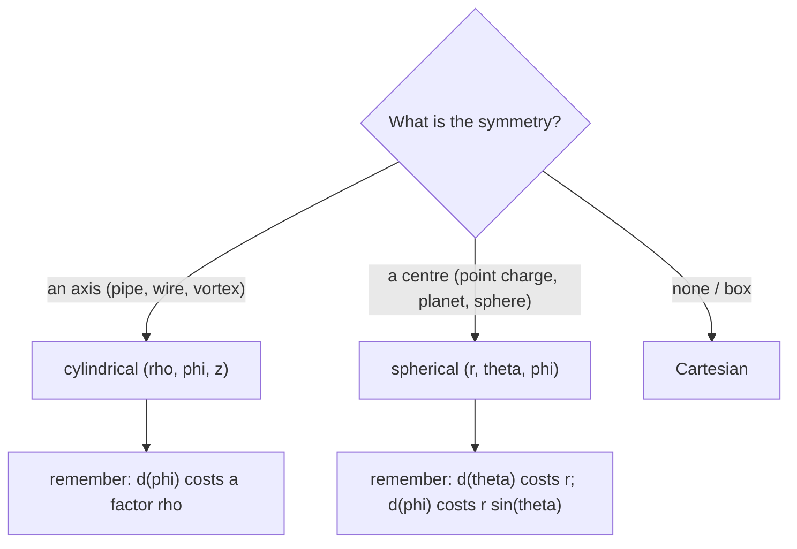

# Curvilinear Coordinates - Cylindrical and Spherical

> [!abstract] The big idea
> Match the coordinates to the symmetry. A problem with an axis wants **cylindrical** $(\rho,\phi,z)$; a problem with a centre wants **spherical** $(r,\theta,\phi)$. In both, the unit vectors change direction from point to point, so the line element, volume element, gradient and kinetic energy each pick up **scale factors**. (This topic is examined in the end-semester only.)

## Visual

![[PH-coords-cylindrical.png]]

**Figure:** Cylindrical: $\rho$ is the distance from the $z$-axis, $\phi$ the angle around it, $z$ the height. The unit vectors $\hat\rho,\hat\phi,\hat z$ at the point are mutually perpendicular but $\hat\rho$ and $\hat\phi$ point in different directions at different $\phi$.

![[PH-coords-spherical.png]]

**Figure:** Spherical: $r$ is the distance from the origin, $\theta$ the **polar angle** measured down from $+z$, $\phi$ the **azimuth** measured around from $+x$. Note that conventions swap $\theta$ and $\phi$ in some books; this course uses the pair shown.

## Everything in one table

| | Cartesian | Cylindrical | Spherical |
|---|---|---|---|
| Coordinates | $x,y,z$ | $\rho,\phi,z$ | $r,\theta,\phi$ |
| Conversion | | $x=\rho\cos\phi,\ y=\rho\sin\phi$ | $x=r\sin\theta\cos\phi,\ y=r\sin\theta\sin\phi,\ z=r\cos\theta$ |
| Line element $d\mathbf r$ | $dx\,\hat x+dy\,\hat y+dz\,\hat z$ | $d\rho\,\hat\rho+\rho\,d\phi\,\hat\phi+dz\,\hat z$ | $dr\,\hat r+r\,d\theta\,\hat\theta+r\sin\theta\,d\phi\,\hat\phi$ |
| Volume element $dV$ | $dx\,dy\,dz$ | $\rho\,d\rho\,d\phi\,dz$ | $r^2\sin\theta\,dr\,d\theta\,d\phi$ |
| Gradient $\nabla f$ | $\partial_xf,\partial_yf,\partial_zf$ | $\partial_\rho f,\ \dfrac1\rho\partial_\phi f,\ \partial_zf$ | $\partial_rf,\ \dfrac1r\partial_\theta f,\ \dfrac{1}{r\sin\theta}\partial_\phi f$ |
| Velocity | $\dot x,\dot y,\dot z$ | $\dot\rho,\ \rho\dot\phi,\ \dot z$ | $\dot r,\ r\dot\theta,\ r\sin\theta\,\dot\phi$ |
| Kinetic energy $T$ | $\tfrac12m(\dot x^2+\dot y^2+\dot z^2)$ | $\tfrac12m(\dot\rho^2+\rho^2\dot\phi^2+\dot z^2)$ | $\tfrac12m(\dot r^2+r^2\dot\theta^2+r^2\sin^2\theta\,\dot\phi^2)$ |

**Where the factors come from:** moving $d\phi$ at distance $\rho$ travels an arc $\rho\,d\phi$; moving $d\theta$ at radius $r$ travels $r\,d\theta$; moving $d\phi$ at radius $r$ and polar angle $\theta$ travels $r\sin\theta\,d\phi$ because the circle of latitude has radius $r\sin\theta$. Everything else follows by multiplying the three small edges.

> [!question]- 🎯 Predict first: what is the volume of a ball of radius $R$ in spherical coordinates, and why does the integral separate?
> $V=\int_0^R r^2\,dr\int_0^\pi\sin\theta\,d\theta\int_0^{2\pi}d\phi=\tfrac{R^3}{3}\cdot2\cdot2\pi=\tfrac43\pi R^3$. It separates because the limits are constants and the integrand is a product, which is the reason spherical coordinates were chosen.

## Method

1. **Choose the system** from the symmetry (axis $\to$ cylindrical, centre $\to$ spherical).
2. **Write the position vector** and the line element $d\mathbf r$ using the table.
3. **Build what you need:** $dV$ for integrals, $T$ for energy or Lagrangians, $\nabla f$ for forces.
4. **Express the unit vectors** in Cartesian if you must add vectors from different points.
5. **Check:** a coordinate that is constant by symmetry should drop out of everything.

## Common traps

> [!warning]- ⚠️ Forgetting $\sin\theta$ in $dV$ or in $\dot\phi$ terms
> The volume element is $r^2\sin\theta\,dr\,d\theta\,d\phi$; dropping the $\sin\theta$ gives wrong volumes and wrong energies.

> [!warning]- ⚠️ Swapping $\theta$ and $\phi$
> Physics convention (used here): $\theta$ is the polar angle from $z$ ($0\le\theta\le\pi$). Maths books often reverse it. Always check which angle carries the $\sin$.

> [!danger]- 💥 Differentiating unit vectors as if they were constant
> $\hat r,\hat\theta,\hat\phi,\hat\rho$ change with position, so $\partial\hat\phi/\partial\phi=-\hat\rho$ is not zero. This is why $\nabla\cdot\mathbf A$ and $\nabla\times\mathbf A$ have extra terms, and why the acceleration has $-r\dot\phi^2$.

## Worked example

> [!example]- 🔬 Find the force from $U=-k/r$ and the speed-squared in spherical coordinates for motion at constant $r=R$
> $U$ depends only on $r$: $\mathbf F=-\nabla U=-\partial_rU\,\hat r=-\dfrac{k}{r^2}\hat r$, a central attractive force (gravity or Coulomb).
> At constant $r=R$: $v^2=R^2\dot\theta^2+R^2\sin^2\theta\,\dot\phi^2$. For a circular path in the equatorial plane ($\theta=\pi/2$, $\dot\theta=0$) this is $v=R\dot\phi$.
> **Check:** $\partial_\theta U=\partial_\phi U=0$, so the force has no $\hat\theta,\hat\phi$ components ✓.

## Quick quiz

> [!question]- Q1. What is the surface area element on a sphere of radius $R$?
> $dS=R^2\sin\theta\,d\theta\,d\phi$ (set $dr=0$ in the volume element). Total $=4\pi R^2$.

> [!question]- Q2. Convert $(x,y,z)=(1,1,\sqrt2)$ to spherical.
> $r=\sqrt{1+1+2}=2$, $\cos\theta=\sqrt2/2\Rightarrow\theta=45^\circ$, $\phi=\arctan(1/1)=45^\circ$.

## Connections

### Prerequisites
- [[Rotation Matrix and Vector Transformation]], [[Newton's Second Law in Polar Coordinates]], [[Conservative Forces, Gradient and Curl]]

### Next
- [[Euler-Lagrange Equations]]: write $T$ in the coordinates that fit the problem and never touch a force vector.
- [[Divergence Theorem and Flux]]: divergence and flux in these coordinates.

### Cross-domain links
- [[Bessel's Equation and Bessel Functions of the First Kind]]: separating the Laplacian in cylindrical coordinates is what produces Bessel's equation.
- [[Legendre Polynomials and Rodrigues' Formula]]: separating it in spherical coordinates produces Legendre's equation.
- [[Laplace Equation on Rectangles and Strips]]: the same equation in Cartesian coordinates, for comparison.

## Self-check
- [ ] I can draw both systems and name every angle.
- [ ] I can write $d\mathbf r$, $dV$ and $T$ in each system.
- [ ] I can choose a system from a problem's symmetry.

## Metadata
- **Status:** draft · **Type:** concept · **Difficulty:** intermediate
- **Course map:** [[Physics I - MOC]]
