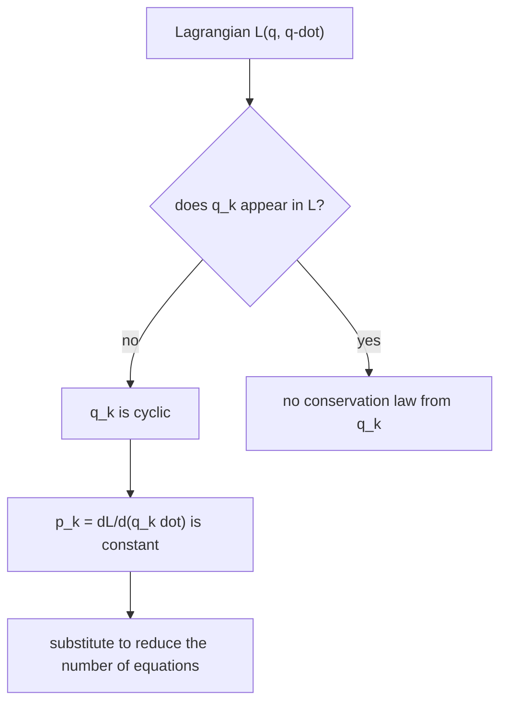

# Cyclic Coordinates and Conservation Laws

> [!abstract] The big idea
> If the Lagrangian does not contain a coordinate $q_k$ (only its velocity), then the conjugate momentum $p_k=\partial\mathcal L/\partial\dot q_k$ is **constant**. A missing coordinate means the system looks the same if you shift $q_k$: a *symmetry*. So every symmetry of the Lagrangian hands you a conservation law for free (this is Noether's theorem in its simplest form).

## Governing relation

Euler–Lagrange for coordinate $q_k$: $\dfrac{d}{dt}\dfrac{\partial\mathcal L}{\partial\dot q_k}=\dfrac{\partial\mathcal L}{\partial q_k}$. If $\partial\mathcal L/\partial q_k=0$ ($q_k$ is **cyclic**), then

$$\boxed{\;p_k=\frac{\partial\mathcal L}{\partial\dot q_k}=\text{const}\;}$$

| Symmetry (invariance under) | Cyclic coordinate | Conserved quantity |
|---|---|---|
| Shifting along a direction | Cartesian $x$ | linear momentum $p_x=m\dot x$ |
| Rotating about an axis | an angle $\phi$ | angular momentum $p_\phi=mr^2\dot\phi$ |
| Shifting in time ($\partial\mathcal L/\partial t=0$) | (time itself) | energy $E=\sum p_k\dot q_k-\mathcal L$ |

## Visual

![[PH-cyclic-projectile.png]]

**Figure:** A projectile in a uniform gravity field has $\mathcal L=\tfrac12m(\dot x^2+\dot y^2)-mgy$. It contains $y$ but not $x$, so $p_x$ (green) never changes while $p_y$ (red) falls linearly. The symmetry (the field is the same everywhere along $x$) *is* the conservation law.

> [!question]- 🎯 Predict first: which quantity is conserved for a ball thrown across a room *if you ignore the floor*?
> Horizontal momentum, in both horizontal directions ($x$ and $y$ are both absent from $\mathcal L=\tfrac12m(\dot x^2+\dot y^2+\dot z^2)-mgz$). Only the vertical momentum changes. This is the Lagrangian reading of "gravity acts only downward".

## Method

1. **Write $\mathcal L$** in good coordinates (see [[Euler-Lagrange Equations]]).
2. **Scan for missing coordinates**: any $q_k$ that appears only through $\dot q_k$ is cyclic.
3. **Record $p_k=\partial\mathcal L/\partial\dot q_k$** and set it to a constant fixed by initial conditions.
4. **Use it to eliminate $\dot q_k$** from the remaining equations; this reduces the problem's dimension.
5. **Check:** if $\mathcal L$ has no explicit time dependence, also keep the energy.

## Common traps

> [!warning]- ⚠️ A coordinate being cyclic is *coordinate-dependent*
> In Cartesian coordinates a central force depends on both $x$ and $y$, but in polar coordinates it depends only on $r$: $\phi$ is cyclic. Choosing coordinates that make symmetries visible is half the skill.

> [!warning]- ⚠️ Confusing $p_k$ with $m\dot q_k$
> $p_k=\partial\mathcal L/\partial\dot q_k$. For an angle $\phi$ it is $mr^2\dot\phi$ (angular momentum), not $m\dot\phi$.

> [!danger]- 💥 "Energy is conserved so the Lagrangian is constant"
> $\mathcal L=T-U$ is *not* conserved in general (it oscillates in a pendulum). What is conserved is $E=\sum p\dot q-\mathcal L$ when $\mathcal L$ has no explicit time dependence.

## Worked example

> [!example]- 🔬 A particle in a plane under $V(r)$: show angular momentum is conserved and find $\dot\phi$
> $\mathcal L=\tfrac12m(\dot r^2+r^2\dot\phi^2)-V(r)$. The angle $\phi$ is absent, so
> $p_\phi=\partial\mathcal L/\partial\dot\phi=mr^2\dot\phi=L$ is constant.
> Hence $\dot\phi=L/(mr^2)$: the particle speeds up when $r$ shrinks.
> **Check:** the radial equation becomes $m\ddot r=-V'(r)+L^2/(mr^3)$, with the centrifugal term arising purely from the conserved $L$ (derived in [[Central Forces and the Effective Potential]]).
> **Geometric bonus:** the area swept per unit time is $\tfrac12r^2\dot\phi=L/2m$, constant: Kepler's second law with no gravity assumed, only a *central* force.

## Quick quiz

> [!question]- Q1. A particle moves freely on the surface of a cylinder of radius $R$: $\mathcal L=\tfrac12m(R^2\dot\phi^2+\dot z^2)$. What is conserved?
> Both $\phi$ and $z$ are absent, so both $p_\phi=mR^2\dot\phi$ (angular momentum about the axis) and $p_z=m\dot z$ (momentum along it) are conserved: the path is a straight line when the cylinder is unrolled, i.e. a helix.

> [!question]- Q2. What symmetry gives energy conservation?
> Invariance under shifts in time: the laws (and the force law) do not change from day to day, so $\partial\mathcal L/\partial t=0$.

> [!question]- Q3. A spherical pendulum has $\mathcal L=\tfrac12m\ell^2(\dot\theta^2+\sin^2\theta\,\dot\phi^2)+mg\ell\cos\theta$. Which coordinate is cyclic and what is conserved?
> $\phi$ is cyclic, so $p_\phi=m\ell^2\sin^2\theta\,\dot\phi$ (the vertical component of angular momentum) is conserved.

## Connections

### Prerequisites
- [[Euler-Lagrange Equations]], [[Newton's Third Law and Momentum Conservation]]

### Next
- [[Central Forces and the Effective Potential]]: the central-force problem collapses to 1-D because $\phi$ is cyclic.

### Cross-domain links
- [[Conservation Laws and Flow Networks]]: every conservation law in the vault (mass, charge, momentum) is a bookkeeping statement; Noether says the deep reason is a symmetry.
- [[Energy Methods - A Unified View]]: energy conservation as time-translation symmetry.
- [[Abel's Formula]]: for $y''+q\,y=0$ (no first-derivative term) the Wronskian is constant, a conserved quantity read off the *form* of the equation without solving it.

## Self-check
- [ ] I can spot cyclic coordinates in $\mathcal L$ and write the conserved $p_k$.
- [ ] I can link translation $\to$ momentum, rotation $\to$ angular momentum, time $\to$ energy.
- [ ] I can use $p_\phi=L$ to eliminate $\dot\phi$ and reduce the problem.

## Metadata
- **Status:** draft · **Type:** concept · **Difficulty:** intermediate–advanced
- **Course map:** [[Physics I - MOC]]
