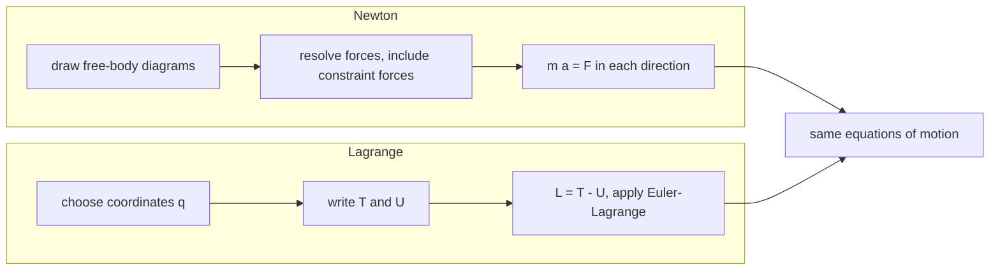

# Euler-Lagrange Equations

> [!abstract] The big idea
> Skip the forces. Write the kinetic energy $T$ and potential energy $U$ in *whatever coordinates fit the problem*, form the single scalar $\mathcal L=T-U$, and the equations of motion fall out of one recipe. Constraint forces (tension, normal forces) never appear, because they do no work along allowed motions. One scalar replaces many free-body diagrams.

## Generalized coordinates

The number of **degrees of freedom** is the number of independent numbers needed to fix the configuration: $3N$ minus the number of constraints.

![[PH-generalized-coords.png]]

**Figure:** A bead on a ring and a pendulum each have one degree of freedom (an angle), even though each point has two Cartesian coordinates, because the length is fixed. The double pendulum has two ($\theta_1,\theta_2$). The $q_i$ can be angles, lengths or anything else, which is why they are called *generalized*.

## Governing relation

$$\mathcal L(q,\dot q)=T-U,\qquad\boxed{\;\frac{d}{dt}\frac{\partial\mathcal L}{\partial\dot q_k}-\frac{\partial\mathcal L}{\partial q_k}=0\;}\quad(k=1,\dots,n)$$

with the **generalized momentum** $p_k=\partial\mathcal L/\partial\dot q_k$ and **generalized force** $\partial\mathcal L/\partial q_k$. In Cartesian coordinates $p_x=m\dot x$ and $\partial\mathcal L/\partial x=-\partial U/\partial x=F_x$, so the equation is exactly Newton's $\dot p_x=F_x$. In other coordinates it keeps the same form, which Newton's law does not.

> [!question]- 🎯 Predict first: for a pendulum of length $\ell$, mass $m$, what are $T$, $U$ and the single coordinate?
> Coordinate $q=\theta$. $T=\tfrac12m\ell^2\dot\theta^2$ and $U=-mg\ell\cos\theta$ (zero at the pivot height). The tension never enters, which is the whole point.

## Method

1. **Count the degrees of freedom** and choose $q_k$ (use symmetry; angles for rotations).
2. **Write the positions** in terms of $q_k$, then $T=\tfrac12\sum m\,\dot{\mathbf r}^2$ in terms of $q_k,\dot q_k$.
3. **Write $U(q)$** from gravity, springs, etc.
4. **Form $\mathcal L=T-U$**, and for each $k$ compute $\partial\mathcal L/\partial\dot q_k$, its time derivative, and $\partial\mathcal L/\partial q_k$.
5. **Assemble** $\tfrac{d}{dt}(\partial\mathcal L/\partial\dot q_k)=\partial\mathcal L/\partial q_k$ and simplify.
6. **Check:** small-angle limit must reproduce SHM; $\mathcal L$ without $q_k$ means $p_k$ is conserved.

## Common traps

> [!warning]- ⚠️ Using $\mathcal L=T+U$
> The sign matters: it is $T-U$. With the wrong sign you get the wrong direction of force.

> [!warning]- ⚠️ Forgetting the *total* time derivative on the first term
> $\frac{d}{dt}\big(\partial\mathcal L/\partial\dot q\big)$ differentiates $p=m\ell^2\dot\theta$ and gives $m\ell^2\ddot\theta$; it is not $\partial\mathcal L/\partial\ddot q$.

> [!danger]- 💥 Putting constraint forces back in
> If you include a tension term *and* use a constrained coordinate, you double-count. In a Lagrangian solution the tension is eliminated; recover it afterwards from Newton's radial equation if you need it.

## Worked examples

> [!example]- 🔬 Pendulum: derive the equation of motion
> $\mathcal L=\tfrac12m\ell^2\dot\theta^2+mg\ell\cos\theta$.
> $\partial\mathcal L/\partial\dot\theta=m\ell^2\dot\theta\Rightarrow\frac{d}{dt}=m\ell^2\ddot\theta$ and $\partial\mathcal L/\partial\theta=-mg\ell\sin\theta$.
> So $m\ell^2\ddot\theta=-mg\ell\sin\theta\Rightarrow\ddot\theta=-(g/\ell)\sin\theta$ ✓, identical to the Newtonian result from [[Newton's Second Law in Polar Coordinates]], with no tension in sight.

> [!example]- 🔬 Atwood machine: masses $m_1,m_2$ on a light pulley string
> One coordinate: the downward position $x$ of $m_1$ (then $m_2$ is at $\ell-x$ and moves up at the same speed).
> $T=\tfrac12(m_1+m_2)\dot x^2$, $U=-m_1gx-m_2g(\ell-x)$, so $\mathcal L=\tfrac12(m_1+m_2)\dot x^2+(m_1-m_2)gx+\text{const}$.
> E-L: $(m_1+m_2)\ddot x=(m_1-m_2)g\Rightarrow a=\dfrac{m_1-m_2}{m_1+m_2}g$. For $3$ kg and $1$ kg: $a=g/2=4.9$ m/s².
> **Check:** equal masses give $a=0$ ✓; $m_2\to0$ gives free fall $a=g$ ✓.

## Quick quiz

> [!question]- Q1. How many degrees of freedom does a particle moving on the surface of a sphere have?
> Two ($\theta,\phi$): three coordinates minus one constraint $r=R$.

> [!question]- Q2. Write $\mathcal L$ for a mass on a spring and get the equation of motion
> $\mathcal L=\tfrac12m\dot x^2-\tfrac12kx^2$, giving $m\ddot x=-kx$: SHM.

> [!question]- Q3. Why does the Lagrangian method scale to systems that overwhelm free-body diagrams?
> Adding a body adds one more term to $T$ and $U$ and one more equation; constraint forces never need to be solved for. A double pendulum is a four-line calculation; with tensions it is a long one.

## Connections

### Prerequisites
- [[Curvilinear Coordinates - Cylindrical and Spherical]] (for $T$), [[Conservative Forces, Gradient and Curl]] (for $U$), [[Newton's Laws as Differential Equations]]

### Next
- [[Cyclic Coordinates and Conservation Laws]]: when $\mathcal L$ does not contain a coordinate, its momentum is conserved.
- [[Central Forces and the Effective Potential]]: the Lagrangian in polar coordinates.

### Cross-domain links
- [[Energy Methods - A Unified View]] and [[Strain Energy and Castigliano's Theorem]]: minimising or stationarising an energy functional is the structural-mechanics version of the principle behind Euler–Lagrange.
- [[Sturm-Liouville Problems]]: the Euler–Lagrange equation of a functional is a Sturm–Liouville equation for many classic cases (the vibrating string).
- [[Mechanical Engineering Curriculum - MOC]]: dynamics of multi-link mechanisms (see [[KDoMs - MOC]]) is where this method pays off.

## Self-check
- [ ] I can count degrees of freedom and pick coordinates.
- [ ] I can derive the pendulum and Atwood equations in under five minutes.
- [ ] I can explain why tension and normal forces never appear.

## Metadata
- **Status:** draft · **Type:** concept · **Difficulty:** intermediate–advanced
- **Course map:** [[Physics I - MOC]]
