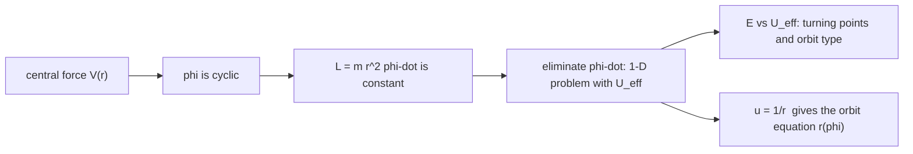

# Central Forces and the Effective Potential

> [!abstract] The big idea
> A central force always points at (or away from) one fixed point and depends only on the distance, $\mathbf F=f(r)\hat r$. Its Lagrangian does not contain the angle, so **angular momentum $L$ is conserved**, and a 2-D (or 3-D) problem collapses to a **one-dimensional problem in $r$** with an extra repulsive term, the *centrifugal barrier*. Then everything you learned about 1-D potentials, turning points and stability applies to orbits.

## Governing relation

$\mathcal L=\tfrac12m(\dot r^2+r^2\dot\phi^2)-V(r)$. The angle is cyclic, so $p_\phi=mr^2\dot\phi=L$ is constant ([[Cyclic Coordinates and Conservation Laws]]). The radial equation is

$$m\ddot r=-\frac{dV}{dr}+\frac{L^2}{mr^3}=-\frac{dU_{\rm eff}}{dr},\qquad\boxed{U_{\rm eff}(r)=V(r)+\frac{L^2}{2mr^2}}$$

and the energy is $E=\tfrac12m\dot r^2+U_{\rm eff}(r)$, exactly the 1-D form of [[Energy and Equilibrium in One Dimension]]. The term $L^2/2mr^2$ is the kinetic energy of the angular motion, rewritten using the conserved $L$.

**For gravity or Coulomb attraction** $V=-k/r$:

- circular orbit at the bottom of the well: $r_0=\dfrac{L^2}{mk}$, $\ E_{\rm circ}=-\dfrac{k}{2r_0}$
- bounded if $E<0$; unbounded if $E\ge0$.

## Visual

![[PH-eff-potential.png]]

**Figure:** Left, $U_{\rm eff}$ (blue) is gravity (grey dashed, attractive) plus the centrifugal barrier (purple dashed, repulsive). Energy levels: the minimum $E=-0.5$ gives a **circle**; $-0.5<E<0$ an **ellipse** (turning points $r_{\min},r_{\max}$); $E=0$ a **parabola**; $E>0$ a **hyperbola**. Right, the matching orbits drawn with the centre at the focus.

> [!question]- 🎯 Predict first: why can't a particle with $L\neq0$ ever reach $r=0$ under a $1/r$ attraction?
> The barrier $L^2/2mr^2$ grows like $1/r^2$, faster than the attraction's $1/r$, so $U_{\rm eff}\to+\infty$ as $r\to0$. Only $L=0$ (a head-on plunge) can fall in. Comets come close but turn around.

## Method

1. **Write $\mathcal L$ in polar coordinates**; identify $L=mr^2\dot\phi$ as constant.
2. **Form $U_{\rm eff}=V+L^2/2mr^2$** and plot it.
3. **Draw the line $E$:** the turning points are $U_{\rm eff}(r)=E$.
4. **Classify:** minimum $\to$ circle; two turning points $\to$ bound (ellipse); one turning point $\to$ unbound.
5. **Orbit shape:** use $u=1/r$ and $\dfrac{d^2u}{d\phi^2}+u=-\dfrac{m}{L^2}\dfrac{dV}{du}$ (for $V=-ku$: $u''+u=mk/L^2$).
6. **Check:** for $E=U_{\rm eff,min}$ the radial speed is zero; $L\to0$ gives a straight plunge.

## Common traps

> [!warning]- ⚠️ Treating the centrifugal term as a real force
> $L^2/mr^3$ is just the effect of angular-momentum conservation, rewritten as an effective radial force. In an inertial frame nothing pushes the particle outward; it is *momentum* carrying it round.

> [!warning]- ⚠️ Using $E=\tfrac12mv^2+V$ with $v=\dot r$ only
> The kinetic energy has an angular part: $\tfrac12m\dot r^2+\tfrac12mr^2\dot\phi^2$. The effective potential bundles the angular part into $U_{\rm eff}$; do not count it twice.

> [!danger]- 💥 "Bounded" does not mean "closed"
> For $1/r$ (and $r^2$, springs) bounded orbits close into ellipses. For a general $V(r)$ they precess and fill a ring. Closed orbits are special to those two force laws (Bertrand's theorem).

## Worked example

> [!example]- 🔬 A satellite orbits Earth in a circle at $r=7000$ km ($GM=3.986\times10^{14}$ m³/s²). Find $v$, the period, and $E/m$
> Circular: gravity gives the centripetal force, $v^2/r=GM/r^2\Rightarrow v=\sqrt{GM/r}=7.55$ km/s.
> $T=2\pi r/v=2\pi\sqrt{r^3/GM}=5829$ s $=97$ min.
> $E/m=-\dfrac{GM}{2r}=-28.5$ MJ/kg (negative: bound).
> **Check:** to escape it needs $E=0$, i.e. $v_{\rm esc}=\sqrt2\,v=10.7$ km/s, a $41\%$ speed increase at the same radius.

## Quick quiz

> [!question]- Q1. What are the turning points of a bound orbit in terms of $E$?
> The two roots of $E=U_{\rm eff}(r)$: pericentre (closest) and apocentre (farthest). At those points $\dot r=0$ and the speed is purely tangential.

> [!question]- Q2. If you double $L$ at fixed $E$, what happens to the pericentre?
> It moves out: a larger barrier $L^2/2mr^2$ raises $U_{\rm eff}$ at small $r$, so the particle turns around farther from the centre.

> [!question]- Q3. A mass whirled on a string is pulled in by a hand. What is conserved?
> Angular momentum $mr^2\dot\phi$ (force is central), *not* kinetic energy: the hand does work, so the speed rises as $r$ shrinks.

## Connections

### Prerequisites
- [[Cyclic Coordinates and Conservation Laws]], [[Energy and Equilibrium in One Dimension]], [[Newton's Second Law in Polar Coordinates]]

### Next
- [[Kepler's Laws and Orbits]]: solve the orbit equation.
- [[Two-Body Problem and Hohmann Transfer]]: reduce two bodies to one with a central force.

### Cross-domain links
- [[Energy Methods - A Unified View]]: an effective potential is a reduced energy with a conserved quantity absorbed.

## Self-check
- [ ] I can derive $U_{\rm eff}$ and say where each term comes from.
- [ ] I can read circle/ellipse/parabola/hyperbola from the energy level.
- [ ] I can find the circular-orbit radius, speed and period.

## Metadata
- **Status:** draft · **Type:** concept · **Difficulty:** advanced
- **Course map:** [[Physics I - MOC]]
