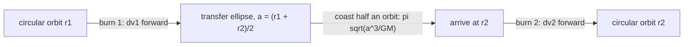

# Two-Body Problem and Hohmann Transfer

> [!abstract] The big idea
> Two bodies pulling on each other are really **one** body: the centre of mass drifts at constant velocity, and the *separation* moves exactly as a single particle of **reduced mass** $\mu=\frac{m_1m_2}{m_1+m_2}$ in the same central force. That is why "planet orbits a fixed Sun" works so well, and why Kepler III picks up the total mass. Once you have an orbit, the cheapest way to change it is the **Hohmann transfer**: two short engine burns along an ellipse that touches both circles.

## The reduction

With $\mathbf R=(m_1\mathbf r_1+m_2\mathbf r_2)/M$ and $\mathbf r=\mathbf r_1-\mathbf r_2$:

$$M\ddot{\mathbf R}=\mathbf F_{\rm ext}=\mathbf 0,\qquad\boxed{\mu\,\ddot{\mathbf r}=\mathbf F(r)},\qquad\mathbf r_1=\mathbf R+\frac{m_2}{M}\mathbf r,\quad\mathbf r_2=\mathbf R-\frac{m_1}{M}\mathbf r$$

Both bodies orbit the CM on *similar* ellipses, the lighter one on the larger. Kepler III becomes $T^2=\dfrac{4\pi^2a^3}{G(m_1+m_2)}$ with $a$ the semi-major axis of the *relative* orbit.

![[PH-two-body.png]]

**Figure:** Masses $m_1=3$ and $m_2=1$. The CM (red cross) sits $\tfrac14$ of the way from the heavy mass to the light one. Dotted lines connect the two bodies at five instants; every line passes through the CM, and the light body's path is three times larger. Each ellipse has the CM at a focus.

> [!question]- 🎯 Predict first: where is the centre of mass of the Earth–Moon system, relative to Earth's centre?
> About $4670$ km from Earth's centre ($384{,}400/82.3$), which is *inside* Earth ($R=6371$ km). So the Moon does not really orbit Earth's centre: both swing about a point $1700$ km below Earth's surface, and Earth's centre traces a small circle of radius $4670$ km around it every month.

## Hohmann transfer between circular orbits

To go from a circular orbit $r_1$ to a larger circular orbit $r_2$:

1. **Burn 1** at $r_1$: speed up along the orbit to the transfer ellipse's pericentre speed.
2. **Coast** half an ellipse of semi-major axis $a_t=\tfrac12(r_1+r_2)$, taking $t=\pi\sqrt{a_t^3/GM}$.
3. **Burn 2** at $r_2$: speed up again to circularise.

Using vis-viva, $v^2=GM(2/r-1/a)$:

$$\Delta v_1=\sqrt{GM\Big(\tfrac{2}{r_1}-\tfrac1{a_t}\Big)}-\sqrt{\tfrac{GM}{r_1}},\qquad\Delta v_2=\sqrt{\tfrac{GM}{r_2}}-\sqrt{GM\Big(\tfrac{2}{r_2}-\tfrac1{a_t}\Big)}$$

![[PH-hohmann.png]]

**Figure:** Earth ($1$ AU) to Mars ($1.524$ AU). The green dashed half-ellipse touches both circles; the two arrows are the burns. The pair costs $\Delta v_1=0.099\,v_1$ and $\Delta v_2=0.089\,v_1$ (with $v_1=29.78$ km/s, that is $2.95$ and $2.65$ km/s) and takes $259$ days.

> [!tip]- 🧠 Why *both* burns are forward even though the outer orbit is *slower*
> Burn 1 raises the apocentre, so the craft climbs and loses speed on the way. At $r_2$ it is *slower* than the circular speed there, so it needs a small push to stay up. The final circular speed is lower than the starting one, yet the net cost of the two burns is positive: you spent energy to gain height.

## Method

1. **Write $a_t=(r_1+r_2)/2$** and use vis-viva at each end.
2. **Compute $\Delta v_1$, $\Delta v_2$** (circular speed minus/plus transfer-ellipse speed).
3. **Coast time:** half the transfer period, $\pi\sqrt{a_t^3/GM}$.
4. **Launch window:** at departure the target must lead the craft by $180^\circ-360^\circ\,t_{\rm transfer}/T_{\rm target}$.
5. **Check:** for $r_2/r_1\to1$ both $\Delta v\to0$; the total $\Delta v$ must exceed the difference of circular speeds.

## Common traps

> [!warning]- ⚠️ Using $\Delta v=v_2-v_1$ of the two circular orbits
> The transfer ellipse's speeds at the ends differ from the circular ones; the burns are $v_{\rm ellipse}-v_{\rm circle}$, not $v_{\rm circle,2}-v_{\rm circle,1}$ (which is *negative* for going out!).

> [!warning]- ⚠️ Forgetting reduced mass in Kepler III for comparable masses
> For binary stars use $m_1+m_2$ in the period formula. For planets it is $M_\odot$ to $0.1\%$ and the correction is invisible.

> [!danger]- 💥 The Hohmann transfer is the cheapest *two-burn* option, not always the cheapest overall
> For $r_2/r_1>11.94$ a three-burn "bi-elliptic" transfer is cheaper; Hohmann is also slow (months to years). Real missions trade fuel for time, and use gravity assists.

## Worked examples

> [!example]- 🔬 Hohmann transfer from low Earth orbit ($r_1=6678$ km) to geostationary ($r_2=42{,}164$ km)
> $a_t=24{,}421$ km. Circular speeds: $v_1=7.726$ km/s. Transfer ellipse at perigee $10.15$ km/s, at apogee $1.61$ km/s; GEO speed $3.07$ km/s.
> $\Delta v_1=2.43$ km/s and $\Delta v_2=1.47$ km/s, total $3.89$ km/s; coast time $5.28$ h.
> **Check:** this matches the standard figure for geostationary insertion (about $2.4$ then $1.5$ km/s).

> [!example]- 🔬 Earth to Mars: when must you launch?
> Transfer time $t=\tfrac12a_t^{3/2}=0.709$ yr ($259$ days). Mars' period is $1.881$ yr, so in that time Mars advances $360^\circ\times0.709/1.881=135.7^\circ$.
> Mars must therefore be $180^\circ-135.7^\circ=\mathbf{44^\circ}$ *ahead* of Earth at launch. Windows repeat every $26$ months (the synodic period).

## Quick quiz

> [!question]- Q1. What is the reduced mass of two equal masses $m$?
> $\mu=m/2$. The relative motion is that of half a mass attached to the force.

> [!question]- Q2. To catch a satellite ahead of you in the same circular orbit, should you speed up or slow down?
> Slow down: that drops you to a lower, *faster* orbit; you gain on the target, then re-raise to match. Speeding up sends you higher and slower.

> [!question]- Q3. Why does the Hohmann ellipse touch both circles at its two extremes?
> Burns are cheapest when applied tangentially at pericentre and apocentre, where the velocity is purely along the orbit and the burn changes energy with no wasted direction.

## Connections

### Prerequisites
- [[Kepler's Laws and Orbits]], [[Newton's Third Law and Momentum Conservation]] (centre of mass)

### Related
- [[Central Forces and the Effective Potential]]

### Cross-domain links
- [[Gears, Transformers and Reflected Impedance]]: referring one side of a system to the other (reduced mass here, reflected impedance there) is the same "replace two coupled things by one equivalent" move.
- [[Energy Methods - A Unified View]]: $\Delta v$ is chosen by an energy argument: vis-viva *is* energy conservation.

## Self-check
- [ ] I can reduce a two-body problem to one body with $\mu$.
- [ ] I can compute both Hohmann burns and the coast time.
- [ ] I can find the launch-window phase angle for an interplanetary transfer.

## Metadata
- **Status:** draft · **Type:** concept · **Difficulty:** advanced
- **Course map:** [[Physics I - MOC]]
