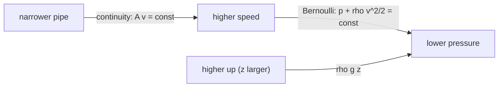

# Fluid Flow, Continuity and Bernoulli

> [!abstract] The big idea
> Two ideas turn vector calculus into fluid mechanics. **Continuity** (mass is conserved, $\nabla\cdot(\rho\mathbf u)=-\partial_t\rho$) says that in a steady incompressible flow, *narrow means fast*. **Bernoulli** (energy is conserved along a streamline) says that *fast means low pressure*. Together they explain pipes, wings, sprays and why a shower curtain blows inward.

## Continuity: mass in equals mass out

For a fluid of density $\rho$ and velocity field $\mathbf u$, conservation of mass applied to a small volume (the divergence theorem, [[Divergence Theorem and Flux]]) gives

$$\frac{\partial\rho}{\partial t}+\nabla\cdot(\rho\mathbf u)=0\ \ \xrightarrow{\ \rho=\text{const}\ }\ \ \nabla\cdot\mathbf u=0,\qquad\text{in a pipe: }A_1v_1=A_2v_2$$

An **incompressible** flow has no sources or sinks: streamlines never start or stop, and flux through any closed surface is zero.

## Bernoulli: energy along a streamline

For steady, inviscid, incompressible flow, along a streamline:

$$p+\tfrac12\rho v^2+\rho gz=\text{const}$$

Pressure energy + kinetic energy + potential energy per unit volume. It is the work–energy theorem for a parcel of fluid, since pressure forces are conservative in this case.

![[PH-venturi.png]]

**Figure:** A venturi. Top: streamlines crowd in the throat (area $\times0.4$), so by continuity the speed rises $2.5\times$, from $2$ to $5$ m/s. Bottom: speed (orange) peaks and pressure (blue) dips by $\tfrac12\rho(v_2^2-v_1^2)=10.5$ kPa exactly where the speed peaks.

> [!question]- 🎯 Predict first: you blow across the top of a sheet of paper held at one edge. Does it rise or fall?
> It rises. Fast air above means lower pressure than the still air below, so the net pressure force is upward. The same principle (with extra help from deflection of the airflow) lifts a wing.

> [!tip]- 🧠 Where Bernoulli applies
> Steady flow, no viscosity, no heat, no pumps or turbines between the two points, same streamline. Break any of these and you need an extended energy equation with head loss and pump/turbine terms ([[Incompressible Inviscid Flow and Bernoulli - Formula Bank]], [[Pipe Flow and Losses - Formula Bank]]).

## Method

1. **Draw the streamline** between two points where you know or want something (a surface, a nozzle exit, a throat).
2. **Continuity:** write $A_1v_1=A_2v_2$ (or $Q=Av$).
3. **Bernoulli:** $p_1+\tfrac12\rho v_1^2+\rho gz_1=p_2+\tfrac12\rho v_2^2+\rho gz_2$.
4. **Use free-surface and atmosphere information:** open to the atmosphere $\Rightarrow p=p_{\rm atm}$; a large tank surface has $v\approx0$.
5. **Solve** for the unknown speed or pressure.
6. **Check:** units (Pa), $v$ rising where area shrinks, $p$ falling where $v$ rises.

## Common traps

> [!warning]- ⚠️ Using Bernoulli across a pump, a fan, or a long viscous pipe
> It conserves energy only without losses and without shaft work. A pipe with friction needs head-loss terms; a pump adds energy.

> [!warning]- ⚠️ "Faster flow means lower pressure" as a universal rule
> It is a statement along a *streamline* of an ideal flow. Compare the pressure inside and outside a jet or across a wing without checking the streamline and you will get nonsense.

> [!danger]- 💥 Taking $\nabla\cdot\mathbf u=0$ for compressible gas flow
> At speeds above roughly $0.3$ of the speed of sound, density changes matter and continuity must use $\nabla\cdot(\rho\mathbf u)$.

## Worked examples

> [!example]- 🔬 A water venturi has $v_1=2$ m/s and a throat of $0.4\times$ the pipe area. Find $v_2$ and the pressure drop
> Continuity: $v_2=v_1A_1/A_2=2/0.4=5$ m/s.
> Bernoulli (same height): $p_1-p_2=\tfrac12\rho(v_2^2-v_1^2)=\tfrac12(1000)(25-4)=10{,}500$ Pa $=10.5$ kPa.
> **Check:** measuring $p_1-p_2$ with a manometer gives the flow rate: this is exactly how a venturi flow meter works.

> [!example]- 🔬 Water drains from a tank through a hole $1.25$ m below the surface. How fast does it exit?
> Take a streamline from the surface (speed $\approx0$, pressure $p_{\rm atm}$) to the jet (pressure $p_{\rm atm}$): $\rho gh=\tfrac12\rho v^2$.
> $v=\sqrt{2gh}=\sqrt{2(9.81)(1.25)}=4.95$ m/s (Torricelli's law), the speed of a body that has *fallen* $h$.
> **Check:** the jet's speed does not depend on the density or the hole size (until the tank level drops appreciably).

## Quick quiz

> [!question]- Q1. A pipe narrows from $10$ cm to $5$ cm diameter. By what factor does the speed rise?
> Area ratio $=(10/5)^2=4$, so the speed rises $4\times$.

> [!question]- Q2. Where is the pressure highest in a horizontal pipe that narrows then widens?
> In the wide sections (low speed); it dips in the narrow throat. (In a real, viscous flow some pressure is permanently lost downstream.)

> [!question]- Q3. What is "stagnation pressure"?
> The pressure where the flow is brought to rest: $p_0=p+\tfrac12\rho v^2$. A Pitot tube measures it; subtract the static pressure and you get the speed.

## Connections

### Prerequisites
- [[Divergence Theorem and Flux]], [[Stokes' Theorem and Circulation]], [[Energy and Equilibrium in One Dimension]]

### Cross-domain links
- [[Conservation of Mass (Continuity Equation)]], [[Linear Momentum Equation]], [[Incompressible Inviscid Flow and Bernoulli - Formula Bank]]: this note is the vector-calculus preview of Fluid Mechanics.
- [[Streamlines, Pathlines, Streaklines and Timelines]]: the lines along which Bernoulli is evaluated.
- [[Conservation Laws and Flow Networks]]: continuity is Kirchhoff's current law for fluids ($Q_{\rm in}=Q_{\rm out}$), and pressure is the "voltage".
- [[Energy Methods - A Unified View]]: Bernoulli is energy conservation per unit volume.

## Self-check
- [ ] I can state continuity in both integral and differential form.
- [ ] I can apply Bernoulli between two points on a streamline, with all assumptions stated.
- [ ] I can solve venturi and Torricelli problems and check them by energy.

## Metadata
- **Status:** draft · **Type:** concept · **Difficulty:** intermediate
- **Course map:** [[Physics I - MOC]]
