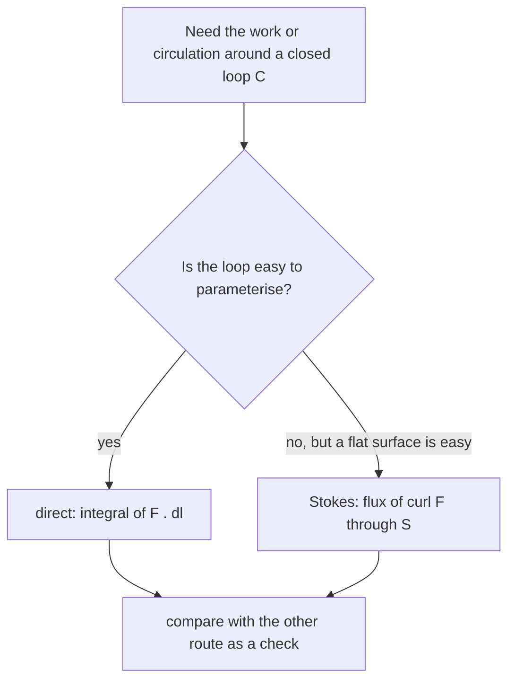

# Stokes' Theorem and Circulation

> [!abstract] The big idea
> **Circulation** is how much a field pushes you *around* a closed loop. **Curl** is circulation per unit area at a point: the local swirl. Stokes' theorem says the circulation around a loop equals the total curl flowing through *any* surface the loop bounds. Big loop = sum of tiny loops, because the interior edges cancel in pairs.

## Governing relation

$$\boxed{\;\oint_C\mathbf F\cdot d\mathbf l=\iint_S(\nabla\times\mathbf F)\cdot d\mathbf S\;}$$

$C$ is the boundary of $S$; orient $C$ so that, by the **right-hand rule**, your thumb gives the direction of $\hat{\mathbf n}$ on $S$. The curl was defined in [[Conservative Forces, Gradient and Curl]]; its component along $\hat{\mathbf n}$ is the circulation per unit area of a tiny loop perpendicular to $\hat{\mathbf n}$.

## What curl really measures

![[PH-curl-paddle.png]]

**Figure:** Hold a tiny paddle wheel in the flow. Left, rigid rotation $(-y,x)$ spins it (curl $=+2$). Middle, a pure shear $(y,0)$ also spins it clockwise (curl $=-1$) even though every streamline is straight: faster layers above turn it. Right, the irrotational vortex $(-y,x)/r^2$ carries the wheel round without turning it (curl $=0$ away from the centre).

> [!question]- 🎯 Predict first: water flows in perfectly straight parallel lines but faster at the top. Is the curl zero?
> No. A paddle wheel in that shear flow feels more push on its upper blades and turns. Curl is not about curved streamlines but about **differential speed across the flow**: $\nabla\times\mathbf F=(\partial_xF_y-\partial_yF_x)\hat z$, and here $\partial_yF_x\ne0$.

## Any surface bounded by the loop

![[PH-stokes-surfaces.png]]

**Figure:** The cap $S_1$ and the flat disc $S_2$ share the same boundary $C$ (red). The curl field (green) pierces both, and the flux of curl through each is the same, equal to the circulation around $C$. Choose the surface that makes the integral easy.

Two quick consequences:
- If $\nabla\times\mathbf F=\mathbf0$ on a surface, the circulation around its boundary is zero: this is *why* the curl test for conservative forces works.
- $\nabla\cdot(\nabla\times\mathbf F)=0$ and $\nabla\times(\nabla f)=\mathbf0$: a curl field has no sources, a gradient field has no swirl.

## Method

1. **Choose a surface** $S$ bounded by $C$ (the flattest one is usually simplest).
2. **Orient it** with the right-hand rule relative to the direction you travel on $C$.
3. **Compute $\nabla\times\mathbf F$** (right coordinates for the geometry).
4. **Integrate** $(\nabla\times\mathbf F)\cdot\hat{\mathbf n}\,dA$.
5. **Or go direct:** parameterise $C$ and integrate $\mathbf F\cdot d\mathbf l$; the two must agree.
6. **Check:** reversing the loop's direction flips both sides' signs.

## Common traps

> [!warning]- ⚠️ Mismatched orientations
> Going anti-clockwise around $C$ (seen from above) pairs with $\hat{\mathbf n}=+\hat z$. Mixing them gives a global sign error.

> [!warning]- ⚠️ Treating "curl zero" as "no circulation" for the vortex
> The point vortex has curl $0$ everywhere except at its core, but its circulation around the core is $2\pi$ (the hole in the region): zero curl on $S$ only works if $S$ contains no singularity.

> [!danger]- 💥 Using the theorem on an open curve
> $C$ must be a *closed* loop that bounds $S$. A line from $A$ to $B$ has no surface to integrate over.

## Worked example

> [!example]- 🔬 Verify Stokes for $\mathbf F=(-y,\,x,\,0)$ around a circle of radius $R$ in the $xy$-plane
> **Direct:** on the circle $\mathbf F=R\hat\phi$ and $d\mathbf l=R\,d\phi\,\hat\phi$, so $\oint\mathbf F\cdot d\mathbf l=\int_0^{2\pi}R\cdot R\,d\phi=2\pi R^2$.
> **Stokes:** $\nabla\times\mathbf F=(0,0,\partial_xF_y-\partial_yF_x)=(0,0,2)$. Flux through the disc: $2\cdot\pi R^2=2\pi R^2$ ✓.
> **Check:** the hemispherical cap gives the same: only the component of $\nabla\times\mathbf F=2\hat z$ along the local normal counts, which is the same as projecting the cap onto the plane, an area $\pi R^2$, so again $2\pi R^2$.

## Quick quiz

> [!question]- Q1. Is the field $\mathbf F=(y,x)$ conservative? Check using Stokes on a unit square.
> $\nabla\times\mathbf F=(\partial_xF_y-\partial_yF_x)\hat z=(1-1)\hat z=0$, so the circulation around any loop is $0$ (the left panel of the curl figure in [[Conservative Forces, Gradient and Curl]]).

> [!question]- Q2. The circulation of a velocity field around a loop of area $0.5$ m² is $3$ m²/s, with uniform curl. What is the curl?
> $3/0.5=6$ s$^{-1}$, which is twice the angular velocity of a paddle wheel in the flow ($\omega=3$ rad/s): $|\nabla\times\mathbf u|=2\omega$.

> [!question]- Q3. Why can't a rotation-free flow have closed circular streamlines with speed $\propto r$?
> Speed $\propto r$ is rigid rotation, whose curl is $2\omega\ne0$. Closed circular flow without curl needs speed $\propto1/r$ (the irrotational vortex).

## Connections

### Prerequisites
- [[Conservative Forces, Gradient and Curl]], [[Divergence Theorem and Flux]]

### Next
- [[Fluid Flow, Continuity and Bernoulli]]: vorticity $\nabla\times\mathbf u$ governs when Bernoulli holds across streamlines.

### Cross-domain links
- [[Streamlines, Pathlines, Streaklines and Timelines]]: circulation and vorticity describe whether streamlines are linked to local rotation.
- [[Differential Mass Conservation and Fluid Kinematics - Formula Bank]]: the rotation rate of a fluid element is half the curl of velocity, the same factor of $2$ as the paddle wheel.
- [[Rotating Vectors - Phasors, Velocity Polygons and Complex Kinematics]]: rigid rotation $\mathbf v=\boldsymbol\omega\times\mathbf r$ has $\nabla\times\mathbf v=2\boldsymbol\omega$, the cleanest curl example.

## Self-check
- [ ] I can compute a curl and interpret it as a paddle-wheel spin.
- [ ] I can verify Stokes both ways on a circle.
- [ ] I can explain why the surface can be chosen freely.

## Metadata
- **Status:** draft · **Type:** concept · **Difficulty:** advanced
- **Course map:** [[Physics I - MOC]]
