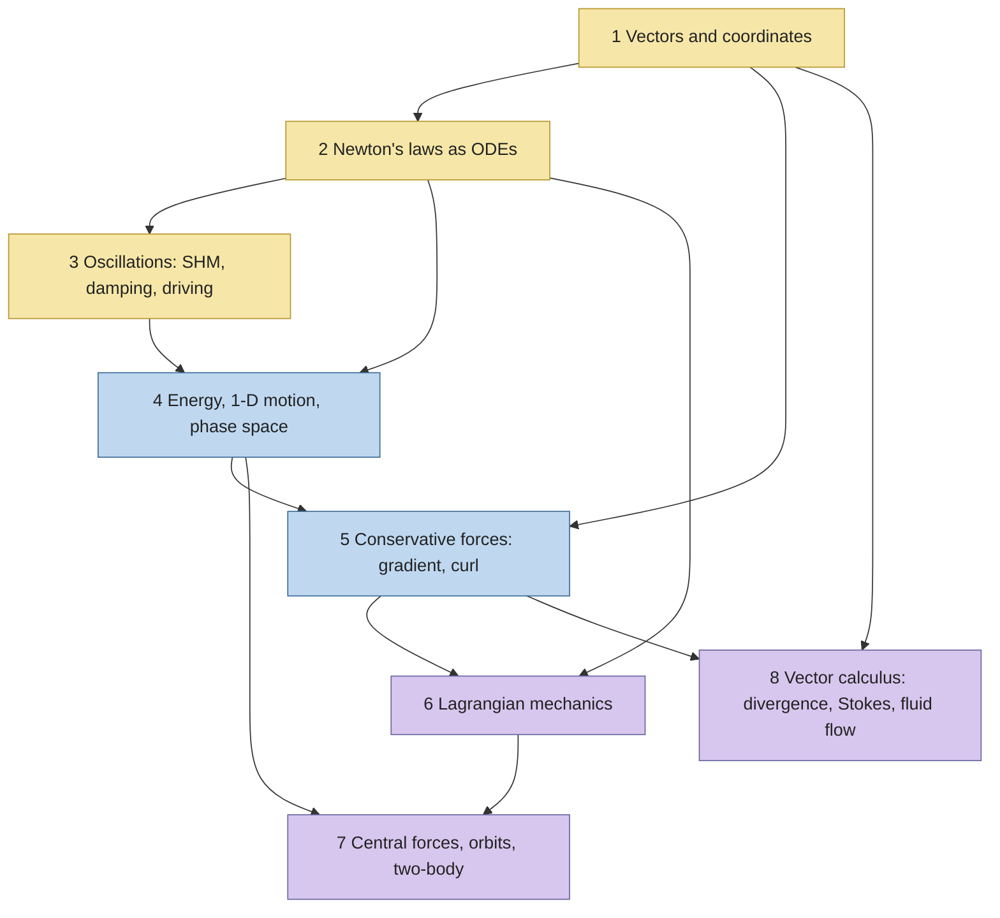
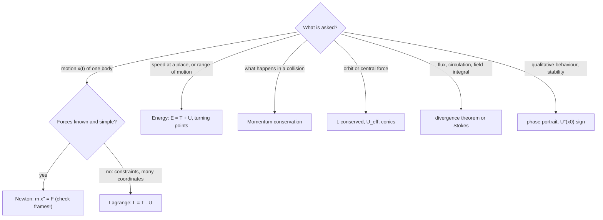

# Physics I — Map of Content

Classical mechanics for engineers: from Newton's laws as differential equations, through oscillations and phase space, to Lagrangian mechanics, orbits and the vector calculus that underlies fluids and fields. This map is for navigation; the explanations live in the 22 concept notes it links to. Slides from the weekly lectures are kept as PDFs in this folder (not linked).

> [!abstract] The one-line course
> **Write the equation of motion, find what is conserved, and read the motion off a picture.** Newton gives the equation, energy and symmetries give the conservation laws, and phase space and potential curves give the picture.

## Course Overview
- **Course:** Physics I (PH1010), January–May 2026, slot D.
- **Core purpose:** model translational and rotational motion, solve oscillator problems (damped and driven), use potentials and conservation laws, apply the Lagrangian method to central-force motion, and use vector calculus for fields and fluid flow.
- **Prerequisites:** school mechanics, calculus, and [[2nd Order Linear ODE with Constant Coefficients]] (used constantly from Module 3).
- **Tools:** vectors and index notation, ODEs, energy methods, coordinate systems, partial derivatives and line/surface integrals.
- **Grading:** Quiz-I 20 (26 Feb) · Quiz-II 20 (19 Mar) · End-sem 60 (11 May). Module 5(iv) (curvilinear coordinates) is end-sem only.
- **Textbooks:** Taylor *Classical Mechanics*; Morin *Introduction to Classical Mechanics*; Thornton & Marion *Classical Dynamics*; Schey *Div, Grad, Curl, and All That*.

## Concept Map

**Colours:** yellow = Quiz-I material, blue = Quiz-II material, purple = end-sem only.

## Main Spine

### 🟡 Quiz-I zone: Modules 1–3
1. **Vectors and coordinates**
   - [[Vectors - Dot and Cross Products]]
   - [[Rotation Matrix and Vector Transformation]]
2. **Newton's laws**
   - [[Newton's Laws as Differential Equations]]
   - [[Inertial and Non-Inertial Frames]]
   - [[Newton's Third Law and Momentum Conservation]]
   - [[Newton's Second Law in Polar Coordinates]]
3. **Oscillations**
   - [[Simple Harmonic Motion]]
   - [[Damped Oscillations]]
   - [[Driven Oscillations and Resonance]]

### 🔵 Quiz-II zone: Modules 4–5
4. **One-dimensional motion and phase space**
   - [[Energy and Equilibrium in One Dimension]]
   - [[Phase Space and Phase Portraits]]
   - [[The Nonlinear Pendulum]]
5. **Conservative forces**
   - [[Conservative Forces, Gradient and Curl]]
   - [[Curvilinear Coordinates - Cylindrical and Spherical]] (end-sem only)

### 🟣 End-sem zone: Modules 6–8
6. **Lagrangian mechanics**
   - [[Euler-Lagrange Equations]]
   - [[Cyclic Coordinates and Conservation Laws]]
7. **Central forces and orbits**
   - [[Central Forces and the Effective Potential]]
   - [[Kepler's Laws and Orbits]]
   - [[Two-Body Problem and Hohmann Transfer]]
8. **Vector calculus and fluid flow**
   - [[Divergence Theorem and Flux]]
   - [[Stokes' Theorem and Circulation]]
   - [[Fluid Flow, Continuity and Bernoulli]]

## Syllabus Coverage

| Module | Lectures | Reading | Notes |
|---|---|---|---|
| 1 Vectors | 4 + 1 tut | Taylor 1.1–1.3; Thornton–Marion 1.2–1.3, 1.10–1.12 | [[Vectors - Dot and Cross Products]], [[Rotation Matrix and Vector Transformation]] |
| 2 Newton's laws | 5 + 1 tut | Taylor 1.4–1.7, 9.1 | [[Newton's Laws as Differential Equations]] … [[Newton's Second Law in Polar Coordinates]] |
| 3 Oscillations | 5 + 1 tut | Taylor 5.1, 5.4–5.6 | [[Simple Harmonic Motion]], [[Damped Oscillations]], [[Driven Oscillations and Resonance]] |
| 4 1-D motion, phase space | 8 + 1 tut | Taylor 4.1–4.2, 4.6; T–M 3.4–3.5, 4.3–4.4, App. B.2 | [[Energy and Equilibrium in One Dimension]], [[Phase Space and Phase Portraits]], [[The Nonlinear Pendulum]] |
| 5 Conservative forces | 4 + 1 tut | Taylor 4.3, 4.4, 4.8* | [[Conservative Forces, Gradient and Curl]], [[Curvilinear Coordinates - Cylindrical and Spherical]]* |
| 6 Lagrangian | 4 + 1 tut | Morin 6.1, 6.3–6.5 | [[Euler-Lagrange Equations]], [[Cyclic Coordinates and Conservation Laws]] |
| 7 Central forces | 6 + 1 tut | Morin 7.1–7.2; Taylor 8.1–8.2, 8.5–8.6, 8.8 | [[Central Forces and the Effective Potential]], [[Kepler's Laws and Orbits]], [[Two-Body Problem and Hohmann Transfer]] |
| 8 Vector calculus | 6 + 1 tut | Schey II–III; Taylor 16.12 | [[Divergence Theorem and Flux]], [[Stokes' Theorem and Circulation]], [[Fluid Flow, Continuity and Bernoulli]] |

\* end-sem only.

## By Theme

### Theme 1 — The same ODE in disguise
[[Newton's Laws as Differential Equations]] → [[Simple Harmonic Motion]] → [[Damped Oscillations]] → [[Driven Oscillations and Resonance]]: one second-order linear ODE, three levels of difficulty.

### Theme 2 — Energy and pictures
[[Energy and Equilibrium in One Dimension]] → [[Phase Space and Phase Portraits]] → [[The Nonlinear Pendulum]] → [[Central Forces and the Effective Potential]]: a graph of $U(x)$ or $U_{\rm eff}(r)$ replaces solving the equation.

### Theme 3 — Symmetry gives conservation
[[Newton's Third Law and Momentum Conservation]] → [[Cyclic Coordinates and Conservation Laws]] → [[Central Forces and the Effective Potential]] → [[Kepler's Laws and Orbits]]: translation, rotation and time give momentum, angular momentum and energy.

### Theme 4 — Fields: gradient, divergence, curl
[[Conservative Forces, Gradient and Curl]] → [[Divergence Theorem and Flux]] → [[Stokes' Theorem and Circulation]] → [[Fluid Flow, Continuity and Bernoulli]]: the three derivatives of $\nabla$ and their two integral theorems.

### Theme 5 — Choosing coordinates
[[Newton's Second Law in Polar Coordinates]] → [[Curvilinear Coordinates - Cylindrical and Spherical]] → [[Euler-Lagrange Equations]]: put the symmetry into the coordinates and the problem simplifies.

## Methods and Problem Types

| Problem type | Concept | Method |
|---|---|---|
| Block, spring or pendulum, find motion | [[Newton's Laws as Differential Equations]], [[Simple Harmonic Motion]] | $m\ddot x=F$, solve with two initial conditions |
| Observer in an accelerating box or train | [[Inertial and Non-Inertial Frames]] | add $-m\mathbf A$ to the free-body diagram |
| Collision or explosion | [[Newton's Third Law and Momentum Conservation]] | conserve $\mathbf P$ (and $E$ if elastic) |
| Circular motion, pendulum with a centre | [[Newton's Second Law in Polar Coordinates]] | resolve into $\hat r,\hat\phi$ |
| Spring plus friction | [[Damped Oscillations]] | roots of $r^2+2\beta r+\omega_0^2=0$ |
| Oscillator plus a periodic push | [[Driven Oscillations and Resonance]] | $D(\omega)$, $\delta(\omega)$, add transient |
| "Where can it go?" given $U(x)$ | [[Energy and Equilibrium in One Dimension]] | line $E$ on the $U$ curve |
| Draw the motion without solving | [[Phase Space and Phase Portraits]] | fixed points + energy contours |
| Is this force conservative? | [[Conservative Forces, Gradient and Curl]] | $\nabla\times\mathbf F=0$, then build $U$ |
| Many coordinates, constraints | [[Euler-Lagrange Equations]] | $\mathcal L=T-U$, one equation per $q$ |
| A coordinate is missing from $\mathcal L$ | [[Cyclic Coordinates and Conservation Laws]] | $p_k=$ const |
| Orbit, planet, satellite | [[Central Forces and the Effective Potential]], [[Kepler's Laws and Orbits]] | $U_{\rm eff}$, vis-viva, Kepler III |
| Change orbit | [[Two-Body Problem and Hohmann Transfer]] | two tangential burns |
| Flux through a closed surface | [[Divergence Theorem and Flux]] | $\iiint\nabla\cdot\mathbf F\,dV$ |
| Circulation around a loop | [[Stokes' Theorem and Circulation]] | $\iint(\nabla\times\mathbf F)\cdot d\mathbf S$ |
| Pipe or jet speed and pressure | [[Fluid Flow, Continuity and Bernoulli]] | $Av=$ const, then Bernoulli |

### "I see this kind of problem, what do I use?"

## Visual Library

**Vectors and Newton:** [[Vectors - Dot and Cross Products]] (dot/cross geometry) · [[Rotation Matrix and Vector Transformation]] (one arrow, two coordinate sets) · [[Newton's Laws as Differential Equations]] (determinism, forward and backward) · [[Inertial and Non-Inertial Frames]] (cart with a hanging ball) · [[Newton's Third Law and Momentum Conservation]] (collision paths and momentum) · [[Newton's Second Law in Polar Coordinates]] (polar unit vectors, pendulum forces, conical pendulum).

**Oscillations and phase space:** [[Simple Harmonic Motion]] (x, v, a; energy exchange) · [[Damped Oscillations]] (three regimes and root locus) · [[Driven Oscillations and Resonance]] (resonance curves, transient to steady state) · [[Energy and Equilibrium in One Dimension]] (potential well with $E$ levels) · [[Phase Space and Phase Portraits]] (four linear portraits, double well) · [[The Nonlinear Pendulum]] (separatrix portrait, period vs amplitude).

**Fields:** [[Conservative Forces, Gradient and Curl]] (gradient and contours, curl fields, path-dependent work) · [[Curvilinear Coordinates - Cylindrical and Spherical]] (3-D coordinate diagrams) · [[Divergence Theorem and Flux]] (flux patches, source and sink fields) · [[Stokes' Theorem and Circulation]] (paddle wheels, two surfaces one boundary) · [[Fluid Flow, Continuity and Bernoulli]] (venturi).

**Lagrange and orbits:** [[Euler-Lagrange Equations]] (generalized coordinates) · [[Cyclic Coordinates and Conservation Laws]] (projectile momentum components) · [[Central Forces and the Effective Potential]] (effective potential with orbits) · [[Kepler's Laws and Orbits]] (conics, equal areas, $T^2\propto a^3$) · [[Two-Body Problem and Hohmann Transfer]] (CM orbits, Hohmann diagram).

All 35 figures are generated by `Tools/ph_all.py`; every number quoted in the notes is recomputed by `Tools/ph_check.py`.

## Formula & Theorem Map

| Purpose | Result | Note |
|---|---|---|
| Newton | $\mathbf F=m\ddot{\mathbf r}$; $\ m\ddot{\mathbf r}=\mathbf F-m\mathbf A$ | [[Newton's Laws as Differential Equations]], [[Inertial and Non-Inertial Frames]] |
| Polar acceleration | $a_r=\ddot r-r\dot\phi^2$, $\ a_\phi=r\ddot\phi+2\dot r\dot\phi$ | [[Newton's Second Law in Polar Coordinates]] |
| Oscillator | $\ddot x+2\beta\dot x+\omega_0^2x=\tfrac{F_0}{m}\cos\omega t$ | [[Damped Oscillations]], [[Driven Oscillations and Resonance]] |
| Resonance | $D=\dfrac{F_0/m}{\sqrt{(\omega_0^2-\omega^2)^2+4\beta^2\omega^2}}$, $\ Q=\omega_0/2\beta$ | [[Driven Oscillations and Resonance]] |
| 1-D energy | $E=\tfrac12m\dot x^2+U$; stable if $U''>0$ | [[Energy and Equilibrium in One Dimension]] |
| Pendulum period | $T=T_0\big(1+\theta_0^2/16+\cdots\big)$ | [[The Nonlinear Pendulum]] |
| Conservative | $\mathbf F=-\nabla U\iff\nabla\times\mathbf F=\mathbf0$ | [[Conservative Forces, Gradient and Curl]] |
| Euler–Lagrange | $\dfrac{d}{dt}\dfrac{\partial\mathcal L}{\partial\dot q}=\dfrac{\partial\mathcal L}{\partial q}$ | [[Euler-Lagrange Equations]] |
| Central force | $U_{\rm eff}=V+\dfrac{L^2}{2mr^2}$; $\ r=\dfrac{\ell}{1+e\cos\phi}$ | [[Central Forces and the Effective Potential]], [[Kepler's Laws and Orbits]] |
| Orbits | $v^2=GM(2/r-1/a)$; $\ T^2=\dfrac{4\pi^2a^3}{GM}$ | [[Kepler's Laws and Orbits]] |
| Divergence theorem | $\oint\mathbf F\cdot d\mathbf S=\iiint\nabla\cdot\mathbf F\,dV$ | [[Divergence Theorem and Flux]] |
| Stokes | $\oint\mathbf F\cdot d\mathbf l=\iint(\nabla\times\mathbf F)\cdot d\mathbf S$ | [[Stokes' Theorem and Circulation]] |
| Fluids | $A_1v_1=A_2v_2$; $\ p+\tfrac12\rho v^2+\rho gz=$ const | [[Fluid Flow, Continuity and Bernoulli]] |

**Assumptions to keep in mind:** point particles; inertial frames unless a pseudo-force is added; small angles whenever SHM is used for a pendulum; conservative force for any potential-energy argument; incompressible, inviscid, steady flow along a streamline for Bernoulli.

## Cross-Domain Links
- [[Simple Harmonic Motion]] ↔ [[The Universal Second-Order Linear System]]: mass–spring, series RLC and a servo are one equation with relabelled symbols.
- [[Damped Oscillations]] ↔ [[Series RLC Natural Response - Damping Cases]]: same three regimes, with $R/2L$ in place of $\beta$.
- [[Driven Oscillations and Resonance]] ↔ [[Frequency Response and Resonance Curves]]: the resonance curve and bandwidth are shared.
- [[Phase Space and Phase Portraits]] ↔ [[Eigenvalues, Rotation and Diagonalization Everywhere]]: the fixed-point type is read from eigenvalues.
- [[Energy and Equilibrium in One Dimension]] ↔ [[Energy Methods - A Unified View]]: minimum potential energy as stability.
- [[Cyclic Coordinates and Conservation Laws]] ↔ [[Conservation Laws and Flow Networks]]: conservation laws as bookkeeping, symmetry as their cause.
- [[Divergence Theorem and Flux]] ↔ [[Conservation of Mass (Continuity Equation)]]: the control-volume continuity equation is the divergence theorem.
- [[Fluid Flow, Continuity and Bernoulli]] ↔ [[Incompressible Inviscid Flow and Bernoulli - Formula Bank]]: this course's preview becomes a full unit later.

## Exam / Revision Map

### High-value ideas
- Solve an equation of motion with initial conditions (SHM, damped, driven).
- Draw and read a phase portrait or potential curve.
- Check a force is conservative and find $U$.
- Use $\mathcal L=T-U$ for a constrained system; spot cyclic coordinates.
- Use $U_{\rm eff}$, Kepler III and vis-viva.
- Apply the divergence theorem and Stokes' theorem and verify them both ways.

### Commonly confused

| Pair | Difference |
|---|---|
| $\omega_0$ vs $\omega_1$ vs $\omega$ | natural, damped and driving frequency |
| $\beta$ vs $\gamma$ vs $b$ | $\beta=b/2m=\gamma/2$ |
| transient vs steady state | transient fades and holds the initial conditions; steady state holds the driver |
| libration vs rotation | closed loop vs open curve in the pendulum portrait |
| $\nabla\cdot$ vs $\nabla\times$ | spread-out vs swirl: scalar vs vector |
| gradient vs divergence | scalar $\to$ vector vs vector $\to$ scalar |
| $\theta$ vs $\phi$ (spherical) | polar angle from $z$ vs azimuth round $z$ |
| Kepler III $a$ | semi-major axis, not the average radius |

### Common traps
- **Weight vs mass; $\omega$ in rad/s vs Hz.**
- **Pseudo-force in the wrong frame**, or in a free-body diagram that is already inertial.
- **Sign of $\mathbf F=-\nabla U$.**
- **Missing a face** of the closed surface in a flux problem.
- **Using Bernoulli across a pump or a long viscous pipe.**

### Exam problem patterns

| Pattern | Recognize by | Usually requires |
|---|---|---|
| Oscillator numbers | "find $T$, $Q$, regime, amplitude" | $\omega_0,\beta,Q$ from $m,k,b$ |
| Potential curve | "equilibrium, stability, trapped?" | $U'=0$, $U''$, $E$ line |
| Pendulum with large swing | "exact period, speed at the bottom" | energy, elliptic-series correction |
| Lagrangian setup | "double pendulum, bead on a rotating hoop" | $T$, $U$, E–L per coordinate |
| Orbit question | "circular speed, escape, transfer, period" | vis-viva, Kepler III, Hohmann |
| Theorem check | "verify the divergence theorem / Stokes" | both integrals, matching orientation |

## Study Progress

### Topics
- [ ] 1 Vectors and coordinates
- [ ] 2 Newton's laws
- [ ] 3 Oscillations
- [ ] 4 One-dimensional motion and phase space
- [ ] 5 Conservative forces
- [ ] 6 Lagrangian mechanics
- [ ] 7 Central forces and orbits
- [ ] 8 Vector calculus and fluid flow

### Problem solving
- [ ] Oscillator problem set (SHM, damped, driven)
- [ ] Potential-curve and phase-portrait sketches
- [ ] Lagrangian setups (pendulum, Atwood, double pendulum)
- [ ] Orbit problems (circular, transfer, Kepler III)
- [ ] Divergence and Stokes verifications

### Weak areas
- *(fill in after each quiz)*

### Current focus
- Quiz-I: Modules 1–3. Quiz-II: Modules 4–5. End-sem: everything.

## Study Log
- 2026-11-05: **Concept notes added.** 22 notes covering Modules 1–8 with 35 figures, toggles and quiz questions; next: add the tutorial problem sets as they are solved.

## MOC Maintenance Rules
1. New concept note $\to$ link it under the right module and theme.
2. New tutorial $\to$ add a "Tutorials and Problems" section here.
3. New figure $\to$ add to `Tools/` and list it in the Visual Library.
4. Re-run `Tools/ph_check.py` after changing any number in a note.

## Course Completion Checklist
- [ ] **Knowledge:** all 22 concept notes read; self-check lists ticked.
- [ ] **Problem solving:** every module has solved problems.
- [ ] **Visual understanding:** can redraw the pendulum portrait, effective potential and Stokes surfaces from memory.
- [ ] **Revision:** formula map and confused-pairs table recalled without looking.

## Quick Navigation
- **Foundations:** [[Vectors - Dot and Cross Products]] · [[Newton's Laws as Differential Equations]]
- **Core concepts:** [[Simple Harmonic Motion]] · [[Energy and Equilibrium in One Dimension]] · [[Euler-Lagrange Equations]]
- **Methods:** see Methods and Problem Types above
- **Applications:** [[Kepler's Laws and Orbits]] · [[Fluid Flow, Continuity and Bernoulli]]
- **Cross-domain:** [[The Universal Second-Order Linear System]] · [[Cross-Domain Synthesis - MOC]]
- **Back to:** [[Mechanical Engineering Curriculum - MOC]]
