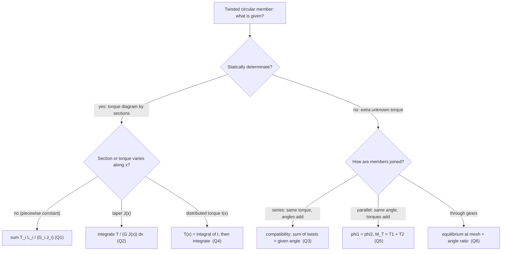

# AM2200 Tutorial 6 — Torsional Members

Part of [[Strength of Materials - MOC]] · Source: [[AM2200_2026_Tutorial 6.pdf]] · Previous: [[Q1 - Axially Loaded Member|Tutorial 5 — Axial Loading]] · Theory notes: [[Torsion of Circular Shafts]], [[Power Transmission by Shafts]], [[Strain Energy and Castigliano's Theorem]]

> [!abstract] What this note contains
> Theory first (§1), then the six problems solved in the order of the sheet (§2–§7), then a formula sheet and exam hints (§8). Every closed-form result was checked numerically with the verification script (see the end of this note), and Q1–Q6 agree with the handwritten solution in `AM2200 Tutorial-6 Solutions.pdf`.

> [!summary] Answers at a glance
> | Q | Result |
> |---|---|
> | 1(a) | $\tau_{max}=4.653$ ksi (segment BC) |
> | 1(b), (c) | $\phi_D=0.01707$ rad $=0.978^\circ$ (direct sum and Castigliano) |
> | 2 | $d_B/d_A=1.446$ (root of $3x^3-2x^2-2x-2=0$) |
> | 3 | $M_T=\dfrac{\alpha}{a/GJ_1+b/GJ_2}$, $\ \beta=\dfrac{M_Ta}{GJ_1}=\dfrac{\alpha a}{a+bJ_1/J_2}$ |
> | 4 | $\tau_{max}=\dfrac{8t_AL}{\pi d^3}$, $\ \phi=\dfrac{t_AL^2}{6GJ}=\dfrac{16\,t_AL^2}{3\pi Gd^4}$ |
> | 5 | $\phi=\dfrac{M_Tl}{G_1J_1+G_2J_2}$, $\ \tau_{1,max}=\dfrac{G_1R_1\phi}{l}$, $\ \tau_{2,max}=\dfrac{G_2R_2\phi}{l}$ |
> | 6 | $M_2=M_1R_2/R_1$; $d_1=\big(\tfrac{16M_1}{\pi\tau_{adm}}\big)^{1/3}$, $d_2=\big(\tfrac{16M_2}{\pi\tau_{adm}}\big)^{1/3}$; $\phi_C=\dfrac{32M_1}{\pi G}\Big[\dfrac{l_1}{d_1^4}+\dfrac{l_2}{d_2^4}\dfrac{R_2^2}{R_1^2}\Big]$ |

---

## 1. Theory

### 1.1 Torsion of a circular shaft (recap of [[Torsion of Circular Shafts]])
Plane sections stay plane and rotate rigidly, so the shear strain is linear in radius, $\gamma=\rho\,d\phi/dx$, and Hooke's law gives $\tau=G\gamma$:

$$\tau(\rho)=\frac{T\rho}{J},\qquad \tau_{max}=\frac{Tc}{J},\qquad \frac{d\phi}{dx}=\frac{T(x)}{GJ(x)}$$

| Section | $J$ | $\tau_{max}$ |
|---|---|---|
| solid, diameter $d$ | $\dfrac{\pi d^4}{32}$ | $\dfrac{16T}{\pi d^3}$ |
| tube, radii $c_i,c_o$ | $\dfrac{\pi}{2}(c_o^4-c_i^4)$ | $\dfrac{Tc_o}{J}$ |

Sign convention used here: torque vectors by the right-hand rule, positive when the vector points **out of** the cut face; a twist angle is the rotation of one section relative to another.

### 1.2 Angle of twist in the general case

$$\phi_{B/A}=\int_A^B\frac{T(x)}{G(x)J(x)}\,dx\ \xrightarrow{\text{piecewise const.}}\ \sum_i\frac{T_iL_i}{G_iJ_i}$$

The structure is the same as $\delta=\int N\,dx/(AE)$ for axial members ([[Axial Deformation]]): $GJ$ is the **torsional stiffness**. A useful analogy table:

| Axial | Torsion | Bending |
|---|---|---|
| force $N$ | torque $T$ | moment $M$ |
| $\sigma=N/A$ | $\tau=T\rho/J$ | $\sigma=My/I$ |
| $\delta=NL/AE$ | $\phi=TL/GJ$ | $\theta=ML/EI$ |
| stiffness $AE/L$ | $GJ/L$ | $EI/L$ |

### 1.3 Four problem types in this tutorial

### 1.4 Statically indeterminate torsion: the compatibility method
As with [[Statically Indeterminate Axial Members]]: (1) **equilibrium** (torque balance), (2) **compatibility** (the geometry that ties the twist angles together), (3) **torque–twist law** $\phi_i=T_iL_i/(G_iJ_i)$ in each member. Two basic arrangements:

| Arrangement | Equilibrium | Compatibility | Result |
|---|---|---|---|
| **series** (end-to-end, fixed at both ends) | internal torque $T$ the same in both | $\phi_1+\phi_2=\text{prescribed}$ (e.g. $=\alpha$) | $T=\dfrac{\text{prescribed}}{\sum L_i/G_iJ_i}$ (springs in series: flexibilities add) |
| **parallel** (concentric, bonded) | $M_T=T_1+T_2$ | $\phi_1=\phi_2$ | $\phi=\dfrac{M_Tl}{\sum G_iJ_i}$ (springs in parallel: stiffnesses add) |

### 1.5 Composite (bonded concentric) shafts
Strain is continuous across a bonded interface ($\gamma=\rho\phi/l$ is the same just inside and outside), but **stress jumps** by the ratio of the shear moduli: $\tau_1=G_1\gamma$ on one side, $\tau_2=G_2\gamma$ on the other. Hence for each material $\tau_i(\rho)=G_i\rho\,\phi/l$ and the maximum in material $i$ is at its outermost radius.

### 1.6 Gears
Two meshing gears exert equal and opposite tangential forces $F$ on each other at the mesh point, so
$$F=\frac{M_1}{R_1}=\frac{M_2}{R_2}\ \Rightarrow\ M_2=M_1\frac{R_2}{R_1}$$
and the arc length of the teeth in contact is equal, $R_1\phi_1=R_2\phi_2$, with **opposite** sense of rotation. This is the mechanical analogue of an ideal transformer: torque ↔ current ratio, angle ↔ voltage ratio ([[Gears, Transformers and Reflected Impedance|Gears, Transformers and Reflected Impedance]]); a twist in the driven shaft is "reflected" to the other side multiplied by $(R_2/R_1)^2$.

### 1.7 Energy view ([[Strain Energy and Castigliano's Theorem]])

$$U=\sum_i\frac{T_i^2L_i}{2G_iJ_i}\quad\text{or}\quad U=\int_0^L\frac{T(x)^2}{2GJ}\,dx$$

- **Work–energy:** for gradual loading $U=\tfrac12\sum T_k\phi_k$. With several torques this gives only one equation for several unknown angles, so it cannot give a single angle by itself.
- **Castigliano:** the rotation at the point where a torque $T_k$ acts (and in its direction) is $\phi_k=\partial U/\partial T_k$. Write the internal torques as functions of $T_k$, differentiate, then substitute the actual value. A **dummy torque** $Q$ (set to 0 afterwards) is used if no torque acts at the point.

---

## 2. Q1 — Stepped shaft ABCD

**Tests:** [[Torsion of Circular Shafts]] (piecewise shaft, torque diagram), [[Strain Energy and Castigliano's Theorem]] (angle by Castigliano)

### Problem
Steel shaft, three segments of length 25 in., diameters $d_{AB}=3.5$, $d_{BC}=2.75$, $d_{CD}=2.5$ in., $G=11.6\times10^3$ ksi. Torques 12.5 k-in. at B, 9.8 k-in. at C, 9.2 k-in. at D (all in the same sense, as in the figure); A is fixed. (a) $\tau_{max}$. (b) $\phi_D$ in degrees. (c) $\phi_D$ by an energy method.

### Given
$L_{AB}=L_{BC}=L_{CD}=25$ in.; $T_B=12.5$, $T_C=9.8$, $T_D=9.2$ k-in.; $G=11.6\times10^3$ ksi.

### Principle and why it applies
Three concentrated torques on a stepped solid shaft: the internal torque is constant within each segment (method of sections from the free end), and each segment obeys $\tau_{max}=16T/\pi d^3$, $\phi=TL/GJ$; the twist at D is the **sum** of the segment twists since A is fixed.

### Solution
**Internal torques** (cut each segment and balance on the free side, towards D):
$$T_{CD}=9.2,\qquad T_{BC}=9.2+9.8=19.0,\qquad T_{AB}=19.0+12.5=31.5\ \text{k-in.}$$

**Polar moments** $J=\pi d^4/32$: $J_{AB}=14.732$, $J_{BC}=5.615$, $J_{CD}=3.835$ in⁴.

**(a) Shear stress**, $\tau=16T/\pi d^3$:

| Segment | $T$ (k-in.) | $d$ (in.) | $\tau$ (ksi) |
|---|---|---|---|
| AB | 31.5 | 3.5 | 3.742 |
| BC | 19.0 | 2.75 | **4.653** |
| CD | 9.2 | 2.5 | 2.999 |

The largest stress is **not** in the segment with the largest torque (AB) but in BC, where the smaller diameter outweighs the lower torque.

**(b) Twist at D:**
$$\phi_D=\frac{T_{AB}L}{GJ_{AB}}+\frac{T_{BC}L}{GJ_{BC}}+\frac{T_{CD}L}{GJ_{CD}}=\frac1{11.6\times10^3}\Big[\frac{31.5(25)}{14.732}+\frac{19(25)}{5.6147}+\frac{9.2(25)}{3.835}\Big]$$
$$=0.004608+0.007293+0.005170=0.01707\ \text{rad}=\mathbf{0.978^\circ}$$
(partial twists: $\phi_B=0.2640^\circ$, $\phi_C=0.6819^\circ$, $\phi_D=0.9781^\circ$).

**(c) Energy method.** Strain energy of the shaft:
$$U=\sum\frac{T_i^2L_i}{2GJ_i}=0.16564\ \text{k-in.}\ \Big(=\tfrac12\sum T_k\phi_k=\tfrac12(12.5\phi_B+9.8\phi_C+9.2\phi_D)\ \text{✓ same value}\Big)$$
Work = energy alone cannot isolate $\phi_D$ (three torques, three unknown angles), so use **Castigliano**: treat the torque at D as the variable $T_D$. The internal torques are $T_{CD}=T_D$, $T_{BC}=T_D+9.8$, $T_{AB}=T_D+9.8+12.5$, each with $\partial T/\partial T_D=1$:
$$\phi_D=\frac{\partial U}{\partial T_D}=\sum\frac{T_iL_i}{G_iJ_i}\frac{\partial T_i}{\partial T_D}=\frac{T_{AB}L}{GJ_{AB}}+\frac{T_{BC}L}{GJ_{BC}}+\frac{T_{CD}L}{GJ_{CD}}\Big|_{T_D=9.2}=0.01707\ \text{rad}$$

![[SM-T6-Q1-stepped-shaft.png]]

**Figure:** Torque diagram, surface stress and cumulative twist along the shaft. The stress curve steps up in BC even though $T$ steps down; the twist grows fastest in the thin segments CD and BC.

### Result
$$\boxed{\tau_{max}=4.65\ \text{ksi (in BC)},\qquad \phi_D=0.0171\ \text{rad}=0.978^\circ}$$

### Check
Units: k-in.·in./(ksi·in⁴) is dimensionless ✓. The numerical Castigliano derivative $\partial U/\partial T_D$ (finite difference) gives 0.017071 rad ✓, and $W=U=0.16564$ k-in. ✓.

### Trap / alternative
- Do **not** use the largest torque with the smallest diameter, or the largest torque with the largest diameter: compute $\tau$ for every segment.
- If a torque is reversed in the figure the internal torques subtract; the sheet's figure has all three in the same sense (confirmed by the reference answer).
- Alternative for (c): unit-load method $\phi_D=\sum\dfrac{T_i\,t_i\,L_i}{G_iJ_i}$ with $t_i=1$ for a unit torque at D — identical to the Castigliano result.

---

## 3. Q2 — Tapered bar

**Tests:** [[Torsion of Circular Shafts]] (variable $J(x)$ integral)

### Problem
Solid circular bar of length $L$, diameter varying linearly from $d_A$ to $d_B$, torque $T$. Find $d_B/d_A$ such that the twist is half that of a prismatic bar of diameter $d_A$ (same $G$, $L$, $T$).

### Principle and why it applies
$J$ changes continuously, so the constant-section formula cannot be used; apply $d\phi=T\,dx/GJ(x)$ to a slice and integrate. The linear taper makes $d(x)$ linear, so the integral reduces to $\int du/u^4$.

### Solution
$d(x)=d_A+\dfrac{d_B-d_A}{L}x$, $J(x)=\dfrac{\pi d^4}{32}$. With $u=d(x)$, $dx=\dfrac{L}{d_B-d_A}du$:
$$\phi_{taper}=\frac{32T}{\pi G}\int_0^L\frac{dx}{d^4}=\frac{32TL}{\pi G(d_B-d_A)}\int_{d_A}^{d_B}\frac{du}{u^4}=\frac{32TL}{3\pi G(d_B-d_A)}\Big(\frac1{d_A^3}-\frac1{d_B^3}\Big)$$
Using $d_B^3-d_A^3=(d_B-d_A)(d_B^2+d_Ad_B+d_A^2)$:
$$\phi_{taper}=\frac{32TL}{3\pi G}\,\frac{d_A^2+d_Ad_B+d_B^2}{d_A^3d_B^3},\qquad \phi_{prism}=\frac{32TL}{\pi Gd_A^4}$$
With $x=d_B/d_A$:
$$\frac{\phi_{taper}}{\phi_{prism}}=\frac{1+x+x^2}{3x^3}=\frac12\ \Longrightarrow\ 3x^3-2x^2-2x-2=0$$
The only real root is $x=1.4463$ (the other two are complex).

![[SM-T6-Q2-taper.png]]

**Figure:** The ratio $(1+x+x^2)/3x^3$ falls from 1 at $x=1$ (prismatic) and reaches ½ at $x=1.446$.

### Result
$$\boxed{\frac{d_B}{d_A}=1.446}$$

### Check
Numerical integration of $\int d\phi$ with $d_B=1.4463d_A$ gives $\phi_t/\phi_p=0.5000$ ✓. Limit: $x\to1$ gives ratio 1 ✓.

### Trap / alternative
Using the **average** diameter $(d_A+d_B)/2$ in $\phi=TL/GJ$ is wrong (it would give $x=1.378$ instead of 1.446): $\phi\propto d^{-4}$ is strongly non-linear, so the narrow end dominates the twist.

---

## 4. Q3 — Hollow and solid shafts joined by a bolt (misfit)

**Tests:** [[Torsion of Circular Shafts]] (statically indeterminate), [[Statically Indeterminate Axial Members]] (same method)

### Problem
Hollow shaft ① (length $a$, torsional stiffness $GJ_1$, fixed on the left) and solid shaft ② (length $b$, $GJ_2$, fixed on the right) are joined at A by a bolt. In the stress-free state their ends are rotated by $\alpha$ relative to each other. Find the torque $M_T$ and the bolt rotation $\beta$ after assembly.

### Principle and why it applies
Once the bolt is in, both shafts carry the **same** internal torque $M_T$ (equilibrium at A) but the problem has an extra unknown: it is solved by **compatibility** — the two twists together must absorb the misfit $\alpha$.

### Solution
Twists of each shaft (cut at A):
$$\phi_1=\frac{M_Ta}{GJ_1},\qquad \phi_2=\frac{M_Tb}{GJ_2}$$
Compatibility: the misfit is made up by the two shafts, $\phi_1+\phi_2=\alpha$ (equivalently $\phi_1=\alpha-\phi_2$ and the bolt rotates through $\beta=\phi_1$):
$$M_T\Big(\frac a{GJ_1}+\frac b{GJ_2}\Big)=\alpha\ \Longrightarrow\ M_T=\frac{\alpha}{\dfrac a{GJ_1}+\dfrac b{GJ_2}}=\frac{\alpha\,GJ_1GJ_2}{aGJ_2+bGJ_1}$$
$$\beta=\phi_1=\frac{M_Ta}{GJ_1}=\frac{\alpha\,a}{a+b\,J_1/J_2}$$
(the more flexible shaft takes the larger share of $\alpha$).

![[SM-T6-Q3-mismatch.png]]

**Figure:** Example with steel, $a=0.5$ m, $b=0.4$ m, hollow $D_o/D_i=40/34$ mm, solid $d=30$ mm, $\alpha=2^\circ$: $M_T=304$ N·m, $\beta=0.906^\circ$, $\phi_2=1.094^\circ$, and $\beta+\phi_2=\alpha$ ✓.

### Result
$$\boxed{M_T=\frac{\alpha}{a/GJ_1+b/GJ_2},\qquad \beta=\frac{\alpha\,a}{a+b\,J_1/J_2}}$$

### Check
Limits: $GJ_2\to\infty$ (rigid solid shaft) gives $M_T=\alpha GJ_1/a$ and $\beta=\alpha$ (all the misfit goes into shaft ①) ✓. $\alpha=0$ gives $M_T=0$ ✓ (no pre-stress).

### Trap / alternative
Signs: both shafts end up twisted so that their relative rotation is $\alpha$; do not subtract $\phi_1-\phi_2$. Same structure as two springs in series with a prescribed total displacement.

---

## 5. Q4 — Bar under distributed torque

**Tests:** [[Torsion of Circular Shafts]] (integrate $T(x)$), [[Relations Between Load, Shear, and Moment]] (the same load → internal-resultant integration)

### Problem
Prismatic solid bar AB (diameter $d$, length $L$, shear modulus $G$), fixed at A, with a distributed torque $t(x)$ per unit length varying linearly from $t_A$ at A to 0 at B. Find (a) $\tau_{max}$, (b) the twist $\phi$ between the ends.

### Principle and why it applies
The torque per unit length is a "load intensity": the internal torque at a section is the integral of the distributed torque **beyond** the section (towards the free end), exactly like shear force from a distributed load. Then $\tau=16T/\pi d^3$ and $\phi=\int T\,dx/GJ$.

### Solution
$t(x)=t_A\Big(1-\dfrac xL\Big)$ ($x$ from the fixed end A).
$$T(x)=\int_x^Lt(s)\,ds=\frac{t_A}{L}\int_x^L(L-s)\,ds=\frac{t_A(L-x)^2}{2L}$$
Maximum at the wall: $T_{max}=T(0)=\dfrac{t_AL}{2}$ (the total applied torque, the area of the triangle).

**(a)**
$$\tau_{max}=\frac{16T_{max}}{\pi d^3}=\boxed{\frac{8\,t_AL}{\pi d^3}}$$

**(b)**
$$\phi=\int_0^L\frac{T(x)}{GJ}dx=\frac{t_A}{2LGJ}\int_0^L(L-x)^2dx=\frac{t_AL^2}{6GJ}=\boxed{\frac{16\,t_AL^2}{3\pi Gd^4}}$$

![[SM-T6-Q4-distributed-torque.png]]

**Figure:** The triangular load, the parabolic internal torque (maximum at the wall, zero at the free end) and the cubic growth of the twist.

### Check
For a uniform $t_A$ the same method would give $\phi=t_AL^2/2GJ$; the triangle gives one-third of that ✓ (because $T(x)=t_A(L-x)^2/2L$ falls off quadratically instead of linearly). Numerically (example $t_A=500$ N·m/m, $L=1.2$ m, $d=40$ mm, $G=80$ GPa): $\tau_{max}=23.87$ MPa, $\phi=0.342^\circ$ — the integral and the closed forms agree ✓.

### Trap / alternative
The maximum stress is at the **fixed** end where the internal torque is largest, not at the end where the distributed torque is largest by coincidence (they happen to coincide here). Don't use $t_A$ as an internal torque: its units are torque per length.

---

## 6. Q5 — Tube heat-shrunk on a shaft

**Tests:** [[Torsion of Circular Shafts]] (composite), [[Composite Members under Axial Load]] (the parallel-spring analogy)

### Problem
Shaft ① (radius $R_1$, shear modulus $G_1$) is surrounded by a shrink-fitted tube ② (inner radius $R_1$, outer $R_2$, shear modulus $G_2$), length $l$, fixed at one end, torque $M_T$ at the other. Find the maximum shear stresses in ① and ② and the twist.

### Principle and why it applies
The two members are joined along the whole length, so they must twist by the **same angle** (parallel springs), and together they carry the applied torque. Equilibrium plus compatibility give two equations for $T_1,T_2$.

### Solution
$$J_1=\frac{\pi R_1^4}{2},\qquad J_2=\frac{\pi}{2}(R_2^4-R_1^4)$$
Compatibility $\phi_1=\phi_2=\phi$; equilibrium $M_T=T_1+T_2$; stiffness law $T_i=G_iJ_i\phi/l$:
$$M_T=\frac{(G_1J_1+G_2J_2)\phi}{l}\ \Rightarrow\ \boxed{\phi=\frac{M_Tl}{G_1J_1+G_2J_2}=\frac{M_Tl}{\dfrac\pi2R_1^4\Big[G_1+G_2\Big(\dfrac{R_2^4}{R_1^4}-1\Big)\Big]}}$$
$$T_1=\frac{G_1J_1}{G_1J_1+G_2J_2}M_T,\qquad T_2=\frac{G_2J_2}{G_1J_1+G_2J_2}M_T$$
Maximum shear stresses (outermost fibre of each material):
$$\tau_{1,max}=\frac{T_1R_1}{J_1}=\frac{G_1R_1\phi}{l}=\boxed{\frac{G_1M_TR_1}{G_1J_1+G_2J_2}},\qquad
\tau_{2,max}=\frac{T_2R_2}{J_2}=\frac{G_2R_2\phi}{l}=\boxed{\frac{G_2M_TR_2}{G_1J_1+G_2J_2}}$$

![[SM-T6-Q5-composite-shaft.png]]

**Figure:** Shear-stress profile $\tau(r)=G(r)\,r\,\phi/l$ for a steel core ($R_1=20$ mm) in an aluminium tube ($R_2=30$ mm), $M_T=2$ kN·m. The strain is continuous at the interface, the **stress jumps** from 67.1 to 22.7 MPa because $G_1\neq G_2$.

### Result
Formulas above. For the example ($l=1$ m): $\phi=2.40^\circ$, $T_1=843$ N·m (42 % of $M_T$), $T_2=1157$ N·m (58 %), $\tau_{1,max}=67.1$ MPa, $\tau_{2,max}=34.0$ MPa. Each member's share of the torque is $G_iJ_i/\sum G_jJ_j$.

### Check
$T_1+T_2=M_T$ ✓ (843.5 + 1156.5 = 2000). If $G_1=G_2=G$ the result collapses to the homogeneous solid shaft $\tau=M_TR_2/J$ with $J=\pi R_2^4/2$ ✓.

### Trap / alternative
Don't assume equal torques or equal stresses in the two materials: **angles** (strain) are equal, not stresses or torques. Always evaluate the stress at the outer radius of each material using that material's $G$ ($\tau_2$ at $R_1$ is only 22.7 MPa, not 67 MPa).

---

## 7. Q6 — Gear system

**Tests:** [[Torsion of Circular Shafts]], [[Power Transmission by Shafts]], [[Gears, Transformers and Reflected Impedance|Gears, Transformers and Reflected Impedance]]

### Problem
Shafts ① (length $l_1$, diameter $d_1$, loaded by torque $M_1$ at C) and ② (length $l_2$, $d_2$, torque $M_2$ at A) of the same material are coupled by gears of radii $R_1$ and $R_2$ at B. (a) Find $M_2$ for equilibrium. (b) Choose $d_1$, $d_2$ for an admissible shear stress $\tau_{adm}$. (c) Find the rotation at C if shaft ② is fixed at A.

### Principle and why it applies
Gears transmit torque through a tangential tooth force; the tooth force is the same on both gears, which relates $M_2$ to $M_1$. For rotation, the teeth in contact move equally, which relates the gear angles.

![[SM-T6-Q6-gear-train.png]]

**Figure:** Left: layout of Fig. 6 with the common tooth force at the mesh. Right: the angle accumulates along shaft ② (A→B), is **scaled by $R_2/R_1$** at the gear, and then accumulates along shaft ① (B→C). Numbers are an example ($R_1=100$, $R_2=50$ mm, $M_1=500$ N·m, $l_1=0.6$, $l_2=0.4$ m, $\tau_{adm}=60$ MPa, $G=80$ GPa).

### Solution
**(a)** Tooth force on shaft ①'s gear: $F=M_1/R_1$. The reaction acts on gear ②, so
$$\boxed{M_2=FR_2=M_1\frac{R_2}{R_1}}$$
(opposite sense of rotation, as drawn).

**(b)** Shaft ① carries $T_1=M_1$, shaft ② carries $T_2=M_2=M_1R_2/R_1$ along their whole lengths; $\tau_{max}=16T/\pi d^3\le\tau_{adm}$:
$$\boxed{d_1\ge\Big(\frac{16M_1}{\pi\tau_{adm}}\Big)^{1/3},\qquad d_2\ge\Big(\frac{16M_2}{\pi\tau_{adm}}\Big)^{1/3}=d_1\Big(\frac{R_2}{R_1}\Big)^{1/3}}$$
(example: $d_1=34.9$ mm, $d_2=27.7$ mm; the shaft with the smaller torque is thinner).

**(c)** Fix shaft ② at A. Twist of shaft ②, which is the rotation of gear ② at B:
$$\phi_B=\frac{M_2\,l_2}{GJ_2}$$
Gear ① rotates by $\phi_B R_2/R_1$ (equal arc length, opposite sense). The end C then rotates by this plus the twist of shaft ①:
$$\phi_C=\frac{R_2}{R_1}\phi_B+\frac{M_1l_1}{GJ_1}=\frac{M_1l_1}{GJ_1}+\Big(\frac{R_2}{R_1}\Big)^2\frac{M_1l_2}{GJ_2}$$
With $J_i=\pi d_i^4/32$:
$$\boxed{\phi_C=\frac{32M_1}{\pi G}\Big[\frac{l_1}{d_1^4}+\frac{l_2}{d_2^4}\Big(\frac{R_2}{R_1}\Big)^2\Big]}$$

### Result
$M_2=M_1R_2/R_1$; diameters and $\phi_C$ as boxed. Example: $M_2=250$ N·m, $\phi_B=1.242^\circ$, $\phi_C=2.099^\circ$.

### Check
Power balance: $M_1\omega_1=M_2\omega_2$ with $\omega_1/\omega_2=R_2/R_1$ gives the same $M_2$ ✓. Reflection check: the flexibility of shaft ② appears in $\phi_C$ multiplied by $(R_2/R_1)^2$ — the same factor as an impedance reflected through a transformer of turns ratio $R_2/R_1$ ✓. Numerically, summing the two shaft rotations step by step equals the closed form (2.0992°) ✓.

### Trap / alternative
Do **not** simply add $\phi_1+\phi_2$: the twist of shaft ② must be multiplied by the gear ratio $R_2/R_1$ before adding to shaft ①'s twist. If the shafts have different lengths and stiffnesses, the torque is **not** the same in both ($M_2\ne M_1$) — it differs by the gear ratio.

---

## 8. Revision

### 8.1 Formula sheet

| Situation | Formula |
|---|---|
| stress, solid shaft | $\tau_{max}=16T/(\pi d^3)$ |
| twist, uniform | $\phi=TL/(GJ)$ |
| piecewise | $\phi=\sum T_iL_i/(G_iJ_i)$ (draw torque diagram first) |
| variable section | $\phi=\int T\,dx/(GJ(x))$ |
| linear taper | $\phi=\dfrac{32TL}{3\pi G}\dfrac{d_A^2+d_Ad_B+d_B^2}{d_A^3d_B^3}$ |
| distributed torque | $T(x)=\int_x^Lt\,ds$ |
| series + misfit $\alpha$ | $M_T=\alpha/\sum(L_i/G_iJ_i)$ |
| parallel / composite | $\phi=M_Tl/\sum G_iJ_i$, $\ \tau_i=G_iR_i\phi/l$ |
| gears | $M_2=M_1R_2/R_1$; $\ \phi_2=\phi_1R_1/R_2$ |
| energy | $U=\sum T^2L/(2GJ)$; $\ \phi_k=\partial U/\partial T_k$ |

### 8.2 Recognise the type
- "stepped shaft with several torques" → torque diagram, sum $TL/GJ$, check $\tau$ in **every** segment.
- "tapered / varying diameter" → integrate; substitute $u=d(x)$.
- "distributed torque $t(x)$" → $T(x)=\int t$, then integrate again for $\phi$.
- "two shafts joined, fixed at both ends / initial gap or misfit" → series compatibility $\sum\phi_i=\alpha$.
- "tube on shaft, heat shrunk, bonded" → parallel: equal $\phi$, $M_T=T_1+T_2$.
- "gears" → force at mesh, $M_2=M_1R_2/R_1$, twist transfers with the ratio.

### 8.3 Cross-domain
- Parallel/series structure ↔ springs, and [[Statically Indeterminate Axial Members]] (same equations with $AE\leftrightarrow GJ$).
- Gear reflection ↔ transformer: [[Gears, Transformers and Reflected Impedance|Gears, Transformers and Reflected Impedance]].
- $J$ as a second moment: [[Second Moments of Area - One Integral, Many Jobs|Second Moments of Area]].

## Verification script
`Strength of materials/Tools/sm_t6.py` recomputes every number in this note (stresses, twists, the Castigliano derivative, the Q2 root, the Q3–Q6 example numbers, the energy balance $W=U$) and regenerates the figures in `assets/SM-T6-*.png`.

---
Previous: [[Q1 - Axially Loaded Member|Tutorial 5 — Axial Loading]] · Index: [[Strength of Materials - MOC]]
