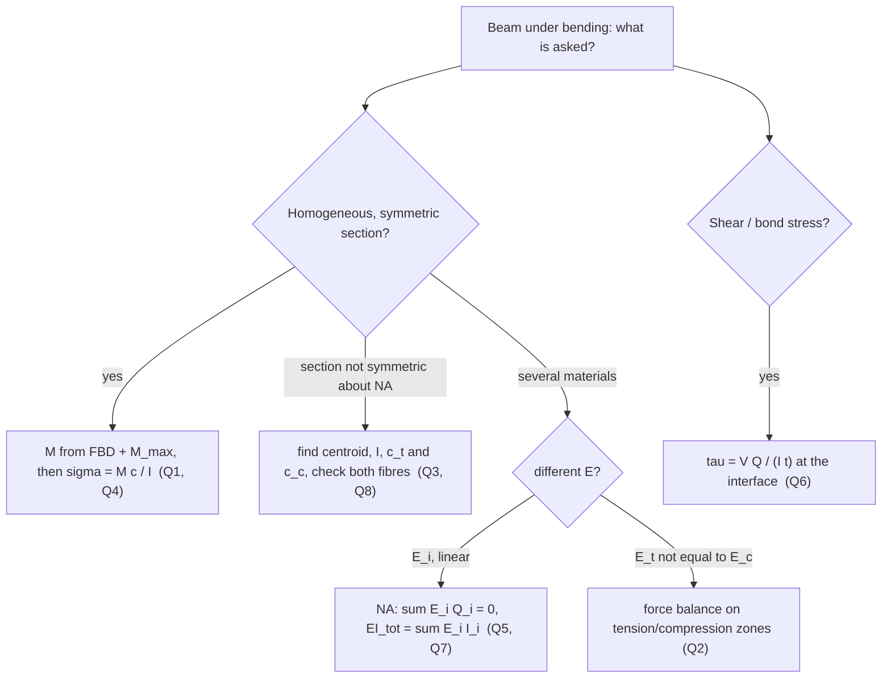

---
tags:
  - tutorial
  - strength-of-materials
  - bending
  - shear
  - MOC
course: AM2200 Strength of Materials (July–November 2026)
source: "[[AM2200_2026_Tutorial 7.pdf]]"
aliases:
  - AM2200 Tutorial 7
  - Bending and Shear Stresses tutorial
---
# AM2200 Tutorial 7 — Bending and Shear Stresses

Part of [[Strength of Materials - MOC]] · Source: [[AM2200_2026_Tutorial 7.pdf]] · Previous: [[Tutorial 6 - Torsional Members|Tutorial 6 — Torsional Members]] · Theory notes: [[Flexure Formula]], [[Shear Stress Formula for Beams]], [[Shear Force and Bending Moment Diagrams]], [[Unsymmetric and Combined Bending]]

> [!abstract] What this note contains
> Theory first (§1), then the eight problems in the order of the sheet (§2–§9), then a formula sheet and exam hints (§10). Every number was reproduced independently by the verification script at the end (closed form versus brute-force numerical integration over the cross-section). There is no reference solution for this sheet, so the checks are internal: units, limiting cases (e.g. $E_t=E_c$) and numerical integration.

> [!summary] Answers at a glance
> | Q | Result |
> |---|---|
> | 1 | $d_{min}=\gamma L^2/\sigma_{allow}=0.0851$ ft $=\mathbf{1.02}$ in |
> | 2 | $c=\dfrac{h\sqrt{E_t}}{\sqrt{E_t}+\sqrt{E_c}}$ (compression side), $\ \sigma_{c,max}=\dfrac{3M(\sqrt{E_t}+\sqrt{E_c})}{bh^2\sqrt{E_t}}$ |
> | 3 | $M_B=1913$ N·m, $\ \bar z=37.15$ mm, $I=7.99\times10^5$ mm⁴, $\ \sigma_{max}=88.9$ MPa, $\ \varepsilon_{max}=7.11\times10^{-4}$ |
> | 4 | $M=36.46$ kN·m, $\ \sigma_{max}=40$ MPa (top compression, bottom tension) |
> | 5 | plywood governs: $M_{max}=171.5$ k·in $=14.3$ kip·ft |
> | 6 | variant 1: $F=\tfrac{10}{3}\tau_{allow}a^2$; variant 2: $F=\tfrac92\tau_{allow}a^2$ (variant 2 carries $1.35\times$ more) |
> | 7 | (a) $b=\dfrac{E_s}{3E_c}h=2h=800$ mm; (b) $\sigma_{c,top}=-7.81$ MPa, $\sigma_{s,bottom}=+93.75$ MPa |
> | 8 | $M=1.37$ kip·in (compression at the notch side governs) |

---

## 1. Theory

### 1.1 The two assumptions behind every bending problem
1. **Plane sections remain plane** (Euler–Bernoulli). A cross-section rotates rigidly, so the longitudinal strain is **linear** in the distance $y$ from the neutral axis (NA):
$$\varepsilon(y)=-\kappa\,y,\qquad \kappa=\frac1\rho=\frac{M}{EI}$$
2. **Material law** $\sigma=\sigma(\varepsilon)$ (here always linear elastic, but possibly with a different modulus in different places).

Then the *only* two equations the section has to satisfy are the stress resultants:
$$\boxed{\int_A\sigma\,dA=0}\ \ (\text{fixes the NA}),\qquad \boxed{-\int_A\sigma\,y\,dA=M}\ \ (\text{fixes }\kappa)$$
For a homogeneous linear section these give the NA through the centroid and $\sigma=-My/I$ ([[Flexure Formula]]). Every problem on this sheet is one of those two integrals done in a slightly unusual setting. Keep that in mind: if you forget a formula you can always rederive it from these two lines.

**Sign convention used here.** $y$ upward from the NA, positive (sagging) $M$ gives compression on top. $\sigma_{max}=Mc/I$ with $c$ the distance to the farthest fibre; assign tension/compression by looking at which side of the NA the fibre is on and which way the beam bends.

### 1.2 Section properties
| Section | $I$ about centroidal axis |
|---|---|
| rectangle $b\times h$ | $bh^3/12$ |
| solid circle, diameter $d$ | $\pi d^4/64$ |
| semicircle (radius $r$) about its flat edge | $\pi r^4/8$; centroid $4r/3\pi$ from the flat edge |

Built-up sections: locate $\bar y=\sum A_i y_i/\sum A_i$, then use the **parallel-axis theorem** $I=\sum(I_{c,i}+A_id_i^2)$. A hole or notch is a *negative* area. If you compute $I$ about a convenient edge (as in Q8) you must subtract $A\bar y^2$ at the end to get the *centroidal* value.

### 1.3 Beams of several materials (Q5, Q7)
Strain is still one straight line $\varepsilon=-\kappa y$ across all materials (perfect bond), but the **stress** is $\sigma_i=-E_i\kappa y$, so it jumps at an interface by the ratio of moduli, exactly as the shear stress jumped by $G_1/G_2$ in the shrink-fit shaft of [[Tutorial 6 - Torsional Members|Tutorial 6]]. The two resultant equations become

$$\sum_iE_i\int_{A_i}y\,dA=0\ \ (\text{NA}),\qquad \kappa=\frac{M}{\sum_iE_iI_i}=\frac{M}{(EI)_{tot}},\qquad \sigma_i=-\frac{E_iM\,y}{(EI)_{tot}}$$

with $I_i$ taken about the **common NA** (parallel-axis theorem), not about each part's own centroid. The transformed-section trick is the same thing in disguise: replace each material by an equivalent area of a reference material with width scaled by $n_i=E_i/E_{ref}$ and use the ordinary formula; remember to multiply the stress back by $n_i$.

> [!tip] Analogy
> $(EI)_{tot}=\sum E_iI_i$ is the bending version of "parallel springs add" ($\sum E_iA_i$ in [[Statically Indeterminate Axial Members]], $\sum G_iJ_i$ in Tutorial 6). Material that is stiffer *and* farther from the NA attracts the stress.

### 1.4 Materials with different tension and compression moduli (Q2)
A bimodular material ($E_t\ne E_c$) keeps linear strain but the stress profile has a **kink at the NA**, so the NA is no longer at the centroid: it shifts toward the stiffer side. Force balance (area $\times$ average stress, each triangle) fixes its position; the moment equation then gives $\kappa$.

### 1.5 Unequal allowable stresses (Q8)
When $\sigma_{allow,t}\ne\sigma_{allow,c}$ and the section is unsymmetric about the NA, **both** fibres must be checked, and the smaller resulting $M$ governs:
$$M\le\min\Big(\frac{\sigma_{t,allow}I}{c_t},\ \frac{\sigma_{c,allow}I}{c_c}\Big)$$
The governing side is often *not* the one with the larger distance to the NA, because the allowables differ.

### 1.6 Shear in beams and the bond (glue) line (Q6)
From [[Shear Stress Formula for Beams]]:
$$\tau=\frac{VQ}{It},\qquad Q=\int_{A'}y\,dA=A'\bar y'$$
$A'$ is the area **beyond** the line where $\tau$ is wanted, $\bar y'$ its centroid distance from the NA, $t$ the **width of the cut** at that line. For a glued joint the cut is the glue line, so $t$ is the *contact width* and $A'$ the whole part on the far side of the glue. The same quantity as a **shear flow** $q=\tau t=VQ/I$ (N/m) is what fasteners or glue must carry per unit length. For the cantilever of Q6 $V=F$ everywhere.

### 1.7 Which tool for which problem

---

## 2. Q1 — Steel rod carrying its own weight

**Tests:** [[Flexure Formula]], [[Shear Force and Bending Moment Diagrams]] (uniform load, $M_{max}=wL^2/8$)

### Problem
Solid steel rod of diameter $d$, simply supported over $L=10$ ft, $\gamma=490$ lb/ft³. Smallest $d$ so that the bending stress does not exceed 4 ksi.

### Given
$L=10$ ft, $\gamma=490$ lb/ft³ ($=0.2836$ lb/in³), $\sigma_{allow}=4000$ psi $=576\,000$ lb/ft². The only load is the self-weight.

### Principle and why it applies
Self-weight is a uniformly distributed load $w=\gamma A$ along a simply supported beam, so $M_{max}=wL^2/8$ at midspan, and the stress is $M_{max}c/I$ with $c=d/2$, $I=\pi d^4/64$. The unknown $d$ appears in the load *and* in the section, so it must be eliminated algebraically rather than guessed.

### Solution
$$w=\gamma\frac{\pi d^2}{4},\qquad M_{max}=\frac{wL^2}{8}=\frac{\gamma\pi d^2L^2}{32},\qquad S=\frac{I}{c}=\frac{\pi d^3}{32}$$
$$\sigma_{max}=\frac{M_{max}}{S}=\frac{\gamma\pi d^2L^2/32}{\pi d^3/32}=\frac{\gamma L^2}{d}$$
The $d^2$ in the weight cancels against $d^3$ in $S$, leaving $\sigma\propto1/d$:
$$d=\frac{\gamma L^2}{\sigma_{allow}}=\frac{490(10)^2}{576\,000}=0.08507\ \text{ft}=\mathbf{1.021\ in.}$$
Then $w=\gamma\pi d^2/4=2.785$ lb/ft, $M_{max}=34.8$ lb·ft, and $\sigma=M/S=4000$ psi ✓.

![[SM-T7-Q1-rod.png]]

**Figure:** loading, parabolic moment diagram and the $\sigma=\gamma L^2/d$ hyperbola. Making the rod thicker helps only like $1/d$ because the load grows as $d^2$.

### Result
$$\boxed{d_{min}\approx1.02\ \text{in.}}$$

### Check
Units: lb/ft³ · ft² / (lb/ft²) = ft ✓. $\sigma$ at the computed $d$ evaluates to exactly 4000 psi. Note $\sigma_{max}=\gamma L^2/d$ is independent of the steel's modulus and depends only on slenderness-like ratio $L^2/d$.

### Trap / alternative
- Do not pick $d$ as given: forgetting the self-weight depends on $d$ gives a "load" with no unknown and an inconsistent equation.
- Mixed units (ft vs in, psi vs lb/ft²): convert once at the start; $4000$ psi $=4000\times144=576\,000$ lb/ft².
- Shear at the supports ($V=wL/2\approx14$ lb) is negligible here; the design is bending-controlled.

---

## 3. Q2 — Beam with different moduli in tension and compression

**Tests:** §1.1 (the two resultant equations) and §1.4

### Problem
Rectangular section $b\times h$, bending moment $M$, stress–strain curve with slope $E_t$ in tension and $E_c$ in compression (Fig. 2). Find the position $c$ of the NA and the maximum compressive stress.

### Given
$b,h,M,E_t,E_c$. In the figure $c$ is measured from the bottom face to the NA, so the **bottom is the compression side**; for the opposite sense of $M$ swap $E_t\leftrightarrow E_c$.

### Principle and why it applies
Plane sections remain plane, so $\varepsilon=\kappa(y-c)$ with $y$ from the bottom. Hooke's law with the two moduli gives a bilinear stress profile. Two unknowns, $c$ and $\kappa$, two equations: net force zero and moment $=M$.

### Solution
Compression zone depth $c$, tension zone depth $h-c$. Each is a triangle of stress, so

$$F_c=\tfrac12E_c\kappa c\cdot c\,b=\tfrac12E_c\kappa bc^2,\qquad F_t=\tfrac12E_t\kappa b(h-c)^2$$

**Force balance** $F_c=F_t$:
$$\sqrt{E_c}\,c=\sqrt{E_t}\,(h-c)\ \Longrightarrow\ \boxed{c=\frac{h\sqrt{E_t}}{\sqrt{E_t}+\sqrt{E_c}}},\qquad h-c=\frac{h\sqrt{E_c}}{\sqrt{E_t}+\sqrt{E_c}}$$

**Moment** about the NA (each triangular force acts at $\tfrac23$ of its depth from the NA):
$$M=F_c\tfrac23c+F_t\tfrac23(h-c)=\frac{\kappa b}{3}\big[E_cc^3+E_t(h-c)^3\big]$$
With $S\equiv\sqrt{E_t}+\sqrt{E_c}$: $E_cc^3+E_t(h-c)^3=\dfrac{h^3}{S^3}\big(E_cE_t^{3/2}+E_tE_c^{3/2}\big)=\dfrac{h^3E_tE_c}{S^2}$, hence
$$\kappa=\frac{3MS^2}{bh^3E_tE_c}$$

**Maximum compressive stress** at the bottom face:
$$\sigma_{c,max}=E_c\kappa c=\frac{3MS^2}{bh^3E_tE_c}\,E_c\,\frac{h\sqrt{E_t}}{S}=\boxed{\frac{3M\big(\sqrt{E_t}+\sqrt{E_c}\big)}{bh^2\sqrt{E_t}}}$$
(and, for completeness, $\sigma_{t,max}=\dfrac{3M(\sqrt{E_t}+\sqrt{E_c})}{bh^2\sqrt{E_c}}$ at the top.)

![[SM-T7-Q2-bimodular.png]]

**Figure:** the bilinear $\sigma$–$\varepsilon$ law, the shifted neutral axis (example $E_t=1,\ E_c=2$ gives $c=0.414\,h$) and the resulting kinked stress profile. The kink is a change of slope, not a jump, because strain is continuous.

![[SM-T7-Q2-na-shift.png]]

**Figure:** compression-side depth $c/h=\sqrt{E_t}/(\sqrt{E_t}+\sqrt{E_c})$ against $E_t/E_c$ — a 1 to 1 modulus ratio gives mid-depth, and the stiffer side occupies the *smaller* depth.

### Result
$$\boxed{c=\frac{h\sqrt{E_t}}{\sqrt{E_t}+\sqrt{E_c}},\qquad \sigma_{c,max}=\frac{3M(\sqrt{E_t}+\sqrt{E_c})}{bh^2\sqrt{E_t}}}$$

### Check
- $E_t=E_c=E$: $c=h/2$ and $\sigma=6M/bh^2$, the ordinary rectangular-beam value ✓.
- Numerical integration of $\int\sigma\,dA$ and $\int\sigma y\,dA$ for $E_t=1,E_c=2$ reproduces $c=0.41421h$ and the same $M$–$\kappa$ relation ✓.

### Trap / alternative
- The NA is **not** at mid-depth; assuming it is gives the wrong answer by a wide margin when $E_t/E_c$ is far from 1.
- The stiffer-in-compression side ($E_c>E_t$) sits at the *bottom* here and has the *smaller* depth $c$, yet it carries the larger stress.
- Use $\kappa$ (not $E$) as the bookkeeping variable: $\sigma=E\varepsilon$ has two different $E$'s, but $\kappa$ is common.

---

## 4. Q3 — Diving board

**Tests:** [[Shear Force and Bending Moment Diagrams]] (overhanging beam), [[Flexure Formula]] (unsymmetric section), strain from stress

### Problem
Man of mass 78 kg at the free end C of a board with a pin at A and a roller at B, $AB=1.5$ m, $BC=2.5$ m. The section is shown in the figure; $E=125$ GPa. Find the maximum normal strain.

### Given
$W=78(9.81)=765.2$ N at C. Section (mm): top plate $350\times20$; three legs each $10$ wide $\times30$ tall hanging below it (so total depth 50 mm). The weight of the board is neglected.

### Principle and why it applies
A statically determinate overhanging beam, so equilibrium gives the reactions and $M(x)$. The extreme moment is at the roller B, and the stress there follows from the flexure formula with the distance to the *farthest* fibre of an unsymmetric section.

### Solution
**Reactions.** $\sum M_B=0$: $R_A(1.5)=W(2.5)\Rightarrow R_A=1.667W=1275.3$ N **downward** (the pin holds the board down); $\sum F_y=0$: $R_B=W+1.275\text{ kN}=2040.5$ N upward.

**Moment.** Between B and C, $M=-W(4-x)$, reaching $|M|=W(2.5)=1913$ N·m at B (hogging: top fibre in tension, bottom in compression). This is the maximum of $|M|$.

**Section** (z up from the bottom of the legs):
| part | $A$ (mm²) | $z_i$ (mm) |
|---|---|---|
| plate $350\times20$ | 7000 | 40 |
| 3 legs, $3(10\times30)$ | 900 | 15 |

$$\bar z=\frac{7000(40)+900(15)}{7900}=37.15\ \text{mm}$$
$$I=\Big[\tfrac{350(20)^3}{12}+7000(2.85)^2\Big]+\Big[3\tfrac{10(30)^3}{12}+900(22.15)^2\Big]=7.99\times10^5\ \text{mm}^4$$
Distances to the extreme fibres: $c_{top}=12.85$ mm, $c_{bottom}=37.15$ mm. The bottom fibre (leg tips) is farthest.

$$\sigma_{max}=\frac{M_Bc_{bot}}{I}=\frac{1913\times10^3(37.15)}{7.99\times10^5}=88.9\ \text{MPa (compression)}$$
$$\varepsilon_{max}=\frac{\sigma_{max}}{E}=\frac{88.9}{125\,000}=\mathbf{7.11\times10^{-4}}$$
(the tension at the top plate is only $30.8$ MPa).

![[SM-T7-Q3-diving-board.png]]

**Figure:** free-body diagram, the triangular moment diagram peaking at B, the section with its off-centre NA, and the linear stress profile.

### Result
$$\boxed{\varepsilon_{max}=7.11\times10^{-4}\ (\text{compressive, bottom of the legs at B})}$$

### Check
- Centroid and $I$ re-integrated numerically over the depth: $\bar z=37.152$ mm, $I=799\,252$ mm⁴ ✓.
- Moment equilibrium about A: $R_B(1.5)=W(4)$ ⇒ $R_B=2.667W=2040.5$ N ✓.

### Trap / alternative
- The maximum moment is at the **support B**, not under the man — an overhang is critical at the support.
- Using $c=25$ mm (half depth) is wrong: the section is unsymmetric, and the larger distance is on the compression (bottom) side.
- The pin at A pulls *down* on the board; a diagram with $R_A$ upward gives $M(x)$ with the wrong sign and a wrong $R_B$.

---

## 5. Q4 — Hollow box beam: find $M$ from a stress at point D

**Tests:** [[Flexure Formula]] (hollow section, stress at an interior point)

### Problem
Square box section with 25 mm walls (outer $200\times200$ mm, inner $150\times150$ mm). Find the moment that produces a compressive stress $\sigma_D=30$ MPa at point D, sketch the stress distribution and find $\sigma_{max}$.

### Given
D is at the inner top corner, i.e. 75 mm above the NA. $\sigma_D=30$ MPa (compression).

### Principle and why it applies
The stress is linear in $y$ and the NA is at mid-depth by symmetry, so one known stress at a known $y$ fixes $M$, and the maximum stress follows by proportion.

### Solution
$$I=\frac{200^4-150^4}{12}\ \text{mm}^4=\frac{(1.6-0.50625)\times10^9}{12}=9.115\times10^7\ \text{mm}^4$$
$$M=\frac{\sigma_DI}{y_D}=\frac{30(9.115\times10^7)}{75}=3.646\times10^7\ \text{N·mm}=\mathbf{36.46\ kN\cdot m}$$
$$\sigma_{max}=\frac{Mc}{I}=\sigma_D\frac{100}{75}=\mathbf{40\ MPa}$$
Distribution: linear, $-40$ MPa at the top face, $-30$ MPa at D (inner face of the top flange), $0$ at the NA, $+40$ MPa at the bottom. The hollow centre is empty, so the stress in the two webs continues smoothly but there is no material between $y=\pm75$ mm over the central 150 mm.

![[SM-T7-Q4-box-beam.png]]

**Figure:** the box with D located, and the linear stress distribution showing the $30\to40$ MPa ratio.

### Result
$$\boxed{M=36.5\ \text{kN·m},\qquad \sigma_{max}=40\ \text{MPa}}$$

### Check
$I$ integrated numerically with the section width 200 mm for $|y|>75$ and 50 mm for $|y|\le75$ (the two webs): $9.1145\times10^7$ mm⁴ ✓. Ratio $\sigma_D/\sigma_{max}=y_D/c=0.75$ ✓.

### Trap / alternative
- Use $y_D=75$ mm (inner corner), not 100 mm.
- The section is hollow: $I$ is the **difference** of two solid-square values, not the value for the outer square.

---

## 6. Q5 — Plywood-web, pine-flange box beam

**Tests:** §1.3 (multi-material beam)

### Problem
Hollow box beam: webs of plywood, 1 in. thick and 12 in. deep ($E_w=1.8\times10^6$ psi, $\sigma_{allow}=2000$ psi); flanges of pine, nominal $2\times4$ in. (actual $1.5\times3.5$ in.) ($E_p=1.4\times10^6$ psi, $\sigma_{allow}=1750$ psi). Allowable $M_{max}$ about the $z$ axis.

### Given
Webs: two plates $1\times12$ in. at $\pm2.25$ in. from the axis; flanges: $3.5\times1.5$ in. between the webs, outer faces at $y=\pm6$ in. The NA is at mid-depth by symmetry.

### Principle and why it applies
The two materials share one curvature, so $\sigma_i=E_iM y/(EI)_{tot}$. For each material, find the $M$ that makes its *most-stressed fibre* reach its allowable; the **smaller** governs.

### Solution
$$(EI)_w=E_w\cdot2\Big[\tfrac{1(12)^3}{12}\Big]=1.8\times10^6(288)=5.184\times10^8$$
$$(EI)_p=E_p\cdot2\Big[\tfrac{3.5(1.5)^3}{12}+3.5(1.5)(5.25)^2\Big]=1.4\times10^6(291.375)=4.079\times10^8$$
$$(EI)_{tot}=9.263\times10^8\ \text{lb·in}^2$$

Extreme fibres are at $y=6$ in. in both materials (the flange's outer face is also the outer edge of the web):

| material | $\sigma=\dfrac{E_iM(6)}{(EI)_{tot}}$ | $M$ at the allowable stress                    |
| -------- | ------------------------------------ | ---------------------------------------------- |
| plywood  | $0.011659\,M$                        | $2000/0.011659=\mathbf{171.5\times10^3}$ lb·in |
| pine     | $0.009068\,M$                        | $1750/0.009068=193.0\times10^3$ lb·in          |

Plywood reaches its limit first, so
$$M_{max}=171.5\ \text{k·in}=14.3\ \text{kip·ft}$$
At this moment the pine carries only $1556$ psi at the outer face (and $1167$ psi at the flange's inner face $y=4.5$ in.).

![[SM-T7-Q5-box-beam.png]]

**Figure:** the section, the single straight strain line, and the stress profile, which is discontinuous between plywood and pine because $E$ jumps.

### Result
$$\boxed{M_{max}=171.5\ \text{k·in}\ \approx\ 14.3\ \text{kip·ft (plywood governs)}}$$

### Check
$(EI)_{tot}$ by numerical integration of $E(y)\,b(y)\,y^2$ over the section is $9.2633\times10^8$ ✓. The strain at $y=6$ in. is $1.11\times10^{-3}$, and the stresses in the two materials at that fibre are $E_i\varepsilon$ ✓.

### Trap / alternative
- Do not assume the flange governs because it is the weaker wood: the allowable is a *stress* limit but the plywood is the **stiffer** material at the same strain, so it picks up more stress.
- Transformed-section alternative: replace the pine by plywood with width $\times E_p/E_w=0.778$, compute $I_{tr}$ and $\sigma_w=My/I_{tr}$, $\sigma_p=0.778\,\sigma_w$; this is algebraically the same.
- Part (a) only is asked on the printed sheet.

---

## 7. Q6 — Wooden cantilever glued from three beams

**Tests:** [[Shear Stress Formula for Beams]] (shear flow at a glue line)

### Problem
Three identical beams, each cross-section $b\times h$ with $b=a$, $h=2a$, are glued as variant 1 (an I shape) or variant 2 (stacked). Largest end load $F$ if the glue line may carry at most $\tau_{allow}$.

### Given
Variant 1: flanges $h\times b=2a\times a$ (top and bottom), web $b\times h=a\times2a$ standing vertically (total depth $4a$). Variant 2: three pieces each $2a\times a$ stacked (total depth $3a$, width $2a$). Shear $V=F$ along the whole cantilever.

### Principle and why it applies
The glue line must carry the horizontal shear $\tau=VQ/(It)$ at the interface, with $Q$ the first moment of the area on the far side of the glue and $t$ the contact width. A geometry that gives a smaller $Q/(It)$ for the same $F$ allows more load.

### Solution
**Variant 1 (I shape).** Glue line at $z=\pm a$ from the NA, contact width $t=b=a$ (the width of the web).
$$I=2\Big[\tfrac{2a\cdot a^3}{12}+2a\cdot a\,(1.5a)^2\Big]+\tfrac{a(2a)^3}{12}=\Big(\tfrac13+9+\tfrac23\Big)a^4=10\,a^4$$
$$Q=A_{flange}\bar z=(2a\cdot a)(1.5a)=3a^3$$
$$\tau_1=\frac{F\,(3a^3)}{10a^4\cdot a}=0.3\,\frac{F}{a^2}\ \Rightarrow\ \boxed{F_1=\tfrac{10}{3}\tau_{allow}a^2=3.33\,\tau_{allow}a^2}$$

**Variant 2 (stack).** Glue line at $z=\pm a/2$, contact width $t=2a$.
$$I=\frac{(2a)(3a)^3}{12}=4.5\,a^4,\qquad Q=(2a\cdot a)(a)=2a^3$$
$$\tau_2=\frac{F(2a^3)}{4.5a^4\cdot2a}=0.2222\,\frac{F}{a^2}\ \Rightarrow\ \boxed{F_2=4.5\,\tau_{allow}a^2}$$

$$\frac{F_2}{F_1}=1.35$$

![[SM-T7-Q6-glued-cantilever.png]]

**Figure:** both sections with the shear stress $\tau(z)=VQ/It$ plotted through the depth. The red line marks the glue; in variant 1 the stress *jumps* there because the width changes from $2a$ (flange) to $a$ (web), which concentrates the shear in the narrow glue contact.

### Result
$$\boxed{F_1=\tfrac{10}{3}\tau_{allow}a^2,\qquad F_2=\tfrac92\tau_{allow}a^2}$$
Variant 2 is better for the glue strength by 35%.

### Check
$Q$, $I$ and $\tau$ at the glue line re-evaluated numerically from the profile $Q(z)/(I\,t(z))$: $0.30000\,F/a^2$ and $0.22222\,F/a^2$ ✓. As a sanity check, variant 2 is a $2a\times3a$ rectangle so its maximum shear $\tfrac{3F}{2A}=0.25F/a^2$ at the NA, a bit above the $0.222F/a^2$ at the glue line ✓.

### Trap / alternative
- The contact width in variant 1 is the **web thickness** $b$, not the flange width $h$.
- Do not use $\tau_{max}$ at the NA (that is not at the glue line, and the glue is the weak link, not the wood).
- Bending is not asked about; the bond limit alone sets $F$. A real design also checks $\sigma=Mc/I$ at the wall.

---

## 8. Q7 — Concrete slab on a steel I-beam

**Tests:** §1.3 (composite section, NA position by $\sum E_iQ_i=0$)

### Problem
Concrete slab $b\times h$ on a steel I-beam of depth $2h$ ($A_S=h^2/6$, $I_S=h^4/18$ about its own centroid), $M=1000$ kN·m, $E_C=3.5\times10^4$, $E_S=2.1\times10^5$ N/mm², $h=40$ cm. (a) Width $b$ so that compression occurs **only** in the concrete and the steel is in tension. (b) Stresses in the extreme fibres of both materials.

### Given
Modular ratio $n=E_S/E_C=6$. With $z$ measured down from the top of the slab: slab occupies $0\le z\le h$, steel $h\le z\le3h$ with its centroid at $z=2h$. The slab is on top, so the moment puts the slab in compression.

### Principle and why it applies
For compression to stay in the concrete the NA must lie at or below the slab/steel interface. The *limiting* case is **NA exactly at the interface**, which gives a unique $b$; a wider slab pulls the NA up into the slab (still with steel entirely in tension), a narrower slab pushes it into the steel. "Such that" means this limiting width.

### Solution
**(a)** Take moments of the $E$-weighted areas about the NA at $z=h$: concrete above (distance $h/2$), steel below (distance $h$):
$$E_C\,(bh)\frac h2=E_S\,A_S\,h=E_S\frac{h^2}{6}h\ \Longrightarrow\ b=\frac{E_S}{3E_C}h=\frac63h=\boxed{2h=800\ \text{mm}}$$

**(b)** $(EI)_{tot}$ about the NA:
$$E_C\Big[\tfrac{bh^3}{12}+bh\Big(\tfrac h2\Big)^2\Big]+E_S\Big[I_S+A_Sh^2\Big]=E_C\tfrac{bh^3}{3}+E_S\Big(\tfrac1{18}+\tfrac16\Big)h^4=\tfrac23E_Ch^4+\tfrac29E_Sh^4=2E_Ch^4$$
$$=1.792\times10^{15}\ \text{N·mm}^2,\qquad \kappa=\frac M{(EI)_{tot}}=5.58\times10^{-7}\ \text{mm}^{-1}$$

$$\sigma_{C,top}=-E_C\kappa h=-\frac{M}{2h^3}=-\mathbf{7.81\ MPa}\ \text{(compression)}$$
$$\sigma_{S,bottom}=E_S\kappa(2h)=\frac{6M}{h^3}=\mathbf{+93.75\ MPa}\ \text{(tension)}$$
At the interface both stresses are zero (the NA); strains are $\varepsilon_{C,top}=-2.23\times10^{-4}$ and $\varepsilon_{S,bottom}=+4.46\times10^{-4}$.

![[SM-T7-Q7-composite-beam.png]]

**Figure:** the section with the NA at the interface, the single straight strain line, and the stress profile with a kink where $E$ jumps from $E_C$ to $E_S$.

### Result
$$\boxed{b=2h=80\ \text{cm};\quad \sigma_C=-7.81\ \text{MPa (top)},\ \ \sigma_S=+93.75\ \text{MPa (bottom)}}$$

### Check
- Force balance of $E$-weighted first moments $2.24\times10^{12}$ on both sides ✓.
- Axial force: concrete resultant $\tfrac12(7.8125)(800)(400)=1.25$ MN (compression); steel resultant $E_S\kappa A_S\,h=2.1\times10^5(5.58\times10^{-7})(26\,667)(400)=1.25$ MN (tension) — equal and opposite, so $\sum F=0$ ✓.
- Equivalent check via transformed section: replace steel by concrete of area $nA_S=h^2$, then $\sigma_S=n\,M y/I_{tr}$ gives the same 93.75 MPa ✓.

### Trap / alternative
- $I_S=h^4/18$ is about the steel's *own* centroid; you must add $A_Sd^2$ with $d=h$ to the NA, otherwise $(EI)$ is wrong by a factor of about 2.
- Stresses are computed from **strain** $\varepsilon=-\kappa z$ times each material's $E$, not from a single formula $My/I$.
- If $b<2h$ the NA falls into the steel and the steel's top fibre goes into compression (violating the condition).

---

## 9. Q8 — Cantilever with a semicircular notch

**Tests:** §1.2 (composite area, negative area), §1.5 (two allowable stresses)

### Problem
Rectangular section $1.6\times0.8$ in. with a semicircular notch of radius $0.5$ in. on the bottom edge (centred on the edge). Allowable $\sigma=12$ ksi (tension), 16 ksi (compression). Largest couple $M$.

### Given
$M$ is applied at the free left end of a cantilever fixed at the wall on the right. The arrow in Fig. 8 turns counter-clockwise, which makes the **top fibre tension** and the **notch side compression**. The notch is on the bottom.

### Principle and why it applies
The notch makes the section unsymmetric about the horizontal centroidal axis, so $c_t\ne c_c$ and the two allowables must each be checked.

### Solution
**Centroid** (from the bottom edge): rectangle $A=1.28$ in² at $0.4$ in., semicircle (negative) $A=\pi(0.5)^2/2=0.3927$ in² at $4r/3\pi=0.2122$ in.
$$\bar y=\frac{1.28(0.4)-0.3927(0.2122)}{1.28-0.3927}=0.4831\ \text{in.},\qquad A=0.8873\ \text{in}^2$$
$c_{top}=0.8-0.4831=0.3169$ in., $c_{bot}=0.4831$ in.

**Moment of inertia** about the bottom edge, then shifted:
$$I_{edge}=\frac{1.6(0.8)^3}{3}-\frac{\pi(0.5)^4}{8}=0.27307-0.02454=0.24852\ \text{in}^4$$
$$I=I_{edge}-A\bar y^2=0.24852-0.8873(0.4831)^2=0.04143\ \text{in}^4$$

**Allowable moments** (tension on top as drawn):
$$M_t=\frac{12\,I}{c_{top}}=\frac{12(0.04143)}{0.3169}=1.569\ \text{k·in},\qquad M_c=\frac{16\,I}{c_{bot}}=\frac{16(0.04143)}{0.4831}=1.372\ \text{k·in}$$
$$\boxed{M=\min=1.37\ \text{kip·in}}\quad(\text{compression at the notch side governs})$$
At this $M$: $\sigma_{bottom}=-16.0$ ksi, $\sigma_{top}=+10.5$ ksi (below the 12 ksi tension limit).

**If $M$ were reversed** (tension at the notch): $M_t=12I/c_{bot}=1.029$, $M_c=16I/c_{top}=2.092$ ⇒ $M=1.03$ k·in, with tension governing. The reading of the arrow therefore matters; the answer above follows the figure.

![[SM-T7-Q8-notched-section.png]]

**Figure:** the section with the centroid; stress distribution at the allowable $M$ for the drawn sense of $M$ (left) and for the reversed sense (right).

### Result
$$\boxed{M_{max}=1.37\ \text{kip·in}\ \ (\text{compression at the notch side governs})}$$

### Check
$\bar y$, $A$ and $I$ re-integrated numerically over the depth (width $=1.6-2\sqrt{0.25-y^2}$ for $y<0.5$): $\bar y=0.4831$, $A=0.8873$, $I=0.04143$ in⁴ ✓.

### Trap / alternative
- $I$ about the *edge* is not the answer: subtract $A\bar y^2$ (the parallel-axis theorem in reverse).
- The farther fibre ($c_{bot}$) is also the one with the **larger** allowable (16 ksi), yet it still governs because the ratio $\sigma_{allow}/c$ is smaller there.
- A notch removes area *and* shifts the NA toward the solid side; treat it as a negative semicircle (centroid $4r/3\pi$ from its flat edge, $I=\pi r^4/8$ about that edge).

---

## 10. Formula sheet and exam hints

| Quantity | Formula |
|---|---|
| bending stress | $\sigma=-My/I$, $\ \sigma_{max}=Mc/I$ |
| curvature | $\kappa=M/EI$ |
| uniform load, simply supported | $M_{max}=wL^2/8$ |
| composite beam | NA: $\sum E_iQ_i=0$; $\ \sigma_i=-E_iMy/\sum E_iI_i$ |
| transformed width | $b_{tr}=(E_i/E_{ref})\,b_i$ |
| bimodular rectangle | $c=\dfrac{h\sqrt{E_t}}{\sqrt{E_t}+\sqrt{E_c}}$ (compression side) |
| unsymmetric, two allowables | $M\le\min(\sigma_t I/c_t,\ \sigma_cI/c_c)$ |
| shear stress / flow | $\tau=VQ/It$, $\ q=VQ/I$ |
| parallel axis | $I=\sum(I_c+Ad^2)$ |

**Exam hints**
1. Draw the strain line first. It tells you where tension and compression are before any number is computed.
2. For overhangs and notches, the extreme fibre is *not* the symmetric one. Compute $c_t$ and $c_c$ separately.
3. In composite beams the stress is $E_i\varepsilon$; do not use $My/I$ without the modulus ratio.
4. A glue line's stress uses the **contact width**, not the width of the part.
5. Sanity-check a result by taking a limit (Q2: $E_t=E_c$; Q7: $E_S=E_C$ would put the NA at the centroid).

---

## 11. Verification script

All results above were reproduced with `Tools/sm_t7.py` (run `python -I sm_t7.py`; figures go to `assets/SM-T7-*.png`). It:
- re-integrates the centroid and $I$ of the sections in Q3, Q4, Q5 and Q8 numerically;
- solves the NA position for the bimodular beam (Q2) numerically by force balance;
- evaluates $VQ/It$ from the section profiles for Q6;
- checks the force balance and stresses for Q7.

## Connections
- [[Flexure Formula]] · [[Shear Stress Formula for Beams]] · [[Unsymmetric and Combined Bending]] — the theory notes behind this sheet
- [[Second Moments of Area - One Integral, Many Jobs|Second Moments of Area]] — the same $I$ integral as in torsion ($J$) and fluid statics
- [[Tutorial 6 - Torsional Members|Tutorial 6]] — the composite shaft there is the torsion twin of Q5 and Q7: strain continuous, stress jumps by the modulus ratio
