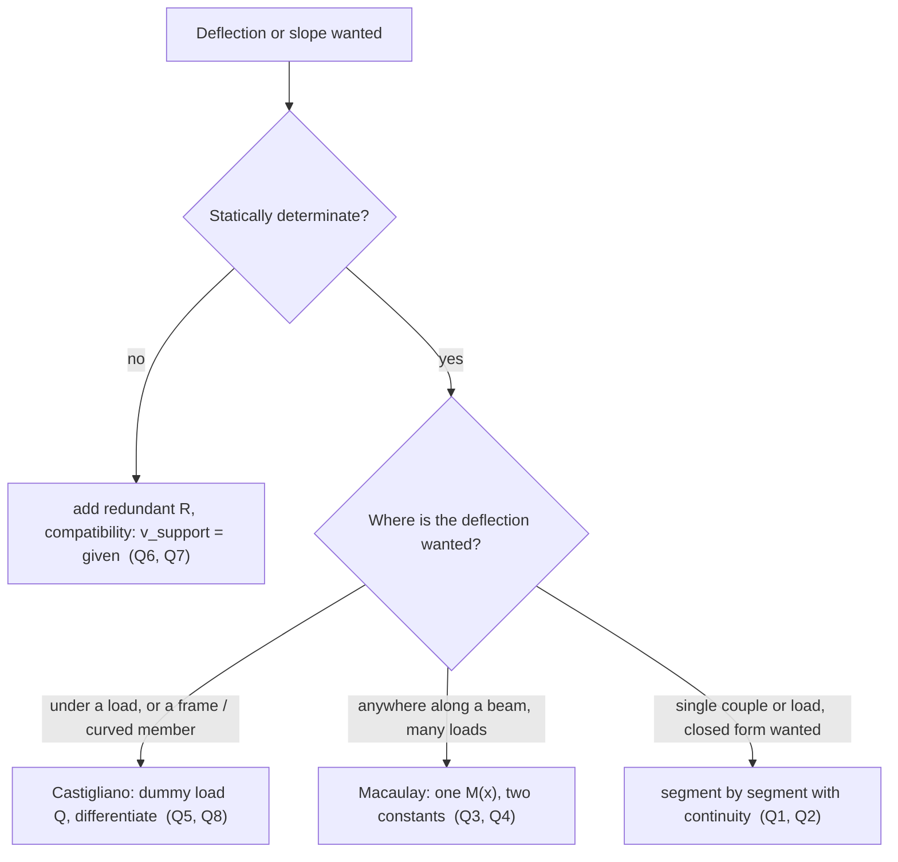

---
tags:
  - tutorial
  - strength-of-materials
  - deflection
  - castigliano
  - MOC
course: AM2200 Strength of Materials (July–November 2026)
source: "[[AM2200_2026_Tutorial 8.pdf]]"
aliases:
  - AM2200 Tutorial 8
  - Deflection of beams tutorial
---
# AM2200 Tutorial 8 — Deflection of Beams

Part of [[Strength of Materials - MOC]] · Source: [[AM2200_2026_Tutorial 8.pdf]] · Previous: [[Tutorial 7 - Bending and Shear Stresses|Tutorial 7 — Bending and Shear Stresses]] · Theory notes: [[Double Integration and Macaulay's Method]], [[Moment-Area Method]], [[Strain Energy and Castigliano's Theorem]], [[Shear Force and Bending Moment Diagrams]]

> [!abstract] What this note contains
> Theory first (§1), then the eight problems in the order of the sheet (§2–§9), then a formula sheet and exam hints (§10). Every closed form was checked against an independent numerical double integration of $EIv''=M$ (script `Tools/sm_t8.py`, all assertions pass). There is no reference solution for this sheet. Figure readings that I had to interpret are flagged in each problem.

> [!summary] Answers at a glance
> | Q | Result |
> |---|---|
> | 1 | $\delta_{max}=\delta_C=\dfrac P{3E}\Big[\dfrac{L^3-l^3}{I_{AB}}+\dfrac{l^3}{I_{BC}}\Big]$ (and $\theta_C=\dfrac P{2E}\Big[\dfrac{L^2-l^2}{I_{AB}}+\dfrac{l^2}{I_{BC}}\Big]$) |
> | 2 | $v=\dfrac{M_0x}{6EIL}\,(x^2+2L^2-6aL+3a^2)$ for $x\le a$; $\ v=\dfrac{M_0(x-L)}{6EIL}\,(x^2-2Lx+3a^2)$ for $x\ge a$; $\ \delta_0=\dfrac{M_0ab(b-a)}{3EIL}$ |
> | 3 | $R_A=22.5$ kN, $R_B=20$ kN; $\ v_{max}=\mathbf{10.99}$ mm downward at $x=2.97$ m from $A$ |
> | 4 | $\theta_A=\mathbf{3.72\times10^{-3}}$ rad clockwise, $\ v_A=\mathbf{4.55}$ mm downward |
> | 5 | $\delta_B=\dfrac{q_0L^4}{30EI}\ (\downarrow)$, $\ U=\dfrac{q_0^2L^5}{504EI}$ |
> | 6 | $B=\mathbf{219.8}$ kN, $\ A=C=\mathbf{70.1}$ kN |
> | 7 | $B_y=\tfrac{123}4=\mathbf{30.75}$ kip, $A_y=2.625$ kip, $C_y=14.625$ kip; $\ M(B)=-40.5$ kip·ft, $\ M_{max}^+=35.6$ kip·ft at $x=19.125$ ft |
> | 8 | $\delta_C=\dfrac{Pb^2(b+3h)}{3EI}\ (\downarrow)$, $\ \theta_C=\dfrac{Pb(b+2h)}{2EI}$ (clockwise) |

---

## 1. Theory

### 1.1 The deflection equation
With $y$ upward and $M$ positive when it sags the beam (compression on top), the curvature relation of [[Flexure Formula]] becomes, for small slopes,
$$EI\,v''=M(x),\qquad EI\,v'''=V(x),\qquad EI\,v''''=-w(x).$$
A sagging beam is "bowl-shaped" ($v''>0$) and has **negative** $v$. Every sign in this note follows this convention: negative $v$ means downward; slope $\theta=v'$ negative means the beam tilts clockwise as $x$ increases.

Boundary conditions: fixed end $v=v'=0$; pin or roller $v=0$; interior support $v=0$ (or a prescribed settlement); symmetry $v'=0$.

### 1.2 Three ways to the same number
| Method | Idea | Best when |
|---|---|---|
| **Double integration / Macaulay** | integrate $M(x)$ twice, fix constants from supports | one or two loads, or any number with singularity functions (Q2, Q3, Q4) |
| **Superposition** | add tabulated cases, valid because the equation is linear | standard loads (Q6 compatibility, check of Q4) |
| **Energy (Castigliano)** | $\delta=\partial U/\partial Q$ with $U=\int M^2/2EI\,dx$ | deflection **at a load point**, frames, redundants (Q5, Q7, Q8) |

### 1.3 Singularity (Macaulay) functions
$\langle x-a\rangle^n=(x-a)^n$ for $x\ge a$, $0$ otherwise. Loads contribute to $M$:
$$P\langle x-a\rangle^1,\qquad M_0\langle x-a\rangle^0,\qquad \tfrac w2\langle x-a\rangle^2\ (\text{uniform load from }a\text{ to the end}),$$
and a load that **stops** or **ramps** is built from a uniform load that continues plus a cancelling one. Integrate bracket by bracket: $\int\langle x-a\rangle^n=\langle x-a\rangle^{n+1}/(n+1)$. Two constants $C_1,C_2$ remain for the whole beam. (Rule: a load that ends before the last support must be *continued to the end* and cancelled, as in Q3.)

### 1.4 Castigliano's theorem
For a linear elastic structure with strain energy $U$ (bending only, shear and axial neglected):
$$U=\int\frac{M^2}{2EI}\,dx,\qquad \delta_i=\frac{\partial U}{\partial Q_i}=\int\frac M{EI}\frac{\partial M}{\partial Q_i}dx.$$
- **Differentiate before integrating** (and before setting the dummy load to zero).
- If there is **no load at the point** (or the wanted quantity is a rotation) add a **fictitious** force $Q$ (couple $M'$), differentiate, then set it to zero. This is the "modified" form used in Q8.
- **Redundant** reactions: $\partial U/\partial R=\delta_{support}$ (zero for a rigid support), the compatibility condition of [[Statically Indeterminate Axial Members]] in energy form (Q7).

### 1.5 Which tool for which problem

---

## 2. Q1 — Cantilever of two rods

**Tests:** [[Double Integration and Macaulay's Method]], [[Moment-Area Method]] (varying $I$)

### Problem
Cantilever $A$–$B$–$C$ built in at $A$, with load $P$ at the free end $C$. $AB$ has second moment $I_{AB}$, $BC$ has $I_{BC}$. Maximum deflection.

### Given (as read from Fig. 1)
$L$ is the distance from the wall to the load, and $l$ is the length of the thin part $BC$, so $AB=L-l$. The maximum deflection is at the free end $C$.

### Principle and why it applies
$M(x)=-P(L-x)$ is the same on both rods, but the curvature $M/EI$ jumps at $B$ because $I$ jumps. Integrating curvature twice with $v(0)=v'(0)=0$ gives the slope and deflection at $C$.

### Solution
Let $u=L-x$ (distance from the load). Then $|M|=Pu$ and
$$\delta_C=\int_0^L\frac{M\,u}{EI}\,dx=\frac P E\Big[\frac1{I_{AB}}\int_l^{L}u^2du+\frac1{I_{BC}}\int_0^{l}u^2du\Big]=\frac P{3E}\Big[\frac{L^3-l^3}{I_{AB}}+\frac{l^3}{I_{BC}}\Big]$$
(unit-load form of the moment-area theorem: the deflection of $C$ is the first moment of the $M/EI$ diagram about $C$). Likewise
$$\theta_C=\frac P{2E}\Big[\frac{L^2-l^2}{I_{AB}}+\frac{l^2}{I_{BC}}\Big].$$

![[SM-T8-Q1-stepped-cantilever.png]]

### Result
$$\boxed{\delta_{max}=\frac P{3E}\Big[\frac{L^3-l^3}{I_{AB}}+\frac{l^3}{I_{BC}}\Big]\ \text{downward at }C}$$

### Check
- $I_{AB}=I_{BC}=I$: $\delta=PL^3/3EI$ (the standard cantilever) ✓.
- $l\to0$: only the thick rod, $PL^3/3EI_{AB}$ ✓; $l=L$: $PL^3/3EI_{BC}$ ✓.
- Numerical double integration with $L=2,\ l=0.8,\ I_{AB}=2I_{BC}$ reproduces $1.41867$ (formula $1.41867$).

### Trap
Using $I_{AB}$ for the whole beam, or $L$ in place of $L-l$ for the thick part: the thin rod contributes most of the flexibility because $I$ appears in the denominator.

---

## 3. Q2 — Simple beam with a couple at distance $a$

**Tests:** [[Double Integration and Macaulay's Method]] (segments with continuity)

### Problem
Simple beam $AB$, span $L$, couple $M_0$ (counter-clockwise, as drawn) acting at distance $a$ from $A$; $b=L-a$. Deflection curve and the deflection $\delta_0$ at the couple.

### Principle and why it applies
A couple makes $M(x)$ jump, so the beam is split at $x=a$. The constants (four) come from $v(0)=0$, $v(L)=0$ and continuity of $v$ and $v'$ at $x=a$.

### Solution
**Reactions.** $\sum M_B=0$: $R_AL=M_0$, so $R_A=M_0/L$ upward and $R_B=M_0/L$ downward.

**Moments (sagging positive).**
$$M=\frac{M_0x}L\ \ (0\le x\le a),\qquad M=\frac{M_0x}L-M_0=-\frac{M_0(L-x)}L\ \ (a\le x\le L).$$
(The jump at $x=a$ equals $M_0$, upward for a counter-clockwise couple.)

**Integrate** $EIv''=M$:
$$EIv_1=\frac{M_0x^3}{6L}+C_1x+C_2,\qquad EIv_2=\frac{M_0(x-L)^3}{6L}+D_1(x-L)+D_2.$$
$v_1(0)=0\Rightarrow C_2=0$; $v_2(L)=0\Rightarrow D_2=0$. Continuity $v_1(a)=v_2(a)$ and $v_1'(a)=v_2'(a)$ give two linear equations for $C_1,D_1$ whose solution is
$$C_1=\frac{M_0(2L^2-6aL+3a^2)}{6L},\qquad D_1=\frac{M_0(3a^2-L^2)}{6L}.$$

### Result
$$\boxed{v_1=\frac{M_0x}{6EIL}\big(x^2+2L^2-6aL+3a^2\big)\ \ (0\le x\le a),\qquad v_2=\frac{M_0(x-L)}{6EIL}\big(x^2-2Lx+3a^2\big)\ \ (a\le x\le L)}$$
$$\boxed{\delta_0=v(a)=\frac{M_0\,ab\,(b-a)}{3EIL}}$$
Positive means **upward**. The couple lifts the point when $a<b$ (couple nearer $A$), is zero at midspan ($a=b$), and the point moves **down** when $a>b$.
Slopes at the supports: $\theta_A=\dfrac{M_0(3b^2-L^2)}{6EIL}$, $\ \theta_B=\dfrac{M_0(3a^2-L^2)}{6EIL}$.

![[SM-T8-Q2-couple.png]]

### Check
- $v_1(0)=0$, $v_2(L)=0$, $v_1(a)=v_2(a)$, $v_1'(a)=v_2'(a)$ and $v''=M/EI$ in both segments verified symbolically.
- Numerical double integration ($a=1.3,\ b=2.7$, $M_0=EI=1$) gives $0.40954$ against $0.40950$ from the formula (the small gap is the trapezoid rule at the jump in $M$).

### Trap
Forgetting that a couple adds **no shear** but a jump $M_0$ in $M$; and using the wrong sign for $R_B$ (it is **down**).

---

## 4. Q3 — Simply supported beam, point load and triangular load (singularity functions)

**Tests:** [[Double Integration and Macaulay's Method]] (singularity functions, ramp load)

### Problem
Simply supported beam $A$–$B$, span 6 m. 20 kN at 1.5 m from $A$; triangular load starting at 3 m from $A$ with intensity 15 kN/m falling linearly to zero at $B$ (3 m long). $E=200$ GPa, $I=65.0\times10^6$ mm⁴. Maximum deflection.

### Given
$EI=200\times10^6\ \text{kN/m}^2\times65\times10^{-6}\ \text{m}^4=\mathbf{13\,000\ kN\cdot m^2}$. (The sheet prints "mm⁶": a typo; a second moment of area is mm⁴.)

### Principle and why it applies
One expression for $M(x)$ with Macaulay brackets, integrated twice; the triangular load is "a 15 kN/m uniform load from $x=3$ minus a ramp of slope 5 kN/m per m":
$$w(x)=15\langle x-3\rangle^0-5\langle x-3\rangle^1\quad(\text{valid to }x=6).$$

### Solution
**Reactions.** Triangle: $\tfrac12(15)(3)=22.5$ kN acting $1$ m from the large end, i.e. at $x=4$. $\sum M_B$: $6R_A=20(4.5)+22.5(2)=135\Rightarrow R_A=22.5$ kN, $R_B=20$ kN.

**Moment.**
$$M=22.5x-20\langle x-1.5\rangle-\frac{15}2\langle x-3\rangle^2+\frac56\langle x-3\rangle^3$$
($M(6)=135-90-67.5+22.5=0$ ✓.)

**Slope and deflection** ($EIv''=M$):
$$EI\,v'=11.25x^2-10\langle x-1.5\rangle^2-2.5\langle x-3\rangle^3+\frac5{24}\langle x-3\rangle^4+C_1$$
$$EI\,v=3.75x^3-\frac{10}3\langle x-1.5\rangle^3-\frac58\langle x-3\rangle^4+\frac1{24}\langle x-3\rangle^5+C_1x+C_2$$
$v(0)=0\Rightarrow C_2=0$. $v(6)=0$: $810-303.75-50.625+10.125+6C_1=0\Rightarrow C_1=-77.625$ kN·m².

**Where is $v'=0$?** The slope at $x=3$ is already positive ($+1.125/EI$), so the minimum of $v$ is in $1.5\le x\le3$ where only the first two brackets act:
$$11.25x^2-10(x-1.5)^2-77.625=0\ \Rightarrow\ 1.25x^2+30x-100.125=0\ \Rightarrow\ x=\frac{-30+\sqrt{900+500.6}}{2.5}=2.970\text{ m}.$$
$$EI\,v_{max}=3.75(2.970)^3-\tfrac{10}3(1.470)^3-77.625(2.970)=-142.9\ \text{kN·m}^3\ \Rightarrow\ v_{max}=\frac{-142.9}{13\,000}=-10.99\ \text{mm}.$$

![[SM-T8-Q3-singularity-beam.png]]

### Result
$$\boxed{v_{max}=10.99\text{ mm downward at }x=2.97\text{ m from }A}$$
Other values: $v(1.5\text{ m})=7.98$ mm, $v(3\text{ m})=10.99$ mm, $\theta_A=5.97\times10^{-3}$ rad (clockwise), $\theta_B=5.71\times10^{-3}$ rad.

### Check
- $v(0)=v(6)=0$; the singularity expression matches a brute-force numerical double integration of $M(x)$ to $10^{-7}$ m.
- Units: kN·m³ / (kN·m²) = m ✓.
- $v_{max}$ is only 0.01 mm larger than $v$ at midspan, as expected when the load is nearly centred.

### Trap
(i) Putting the triangle's "15 kN/m" at the wrong end (here it is **next to the point load** and decreases toward $B$); (ii) using $\tfrac{w}{2}\langle x-3\rangle^2$ alone: a ramp that must stop at $B$ needs the cancelling term, otherwise $M(6)\ne0$; (iii) unit slip $I=65\times10^6$ mm⁴ $=65\times10^{-6}$ m⁴.

---

## 5. Q4 — Cantilever with a point load and an end couple

**Tests:** [[Double Integration and Macaulay's Method]], superposition

### Problem
Cantilever fixed at $B$, free end $A$ at 2 m. 60 kN down at 1 m from the wall; 30 kN·m couple at the free end (clockwise as drawn). $E=200$ GPa, $I=121\times10^{-6}$ m⁴. Slope and deflection at $A$.

### Given
$EI=200\times10^6\times121\times10^{-6}=\mathbf{24\,200\ kN\cdot m^2}$. Take $x$ from the wall.

### Principle and why it applies
$M(x)$ is zero only at the free end, so write it from the wall (reactions $V_B=60$ kN, $M_B=-90$ kN·m): one Macaulay expression, constants $C_1=C_2=0$ because $v(0)=v'(0)=0$.

### Solution
Moment on the right piece: $M=-30-60\langle1-x\rangle$ for $0\le x\le2$ (clockwise couple and downward load both bend the cantilever **hogging**). In singularity form:
$$M=-90+60x-60\langle x-1\rangle\quad(M(2)=-90+120-60=-30\ \checkmark)$$
$$EIv'=-90x+30x^2-30\langle x-1\rangle^2,\qquad EIv=-45x^2+10x^3-10\langle x-1\rangle^3.$$
At $x=2$ m:
$$EI\theta_A=-180+120-30=-90\ \text{kN·m}^2,\qquad EIv_A=-180+80-10=-110\ \text{kN·m}^3.$$

![[SM-T8-Q4-cantilever.png]]

### Result
$$\boxed{\theta_A=-\frac{90}{24\,200}=-3.72\times10^{-3}\text{ rad (clockwise)},\qquad v_A=-\frac{110}{24\,200}=-4.55\text{ mm (downward)}}$$

### Check — superposition
Tip load $60$ kN at $a=1$ m: $\theta=Pa^2/2EI=30/EI$ and $v_{tip}=Pa^2(3L-a)/6EI=50/EI$. End couple $30$ kN·m: $\theta=ML/EI=60/EI$, $v=ML^2/2EI=60/EI$. Sum: $\theta=90/EI$, $v=110/EI$ (both downward / clockwise) ✓.

### Trap
Using $x$ from the free end for the Macaulay brackets without recomputing $M$; and the direction of the couple: a clockwise couple on the free end of a cantilever bends it **down** (hogging), adding to the load's effect.

---

## 6. Q5 — Triangular load on a cantilever: strain energy and Castigliano

**Tests:** [[Strain Energy and Castigliano's Theorem]]

### Problem
Cantilever fixed at $A$, span $L$, load $q(x)=q_0(1-x/L)$ (maximum at the wall, zero at $B$). Deflection $\delta_B$ by strain energy and Castigliano.

### Principle and why it applies
There is no point load at $B$, so add a **dummy** load $Q$ at $B$; $\delta_B=\partial U/\partial Q\big|_{Q=0}$.

### Solution
Let $u$ be the distance from the free end. The load between the section and $B$ has intensity $q_0u/L$ at distance $u$ (a ramp from zero), so its moment about the section is
$$M(u)=-\Big[Qu+\int_0^u\frac{q_0t}L(u-t)\,dt\Big]=-\Big[Qu+\frac{q_0u^3}{6L}\Big].$$
Strain energy. Expand the square: $\big(Qu+\frac{q_0u^3}{6L}\big)^2=Q^2u^2+\frac{Qq_0u^4}{3L}+\frac{q_0^2u^6}{36L^2}$, so
$$U=\frac1{2EI}\Big[\frac{Q^2L^3}3+\frac{Qq_0L^4}{15}+\frac{q_0^2L^5}{252}\Big],\qquad \delta_B=\frac{\partial U}{\partial Q}\Big|_{Q=0}=\frac1{2EI}\cdot\frac{q_0L^4}{15}=\frac{q_0L^4}{30EI}.$$
At $Q=0$: $U=\dfrac{q_0^2L^5}{504EI}$.

![[SM-T8-Q5-triangular-castigliano.png]]

### Result
$$\boxed{\delta_B=\frac{q_0L^4}{30EI}\ (\text{downward})}$$

### Check
Same value from the unit-load integral $\int M\,u/EI$: $\dfrac{q_0}{6LEI}\int_0^Lu^4du=\dfrac{q_0L^4}{30EI}$ ✓; numerical double integration of $M(x)$ also gives $q_0L^4/30EI$. Limit sense: for a *uniform* load $q_0$ the answer is $q_0L^4/8EI$; the triangle (resultant $q_0L/2$ acting nearer the wall) gives $0.0333$ versus $0.125$ — smaller, as it must be.

### Trap
Setting $Q=0$ **before** differentiating (the derivative of a quantity that no longer contains $Q$ is zero). Also the cross term: $(a+b)^2$ has $2ab$.

---

## 7. Q6 — Beam on a post with an initial gap

**Tests:** [[Double Integration and Macaulay's Method]], superposition, compatibility (one redundant)

### Problem
Beam $AC$, 12 m, pinned at $A$, roller at $C$, with a post under mid-span $B$ separated from the beam by a **0.2 mm gap**; $w=30$ kN/m on the whole beam. Post: diameter 40 mm, height 1 m, $E=200$ GPa. Beam: $E=200$ GPa, $I=875\times10^6$ mm⁴. Find the reactions at $A,B,C$.

### Given
$I=875\times10^{-6}$ m⁴, $EI=175\,000$ kN·m² (=$175\times10^6$ N·m²). Post area $A_p=\pi(0.04)^2/4=1.2566\times10^{-3}$ m², length $L_p=1$ m (the "1 m" dimension in the figure). Gap $\Delta=0.2$ mm.

### Principle and why it applies
Without the post the beam would sag $\frac{5wL^4}{384EI}=46.3$ mm at midspan, far more than 0.2 mm, so **contact occurs**. With the post force $F_B$ (the redundant) the beam's deflection at $B$ equals the gap plus the post's compression:
$$\frac{5wL^4}{384EI}-\frac{F_BL^3}{48EI}=\Delta+\frac{F_BL_p}{A_pE}.$$

### Solution
$$\frac{5wL^4}{384EI}=\frac{5(30\,000)(12)^4}{384(175\times10^6)}=0.046286\ \text{m},\qquad \frac{L^3}{48EI}=2.0571\times10^{-7}\ \text{m/N},\qquad \frac{L_p}{A_pE}=3.979\times10^{-9}\ \text{m/N}.$$
$$0.046286-2.0571\times10^{-7}F_B=0.0002+3.979\times10^{-9}F_B\ \Rightarrow\ F_B=\frac{0.046086}{2.0969\times10^{-7}}=2.198\times10^5\ \text{N}.$$
Statics (symmetric): $A=C=\dfrac{wL-F_B}2=\dfrac{360-219.8}{2}=70.1$ kN.

![[SM-T8-Q6-post-and-gap.png]]

### Result
$$\boxed{F_B=219.8\text{ kN},\qquad A=C=70.1\text{ kN}}$$
The beam deflects $1.07$ mm at $B$ ($0.20$ mm gap closed $+\,0.87$ mm post shortening).

### Check
- Equilibrium: $70.1+219.8+70.1=360$ kN $=wL$ ✓. A numerical double integration of the beam with these reactions gives $v_B=-1.0745$ mm, equal to $\Delta+F_BL_p/A_pE$ ✓.
- Limits: infinitely stiff post and no gap gives $F_B=\tfrac58wL=225$ kN; the flexible post and the gap lower this to $219.8$ kN ✓.
- The post first touches the beam at only $w=0.13$ kN/m, so for $w=30$ kN/m it is certainly in contact.
- *Beyond the question:* the post stress is $219.8/1.2566\times10^{-3}=175$ MPa, and its Euler load (pinned ends, $I_p=\pi d^4/64=1.2566\times10^{-7}$ m⁴) is $\pi^2EI_p/L_p^2=248$ kN, only 13 % above the load, so buckling of the post would need checking in a design.

### Trap
Forgetting the post's own shortening (it is 0.87 mm, four times the gap); mixing mm⁴ and m⁴ in $I$; using $F_B$ as a **downward** deflection term for the beam (the beam's deflection from $F_B$ is *upward*, so it is subtracted).

---

## 8. Q7 — Continuous beam by Castigliano; shear and moment diagrams

**Tests:** [[Strain Energy and Castigliano's Theorem]], [[Shear Force and Bending Moment Diagrams]]

### Problem
Beam with supports $A$ (roller, $x=0$), $B$ (roller, $x=12$ ft), $C$ (pin, $x=24$ ft). Loads: 12 kip at $x=6$ ft; 3 kip/ft over the 12 ft from $B$ to $C$ (as read from Fig. 7). $EI$ constant. Reactions; diagrams.

### Principle and why it applies
Three vertical reactions, two equilibrium equations: one redundant. Choose $B_y=R$; the support does not move, so $\partial U/\partial R=0$.

### Solution
**Statics with $R$** (kip, ft): $\sum M_C=0$: $24A+12R=12(18)+36(6)=432\Rightarrow A=18-\tfrac R2$; $C=48-A-R=30-\tfrac R2$.

**Moments and their derivatives** ($x$ from $A$):
| Segment | $M(x)$ | $\partial M/\partial R$ |
|---|---|---|
| $0<x<6$ | $\big(18-\tfrac R2\big)x$ | $-\tfrac x2$ |
| $6<x<12$ | $\big(18-\tfrac R2\big)x-12(x-6)$ | $-\tfrac x2$ |
| $12<x<24$ | $\big(18-\tfrac R2\big)x-12(x-6)+R(x-12)-\tfrac32(x-12)^2$ | $\tfrac x2-12$ |

$$EI\frac{\partial U}{\partial R}=\int M\frac{\partial M}{\partial R}dx=\underbrace{(18R-648)}_{0\to6}+\underbrace{(126R-3456)}_{6\to12}+\underbrace{(144R-4752)}_{12\to24}=288R-8856=0$$
$$\Rightarrow\ \boxed{B_y=R=30.75\ \text{kip}},\qquad A_y=18-15.375=2.625\ \text{kip},\qquad C_y=30-15.375=14.625\ \text{kip}.$$

**Shear** (kip): $V=+2.625$ for $0<x<6$; $-9.375$ for $6<x<12$; $+21.375$ just right of $B$, then falling $3$ kip per ft, to $V=-14.625$ at $C$. Zero shear in $BC$ at $x=12+21.375/3=19.125$ ft.

**Moment** (kip·ft): $M(6)=2.625(6)=15.75$; $M(12)=2.625(12)-12(6)=-40.5$; maximum positive in $BC$ at $x=19.125$ ft: $M=35.65$ kip·ft. Zeros of $M$: $x=7.68$ ft and $x=14.25$ ft (points of contraflexure); $M(24)=0$ ✓.

![[SM-T8-Q7-continuous-beam.png]]

### Result
$$A_y=2.625\ \text{kip},\ \ B_y=30.75\ \text{kip},\ \ C_y=14.625\ \text{kip};\qquad M_{max}^-=-40.5\ \text{kip·ft at }B,\ \ M_{max}^+=35.65\ \text{kip·ft at }x=19.125\ \text{ft}.$$

### Check
- $2.625+30.75+14.625=48$ kip $=12+36$ ✓.
- Independent method: superposition with the deflection at $B$ of the primary beam and of the unit load, solved numerically: $R=30.75$ kip ✓.

### Trap
A UDL that covers only part of the beam: $\partial M/\partial R$ is different in each segment (the support reaction acts only for $x>12$); and carrying the factor $\tfrac12$ in $A=18-R/2$ into the derivative.

---

## 9. Q8 — Frame $ABC$: modified Castigliano

**Tests:** [[Strain Energy and Castigliano's Theorem]] (fictitious couple)

### Problem
Frame fixed at $A$, vertical member $AB$ of length $h$, horizontal member $BC$ of length $b$, load $P$ downward at $C$. Vertical deflection $\delta_C$ and rotation $\theta_C$ of $C$. $EI$ constant (the sheet does not give a different $EI$ for the two members).

### Principle and why it applies
$\delta_C=\partial U/\partial P$ needs no dummy load. The rotation is the work-conjugate of a couple, so apply a fictitious couple $M_0'$ at $C$ (in the sense of $P$'s moment: clockwise), differentiate, and set $M_0'=0$ (**modified Castigliano**). Axial and shear energy are neglected.

### Solution
With $s$ measured from $C$ along $CB$ and along $BA$:
$$BC:\ M=-(Ps+M_0'),\qquad AB:\ M=-(Pb+M_0').$$
$$U=\frac1{2EI}\Big[\int_0^b(Ps+M_0')^2ds+\int_0^h(Pb+M_0')^2ds\Big]$$
$$\delta_C=\frac{\partial U}{\partial P}\Big|_{M_0'=0}=\frac1{EI}\Big[\int_0^bPs^2ds+\int_0^hPb^2ds\Big]=\frac{Pb^3}{3EI}+\frac{Pb^2h}{EI}$$
$$\theta_C=\frac{\partial U}{\partial M_0'}\Big|_{M_0'=0}=\frac1{EI}\Big[\int_0^bPs\,ds+\int_0^hPb\,ds\Big]=\frac{Pb^2}{2EI}+\frac{Pbh}{EI}.$$

![[SM-T8-Q8-frame.png]]

### Result
$$\boxed{\delta_C=\frac{Pb^2(b+3h)}{3EI}\ (\downarrow),\qquad \theta_C=\frac{Pb(b+2h)}{2EI}\ (\text{clockwise})}$$
$AB$ carries a *constant* moment $Pb$ and rotates $B$ by $Pbh/EI$; this rotation swings $BC$ and adds $b\cdot Pbh/EI$ to the tip deflection, which is why the column length $h$ appears.

### Check
- $h=0$: the cantilever $BC$, $\delta=Pb^3/3EI$, $\theta=Pb^2/2EI$ ✓.
- Geometric check by integrating the curvature along the frame numerically (test $h=1.5,\ b=1$) gives the same $\delta_C$ and $\theta_C$ ✓ (the cross and dot in the figure agree in the vertical coordinate).
- Neglected: the axial shortening of $AB$ ($Ph/AE$) and shear; for slender members they are of order $(r/L)^2$ relative to bending.

### Trap
Differentiating after setting $M_0'=0$; and forgetting that $AB$ is also bent (a frame is not just a cantilever $BC$).

---

## 10. Formula sheet and exam hints

| Case | Result |
|---|---|
| Cantilever, tip load $P$ | $\delta=PL^3/3EI$, $\ \theta=PL^2/2EI$ |
| Cantilever, uniform $w$ | $\delta=wL^4/8EI$ |
| Cantilever, triangular $q_0$ (max at wall) | $\delta=q_0L^4/30EI$ (Q5) |
| Cantilever, tip couple $M$ | $\delta=ML^2/2EI$, $\ \theta=ML/EI$ |
| Simple beam, uniform $w$ | $\delta_{mid}=5wL^4/384EI$ |
| Simple beam, central load $P$ | $\delta_{mid}=PL^3/48EI$ |
| Simple beam, couple $M_0$ at $a$ | $\delta_0=M_0ab(b-a)/3EIL$ (Q2) |
| Castigliano | $\delta_i=\int\frac M{EI}\frac{\partial M}{\partial Q_i}dx$; add a dummy load/couple where nothing is applied |
| Redundant $R$ | $\partial U/\partial R=$ support movement (Q6, Q7) |

**Exam habits.** (1) Say your sign convention before you integrate. (2) A ramp or partial UDL needs a cancelling bracket. (3) Differentiate before setting a dummy load to zero. (4) Convert $I$ to the same length unit as everything else (mm⁴ ↔ m⁴ is a $10^{12}$ trap). (5) Always do one limit check (the cantilever, $h\to0$, rigid post).

### How this connects
- [[Moment-Area Method]] and Castigliano both compute the same area under $M/EI$; Q1 is the moment-area first-moment rule in disguise.
- The redundant-reaction trick of Q6/Q7 is the energy form of the compatibility equation in [[Statically Indeterminate Axial Members]] ($\delta_{beam}=\delta_{support}$).
- Next topic: [[Euler Buckling of Columns]] (the post in Q6 is a column), then [[Strain Energy and Castigliano's Theorem]] for general energy methods.
