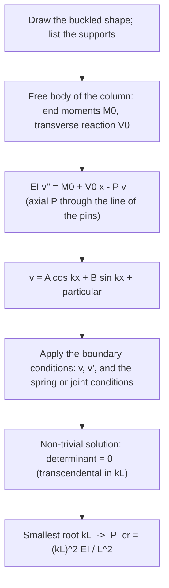

---
tags:
  - tutorial
  - strength-of-materials
  - columns
  - buckling
  - MOC
course: AM2200 Strength of Materials (July–November 2026)
source: "[[AM2200_2026_Tutorial 9.pdf]]"
aliases:
  - AM2200 Tutorial 9
  - Columns tutorial
---
# AM2200 Tutorial 9 — Columns

Part of [[Strength of Materials - MOC]] · Source: [[AM2200_2026_Tutorial 9.pdf]] · Previous: [[Tutorial 8 - Deflection of Beams|Tutorial 8 — Deflection of Beams]] · Theory: [[Euler Buckling of Columns]]

> [!abstract] What this note contains
> Theory first (§1: the buckling ODE, effective length, validity, and the recipe for any end condition), then the five problems in the order of the sheet (§2–§6), then a formula sheet and exam hints (§7). Every number was recomputed in `Tools/sm_t9.py`, and the transcendental conditions of Q4 and Q5 were checked a second way (integrating the buckling ODE and finding where the boundary determinant vanishes).

> [!summary] Answers at a glance
> | Q | Result |
> |---|---|
> | 1 | $P_{cr}(BC)=59.14$ kN, $F_{BC}=1.980\,P$ ⇒ $P_{max}=\mathbf{29.9}$ kN |
> | 2 | $P_{cr}=22.2$ kN (x–x governs), $P_{allow}=7.40$ kN, $F_{AB}=1.333\,w$ ⇒ $w_{max}=\mathbf{5.55}$ kN/m |
> | 3 | $P_{cr}=\dfrac{\pi^2EI}{L^2}$ |
> | 4 | $\tan u=-2u$, $u=kl/2=1.8366$ ⇒ $P_{cr}=\mathbf{13.49}\,EI/l^2$ |
> | 5 | $\tan ka=-ka$, $ka=2.0288$ ⇒ $F_{cr}=\mathbf{4.116}\,EI/a^2$ |

---

## 1. Theory

### 1.1 The buckling equation
For a straight column under axial compression $P$ with small lateral deflection $v(x)$, the bending moment at a section is the axial force times its lever arm $v$ (plus any end moments or transverse reactions):
$$EI\,v''=M(x).$$
Pin-ended with no end moments, $M=-Pv$:
$$EI\,v''+Pv=0,\qquad k^2=\frac P{EI}\ \Rightarrow\ v=A\cos kx+B\sin kx.$$
The straight shape is always an equilibrium; **buckling** is the load at which a bent shape is also an equilibrium, i.e. at which the boundary conditions admit a non-zero $(A,B)$. That is an eigenvalue problem ([[Sturm-Liouville Problems]]): the determinant of the boundary-condition system must vanish, and the **smallest** root gives $P_{cr}$.

### 1.2 Effective length
For the standard ends the boundary condition determinant gives $kL=\pi,\ 2\pi,\dots$ and the result is conveniently written
$$P_{cr}=\frac{\pi^2EI}{(KL)^2},\qquad\sigma_{cr}=\frac{\pi^2E}{(KL/r)^2},\qquad r=\sqrt{I/A},$$

| Ends | $K$ | $P_{cr}L^2/EI$ |
|---|---|---|
| pinned–pinned | 1 | $\pi^2=9.87$ |
| fixed–free | 2 | $\pi^2/4=2.47$ |
| fixed–pinned | 0.699 | $2.046\pi^2=20.19$ |
| fixed–fixed | 0.5 | $4\pi^2=39.48$ |
| fixed at both ends, one end free to sway (guided) | 1 | $\pi^2=9.87$ |

$K$ is the length of the equivalent pinned–pinned column: the distance between inflection points of the buckled shape.

### 1.3 Which axis, which area
A rectangular section can buckle about either principal axis. Each axis has its own $I$ **and** its own end conditions (Q2). Compute $P_{cr}$ for each and take the **smaller**. Buckling about the axis through which the section is **thinner** is usually critical, unless the end conditions are much stiffer about that axis.

### 1.4 When Euler's formula applies
$\sigma_{cr}$ must stay below the proportional limit (for A-36 steel about $250$ MPa, i.e. $KL/r>\pi\sqrt{2E/\sigma_Y}=126$). For stockier columns yielding intervenes and Johnson's parabola or a code formula is used. Buckling is a **stiffness** limit: it depends on $E$ and $I$, not on yield strength.

### 1.5 Recipe for any support condition

For symmetric problems use the mid-span condition $v'(L/2)=0$ to halve the work (Q4). Elastic supports and stepped columns do not fit the $K$ table; they give a transcendental equation, solved numerically (Q4, Q5).

---

## 2. Q1 — Control rod BC

> [!question] Determine the maximum force $P$ on the handle so that the A-36 steel rod $BC$ ($d=25$ mm, $E=200$ GPa) does not buckle.

![[SM-T9-Q1-control-rod.png]]

**Given.** $P$ horizontal, 350 mm above pin $A$; $AB=250$ mm at $45^\circ$; rod $BC$ horizontal, $L=800$ mm, pinned at both ends.

**Principle.** The lever $A$–$B$ turns about pin $A$, so $P$ is balanced by the **compressive force in the rod**. Statics gives $F_{BC}$ in terms of $P$; Euler gives the largest $F_{BC}$ the rod can carry; the two together give $P_{max}$.

**Solution.**
1. Moments about $A$: $B$ lies $250\sin45^\circ=176.8$ mm below $A$ and the rod force is horizontal, so its lever arm is $176.8$ mm:
$$P\,(350)=F_{BC}\,(176.8)\ \Rightarrow\ F_{BC}=\frac{350}{176.8}P=1.980\,P.$$
2. Euler for the pinned–pinned rod: $I=\dfrac\pi4(12.5)^4=1.917\times10^{4}$ mm⁴,
$$P_{cr}=\frac{\pi^2EI}{L^2}=\frac{\pi^2(200\,000)(19\,175)}{800^2}=59\,140\ \text{N}=59.14\ \text{kN}.$$
3. Set $F_{BC}=P_{cr}$:
$$P_{max}=\frac{59.14}{1.980}=\boxed{29.9\ \text{kN}}.$$

**Check.** $r=\sqrt{I/A}=6.25$ mm, $L/r=128>126$ (the Euler limit for A-36, §1.4) ✓; $\sigma_{cr}=59\,140/490.9=120.5$ MPa $<250$ MPa ✓ (elastic).

**Trap.** Taking $F_{BC}=P$ (forgetting the lever ratio), or measuring the arm to $B$ along the member ($250$ mm) instead of perpendicular to the rod force ($176.8$ mm). The direction of $P$ must put the rod in compression (it does: the crank pushes $B$ toward $C$).

---

## 3. Q2 — Distributed load on BC and the column AB

> [!question] Find the maximum $w$ on $BC$ without buckling $AB$. $AB$ is pinned at its ends for $x$–$x$ buckling and fixed at its ends for $y$–$y$ buckling; $FS=3$; $E=200$ GPa, $\sigma_Y=360$ MPa.

![[SM-T9-Q2-column-AB.png]]

**Given.** $AB$: 2 m, section $30\times20$ mm. $BC$: pinned at $C$, carried by $AB$ at $B$ ($1.5$ m from $C$), overhanging $0.5$ m, with $w$ over the whole $2.0$ m.

> [!note] Reading the sketch
> I take $x$–$x$ to be the **vertical** axis drawn on the section (height 20 mm, width 30 mm): buckling about $x$–$x$ bends the section across its 30 mm width. If the axes were swapped, $x$–$x$ (pinned) would use $I=20\,000$ mm⁴ and $w$ would drop to 2.47 kN/m, so check the labelling against your copy.

**Principle.** $AB$ is a two-force member: it carries axial compression $F_{AB}$, found from moments on $BC$. Check Euler buckling about **both** axes with their own end conditions and take the smaller load; then apply the factor of safety.

**Solution.**
1. Moments about $C$ for $BC$ (resultant $2.0w$ at $1.0$ m):
$$F_{AB}(1.5)=w(2.0)(1.0)\ \Rightarrow\ F_{AB}=1.333\,w.$$
2. Section properties: $I_x=\dfrac{20\cdot30^3}{12}=45\,000$ mm⁴ (about $x$–$x$), $I_y=\dfrac{30\cdot20^3}{12}=20\,000$ mm⁴, $A=600$ mm².
3. $x$–$x$ buckling, pinned ($K=1$):
$$P_{cr,x}=\frac{\pi^2E I_x}{(1.0\cdot2000)^2}=\frac{\pi^2(200\,000)(45\,000)}{2000^2}=22.2\ \text{kN}.$$
4. $y$–$y$ buckling, fixed ($K=0.5$):
$$P_{cr,y}=\frac{\pi^2E I_y}{(0.5\cdot2000)^2}=\frac{\pi^2(200\,000)(20\,000)}{1000^2}=39.5\ \text{kN}.$$
5. The smaller governs: $P_{cr}=22.2$ kN. With $FS=3$: $P_{allow}=\dfrac{22.2}3=7.40$ kN.
6. $F_{AB}=P_{allow}$:
$$w_{max}=\frac{7.40}{1.333}=\boxed{5.55\ \text{kN/m}}.$$

**Check.** $\sigma_{cr}=\pi^2E/(KL/r)^2$: about $x$–$x$, $r=8.66$ mm, $KL/r=231$, $\sigma_{cr}=37$ MPa; about $y$–$y$, $r=5.77$ mm, $KL/r=173$, $\sigma_{cr}=66$ MPa. Both $\ll\sigma_Y=360$ MPa, so Euler's formula is valid ($\sigma_Y$ only confirms that). Working stress at the allowable load: $7.40\ \text{kN}/600\ \text{mm}^2=12.3$ MPa.

**Trap.** Using the thin direction ($I=20\,000$) for both axes: the *stiffer end condition* about $y$–$y$ more than compensates for the smaller $I$ ($39.5$ vs $22.2$ kN). Applying $FS$ to the load $w$ instead of to $P_{cr}$ is equivalent here (linear), but apply it once only. The load acts over the **overhang** too: using $1.5w$ at $0.75$ m gives $F_{AB}=0.75w$ and the wrong $w$.

---

## 4. Q3 — Column fixed against rotation at both ends, one end free to sway

> [!question] The column of constant $EI$ has the end constraints of Fig. 3. Find the critical load.

![[SM-T9-Q3-sway-column.png]]

**Reading the supports.** Top: a block between walls, so no lateral displacement and no rotation, but it can slide down. Base: a rigid block on rollers, so no rotation but it **can translate sideways**. The sketched buckled shape confirms this: the base moves sideways by $\delta$ while both ends keep zero slope.

**Principle.** No horizontal force can act at the roller base, and none at the top wall in equilibrium, so there is **no transverse reaction**. Only the (equal) end moment $M_0$ and the axial force act, so $M(x)=M_0-Pv$.

**Solution.** With $v(0)=0$ at the top and $x$ measured downward:
$$EI\,v''+Pv=M_0\ \Rightarrow\ v=\frac{M_0}P\,(1-\cos kx)+B\sin kx.$$
Zero slope at the top: $v'(0)=Bk=0\Rightarrow B=0$. Zero slope at the base: $v'(L)=\dfrac{M_0}Pk\sin kL=0\Rightarrow kL=\pi$ (smallest non-trivial root):
$$\boxed{P_{cr}=\frac{\pi^2EI}{L^2}}\qquad(K=1)$$
The shape $v=\frac\delta2\big(1-\cos\frac{\pi x}L\big)$ has its inflection at mid-height: each half behaves like a pinned–pinned column of length $L$ made of two fixed–free halves of length $L/2$ ($K=2$ on $L/2$ gives the same $L$).

**Check.** Same result as a fixed–fixed column that is allowed to sway: $K=1$ rather than $0.5$. Compare the five standard cases in the figure: allowing sway cuts the fixed–fixed capacity ($4\pi^2$) to a quarter ($\pi^2$).

**Trap.** Reading the rollers as a base held against sway, which would make the column fixed–fixed ($K=0.5$, $4\pi^2EI/L^2$). The rollers are there precisely to leave the base free to move sideways; that sway is what lowers the load to $\pi^2EI/L^2$.

---

## 5. Q4 — Beam with torsional springs at the ends

> [!question] A beam of length $l$ and stiffness $EI$ under axial compression $F$ is pinned at both ends and restrained by torsional springs $c_T$. Find the critical load for $EI=l\,c_T$.

![[SM-T9-Q4-spring-ends.png]]

**Principle.** Each end can rotate, but the spring resists with a moment $M_s=c_T\theta$. The beam is the pinned–pinned column of Q3's method with the end moment tied to the end slope. The lowest buckling mode is **symmetric**.

**Solution.**
1. Free body: axial $F$ at the pins, spring moment $M_s$ at each end (opposing the end rotation), no transverse reaction (symmetry). With $v$ upward and sagging moment positive,
$$EI\,v''=M_s-Fv\ \Rightarrow\ v=A\cos kx+B\sin kx+\frac{M_s}F,\qquad k^2=\frac F{EI}.$$
2. $v(0)=0$: $A=-M_s/F$.
3. Symmetry, $v'(l/2)=0$: $-Ak\sin\frac{kl}2+Bk\cos\frac{kl}2=0\Rightarrow B=A\tan\frac{kl}2$. So the end slope is
$$v'(0)=Bk=-\frac{M_s}Fk\tan\frac{kl}2.$$
4. Spring law, $M_s=c_Tv'(0)$:
$$M_s=-c_T\frac{M_s}Fk\tan\frac{kl}2\ \Rightarrow\ F=-c_Tk\tan\frac{kl}2\ \Rightarrow\ EIk=-c_T\tan\frac{kl}2.$$
5. Put $u=kl/2$ and $\beta=c_Tl/EI$: $\ \tan u=-\dfrac2\beta\,u$ (root in $\frac\pi2<u<\pi$).

For $EI=l\,c_T$, $\beta=1$:
$$\tan u=-2u\ \Rightarrow\ u=1.8366,\quad kl=2u=3.6732$$
$$\boxed{F_{cr}=\frac{(kl)^2EI}{l^2}=13.49\,\frac{EI}{l^2}}$$

**Check.** Limits: $\beta\to0$ (no springs) $u\to\frac\pi2$, $F_{cr}=\pi^2EI/l^2=9.87$ ✓; $\beta\to\infty$ (clamped) $u\to\pi$, $F_{cr}=4\pi^2EI/l^2=39.5$ ✓. Here $13.49$ lies between, $37\ \%$ above the pinned value.

| $c_Tl/EI$ | 0.1 | 1 | 10 | 100 |
|---|---|---|---|---|
| $F_{cr}\,l^2/EI$ | 10.27 | **13.49** | 28.17 | 37.95 |

A second check: integrating the buckling ODE with unknown end slope and reaction and locating the first zero of the boundary determinant gives $13.49236$, identical (and shows the antisymmetric mode, which starts above $4\pi^2$, is not the lowest).

**Trap.** Writing the spring law with the wrong sign: that gives $\tan u=+2u$, whose root $u=1.166$ means $F=5.43\,EI/l^2$, *below* the pinned value, which is impossible for a restrained column. The sign test: the answer must lie between the pinned and clamped values.

---

## 6. Q5 — Rigid and elastic halves

> [!question] A pinned–pinned beam consists of a rigid half (length $a$, left) and an elastic half (length $a$, rigidity $EI$, right), compressed by $F$. Find the buckling condition and the critical load.

![[SM-T9-Q5-rigid-elastic.png]]

**Principle.** The rigid half cannot bend; it **rotates rigidly** about the left pin through a small angle $\varphi$. The elastic half must therefore start at the joint with deflection $a\varphi$ and slope $\varphi$, and end at the right pin with zero deflection. With both supports on the line of action of $F$ and no transverse load, the supports carry only axial force.

**Solution.** Let $x$ run from the joint ($x=0$) to the right pin ($x=a$). On the elastic part $M=-Fv$:
$$EI\,v''+Fv=0\ \Rightarrow\ v=A\cos kx+B\sin kx,\qquad k^2=\frac F{EI}.$$
- Joint deflection: $v(0)=A$ (equals $a\varphi$).
- Joint slope equals the rigid part's slope $\varphi=v(0)/a$: $v'(0)=Bk=\dfrac Aa\Rightarrow B=\dfrac A{ka}$.
- Right pin: $v(a)=0\Rightarrow A\cos ka+B\sin ka=0$.

Eliminating $B$:
$$ka\cos ka+\sin ka=0\quad\Longleftrightarrow\quad\boxed{\tan ka=-ka}\qquad(\text{buckling condition}).$$
Smallest positive root: $ka=2.0288$. Hence
$$\boxed{F_{cr}=\frac{(2.0288)^2EI}{a^2}=4.116\,\frac{EI}{a^2}},\qquad L_e=\frac{\pi a}{2.0288}=1.549\,a\ \text{(for the elastic half)}.$$

**Check.** Bounds: all-elastic pinned beam of total length $2a$: $\pi^2EI/(2a)^2=2.47\,EI/a^2$ (lower); pinned beam of length $a$: $\pi^2EI/a^2=9.87\,EI/a^2$ (higher). $4.116$ lies between, and is $67\ \%$ above the all-elastic value because the rigid half removes half of the flexibility. Numerical integration of the ODE with the joint conditions finds the same root ($F_{cr}a^2/EI=4.11586$).

**Trap.** Applying $v'(0)=0$ at the joint (a fixed end): the rigid part is *not* a wall, it rotates, and the slope condition is $v'(0)=v(0)/a$. Also writing $L=2a$ in Euler's formula, which ignores that half of the length cannot bend.

---

## 7. Formula sheet and exam hints

| Quantity | Formula |
|---|---|
| Euler load | $P_{cr}=\dfrac{\pi^2EI}{(KL)^2}$ |
| critical stress | $\sigma_{cr}=\dfrac{\pi^2E}{(KL/r)^2}$, valid for $KL/r>\pi\sqrt{2E/\sigma_Y}$ |
| radius of gyration | $r=\sqrt{I/A}$, use the axis that buckles |
| axial force in a link | statics (moments) first, then compare with $P_{cr}$ |
| factor of safety | $P_{allow}=P_{cr}/FS$ |
| sway with fixed ends | $K=1$, $P_{cr}=\pi^2EI/L^2$ |
| spring-ended column | $\tan u=-\dfrac2\beta u$, $u=\dfrac{kl}2$, $\beta=\dfrac{c_Tl}{EI}$ (symmetric mode) |
| rigid half plus elastic half | $\tan ka=-ka$, $F_{cr}=4.116\,EI/a^2$ |

**Pattern recognition.**
| You see | Do |
|---|---|
| a linkage with a long slender link | statics for the link's axial force, then Euler on the link |
| section with two different $I$ and two end conditions | $P_{cr}$ for each axis, take the smaller |
| ends not on the standard list | write $EI v''=M_0+V_0x-Pv$, apply the conditions, determinant $=0$ |
| elastic supports, stepped or partly rigid column | transcendental condition, bracket between the pinned and clamped values to choose the root |

**Sanity checks to run every time.** (i) The answer must lie between the pinned–pinned and the more-restrained case. (ii) $\sigma_{cr}$ must be below the proportional limit, otherwise Euler overestimates. (iii) The smallest root of the characteristic equation, not the first one you find.

## Cross-domain links
- [[Resonance and Buckling - Instability as an Eigenvalue Problem]] — every critical load here is an eigenvalue $k^2EI$ of the boundary-value problem; the spring-ended and rigid-plus-elastic columns are exactly the transcendental eigenproblems met for the heated rod in [[Heat Equation - Separation of Variables]] (Robin end, $\tan p\pi=-p/h$).
- [[Sturm-Liouville Problems]] — Q3–Q5 are Sturm–Liouville problems with different boundary conditions ($v'=0$, a spring (Robin) condition, a slope-continuity condition at a joint); the smallest eigenvalue is $P_{cr}$.
- [[The Universal Second-Order Linear System]] — $EIv''+Pv=0$ is the undamped oscillator: the column "oscillates" in space and buckles when the boundary conditions let the shape close.

## Concepts used
- [[Euler Buckling of Columns]] · [[Flexure Formula]] · [[Double Integration and Macaulay's Method]]
