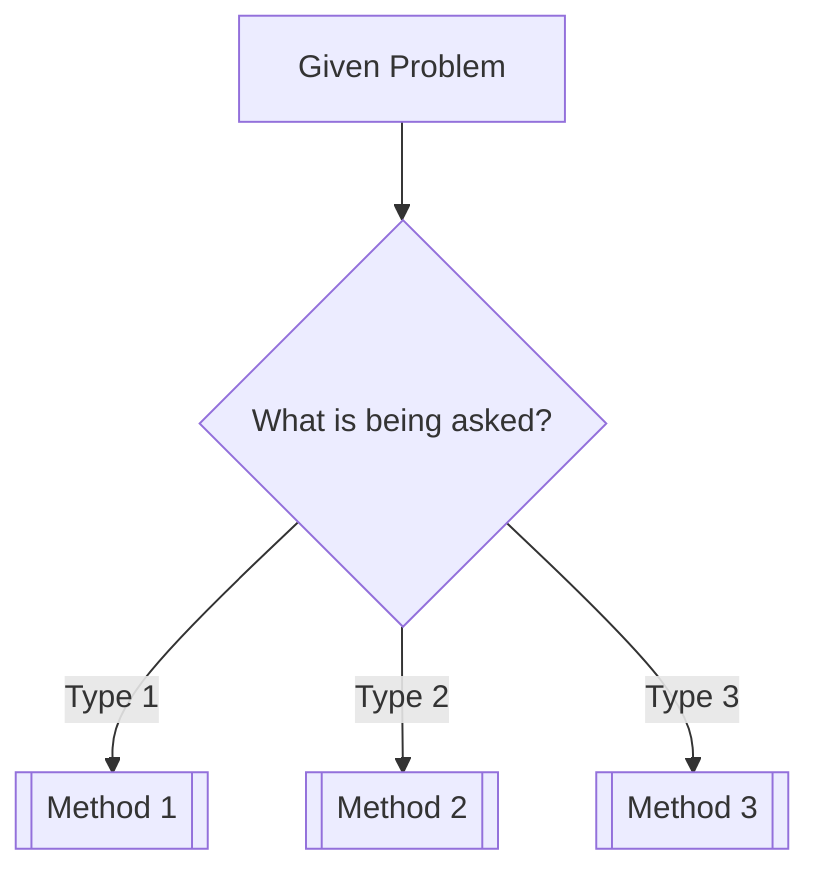

tags: [MOC, course]

course: "{{course}}"
status: active

# {{course}} — Map of Content

This is the **navigation spine and conceptual map** for the course.

The MOC should allow a student to quickly answer:

* What are the major topics in this course?
* What should I learn first?
* How are the topics connected?
* Which tutorials/problems test each concept?
* Where does this course connect to other subjects?
* What still needs to be studied?

Every major concept should be reachable from this MOC.

> **MOC rule:** Do not turn this page into a collection of explanations. Keep explanations in atomic concept notes and use this page primarily for navigation, relationships, and progress.


## Course Overview

**Course:** {{course}}

**Course code:** {{code}}

**Core purpose:**
What does this course teach, and what kind of problems does it enable the student to solve?

**Prerequisites:**

* [[...]]
* [[...]]

**Major mathematical tools:**

* [[...]]
* [[...]]

---

## Concept Map

<!-- Create a visual map when the course has enough topics for relationships to become difficult to see from a list alone. -->

```mermaid
graph TD
    A[{{course}}] --> B[Topic 1]
    A --> C[Topic 2]
    A --> D[Topic 3]

    B --> E[Concept]
    C --> E
    D --> F[Concept]
```

> Keep this map conceptual. It should show **dependencies and relationships**, not every individual note.


## Main Spine

The recommended learning sequence for the course.

1. [[01 - Topic]]
2. [[02 - Topic]]
3. [[03 - Topic]]
4. [[04 - Topic]]
5. [[05 - Topic]]

### Learning Dependencies

```text
Prerequisites
     ↓
Foundation
     ↓
Core methods
     ↓
Applications
     ↓
Advanced topics
     ↓
Synthesis
```

> Reorder the spine according to conceptual dependencies, not necessarily the order in which the professor teaches the course.

---

## By Theme

### Theme 1 — {{Theme}}

* [[Concept]]
* [[Concept]]
* [[Concept]]

### Theme 2 — {{Theme}}

* [[Concept]]
* [[Concept]]
* [[Concept]]

### Theme 3 — {{Theme}}

* [[Concept]]
* [[Concept]]

> Use themes when they reveal relationships that the chronological course sequence hides.

---

## Methods & Problem Types

<!-- This section answers: "I see this kind of problem. What method should I use?" -->

| Problem Type | Relevant Concept | Method | Example |
| ------------ | ---------------- | ------ | ------- |
| ...          | [[...]]          | ...    | [[...]] |
| ...          | [[...]]          | ...    | [[...]] |
| ...          | [[...]]          | ...    | [[...]] |

### Problem-Solving Decision Tree

<!-- Add when the course contains multiple competing methods. -->



---

## Tutorials And Problems

### Tutorial Index

* [[Tutorial 1 - MOC]]
* [[Tutorial 2 - MOC]]
* [[Tutorial 3 - MOC]]

### Important Problems

* [[Tutorial X Q1]] — [[Concept]]
* [[Tutorial X Q2]] — [[Concept]]
* [[Tutorial X Q3]] — [[Concept]]

### Problem Coverage

| Concept       | Problems       | Status |
| ------------- | -------------- | ------ |
| [[Concept 1]] | [[Q1]], [[Q4]] | ⬜      |
| [[Concept 2]] | [[Q2]], [[Q5]] | ⬜      |
| [[Concept 3]] | [[Q3]]         | ⬜      |

> Link problems to concepts rather than keeping tutorial questions isolated from the knowledge graph.

---

## Visual Library

<!-- Use this section when the course contains important diagrams, graphs, mechanisms, or visual summaries. -->

### Essential Diagrams

* [[...]] — diagram explaining ...
* [[...]] — diagram explaining ...

### Essential Graphs

* [[...]] — relationship between ...
* [[...]] — response of ... versus ...

### Revision Infographics

* [[...]] — one-page summary of ...
* [[...]] — formula/method selection map

> A visual should be included when it improves spatial understanding, comparison, process recognition, or recall. Do not create visuals merely for decoration.

---

## Formula & Theorem Map

Group equations by conceptual purpose rather than dumping every formula into one list.

### Theme 1

$$
...
$$

* [[Concept]] — explains this relation.

### Theme 2

$$
...
$$

* [[Concept]] — explains this relation.

### Important Assumptions

* ...
* ...
* ...

> The MOC should link to the concept explaining each equation rather than becoming the authoritative location for every derivation.

---

## Cross-Domain Links

Identify concepts in this course that share mathematical or physical structures with other courses.

* [[Concept]] ↔ [[Other Course Concept]]
  Same mathematical structure: ...

* [[Concept]] ↔ [[Other Course Concept]]
  Same physical principle: ...

* [[Concept]] ↔ [[Other Course Concept]]
  Useful analogy: ...

### Recurring Structures

Look specifically for:

* conservation laws,
* linear systems,
* ODEs,
* eigenvalue problems,
* energy methods,
* equilibrium,
* stability,
* resonance,
* time constants,
* second moments,
* vector/matrix transformations,
* optimization,
* numerical methods.

> Cross-domain links should explain **why the connection exists**, not merely point to another course.

---

## Exam / Revision Map

### High-Value Concepts

* [[...]]
* [[...]]
* [[...]]

### Commonly Confused Concepts

| Concept A | Concept B | Key Difference |
| --------- | --------- | -------------- |
| [[...]]   | [[...]]   | ...            |
| [[...]]   | [[...]]   | ...            |

### Common Traps

* ...
* ...
* ...

### One-Page Revision

[[{{course}} — Revision Sheet]]

### Exam Problem Patterns

1. **Pattern:** ...

   * Recognize by: ...
   * Usually requires: [[...]]

2. **Pattern:** ...

   * Recognize by: ...
   * Usually requires: [[...]]

---

## Study Progress

### Topic Progress

* [ ] [[Topic 1]]
* [ ] [[Topic 2]]
* [ ] [[Topic 3]]
* [ ] [[Topic 4]]

### Concept Progress

* [ ] [[Concept 1]]
* [ ] [[Concept 2]]
* [ ] [[Concept 3]]

### Problem-Solving Progress

* [ ] Tutorial 1
* [ ] Tutorial 2
* [ ] Tutorial 3
* [ ] Past-paper problems

### Weak Areas

* [[...]]
* [[...]]

### Current Focus

> What should be studied next, and why?

[[Current topic]]

---

## Study Log

### {{date}}

* Studied:
* Problems solved:
* New concepts:
* Difficulties:
* Connections discovered:
* Visuals created:
* Next action:

---

## MOC Maintenance Rules

When adding a new concept:

1. Create or update the appropriate atomic concept note.
2. Link it from the correct section of this MOC.
3. Place it in the **Main Spine** if it is a major concept.
4. Add it under **By Theme** if it belongs to a meaningful conceptual cluster.
5. Link relevant tutorials/problems.
6. Add cross-domain links when a meaningful connection exists.
7. Add or update a visual when the concept is inherently spatial, procedural, structural, or graphical.
8. Update the revision/problem map if the concept is important for problem solving.

When removing or renaming a concept:

1. Check incoming links.
2. Update this MOC.
3. Update tutorial indexes.
4. Preserve aliases where useful.
5. Do not silently delete knowledge.

---

## Course Completion Checklist

### Knowledge

* [ ] Main concepts understood
* [ ] Major derivations understood
* [ ] Formula relationships understood
* [ ] Cross-domain connections identified

### Problem Solving

* [ ] Basic problems solved
* [ ] Intermediate problems solved
* [ ] Difficult problems solved
* [ ] Tutorial questions completed
* [ ] Past-paper patterns identified

### Visual Understanding

* [ ] Essential diagrams understood
* [ ] Important graphs understood
* [ ] Major processes can be visualized
* [ ] Revision infographic created where useful

### Revision

* [ ] Formula map reviewed
* [ ] Common traps reviewed
* [ ] Weak areas revisited
* [ ] One-page revision sheet completed

---

## Quick Navigation

**Foundations:** [[...]]

**Core Concepts:** [[...]]

**Methods:** [[...]]

**Applications:** [[...]]

**Tutorials:** [[...]]

**Revision:** [[...]]

**Cross-Domain:** [[...]]

**Study Log:** [[...]]
