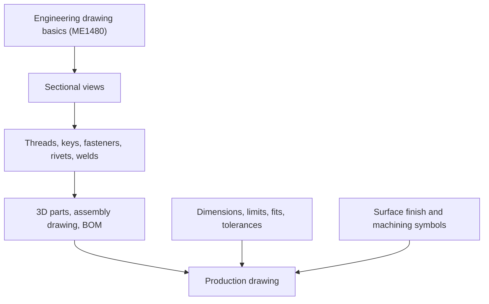

# Computer Aided Machine Drawing — Map of Content

Navigation spine for ME3283. Part of [[Mechanical Engineering Curriculum - MOC]]. Official syllabus: [[Computer Aided Machine Drawing/Course Details|Course Details]].

## Course Overview

**Course:** Computer Aided Machine Drawing · **Code:** ME3283 · **Semester 5** · **L-T-E-P-O / credits:** 1-0-0-2-3 / 6

**Core purpose:** read and produce machine drawings that follow standard conventions, including dimensioning and tolerancing; create 3D models and assembly drawings with a bill of materials.

**Textbooks:** Narayana, Kannaiah & Venkata Reddy, *Machine Drawing* (New Age); N. D. Bhatt, *Machine Drawing* (Charotar). References: Luzadder & Duff, *Fundamentals of Engineering Drawing*; French & Vierck, *Fundamentals of Engineering Drawing*.

**Prerequisite:** none in the syllabus; builds on Engineering Drawing (ME1480; the course guidelines PDF is in `mech stuff/Engineering drawing/`).

## Syllabus Map (hours as listed)

1. **Sectional views of machine components** (10 h): sectioning techniques and conventions.
2. **Fastening and connecting methods for assembly** (12 h): representation of screw threads, keys, fasteners, riveting and welding.
3. **3D modelling and assembly** (16 h): 3D modelling of machine components; assembly drawings and bill of materials.
4. **Dimensions, limits, fits and tolerances:** surface finish and machining symbols; production drawings.

## Concept Map

## Methods & Problem Types

| Task | Method |
|---|---|
| Show an internal feature | choose a full, half, offset, aligned, revolved or removed section, apply hatching conventions |
| Draw a threaded or bolted joint | conventional thread representation, standard proportions for the head and nut |
| Represent a key, rivet or weld | standard symbols and proportions |
| Model and assemble | part models with constraints, assembly mates, BOM extraction |
| Specify a fit | hole-basis or shaft-basis system, tolerance grades, limits for clearance, transition or interference fits |
| Prepare a production drawing | views, dimensioning, tolerances, surface-finish symbols |

## Cross-Domain Links
- **Fits and tolerances** ↔ [[Manufacturing Technology - MOC]]: limits and fits, GD&T and gauging are what manufacturing must achieve and metrology must verify.
- **Fasteners and keys** ↔ [[Introduction to Machine Design - MOC]]: the bolt, key and shaft drawn here are the ones sized there.
- **Welding and riveting symbols** ↔ [[Manufacturing Technology - MOC]] (joining processes).
- **Assemblies of mechanisms** ↔ [[KDoMs - MOC]]: linkage and gear-train assemblies are drawn with the same conventions.

## Study Progress
- [ ] Sectional views · [ ] Threads and fasteners · [ ] Keys, rivets, welds · [ ] 3D modelling · [ ] Assembly and BOM · [ ] Limits, fits, tolerances · [ ] Production drawings

## Study Log
*(add dated entries when the course starts)*

## MOC Maintenance Rules
Link each new concept note from the syllabus map, add exercise links to the table, log changes in [[Wiki Maintenance Log]].
