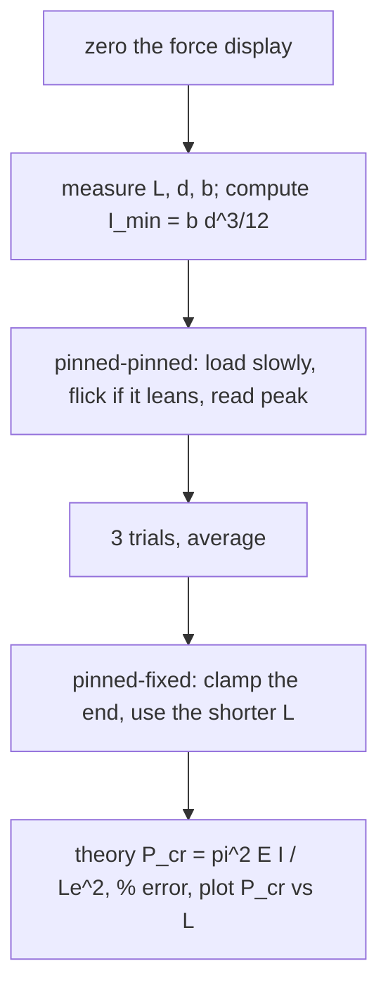

# Lab - Buckling of Struts

> [!abstract] The experiment in one line
> Squeeze slender steel or aluminium strips between pinned or clamped ends until they suddenly bow sideways, read the peak load, and compare with Euler's $P_{cr}=\pi^2EI/L_e^2$ for each end condition.

## Aim and apparatus
**Aim:** study buckling of a column under axial load with different end conditions and compare experimental buckling loads with the Euler formulae.
**Apparatus:** a back plate with a load cell at one end and a loading device at the top. The bottom chuck sits on an articulated parallelogram that **prevents rotation but allows vertical motion** against the ring load cell, so it absorbs the large side thrust at buckling with little friction. A digital force display reads the load.

## Theory

$$P_{cr}=\frac{\pi^2EI}{L_e^{\,2}},\qquad L_e=\begin{cases}L&\text{pinned–pinned}\\L/\sqrt2&\text{pinned–fixed}\\L/2&\text{fixed–fixed}\end{cases},\qquad E_{\rm steel}=210\text{ GPa},\ E_{\rm Al}=70\text{ GPa}$$

Choose $I_{xx}$ or $I_{yy}$ so that **$I$ is the smaller** one: the strip buckles about its weak axis ($I_{\min}=bd^3/12$ with $d$ the thickness). Full theory: [[Euler Buckling of Columns]] and [[Tutorial 9 - Columns/Tutorial 9 - Columns|Tutorial 9]].

![[AML-buckling-vs-length.png]]

**Figure:** Euler load against length for an illustrative $25\times3$ mm steel strip. Shortening the strut raises $P_{cr}$ as $1/L^2$; fixing an end raises it by $2\times$ (pinned–fixed, $L_e=L/\sqrt2$) or $4\times$ (fixed–fixed). The red line is the yield load $\sigma_yA$: below about $79$ mm this strip would squash, not buckle, and Euler's formula no longer applies.

> [!question]- 🎯 Predict first: a pinned–pinned strut is clamped at one end instead. By what factor does the buckling load change, at the same length?
> **Doubles.** $L_e$ drops from $L$ to $L/\sqrt2$, and $P_{cr}\propto1/L_e^2$ so $(\sqrt2)^2=2$. Note the manual shortens the test length for the clamped case (clamping eats some of it), so the *measured* ratio at the shorter length will be even larger.

## Procedure (condensed)
1. **Zero the force meter:** switch on, zero with the dial, apply a light finger load and release; repeat until it returns to zero (tap the frame if it sticks within $\pm1$ N).
2. **Measure** the strut's length, thickness and breadth with the vernier.
3. **Pinned–pinned:** fit the bottom chuck, remove the top chuck, seat the strut in the notches, lock the crosshead with maximum hand-wheel travel left.
4. **Load slowly.** If it starts to bow left, *flick* it to the right (and vice versa) to cancel initial crookedness. Stop at the peak load and **do not load past buckling** (the strut will be permanently deformed).
5. **Repeat three times** and average.
6. **Pinned–fixed:** replace the bottom chuck by the clamp plate; use the **shorter** test length in the calculation.

## Observations and calculation
Tabulate per strut: $L$, $d$, $b$, $I_{xx}$, $I_{yy}$, three trial loads and their mean, the Euler load, and
$$\%\text{ error}=\frac{P_{\rm exp}-P_{\rm theory}}{P_{\rm theory}}\times100.$$
Plot $P_{cr}$ against $L$ (experiment and theory on one graph, as in the sample sheet).

## Worked example
> [!example]- 🔬 Illustrative steel strip $25\times3$ mm, $L=400$ mm, pinned–pinned
> $I_{\min}=25\cdot3^3/12=56.25$ mm⁴, $A=75$ mm².
> $P_{cr}=\dfrac{\pi^2(210{,}000)(56.25)}{400^2}=729$ N. With one end clamped (same $L$): $P_{cr}=1457$ N.
> Slenderness $L/r$ with $r=d/\sqrt{12}=0.866$ mm: $L/r=462$. Critical stress $\sigma_{cr}=P_{cr}/A=9.7$ MPa $\ll\sigma_y\approx250$ MPa, so the strut buckles *elastically*, long before yielding, and Euler applies. It springs back after buckling if you stop in time.
> **Check:** $P_{cr}/(\sigma_yA)=729/18{,}750=3.9\%$, which is why the load cell range is only a few hundred newtons.

## Why $P_{\rm exp}<P_{\rm Euler}$ (usually)

| Source | Direction | Why |
|---|---|---|
| Initial crookedness, load eccentricity | lowers $P_{\rm exp}$ | bending starts at once; the "peak" is the knee of a smooth curve |
| Imperfect pins, notch friction | raises $P_{\rm exp}$ | end friction supplies a restraining moment |
| Strut cross-section measured with the wrong axis | either | $I$ depends on the cube of the thickness |
| Not truly fixed ends (clamp slip) | lowers the fixed-end result | $L_e$ is longer than $L/\sqrt2$ |
| Modulus assumed ($210$ or $70$ GPa) | either | alloys vary by $\pm5\%$ |

> [!warning]- ⚠️ Using $I_{xx}$ when the strut bends about $yy$
> A flat strip buckles about its **weak** axis. Taking the strong-axis $I$ ($b\,d^3/12$ versus $d\,b^3/12$) overestimates $P_{cr}$ by $(b/d)^2$, a factor of $\sim70$ for a $25\times3$ mm strip.

> [!danger]- 💥 Loading past the peak
> After buckling, deflection grows rapidly for little extra load and the strip yields locally. A permanently bent strut gives wrong results for every later student and is the first thing the instructor checks.

## Questions for the viva (with short answers)

> [!question]- 1. How do imperfections change the real buckling load?
> They lower it and smear the sharp bifurcation into a smooth curve; the more slender the column, the closer the strength gets to Euler's, while stocky columns fail near yield regardless.

> [!question]- 2. Why do railway tracks buckle in heat?
> Thermal expansion is prevented by the clamped rails, producing a compressive axial force $P=EA\alpha\Delta T$ which can exceed $P_{cr}$ of the long track: a very slender, nearly fixed–fixed column.

> [!question]- 3. Why does slenderness matter so much, and how do you design against it?
> $\sigma_{cr}=\pi^2E/(L_e/r)^2$: stress capacity falls with the *square* of $L_e/r$. Raise $r$ (hollow or I sections), shorten $L_e$ with bracing or fixed ends, and keep $L_e/r$ below the elastic/inelastic transition.

> [!question]- 4. Your results are consistently below Euler. What would you check?
> Eccentric loading, initial curvature, end fixity better than pinned, wrong $I$ axis. Test: repeat with a straightened strut and flick technique; measure initial deflection at midspan and apply the Southwell plot $\delta/P$ vs $\delta$ to extract the true $P_{cr}$.

> [!question]- 5. Same dimensions, different materials. How do the loads compare?
> $P_{cr}\propto E$, so steel : aluminium $=3:1$ as long as both stay elastic. Real differences come from yield and imperfection sensitivity; choose by specific stiffness $E/\rho$ for weight-critical columns.

> [!question]- 6. How does changing end conditions change $P_{cr}$?
> Pinned–pinned $1\times$, pinned–fixed $2\times$, fixed–fixed $4\times$, fixed–free $\tfrac14\times$ (relative factors $1/K^2$ with $K=1,0.7,0.5,2$).

> [!question]- 7. How could you study imperfections systematically?
> Pre-bend struts by known amounts $\delta_0$, measure $P_{\rm max}$ against $\delta_0$, and fit the Perry–Robertson relation. Result: safety factors for columns must be higher for slender, imperfection-sensitive members.

## Connections
- **Theory:** [[Euler Buckling of Columns]], [[Tutorial 9 - Columns/Tutorial 9 - Columns|Tutorial 9 — Columns]]
- **Cross-domain:** [[Resonance and Buckling - Instability as an Eigenvalue Problem]] (buckling load is the lowest eigenvalue), [[Second Moments of Area - One Integral, Many Jobs]], [[Simple Harmonic Motion]] (a column's first mode is an oscillator with $k$ going negative).
- **Previous:** [[Lab - Deflection of Beams (Three-Point Bending)]] · **Next:** [[Lab - Tensile Test on the ES6 Tester]]

## Self-check
- [ ] I can pick the right $I$ and $L_e$ and compute $P_{cr}$ for each end condition.
- [ ] I know why the strut is flicked, why trials are repeated, and why loading stops at the peak.
- [ ] I can name three reasons for the experiment–theory gap and say whether each raises or lowers $P_{\rm exp}$.

## Metadata
- **Status:** draft · **Type:** concept (lab) · **Difficulty:** intermediate
- **Course map:** [[Applied Mechanics Lab - MOC]]
