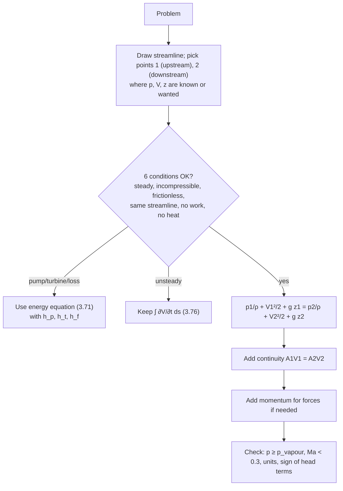

# Incompressible Inviscid Flow and Bernoulli – Formula Bank

← up: [[Fluid Mechanics/Fluid Mechanics - MOC|Fluid Mechanics MOC]] · builds on: [[Fluid Mechanics/07 Differential Kinematics and Mass Conservation/Differential Mass Conservation and Fluid Kinematics - Formula Bank|Differential kinematics]], [[Fluid Mechanics/04 Control Volume Analysis/Linear Momentum Equation|Linear momentum]], [[Fluid Mechanics/00 Introduction and Fundamental Concepts/Ideal Fluid|Ideal fluid]] · worked problems: [[Fluid Mechanics/08 Incompressible Inviscid Flow/Incompressible Inviscid Flow and Bernoulli - Solved Problems|Solved Problems]]

Equation numbers are White's. Items marked ✓ are recomputed in `Tools/fm_core.py`. Items marked † are standard practice, not stated in White's text.

> [!abstract] Contents
> [[#1. Euler's equations]] · [[#2. The Bernoulli equation]] · [[#3. Assumptions and restrictions]] · [[#4. Static, stagnation and dynamic pressure]] · [[#5. Pressure measurements: Pitot, static tap, wall tap]] · [[#6. Standard applications]] · [[#7. Procedure and traps]]

---

## 1. Euler's equations

Newton's second law for a frictionless fluid element (momentum equation with $\boldsymbol\tau=0$, 4.114):

$$
\boxed{\rho\frac{D\mathbf V}{Dt}=\rho\mathbf g-\nabla p}\qquad\Longleftrightarrow\qquad\rho\Big[\frac{\partial\mathbf V}{\partial t}+(\mathbf V\!\cdot\!\nabla)\mathbf V\Big]=-\nabla p-\rho g\,\hat{\mathbf k}\ (z\text{ up})
$$

Components: $\rho\,a_x=-\partial p/\partial x,\ \rho\,a_y=-\partial p/\partial y,\ \rho\,a_z=-\partial p/\partial z-\rho g$.

**Vector identity** (4.115): $\ (\mathbf V\!\cdot\!\nabla)\mathbf V=\nabla\!\big(\tfrac12V^2\big)-\mathbf V\times\boldsymbol\zeta$ with $\boldsymbol\zeta=\nabla\times\mathbf V$. Dotting Euler with a displacement $d\mathbf r$ gives (4.116)

$$
\frac{\partial\mathbf V}{\partial t}\!\cdot d\mathbf r+d\!\Big(\tfrac12V^2\Big)-(\mathbf V\times\boldsymbol\zeta)\!\cdot d\mathbf r+\frac{dp}{\rho}+g\,dz=0
$$

The third term disappears if (1) no flow, (2) $\boldsymbol\zeta=0$ (irrotational), (3) $d\mathbf r\perp\mathbf V\times\boldsymbol\zeta$ (rare), or (4) **$d\mathbf r\parallel\mathbf V$ (along a streamline)** – that is how Bernoulli arises.

**Streamline coordinates** ($s$ along the streamline, $n$ toward the **centre of curvature**, radius $R$; P4.26):

$$
\boxed{\frac{\partial V}{\partial t}+V\frac{\partial V}{\partial s}=-\frac1\rho\frac{\partial p}{\partial s}-g\frac{\partial z}{\partial s}}\qquad
\boxed{\frac{V^2}{R}=-\frac1\rho\frac{\partial p}{\partial n}-g\frac{\partial z}{\partial n}}
$$

- Along $s$: integrates to Bernoulli (steady: $\tfrac12V^2+p/\rho+gz=$ const).
- Normal to $s$: pressure **increases away from the centre of curvature** (centripetal force). For straight, parallel streamlines ($R\to\infty$): $p+\rho gz=$ const across the flow – **hydrostatic in the normal direction**. Forced vortex check ✓: $V=\Omega r\Rightarrow dp/dr=\rho\Omega^2r$.

**Cylindrical components** (steady, $v_z=0$): $\rho\big(v_r\partial_rv_r+\tfrac{v_\theta}{r}\partial_\theta v_r-\tfrac{v_\theta^2}{r}\big)=-\partial_rp$, $\ \rho\big(v_r\partial_rv_\theta+\tfrac{v_\theta}{r}\partial_\theta v_\theta+\tfrac{v_rv_\theta}{r}\big)=-\tfrac1r\partial_\theta p$ (gravity omitted).

---

## 2. The Bernoulli equation

### 2.1 Derivation (control volume, Sec. 3.7; or Euler along a streamline)

Streamtube of area $A(s)$, length $ds$; mass: $d\dot m=\dfrac{\partial\rho}{\partial t}A\,ds$ (3.74); momentum with pressure and gravity forces only gives

$$
\frac{\partial V}{\partial t}ds+\frac{dp}{\rho}+V\,dV+g\,dz=0\qquad(3.75)
$$

### 2.2 Forms

**Unsteady, along a streamline** (3.76, 4.119):

$$
\int_1^2\frac{\partial V}{\partial t}ds+\int_1^2\frac{dp}{\rho}+\tfrac12\big(V_2^2-V_1^2\big)+g(z_2-z_1)=0
$$

**Steady, incompressible, frictionless** (3.77, 4.120):

$$
\boxed{\frac{p_1}{\rho}+\frac12V_1^2+gz_1=\frac{p_2}{\rho}+\frac12V_2^2+gz_2=\text{const along the streamline}}
$$

| Form | Equation | Units |
|---|---|---|
| **pressure** | $p+\tfrac12\rho V^2+\gamma z=p_0+\gamma z_0$ | Pa |
| **energy per unit mass** | $\dfrac p\rho+\dfrac{V^2}{2}+gz=w_0$ | J/kg |
| **head** | $\dfrac p\gamma+\dfrac{V^2}{2g}+z=h_0$ | m |

**With work and losses** (steady-flow energy equation, 3.71, kinetic-energy factor $\alpha$):
$$\Big(\frac p\gamma+\alpha\frac{V^2}{2g}+z\Big)_{in}=\Big(\frac p\gamma+\alpha\frac{V^2}{2g}+z\Big)_{out}+h_{turbine}+h_{friction}-h_{pump}$$
$\alpha=2.0$ laminar pipe flow, $1.04$–$1.11$ turbulent (3.72, 3.73); usually $\alpha\approx1$ for turbulent flow. Bernoulli is the special case $h_t=h_p=h_f=0$, $\alpha=1$.

**Irrotational flow** ($\boldsymbol\zeta=0$): the constant is the **same everywhere**, not just along one streamline (4.120). For rotational flow each streamline has its own constant $w_0$.

**Unsteady irrotational** (with $\mathbf V=\nabla\phi$, 4.123, 4.124):
$$\frac{\partial\phi}{\partial t}+\int\frac{dp}{\rho}+\frac12V^2+gz=f(t)$$

**Compressible, isentropic ideal gas** (P3.182, $p\propto\rho^k$):
$$\frac{k}{k-1}\frac p\rho+\frac12V^2+gz=\text{const}$$

**Unsteady example (P3.180, P3.181):** large tank (depth $h$ constant), pipe of length $L$ opened at $t=0$: $L\dfrac{dV}{dt}+\dfrac{V^2}{2}=gh$ ⇒ $V(t)=\sqrt{2gh}\tanh\!\Big(\dfrac{\sqrt{2gh}}{2L}t\Big)$ ✓ (closed tank at gage pressure $p_0$: replace $gh$ by $gh+p_0/\rho$).

### 2.3 Energy grade line and hydraulic grade line

$$\text{EGL}=\frac p\gamma+\frac{V^2}{2g}+z\ (\text{constant if frictionless, no work}),\qquad\text{HGL}=\frac p\gamma+z=\text{EGL}-\frac{V^2}{2g}$$

- HGL = height liquid rises in a piezometer tube; EGL = height of a Pitot tube.
- EGL falls with friction or turbines, rises only with a pump; HGL rises where velocity falls.
- Open channel: HGL = free surface.

![[FM-B2-venturi-EGL-HGL.png]]
**Figure:** FE3.9: EGL stays constant (frictionless); the HGL dips by $V^2/2g$ in the throat, where pressure is lowest (30.5 kPa).

---

## 3. Assumptions and restrictions

> [!important] The six conditions for $\frac p\rho+\frac12V^2+gz=$ const (White, p. 176)
> 1. **Steady** flow
> 2. **Incompressible** ($Ma<0.3$)
> 3. **Frictionless** (inviscid) – excludes boundary layers, wakes, separated regions
> 4. Along a **single streamline** (or throughout, if irrotational)
> 5. **No shaft work** (no pump/turbine between the points)
> 6. **No heat transfer** (the work and heat items are tied to friction in real fluids)

| Region | Valid? |
|---|---|
| core flow of a wind tunnel, outside the boundary layers | yes |
| boundary layers, wakes, near solid walls | **no** |
| across a propeller or pump, or heated chimney | constant **changes** (valid on each side) |
| within a free jet leaving a nozzle | yes (p = ambient) |

Other checks: points 1 (upstream) and 2 (downstream) should be where the most is known; Bernoulli almost always needs **continuity** $A_1V_1=A_2V_2$ as a partner; no conversion factors are needed in consistent SI/BG units.

---

## 4. Static, stagnation and dynamic pressure

| Pressure | Definition | Measured by |
|---|---|---|
| **static** $p$ | thermodynamic pressure in the fluid, felt by an observer moving with it | wall tap, static port, piezometer |
| **dynamic** $q$ | $\tfrac12\rho V^2$ | difference between stagnation and static |
| **stagnation** $p_0$ | pressure when the flow is brought **isentropically** to rest | Pitot (total-head) tube |
| **total** (hydraulic) $p_T$ | $p+\tfrac12\rho V^2+\rho gz$ | with elevation included |

$$
\boxed{p_0=p+\tfrac12\rho V^2}\qquad(\text{incompressible, elevation neglected})
$$

Pressure coefficient: $C_p=\dfrac{p-p_\infty}{\tfrac12\rho U^2}=1-\dfrac{V^2}{U^2}$; at a stagnation point $C_p=1$ ✓.

**Compressible stagnation pressure** (ideal gas, isentropic, Ch. 9): $\dfrac{p_0}{p}=\Big(1+\dfrac{k-1}{2}Ma^2\Big)^{k/(k-1)}$, so
$$p_0-p=\tfrac12\rho V^2\Big(1+\frac{Ma^2}{4}+\frac{2-k}{24}Ma^4+\dots\Big)\qquad(+2.3\%\ \text{at }Ma=0.3,\ +6\%\ \text{at }0.5)$$

![[FM-B4-pitot-compressibility.png]]
**Figure:** Why the incompressible Pitot formula over-reads dynamic pressure at higher speed.

---

## 5. Pressure measurements: Pitot, static tap, wall tap

![[FM-B1-pitot-static.png]]

| Device | Reads | Notes |
|---|---|---|
| **Piezometer tube** (open vertical tube on a wall) | $p_s+\gamma z$ (HGL) | liquids only, $p_s>p_{atm}$ |
| **Wall tap / static tap** (small hole normal to the wall, flush, burr-free) † | static pressure $p_w$ | valid where streamlines are straight and parallel, $\partial p/\partial n=0$; errors from burrs, large holes, rough edges, curvature, separation |
| **Pitot tube** (total-head tube pointing into the flow) | $p_0$ | stagnation pressure; yaw sensitivity |
| **Pitot-static (Prandtl) tube** | $p_0-p_s$ | static ports on the side (4–8 holes, about 8 diameters behind the nose) |

**Pitot formula** (6.117), $Re_D>1000$ (frictionless), elevation difference negligible:

$$
\boxed{V=\sqrt{\frac{2\,(p_0-p_s)}{\rho}}}
$$

**With a differential manometer** (fluid $\rho_m$, height $h$, flowing fluid $\rho$):
$$p_0-p_s=(\rho_m-\rho)\,g\,h\ \Rightarrow\ V=\sqrt{2gh\Big(\frac{\rho_m}{\rho}-1\Big)}$$
Gas flow with a liquid manometer ($\rho_m\gg\rho$): $V\approx\sqrt{2gh\rho_m/\rho}$; liquid flow with mercury ($\rho_m/\rho=13.6$): $V=\sqrt{25.2\,g h}$ ✓.

**Practical limits** (White): align with the flow (errors grow beyond about **5° yaw**: both the stagnation and static readings go wrong, reaching about ±10 % at 20°, Fig. 6.30); useless in unsteady flow because the tube lag is slow; for gases at high $Ma$ use the compressible correction (Sec. 4); probe diameter small compared with the flow scale so it is nearly a point measurement.

**Airspeed example** ✓: air $\rho=1.225$ kg/m³, $p_0-p_s=550$ Pa ⇒ $V=\sqrt{2\times550/1.225}=30.0$ m/s ($Ma=0.088$, compressibility error $Ma^2/4=0.19\%$).

**Static-tap checklist** †: place on a straight wall away from bends and fittings; hole normal and flush; diameter ≲ 1/10 of the wall-layer thickness, ≈ 1 mm typical; deburr; several taps around a duct (a ring or piezometer ring) to average out asymmetry; connect with liquid-filled lines free of bubbles.

---

## 6. Standard applications

**Torricelli (tank outflow)** (Ex. 3.21): free surface $h$ above a nozzle, both at $p_a$:
$$V_2^2\Big(1-\frac{A_2^2}{A_1^2}\Big)=2gh\ \Rightarrow\ V_2\approx\sqrt{2gh}\quad(A_2\ll A_1),\qquad Q=c_d\,A_2\sqrt{2gh},\ c_d\approx0.6\text{–}1.0$$
Independent of $\rho$.

**Draining time** (P3.179): $h_0\to$ empty, tank diameter $D$, hole $d$:
$$\frac{dh}{dt}=-\Big(\frac dD\Big)^2\sqrt{\frac{2gh}{1-(d/D)^4}},\qquad t_0=\Big(\frac Dd\Big)^2\sqrt{\frac{2h_0}{g}}\ (d\ll D)$$

**Venturi meter / nozzle** (Ex. 3.23, P3.165): horizontal, $\Delta p=p_1-p_2$, $\beta=D_2/D_1$:
$$\dot m_{ideal}=\rho A_2\sqrt{\frac{2\Delta p}{\rho\,(1-\beta^4)}},\quad Q=\frac{A_2}{\sqrt{1-\beta^4}}\sqrt{\frac{2\Delta p}{\rho}}\ ;\ \text{with manometer: }\Delta p=(\rho_M-\rho)gh$$
Actual $\dot m=c_d\,\dot m_{ideal}$.

**Orifice / pipe contraction + momentum** (Ex. 3.24 fire hose): Bernoulli gives $p_1$; control-volume momentum gives the flange force $F_B=p_1A_1-\dot m(V_2-V_1)$ ✓ ($F_B=4067$ N for 10 cm → 3 cm, 1.5 m³/min).

**Hose / nozzle jet range** (P3.159): Bernoulli + continuity, $\beta=D_2/D_1$: $\ V_2=\sqrt{\dfrac{2(p_1-p_a)}{\rho(1-\beta^4)}}$; a frictionless jet leaving at angle $\theta$ travels $R=V_2^2\sin2\theta/g$ (maximum at 45°, so $V_2=\sqrt{gR}$) ✓ (P3.159: $R=125$ ft needs $p_1=23.6$ psig).

**Cavitation limit** (P3.170–3.172): lowest absolute pressure in the flow must exceed the vapour pressure. At a throat: $p_{throat}=p_1-\tfrac12\rho(V_2^2-V_1^2)\ge p_v$ ⇒ $Ca=\dfrac{p_1-p_v}{\tfrac12\rho V_1^2}\ge\Big(\dfrac{A_1}{A_2}\Big)^2-1$ to avoid it.

**Siphon** (P3.169): free surface at $z=0$, summit a height $L_s$ above it, outlet a depth $H$ below it, constant tube area. Bernoulli surface → outlet: $V=\sqrt{2gH}$ (depends only on $H$). Surface → summit: $p_{summit}=p_a-\rho g(H+L_s)$ – the lowest pressure in the system; it cannot go below $p_v$, so $H+L_s\le(p_a-p_v)/\rho g\approx10$ m for water.

**Open-channel step/bump** (P3.175–3.178): Bernoulli on the free surface with $V_1h_1=V_2h_2$:
$$h+\frac{q^2}{2gh^2}\pm\Delta z=E\qquad(q=Vh)$$
a cubic with **two positive roots** – sub-critical (deep, slow) and super-critical (shallow, fast), meeting at the critical depth $h_c=(q^2/g)^{1/3}$, $Fr=V/\sqrt{gh}=1$.

![[FM-B3-alternate-depths.png]]
**Figure:** Specific-energy curve: for one energy $E$ the free surface can take two depths (the physical one depends on the downstream condition).

**Drain vortex / free vortex** (P4.60): irrotational, so Bernoulli holds across streamlines: $p+\tfrac12\rho v_\theta^2+\rho gz=$ const with $v_\theta=\Gamma/2\pi r$.

**Forced vortex** (rotating container): rotational; $p=p_0+\tfrac12\rho\Omega^2r^2-\rho gz$; free surface $z=\Omega^2r^2/(2g)$.

---

## 7. Procedure and traps

> [!warning] Common traps
> - Applying Bernoulli across a pump, turbine, or through a boundary layer.
> - Using **gage** pressure in a compressible/cavitation check (use absolute).
> - Forgetting continuity (two unknowns $V_1,V_2$).
> - Applying it **between different streamlines** in rotational flow.
> - Treating $p_0$ (stagnation) as the pressure the fluid is *at*; it is the pressure it *would reach* at rest.
> - Using the Pitot formula with a manometer without subtracting $\rho$ of the flowing fluid (liquid-in-liquid).
> - Ignoring that a static tap reads the true static pressure only in nearly straight flow.
> - Taking the tank-draining $V_1$ as zero when $A_2/A_1$ is not tiny.
> - Using Bernoulli to compute *friction* losses: it contains none.

## Prerequisites and next
- Prerequisites: [[Fluid Mechanics/02 Fluid Statics/Pressure and the Hydrostatic Equation|Pressure and the hydrostatic equation]], [[Fluid Mechanics/04 Control Volume Analysis/Conservation of Mass (Continuity Equation)|Continuity]]
- Next: viscous flow in ducts (head loss), potential flow (Ch. 8)

## Cross-domain links
- Bernoulli's three terms are the mechanical-energy balance of an ideal fluid – same structure as energy methods in [[Strength of materials/Strength of Materials - MOC|Strength of Materials]] (strain energy + work) and the electrical energy balance of [[EE1100 MOC|EE1100]] circuits (capacitor/inductor energy exchange without loss).

## Cross-domain links

- [[Cross-Domain Synthesis/Conservation Laws and Flow Networks|Conservation Laws and Flow Networks]] — Bernoulli as KVL for an ideal pipe; ½ρV² is inductor energy with inertance ρℓ/A.
