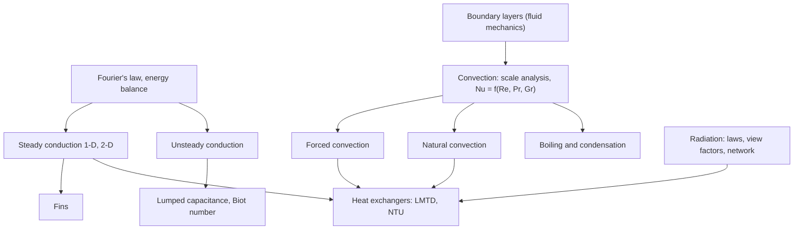

# Heat Transfer — Map of Content

Navigation spine for ME3101. Part of [[Mechanical Engineering Curriculum - MOC]]. Official syllabus: [[Heat transfer/Course Details|Course Details]]. Explanations will live in atomic concept notes; this page is the map.

## Course Overview

**Course:** Heat Transfer · **Code:** ME3101 · **Semester 5** · **L-T-E-P-O / credits:** 3-1-0-0-6 / 10

**Core purpose:** model and solve problems of conduction, convection and radiation, with governing equations (not only correlations), and size or analyse heat exchangers.

**Prerequisites (syllabus: none).** In practice this course reuses [[Fluid Mechanics - MOC]] (boundary layers, dimensionless numbers), the thermodynamics sequence ([[Foundations of Thermal Engineering - MOC]]) and the differential-equation tools in [[2nd Order ODEs - MOC]] and [[Special Functions - MOC]].

**Textbooks:** Holman, *Heat Transfer* (8th ed); Incropera & DeWitt, *Fundamentals of Heat and Mass Transfer* (6th ed); Kaviany, *Principles of Heat Transfer*; Çengel, *Heat Transfer: A Practical Approach*.

## Syllabus Map

1. **Conduction, steady state:** one- and two-dimensional systems; convection and/or radiation boundary conditions.
2. **Conduction, unsteady:** one-dimensional, analytical and numerical solutions; approximate solutions from charts for a few geometries.
3. **Convection fundamentals:** governing equations, scale analysis to find the relevant dimensionless parameters, laminar boundary-layer equations (momentum and energy), approximate solutions for internal and external flow.
4. **Forced convection:** external and internal flows, laminar and turbulent, correlations.
5. **Natural convection:** scale analysis and correlations.
6. **Boiling and condensation:** correlations for simple geometries.
7. **Radiation:** basic laws, surface properties, view factors, network method and enclosure analysis for gray diffuse enclosures with transparent media, engineering treatment of gas radiation.
8. **Heat exchangers:** analysis and design with the LMTD and NTU methods.

## Concept Map

## Methods & Problem Types

| Problem type | Method |
|---|---|
| Heat through composite walls, cylinders, spheres | thermal resistance network (series/parallel) |
| Fin heat loss, fin efficiency | fin ODE $\theta''=m^2\theta$ with tip condition |
| 2-D steady conduction | separation of variables, or finite-difference nodes |
| Transient cooling of a body | lumped capacitance if $Bi<0.1$; otherwise charts or series solution |
| Convective coefficient | identify flow regime, choose a correlation $Nu=f(Re,Pr)$ |
| Natural convection from plates and cylinders | $Nu=f(Ra)$ correlations |
| Radiation exchange between surfaces | view factors, radiosity network |
| Heat exchanger rating or sizing | LMTD (given terminal temperatures) or $\varepsilon$–NTU (given sizes) |

## Cross-Domain Links
- **Heat equation** ↔ [[Sturm-Liouville Problems]] and [[Fourier-Bessel Series]]: separation of variables in a slab gives sine/cosine eigenfunctions; in a cylinder it gives [[Bessel's Equation and Bessel Functions of the First Kind|Bessel functions]], expanded exactly as in Assignment 6/7 of the DE course.
- **Fins** ↔ [[2nd Order Linear ODE with Constant Coefficients]]: $\theta''-m^2\theta=0$ is the constant-coefficient ODE with real roots (cosh/sinh solutions).
- **Lumped capacitance** ↔ [[04 Capacitors, Inductors and First Order Circuits]] and [[Exponential Decay - Time Constants, Damping and Spatial Relaxation]]: $\tau=\rho Vc/hA$ is $RC$, with thermal resistance $1/hA$ and thermal capacitance $\rho Vc$.
- **Resistance networks** ↔ [[Series-Parallel Resistance Reduction]]: same series/parallel algebra with temperature in place of voltage.
- **Scale analysis and Nusselt, Prandtl, Grashof numbers** ↔ [[Buckingham Pi Theorem]] and [[Dimensional Analysis and Similitude - Formula Bank]].
- **Thermal stress** ↔ [[Thermal Stresses]]: the temperature field from this course is the input to restrained-expansion stresses.

## Study Progress
- [ ] Conduction (steady, unsteady) · [ ] Convection · [ ] Radiation · [ ] Boiling/condensation · [ ] Heat exchangers
- [ ] Tutorials · [ ] Past-paper patterns

## Study Log
*(add dated entries when the course starts)*

## MOC Maintenance Rules
Link each new concept note from the syllabus map, add tutorial links to the methods table, log changes in [[Wiki Maintenance Log]].
