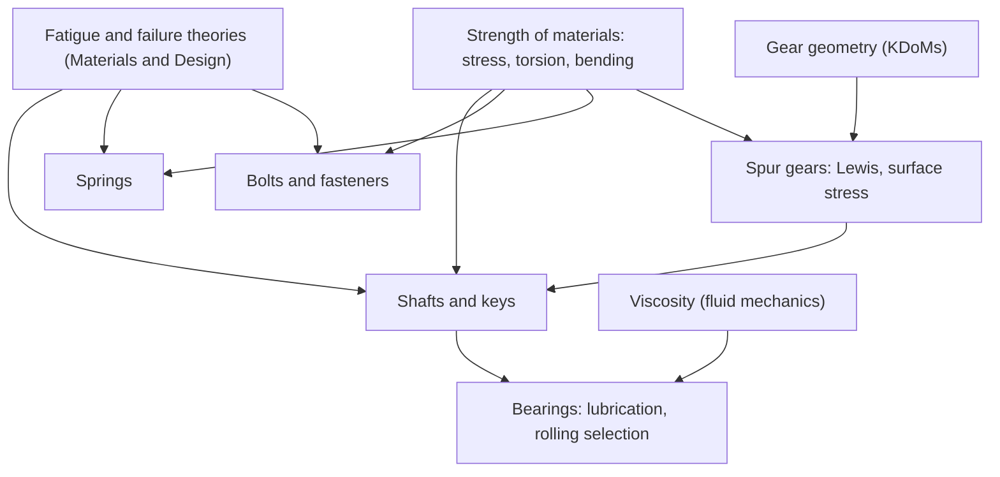

# Introduction to Machine Design — Map of Content

Navigation spine for ME3203. Part of [[Mechanical Engineering Curriculum - MOC]]. Official syllabus: [[Introduction to Machine Design/Course Details|Course Details]].

## Course Overview

**Course:** Introduction to Machine Design · **Code:** ME3203 · **Semester 5** · **L-T-E-P-O / credits:** 2-1-1-0-4 / 8

**Core purpose:** stress-based design of simple mechanical elements: choose materials and dimensions so that shafts, keys, bearings, gears, springs and bolts survive static and fluctuating loads.

**Textbooks:** R. L. Norton, *Machine Design: An Integrated Approach* (Pearson). Reference: Budynas & Nisbett, *Shigley's Mechanical Engineering Design*.

**Prerequisite (syllabus: none).** The course is a direct application of [[Strength of Materials - MOC]], the fatigue and failure theories of [[Materials and Design - MOC]], the gear geometry of [[KDoMs - MOC]] and the drawing skills of [[Computer Aided Machine Drawing - MOC]].

### Prepare from the existing vault
- Stress at a point and combined loading: [[Plane Stress Transformation]], [[Mohr's Circle for Stress]], [[Unsymmetric and Combined Bending]].
- Shaft sizing: [[Torsion of Circular Shafts]], [[Power Transmission by Shafts]], [[Flexure Formula]], [[Shear Force and Bending Moment Diagrams]].
- Bolted joints and preload: [[Statically Indeterminate Axial Members]], [[Thermal Stresses]] (joint stiffness is a parallel-spring problem).
- Gears: [[Gear Formula Bank]] (geometry, contact ratio, interference).
- Columns and instability: [[Euler Buckling of Columns]].

## Syllabus Map

1. **Shafts, keys and couplings:** shaft materials, loads and stresses; shafts under fully reversed bending with steady torsion; fluctuating bending and torsion; key types and design.
2. **Bearings:** sliding bearings (lubrication basics, choice of lubricant and geometry for a given load); rolling-element bearings (types, uses, selection from load ratings).
3. **Transmission elements, spur gears:** loading and stresses; Lewis bending equation and design factors; surface stress; designing a gear mesh; extension to helical and worm gears.
4. **Springs:** stresses in helical compression and tension springs; design for static and fatigue loading.
5. **Bolts and fasteners:** nomenclature, load analysis, design under static and dynamic loads, joint stiffness factor, bolts and dowel pins in shear.

## Concept Map

## Methods & Problem Types

| Problem type | Method |
|---|---|
| Size a shaft under bending plus torsion | equivalent stress from the combined loading, with a failure theory and safety factor |
| Fatigue of a shaft | endurance limit with Marin factors, Goodman line for mean plus alternating stress |
| Select a key | shear and bearing check at the key |
| Select a rolling bearing | equivalent load, load rating and life |
| Gear tooth bending | Lewis equation with dynamic and geometry factors |
| Gear surface durability | contact (Hertz) stress |
| Helical spring | shear stress with Wahl factor, deflection $\delta=8FD^3N/(Gd^4)$ |
| Bolted joint | joint stiffness factor, preload and load sharing between bolt and members |

## Cross-Domain Links
- **Shaft design** ↔ [[Power Transmission by Shafts]] and [[Gears, Transformers and Reflected Impedance]]: torque, speed and power relations through a gear train.
- **Joint stiffness** ↔ [[Statically Indeterminate Axial Members]]: the bolt and the clamped members are two springs sharing a load, solved by compatibility.
- **Helical spring** ↔ [[Torsion of Circular Shafts]]: a coil spring wire is loaded in torsion.
- **Sliding-bearing lubrication** ↔ [[Viscosity and Newton's Law of Viscosity]] and [[Newtonian and Non-Newtonian Fluids]].
- **Fluctuating stress** ↔ [[Materials and Design - MOC]] (S–N curve, Goodman diagram).

## Study Progress
- [ ] Shafts, keys, couplings · [ ] Bearings · [ ] Spur gears · [ ] Springs · [ ] Bolts and fasteners
- [ ] Tutorials · [ ] Past-paper patterns

## Study Log
*(add dated entries when the course starts)*

## MOC Maintenance Rules
Link each new concept note from the syllabus map, add tutorial links to the methods table, log changes in [[Wiki Maintenance Log]].
