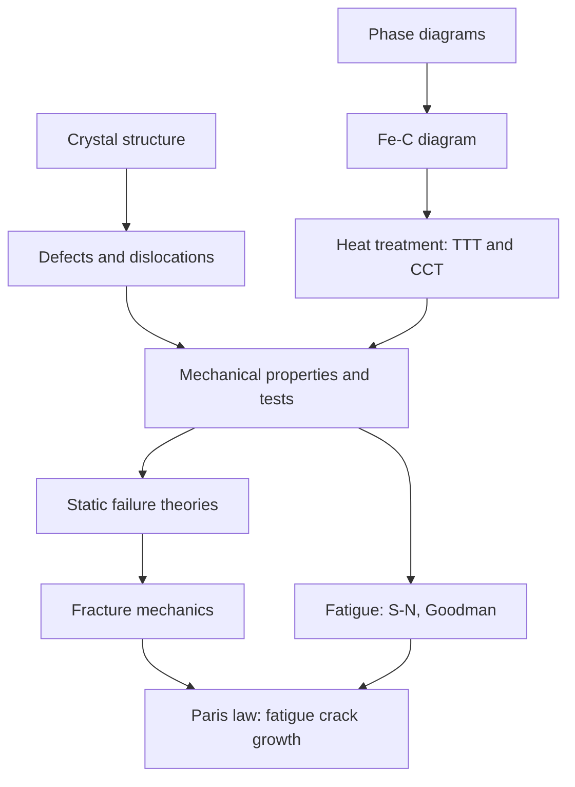

# Materials and Design — Map of Content

Navigation spine for ME2200. Part of [[Mechanical Engineering Curriculum - MOC]]. Official syllabus: [[Materials and design/Course Details|Course Details]].

## Course Overview

**Course:** Materials and Design · **Code:** ME2200 · **Semester 4** · **L-T-E-P-O / credits:** 3-1-0-0-6 / 10

**Core purpose:** connect the internal structure of materials to their mechanical properties, and use that to predict failure (static, fracture, fatigue) and to tailor Fe–C alloys by heat treatment.

**Textbooks:** W. D. Callister, *Materials Science and Engineering: An Introduction* (6th ed); R. L. Norton, *Machine Design: An Integrated Approach*.

**Prerequisite (syllabus: none).** Builds directly on [[Strength of Materials - MOC]]: stress-strain behaviour, generalised Hooke's law and stress transformation are used again and again.

### Prepare from the existing vault
[[Stress-Strain Diagram and Hooke's Law]] · [[Generalized Hooke's Law and Poisson's Ratio]] · [[Concept of Stress]] · [[Plane Stress Transformation]] · [[Mohr's Circle for Stress]] · [[Torsion of Circular Shafts]] (torsion test) · [[Thermal Stresses]].

## Syllabus Map

1. **Crystal structure:** unit cells, metallic crystal structures, ceramics.
2. **Imperfections in solids:** point, line, interfacial and volume defects; dislocation strengthening mechanisms and slip systems; critically resolved shear stress.
3. **Mechanical properties:** tensile, compression and torsion tests; Young's modulus; true vs engineering stress-strain; generalised Hooke's law; yielding and yield strength; Considère criterion; ductility, resilience, toughness, elastic recovery; hardness (Rockwell, Brinell, Vickers) and its relation to strength.
4. **Static failure theories:** ductile and brittle failure; Tresca, von Mises, maximum normal stress, Mohr–Coulomb and modified Mohr–Coulomb.
5. **Fracture mechanics:** stress-intensity factor approach, Griffith criterion.
6. **Fatigue failure:** high-cycle fatigue, stress-life, S–N curve, endurance and fatigue limits, Marin factors, mean-stress effects (modified Goodman diagram), multiaxial fatigue methods.
7. **Fracture with fatigue:** Paris law.
8. **Phase diagrams:** binary diagrams and microstructure; eutectic, peritectic, peritectoid, monotectic reactions; the iron–iron-carbide diagram (ledeburite, austenite, ferrite, cementite).
9. **Heat treatment of steel:** annealing, tempering, normalising, spheroidising; TTT diagrams; continuous cooling curves and the final microstructures and properties.

## Concept Map

## Methods & Problem Types

| Problem type | Method |
|---|---|
| Will it yield under a combined stress state? | principal stresses, then Tresca or von Mises ($\sigma_{vm}=\sqrt{\sigma_1^2-\sigma_1\sigma_2+\sigma_2^2}$ in plane stress) |
| Brittle material under combined stress | maximum normal stress, Mohr–Coulomb or modified Mohr–Coulomb |
| Conversion engineering ↔ true stress-strain | $\sigma_T=\sigma_E(1+\varepsilon_E)$, $\varepsilon_T=\ln(1+\varepsilon_E)$ |
| Infinite-life check under fluctuating load | endurance limit with Marin factors, modified Goodman line |
| Crack safe or not | $K_I=Y\sigma\sqrt{\pi a}$ against $K_{Ic}$ |
| Fatigue life with a crack | integrate the Paris law $da/dN=C(\Delta K)^m$ |
| Read a binary phase diagram | tie line and lever rule for phase fractions |
| Predict a steel microstructure | TTT or CCT diagram with the cooling path drawn on it |

## Cross-Domain Links
- **Von Mises and Tresca** ↔ [[Plane Stress Transformation]] and [[Mohr's Circle for Stress]]: both criteria are statements about the principal stresses (or the maximum shear radius of Mohr's circle).
- **True vs engineering strain** ↔ [[Stress-Strain Diagram and Hooke's Law]]: the necking onset (Considère) is where the true stress-strain curve's slope equals the true stress.
- **Fatigue and S–N** ↔ [[Introduction to Machine Design - MOC]]: shafts, springs and bolts are all designed against the endurance limit of this course.
- **Dislocation slip** ↔ [[Generalized Hooke's Law and Poisson's Ratio]]: shear stress resolved on the slip plane, the crystal-scale version of stress transformation.
- **Heat-treatment kinetics** ↔ [[Exponential Decay - Time Constants, Damping and Spatial Relaxation]]: transformations and diffusion proceed with characteristic times.

## Study Progress
- [ ] Crystal structure and defects · [ ] Mechanical properties · [ ] Static failure · [ ] Fracture · [ ] Fatigue · [ ] Phase diagrams · [ ] Heat treatment
- [ ] Tutorials · [ ] Past-paper patterns

## Study Log
*(add dated entries when the course starts)*

## MOC Maintenance Rules
Link each new concept note from the syllabus map, add tutorial links to the methods table, log changes in [[Wiki Maintenance Log]].
