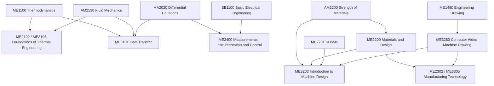

# Mechanical Engineering Curriculum — Map of Content

Semester-by-semester map of the core programme, taken from `ME25B_curriculum.pdf` (ME section, 2025 batch), with a link to the note set for each course. Part of [[Home|Ajay's Engineering Wiki]]. Credits are shown as L-T-E-P-O → C. Total core credits: **401** (semester totals 53, 56, 61, 60, 54, 45, 36, 36).

> **How to use:** courses with a ✅ already have notes; 🔜 have a syllabus-based map ready for when the course starts; ⬜ have nothing in the vault yet. Humanities, life skills, NCC/NSO, workshop and similar courses are listed in the PDF and omitted here.

## Semester 1
| Code | Course | L-T-E-P-O → C | Vault |
|---|---|---|---|
| ME1100 | Thermodynamics | 3-1-0-0-6 → 10 | ⬜ folder `Thermodynamics/` is empty |
| ME1401 | Introduction to Computing for Mechanical Engineers | 2-0-2-0-8 → 12 | ⬜ folder is empty |
| ME1480 | Engineering Drawing | 1-0-0-3-3 → 7 | ✅ [[Engineering Drawing - MOC]] (guidelines deck in `Engineering drawing/`) |
| CY1001, CY1002 | Chemistry I and lab | | see the `Chemistry/` folder |

## Semester 2
| Code | Course | L-T-E-P-O → C | Vault |
|---|---|---|---|
| MA1101 | Calculus | 3-1-0-0-6 → 10 | PDFs in `MathFlow/Calculus/` |
| PH1010, PH1030 | Physics I and Physics Laboratory I | 3-1-0-0-6 → 10; 0-0-0-3-1 → 4 | concept notes and figures in [[Physics I - MOC]] (weekly slides in `Physics/`), lab notes in [[Physics Laboratory I - MOC]] (manual in `Physics Lab/`) |
| AM1100 | Engineering Mechanics | 3-1-0-0-6 → 10 | ✅ [[Engineering Mechanics - MOC]] (Meriam & Kraige books in `Engineering Mechanics/`) |

## Semester 3 (current)
| Code | Course | L-T-E-P-O → C | Vault |
|---|---|---|---|
| AM2200 | Strength of Materials | 3-1-0-0-6 → 10 | ✅ [[Strength of Materials - MOC]] |
| AM2530 | Foundations of Fluid Mechanics | 3-1-0-0-6 → 10 | ✅ [[Fluid Mechanics - MOC]] |
| AM2540 | Applied Mechanics / Fluid Mechanics Lab | 0-0-0-3-0 → 3 | ✅ [[Applied Mechanics Lab - MOC]] (manuals in `Fluid Mechanics Lab/`) |
| EE1100 | Basic Electrical Engineering | 3-1-0-0-6 → 10 | ✅ [[EE1100 MOC]] |
| MA2020 | Differential Equations | 3-0-0-0-6 → 9 | ✅ [[Differential Equations - MOC]] |
| ME2201 | Kinematics and Dynamics of Machinery | 3-1-0-0-6 → 10 | ✅ [[KDoMs - MOC]] |
| — | Entrepreneurship | 3-0-0-0-6 → 9 | ✅ [[Entrepreneurship - MOC]] |

## Semester 4
| Code | Course | L-T-E-P-O → C | Vault |
|---|---|---|---|
| ME2102 | Foundations of Thermal Engineering-1 | 2-1-0-0-4 → 7 | 🔜 [[Foundations of Thermal Engineering - MOC]] |
| ME2200 | Materials and Design | 3-1-0-0-6 → 10 | 🔜 [[Materials and Design - MOC]] |
| ME2302 | Manufacturing Technology-I | 3-1-0-1-6 → 11 | 🔜 [[Manufacturing Technology - MOC]] |
| ME2400 | Measurements and Instrumentation | 3-0-0-2-6 → 11 | 🔜 [[Measurements, Instrumentation and Control - MOC]] |
| ME3481 | Mechanical Engineering Lab 1 | 0-0-0-3-0 → 3 | ⬜ folder `Mechanical engineering lab/` is empty |
| MA, BT1010 | Mathematics elective; Life Sciences | | [[Life sciences/Course Details|BT1010 syllabus]] |

## Semester 5
| Code | Course | L-T-E-P-O → C | Vault |
|---|---|---|---|
| ME3101 | Heat Transfer | 3-1-0-0-6 → 10 | 🔜 [[Heat Transfer - MOC]] |
| ME3105 | Foundations of Thermal Engineering-2 | 2-1-0-0-4 → 7 | 🔜 [[Foundations of Thermal Engineering - MOC]] |
| ME3203 | Introduction to Machine Design | 2-1-1-0-4 → 8 | 🔜 [[Introduction to Machine Design - MOC]] |
| ME3305 | Manufacturing Technology-II | 3-1-0-1-6 → 11 | 🔜 [[Manufacturing Technology - MOC]] |
| ME3482 | Mechanical Engineering Lab 2 | 0-0-0-3-0 → 3 | ⬜ |
| ME3283 | Computer Aided Machine Drawing | 1-0-0-2-3 → 6 | 🔜 [[Computer Aided Machine Drawing - MOC]] |

## Semesters 6–8
Semester 6: humanities elective, Professional Electives 1–2, Free Electives 2–3 (45 credits). Summer: ME3500 Summer Internship. Semester 7: Professional Electives 3–5 / Free Electives 4–6, humanities elective 3 (36). Semester 8: Professional Electives 6–9 / Free Electives 5–7 (36); ME4492 BTP in ME replaces Professional Electives 4–6. B.Tech (Honours) needs 27 extra credits (eligibility: CGPA ≥ 8.5 at the end of semester 5).

## How the courses build on each other

## Maintenance
When a course starts, extend its MOC following [[LLM Wiki Guide]] and the `wiki-course-moc` workflow; keep this page in sync (mark ✅ and fix the link) and log changes in [[Wiki Maintenance Log]].
